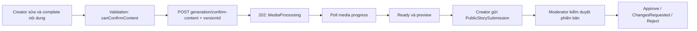
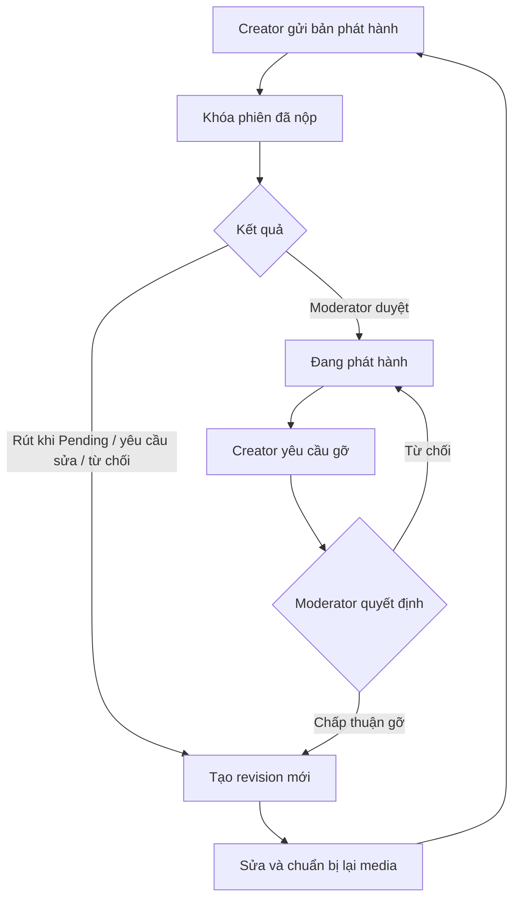

# API backend theo actor và luồng tích hợp frontend

> Rà soát source ngày **20/10/2026**. Đây là tài liệu contract và checklist tích hợp từ mã nguồn, **không phải biên bản kiểm thử API/DB hoặc xác nhận đã triển khai**.

## Mục lục

1. [Phạm vi, phiên bản và cách dùng](#phien-ban)
2. [Quy ước gọi API, lỗi và phiên](#quy-uoc)
3. [Actor và quyền](#actor)
4. [Khách chưa đăng nhập và tài khoản](#khach)
5. [Parent — hồ sơ trẻ và giám sát](#parent)
6. [Pipeline truyện AI/nhập truyện dùng chung](#pipeline)
7. [Parent — soạn thủ công và giao cho con](#parent-manual)
8. [Trẻ — đăng nhập và đọc](#child)
9. [ContentCreator — sáng tác và gửi duyệt](#creator)
10. [Moderator — kiểm duyệt](#moderator)
11. [Administrator — vận hành](#admin)
12. [API dùng chung và hệ thống](#he-thong)
13. [Kết quả mapping và việc frontend cần xử lý](#frontend)
14. [Danh mục contract từng endpoint](#contracts)
15. [Schema DTO, enum và ví dụ request](#schemas)
16. [Checklist nghiệm thu và giới hạn](#kiem-chung)

<a id="phien-ban"></a>
## 1. Phạm vi, phiên bản và cách dùng

- Backend: branch **feat/cont_creator**; bao gồm AI generation, xác nhận nội dung, khóa bản đã nộp và luồng gỡ/revision của Creator.
- Frontend: branch **main**, HEAD **93d00ef**.
- Inventory: **249 cặp method + route**, **36 controller có action**; gồm 1 alias, 1 webhook; không gồm health/SignalR/Swagger.
- Controller chuyên biệt cho Creator: [CreatorAIStoryInputController.cs](../src/Core/StoryPlatform.Api/Controllers/CreatorAIStoryInputController.cs), [CreatorPublicationController.cs](../src/Core/StoryPlatform.Api/Controllers/CreatorPublicationController.cs).


- Nguồn chính: [controllers](../src/Core/StoryPlatform.Api/Controllers), [Program.cs](../src/Core/StoryPlatform.Api/Program.cs), [authorization](../src/Core/StoryPlatform.Api/Extensions/ServiceExtensions.cs), DTO/service Application và shared contract được controller sử dụng.
- Bao phủ toàn bộ route HTTP Core API trong phiên bản source được mô tả; health check và SignalR ghi riêng. Không lấy số liệu coverage từ tài liệu frontend cũ.
- Đọc luồng theo actor trước, sau đó tra controller ở mục 14. Mỗi endpoint dẫn đến schema request/response, source và nơi frontend gọi. API dùng chung chỉ đếm một lần, không nhân theo actor.
- Mọi ID, revision, token và key trong ví dụ là minh họa. Thay bằng giá trị từ response/phiên thật. Mẫu schema thể hiện hình dạng JSON, không bảo đảm thỏa điều kiện dữ liệu/quyền trong DB.
- Mapping frontend dựa trên source, không đọc biến môi trường bí mật, không suy ra môi trường đang gọi thật từ sự tồn tại của service.
- Cập nhật cùng thay đổi backend: tách Creator confirm-content khỏi Parent review/approve. Đợt này không triển khai frontend hoặc migration/database.
- `.gitignore` có ngoại lệ để theo dõi tài liệu này và hướng dẫn AI generation của Creator trong Git.

<a id="quy-uoc"></a>
## 2. Quy ước gọi API, lỗi và phiên

### 2.1 Base URL và định dạng

- Dùng CORE_ORIGIN theo môi trường, nối /api/v1/... đúng một lần.
- JSON dùng camelCase theo ASP.NET web defaults và Content-Type: application/json. Upload dùng multipart/form-data; trình duyệt tự đặt boundary, không ép header JSON.
- Người lớn dùng Authorization: Bearer adultAccessToken; trẻ dùng token riêng có token_type=child. Không refresh request trẻ sang phiên người lớn.
- Enum JSON chỉ gửi chuỗi khi DTO có JsonStringEnumConverter; xem từng field trong schema. Enum query hỗ trợ tên enum theo model binding. Không tự chuyển đồng loạt PascalCase/snake_case.
- Query phân trang theo DTO: pageIndex/pageSize/searchTerm/orderBy/isDescending khi có. PageRequest mặc định trang 1, kích thước 10, tối đa 100; endpoint khác có default riêng.
- Phân biệt versionNo của outline, versionId/storyVersionId trong DB, revisionToken, taskRevision, requestId, preparationId, confirmationId và itemId.

### 2.2 Envelope và HTTP

Phần lớn API trả ApiResponse&lt;T&gt;:

~~~json
{
  "success": true,
  "message": "Thao tác thành công.",
  "data": null,
  "errors": null
}
~~~

T có thể là object, array, bool hoặc null. Thành công với data=null hợp lệ ở nhiều lệnh; không dùng điều kiện “phải có data” cho mọi endpoint.

- **200:** request hoàn tất, vẫn xem trạng thái nghiệp vụ; không mặc định media đã sẵn sàng.
- **201:** đã tạo resource/version/receipt.
- **202:** đã chấp nhận hoặc đang chạy; theo progress/pollUrl của đúng luồng. Regenerate illustration beat trả **202 body rỗng**, không parse JSON bắt buộc.
- **400:** input/điều kiện nghiệp vụ sai; **401:** phiên không hợp lệ; **403:** thiếu quyền; **404:** không tìm thấy hoặc bị che theo scope; **409:** xung đột state/version/revision/operation.
- Input guardrail có thể trả 422/503 với **data progress dù success=false**. Giữ reasonCode/canRetry và các ID, không làm mất tiến trình chỉ vì HTTP lỗi.
- Assistance có 429/502/504; mã ổn định nằm trong errors[0] khi là AssistanceException. Không parse message để điều khiển UX.
- Ngoại lệ envelope: download file DataRequest, webhook thành công body rỗng, health check, handshake/event SignalR. Authentication challenge có thể không có JSON.
- [ExceptionHandlingMiddleware](../src/Core/StoryPlatform.Api/Middleware/ExceptionHandlingMiddleware.cs) ánh xạ AppException sang status thực; lỗi chưa phân loại trả 500. HTTP trong contract là nhánh nhìn thấy ở controller, không phải toàn bộ lỗi của mọi tầng.

### 2.3 Retry, hủy và đồng bộ

Giữ riêng key generation (idempotencyKey/retryKey/operationKey/approvalKey), command authoring (operationId + revision Story) và command assistance (operationId + expectedTaskRevision).

Mất response: replay đúng command/payload khi contract cho phép; không tạo lệnh ghi mới để “thử cho chắc”. Đổi nội dung cần key mới theo contract. Receipt replay có thể mang revision lịch sử; GET resource để biết trạng thái hiện tại.

409 → giữ nội dung chưa lưu, tải trạng thái mới để đối chiếu; không tự tăng revision hoặc ghi đè. Hủy polling chỉ dừng theo dõi, không mặc định đã hủy job. Rời màn hình/đổi tài khoản hoặc resource phải loại response cũ. Chu kỳ polling/timeout UI không phải SLA backend.

<a id="actor"></a>
## 3. Actor và quyền

| Actor/ngữ cảnh | Token và quyền thực | Ghi chú |
|---|---|---|
| Khách | AllowAnonymous | Không gắn token từ phiên khác khi không cần. |
| Parent — Owner | JWT Parent + quan hệ Owner hiện hành | Vượt kiểm tra từng Permission trong guard, vẫn chịu state/policy. |
| Parent — AdditionalSupervisor | JWT Parent + giám sát còn hiệu lực + Permission cụ thể | Không phải role JWT riêng. |
| Trẻ | JWT ChildSession | Default Authorize dành cho người lớn loại token trẻ. |
| ContentCreator | AI input/submission kiểm role ContentCreator; manual/assistance đang chỉ kiểm adult + active/scope/tác giả | Có chênh lệch role gate ở backend, xem CR1. |
| Moderator | JWT Moderator + claim mục còn hiệu lực | Không tự duyệt nội dung mình tạo/nộp. |
| Administrator | JWT Administrator + guard nghiệp vụ | Không tự bỏ qua ownership/eligibility. |
| SePay / vận hành | Header webhook / health | Không phải actor màn hình frontend. |

Source có **4 role JWT**: Parent, Moderator, Administrator, ContentCreator; không có role Teacher trong enum hiện tại. Có **8 Permission**: ViewProgress, ViewResults, AssignActivity, ReceiveReport, ApproveReadingLevel, ApproveStory, ManageSafetySettings, GenerateStory. Không dùng danh sách 7 quyền frontend để suy backend thiếu GenerateStory.

Nguồn: [UserRole](../src/Core/StoryPlatform.Domain/Enums/UserRole.cs), [Permission](../src/Core/StoryPlatform.Domain/Enums/Permission.cs), [SupervisionAccessGuard](../src/Core/StoryPlatform.Application/Features/ChildProfiles/Supervision/Services/SupervisionAccessGuard.cs).

<a id="khach"></a>
## 4. Khách chưa đăng nhập và tài khoản

### A1. Đăng ký → xác thực → đăng nhập

1. POST /Auth/register: username/email/fullName/password/confirmPassword; không có field tự cấp role nâng quyền.
2. POST /Auth/verify-email: **email + otp**, không phải token link cũ. POST /Auth/resend-verification-email gửi lại.
3. POST /Auth/login: **identifier + password**; xem mfaRequired/mfaSetupRequired trước khi lưu phiên.
4. Có MFA: dùng mfaChallengeToken + code ở POST /Auth/mfa/verify. Provisioning URI chỉ cho thiết lập MFA; challenge không phải access token.
5. Khi có phiên hoàn chỉnh, đồng bộ accessToken/refreshToken/user; GET /Auth/me nạp lại tài khoản.

PasswordPolicy: 8–100 ký tự, ít nhất một chữ cái và một chữ số. Backend quyết định xác thực/lockout.

### A2. Khôi phục mật khẩu và kích hoạt nhân sự

Quên: POST /Auth/forgot-password với email → POST /Auth/reset-password với email/resetToken/newPassword/confirmPassword. Không dùng response forgot để xác nhận email tồn tại.

Moderator được mời: POST /Auth/staff-activation với email/inviteToken/newPassword/confirmPassword/commitmentAccepted → đăng nhập. Register không tự cấp role Moderator/Admin/Creator.

POST /Auth/refresh-token để đổi cặp token; thay refresh token cũ khi rotate và tránh refresh song song.

### A3. Quản lý tài khoản sau đăng nhập

- GET/PUT /Auth/me; Parent đổi email qua POST /Auth/change-email → /change-email/confirm với OTP.
- POST /Auth/change-password: currentRefreshToken giúp giữ phiên đang dùng theo service; bỏ trống có thể thu hồi mọi phiên.
- GET /Auth/sessions → DELETE /Auth/sessions/{id}; POST /Auth/logout cần refreshToken; logout-all-devices thu hồi tất cả.
- Parent xóa tài khoản: GET /Auth/me/delete-preview → xử lý blockingProfiles → DELETE /Auth/me với currentPassword/deleteDraftProfiles.
- GET /Auth/me/audit-log là phân trang, lịch sử của người dùng hiện tại.

Contract: [Auth](#controller-auth).

<a id="parent"></a>
## 5. Parent — hồ sơ trẻ và giám sát

### P1. Tạo hồ sơ đủ điều kiện sử dụng

1. GET /ChildProfile/mine hoặc POST /ChildProfile tạo Draft; giữ data.id.
2. GET /ContentCategory lấy ID/preset; GET /Permission lấy quyền hệ thống.
3. PUT /LearningProfile/{childId}: readingLevel 1–5, readingMode, comprehensionGoal, topics.
4. PUT /SafetyPolicy/{childId}: policy/danh mục; Owner ghi nhận consent theo điều khoản.
5. PATCH /ChildProfile/{childId}/activate. Thiếu learning/policy/consent thì bổ sung, không giả lập Active.
6. Đọc lại profile/learning/policy/quota trước sinh truyện.

Hồ sơ dùng enum Age_6_8/Age_9_10; API sáng tác có chuỗi 6-8/9-10. Không tái dùng một wire enum cho mọi API.

### P2. Cập nhật và vòng đời

- Owner PUT /ChildProfile/{id}; thay tuổi xử lý shouldReapplyBlockedPreset/suggestedReadingMode.
- GET /SafetyPolicy/{id}/age-preset → xác nhận → POST .../age-preset/apply.
- Learning cần ApproveReadingLevel; safety cần ManageSafetySettings. Consent/reconsent có guard Owner; không tự bật consent khi thiếu quyền.
- POST /SafetyPolicy/{id}/reconsent khi consentOutdated. PUT phải giữ field chưa sửa vì server có thể ghi đè.
- PATCH /ChildProfile/{id}/suspend → /resume; DELETE là lưu trữ theo lifecycle; PATCH /restore để khôi phục. Resume/restore có acceptCurrentConsent.
- GET mine không trả hồ sơ archived; có restore API không đồng nghĩa UI đã có nơi tìm hồ sơ archived.
- DELETE LearningProfile/SafetyPolicy có điều kiện, không dùng làm reset trên Active. GET /ChildProfile/{id}/audit-log theo dõi thay đổi.

### P3. Mời người giám sát

Owner POST /Supervision/{childId}/invitations → giữ invitationId/code/status/expiresAt → xem danh sách. DELETE để hủy hoặc POST regenerate; mã cũ hết hiệu lực.

Người được mời đăng nhập Parent → POST /Supervision/invitations/claim với invitationCode → nhận OTP → POST /verify-otp → xem preview → accept hoặc reject. Nhập đúng code/OTP chưa tạo quan hệ.

GET /Supervision/{childId}/relationships lấy relationshipId/role. DELETE relationship để Owner gỡ hoặc người giám sát tự rời theo guard; không tự xóa Owner cuối.

### P4. Quyền và chuyển Owner

- GET/POST/DELETE /Supervision/relationships/{relationshipId}/permissions[/{permission}]. Một số /Permission/relationships/... tương đương, không cần gọi cả hai.
- AdditionalSupervisor POST /Permission/relationships/{id}/requests với permissions[] → GET → Owner accept/reject, người xin cancel.
- Owner POST /Supervision/{childId}/transfer-ownership với targetSupervisorUserId hợp lệ → GET ownership-transfers → người nhận accept/reject; Owner cancel khi còn chờ.
- Sau quyết định tải lại quan hệ/quyền, không chỉ đổi state UI.

### P5. Dữ liệu, báo cáo nội dung, thanh toán

- Owner POST /DataRequest loại export/delete → GET /DataRequest/mine?childProfileId=... → cancel khi pending. Delete cần currentPassword/confirmNickname theo service.
- GET /Payment/plans → POST /Payment/transactions → hiển thị QR/transaction. Parent không gọi webhook/mark-paid.
- POST /ContentReport với storyId/reason/description/attachmentUrl để báo truyện được phép truy cập. Gửi report chưa tự ẩn/xóa truyện.

<a id="pipeline"></a>
## 6. Pipeline truyện AI và truyện nhập dùng chung

### G1. Input và snapshot

Parent: GET /ai-story-input/children/{childId}/context → POST /ai-story-input/requests.
Creator: GET /creator/ai-story-input/context → POST /creator/ai-story-input/requests.

Parent cần child Active, quyền GenerateStory, learning/policy/consent hợp lệ và quota. Creator dùng audience của tác giả, không gửi childProfileId/consent giả. Core dựng snapshot; frontend không tự gửi entity/policy để quyết quyền.

Giữ storyId/requestId/inputStatus/handoffStatus/canRetry. 202 chưa có truyện; poll đúng prefix actor. 422 hiển thị reasonCode/fallbackMessage. Retry khi canRetry theo input/audience gốc; thay ý tưởng tạo request/key mới. ExistingStoryId chỉ dùng draft đúng luồng.

Output learning tạo vocabulary/quiz/discussion; reading_media_only bỏ artifacts. TargetLength chịu context server, không chỉ Range DTO.

### G2. Outline → nội dung

1. Poll GET /stories/{storyId}/outline đến phiên current có thể duyệt và không có operation đang chạy.
2. History qua /outline/versions và /versions/{versionNo}.
3. PUT sửa; POST regenerate/retry với operation key theo DTO.
4. POST /outline/versions/{versionNo}/approve với approvalKey; 202 xếp GenerateContent cho đúng phiên.
5. Poll /generation/progress: storyStatus/content/stableStoryVersionId/currentStep/lỗi. Candidate/refinement chưa phải stable.
6. Retry qua /generation/retry với retryKey nếu được phép; reject/archive không phải “dừng polling”.

### G3. Review và AI proposal

GET /review và từng artifact áp dụng. PUT story/vocabulary/quiz/discussion với versionId thực. Vocabulary phải có từ trong truyện; quiz đúng choices/đáp án; discussion qua validator.

Partial edit gửi selection khớp nội dung. Partial edit/regenerate trả proposalId, chưa apply. GET proposal → xem so sánh → apply/discard; xử lý expiry/version đã đổi, không tự rebase.

Complete từng artifact → GET /review/validation. Với Creator, dùng `canConfirmContent` cho nút xác nhận; `canApprove=false`. Trường tương ứng trong GET /review cũng tách quyền; không coi nút xác nhận là quyền Moderator. Parent generation dùng `/review/approve`; Creator dùng API `POST /api/v1/creator/stories/{storyId}/generation/confirm-content` với `versionId` hiện tại. Bỏ learning endpoints nếu chỉ đọc. Creator xác nhận nội dung để chuẩn bị media, không tự duyệt tác phẩm công khai.

**Phân quyền:** `/review/approve` và `/review/archive` vẫn chỉ dành cho Parent,Administrator. Creator gọi `generation/confirm-content` riêng; service cũng từ chối Creator qua `ApproveAsync`. Moderator quyết định kiểm duyệt/công khai trong Public Story Review; không chuyển quyền đó cho Creator.

/review/auto-publish-check kiểm theo policy, không thay quyết định thủ công và không tự công khai Creator.

Khi sửa nội dung đồng thời với confirm-content: backend đọc lại dữ liệu sau khi lấy cùng khóa story. Confirm thắng thì request sửa trả `409 INVALID_STORY_STATUS`; edit thắng thì confirm phiên cũ trả `409 STALE_STORY_VERSION` trước validation. Request sửa có media job Pending/Processing cho phiên đó trả `409 MEDIA_JOB_ACTIVE`. Frontend tải lại `GET /review` và `/media/progress`, giữ nội dung đang nhập tại editor, yêu cầu Creator quyết định tiếp; không tự retry ghi hoặc tự xác nhận phiên bản mới. Mã `STALE_STORY_VERSION` cũng áp dụng cho request sửa Creator có versionId cũ; luồng Parent giữ contract hiện có.

### G4. Media và readiness

Parent: Approved → MediaProcessing → Ready. Creator: ContentReview → MediaProcessing → Ready sau confirm-content, theo worker/readiness. Poll /media/progress dùng isReady, requiredIllustrations, readyIllustrations, readyAudio, missing beat/segment IDs, manualReviewAssetIds, scenesWithoutValidBeats. Không suy Ready từ số ảnh hay approve response.

GET /media/package lấy scenes/beats/segments và URL ký; tải lại package khi URL hết hạn. POST /media/retry xếp lại job; regenerate beat trả 202 body rỗng rồi poll. UI background thay thế không chứng minh media đã nối.

### G5. Nhập truyện qua pipeline cũ

POST /stories/import hoặc multipart /stories/import-file → storyId/storyVersionId → POST /existing/evaluate → GET /existing/evaluation để mở lại.

Theo kết quả: adapt với baseStoryVersionId; PUT existing/content để sửa; keep-original với overrideReason khi được phép; hoặc archive. Sau mutation tải version/state mới. Không gộp với /parent/stories manual editor: receipt/gate khác nhau.

Nguồn: [luồng 2](HUONG_DAN_SU_DUNG_API_LUONG_2.md), [AIStoryInputService](../src/Core/StoryPlatform.Application/Features/AIStoryInput/Services/AIStoryInputService.cs), [StoryReviewService](../src/Core/StoryPlatform.Application/Features/StoryReview/Services/StoryReviewService.cs).

<a id="parent-manual"></a>
## 7. Parent — soạn thủ công và giao cho con

### M1. Tạo/lưu/nhập

1. GET /authoring-guides (chỉ phiên bản đang phát hành, có catalogVersion) → POST /{guideId}/render trả envelope RenderGuideResult; có thể gửi catalogVersion, lệch thì 409 GUIDE_CATALOG_CHANGED → tải lại danh sách. Render text, không innerHTML; chèn/undo không tạo version.
2. POST /parent/stories/manual với operationId/childProfileId/ngữ cảnh → giữ data.story.storyId, revisionToken, selectedVersionId.
3. GET detail/workflow phục hồi; đổi child tạo tác phẩm/ngữ cảnh riêng.
4. POST /{storyId}/manual/versions với revisionToken/baseVersionId/nội dung cuối → version mới. GET versions/version; restore tạo version mới.
5. Preview text/file → confirm import, previewToken ràng buộc user/story/revision/expiry; content phải khớp. Preview thay body; nối thêm phải ghép và preview lại.
6. PATCH setup để đổi purpose/language/experienceMode; ngữ cảnh/mode/ngôn ngữ đổi có thể làm stale checks/package.

Tác giả còn GenerateStory trên child Active mới sửa được. Thiếu consent AI không tự chặn viết tay; xem isReadOnly/readOnlyReason/canUseAiAssistance/aiUnavailableReason. Parent phải khớp tuổi/ngôn ngữ trẻ.

### M2. Check → xác nhận → chuẩn bị → cấp quyền đọc

1. Lưu version → POST /content/checks với operationId/revisionToken/baseVersionId → checkId/canPrepare/errors/warnings/contextFingerprint.
2. POST /content/confirm với checkId và checklist intendedMeaning/suitableForChild/privacyChecked/endingChecked đều true. Checkbox không vượt lỗi policy.
3. POST /preparations với contentConfirmationId; segmentEnds tùy chọn là exclusive ends theo **UTF-16**, tăng dần, cuối bằng toàn content.Length; không cắt surrogate pair.
4. GET /preparations/{preparationId} preview toàn văn; chờ isReady, xem missingRequirements.
5. POST /family-confirmations với preparationId, cần GenerateStory cùng ApproveStory + AssignActivity hiện hành → giữ confirmationId/storyVersionId/childProfileId/preparationId.
6. Giao xong khóa ghi PARENT_STORY_FINALIZED. Thu hồi grant qua /family-confirmations/revoke; grant cuối bị thu hồi → GET revision mới → check/confirm/prepare/giao lại.

Receipt gắn version/fingerprint, không suy quyền từ IsCurrent. Family confirmation không publish công khai/đặt Ready theo media pipeline. SafetyScoreThreshold có thể trả SEMANTIC_SAFETY_REVIEW_REQUIRED; keyword scan không chứng minh semantic safety.

Listening/combined có thể chưa ready với MANUAL_AUDIO_PREPARATION_NOT_AVAILABLE. Schema mới còn dependency migration; tài liệu không xác nhận DB đã áp dụng.

### M3. Assistance Parent và Creator

Prefix Parent: /parent/stories/{storyId}/assistance-tasks, cần quyền/consent/context trẻ.
Prefix Creator: /creator/stories/{storyId}/assistance-tasks, cần scope/tác giả active/draft đúng luồng.

Create gửi snapshot title/content kể cả chưa lưu, revisionToken/baseVersionId/entryPoint/target/goal/constraints. Giữ taskId/taskRevision/snapshotHash riêng revision Story.

ContinueWriting dùng cursor; SupportSelection dùng selection nhỏ hơn toàn body; ReviewDraft dùng wholeDraft. Offset UTF-16, giữ whitespace/newline. Click/bôi đen chưa gọi AI.

Suggestions trả Options/Clarification/ReviewFindings. Clarification-answer chỉ lưu; gọi suggestions mới với answerStepId để tiếp tục. Direction không inference; trials tùy chọn sinh patch cục bộ. ReviewDraft không trial trực tiếp; chọn finding mở task con.

GET task/steps phục hồi active operation/result/revision/stale flags. IsRunning → Location/pollUrl, không tạo inference mới. Cancel có operationId riêng + targetOperationId đang chạy; Close không lưu tác phẩm.

Apply chỉ thay editor, so snapshot nguồn và stale flags, không tự rebase. Chỉ Save manual/versions tạo version, assistanceReferences dùng ID thật và Usage DirectionUsed/TrialUsed; provider/model do server ghi.

Mất mạng → GET trước quyết retry. 409 giữ editor/đồng bộ; 429 chờ; 502/504 giữ draft/lấy revision trước inference mới. Source options mặc định timeout 120 giây/lease 150 giây, không phải SLA triển khai.

Nguồn: [Parent manual](PARENT_MANUAL_API_GUIDE.md), [Creator assistance](CREATOR_ASSISTANCE_API_FRONTEND_GUIDE.md), [Parent policy](../src/Core/StoryPlatform.Application/Features/ParentAuthoring/ParentManualAuthoringPolicy.cs).

<a id="child"></a>
## 8. Trẻ — đăng nhập và đọc

### C1. Bàn giao / EasyLogin

- Người lớn GET credential → POST easylogin tạo secret chỉ trả một lần. Tạo lại/DELETE thu hồi làm mã cũ và phiên liên quan hết hiệu lực theo service.
- POST /ChildAccessCredential/{childId}/handover kèm supervisorRefreshToken → giữ token trẻ riêng.
- POST /ChildAccessCredential/easylogin/login với secret, anonymous → token trẻ.
- GET /ChildAccessCredential/me bằng **token trẻ** kiểm phiên/lấy childProfileId/nickname/ageBand/entryMode server cấp.
- JWT validator kiểm session/credential/trạng thái trẻ/inactivity; 401/403 kết thúc phiên trẻ, không refresh sang token người lớn.

### C2. Truyện thủ công được gia đình xác nhận

GET /child/manual-stories → chọn confirmationId hợp lệ → GET /child/manual-stories/{confirmationId}/package. Đọc version/segments ghim, không GET current Story thay thế. Child từ claim, không query/body tự khai.

Grant thu hồi hoặc quyền/policy/context đổi có thể làm mất quyền. Preview Parent không phải reading session trẻ.

### C3. Rời chế độ trẻ và giới hạn

POST /ParentalGate/verify email/password kiểm người lớn, **không cấp token mới**. FE khôi phục/đăng nhập phiên đúng luồng; gate có lockout, không bypass sau lỗi.

API /reading/sessions, /children/{id}/reading/home, progress, quiz trẻ, notebook, achievements, telemetry frontend đề xuất **chưa có controller tương ứng** trong Core hiện tại. Hai GET /Story công khai không thay gói cấp quyền child manual.

<a id="creator"></a>
## 9. ContentCreator — sáng tác và gửi duyệt

### CR1. Soạn thủ công

GET /creator/stories → POST /manual hoặc chọn draft → GET detail/version → Save/import/restore theo operationId/revision (M1), assistance tùy chọn (M3). Xem source/status để phân biệt Ai/Manual.

Manual versions không sửa AI generation: service chặn AI_STORY_USE_GENERATION_REVIEW_API. Parent editor không đi generation/review để vượt checks. Save manual chưa tự sinh media/Ready.

**Chênh lệch phân quyền hiện tại:** CreatorAuthoringController/CreatorAssistanceController chỉ Authorize; RequireCreatorAsync trong ManualAuthoringService chỉ kiểm active/không khóa, Creator policy kiểm scope/tác giả nhưng không kiểm UserRole.ContentCreator. Đây là hành vi source, không phải quyền được khuyến nghị cho Parent/Admin. Cần backend thống nhất role gate; frontend không coi ẩn menu là kiểm soát quyền. Nguồn: [ManualAuthoringService](../src/Core/StoryPlatform.Application/Features/ManualAuthoring/Services/ManualAuthoringService.cs), [Creator policy](../src/Core/StoryPlatform.Application/Features/ManualAuthoring/Services/IManualAuthoringPolicy.cs), [Assistance engine](../src/Core/StoryPlatform.Application/Features/CreatorAssistance/Services/StoryAssistanceService.cs), [Assistance policy](../src/Core/StoryPlatform.Application/Features/CreatorAssistance/Services/AssistanceAccessPolicy.cs).

### CR2. Sinh AI

G1 bằng prefix Creator, chọn ageBand/readingLevel/language từ context; scope Creator/source Ai/child null. Outline/content/review/media chung có guard tác giả. Creator xác nhận phiên bản qua `POST /api/v1/creator/stories/{storyId}/generation/confirm-content` (202), rồi poll media. Không gọi `/review/approve` hoặc `/review/archive` bằng token Creator; hai API đó trả 403 theo thiết kế.



Creator chỉ xác nhận quyết định sáng tác. Approve outline cũng là chấp nhận outline để sinh nội dung, không phải phê duyệt công khai của Moderator.

### CR3. Gửi Public Library

Chỉ khi version đủ Ready/media/tác giả: POST /PublicStorySubmission/submit với storyId/storyVersionId → giữ itemId/status. Không dùng /community-submissions giả định của Parent.

POST /{itemId}/withdraw chỉ khi Pending và do mình gửi; Claimed không rút được. Sau withdraw, ChangesRequested hoặc Rejected, gọi API revisions để tạo phiên mới trước khi sửa rồi gửi lại. Phiên đã nộp vẫn bất biến. Có submission API không chứng minh manual Creator đã có bước Ready.

### CR4. Khóa bản phát hành, yêu cầu gỡ và tạo revision

**Mốc khóa là `POST /api/v1/PublicStorySubmission/submit` thành công.** Đây là xác nhận bản phát hành để gửi Moderator, khác `generation/confirm-content` chỉ xác nhận nội dung để tạo media. Từ lúc gửi duyệt, không được sửa nội dung, metadata sáng tác, learning artifacts, áp dụng AI proposal hoặc regenerate media trên bản đã nộp. API ghi trả 409 (`CREATOR_PUBLICATION_LOCKED` hoặc `SUBMITTED_VERSION_IMMUTABLE_CREATE_REVISION`). Lịch sử đã nộp giữ nguyên nội dung/artifacts/media, kể cả khi rút yêu cầu.

- Pending: Creator rút bằng API withdraw hiện có, sau đó tạo revision mới. Claimed: không được tự rút; chờ Moderator xử lý.
- ChangesRequested/Rejected: tạo revision mới từ phiên bản bị trả về; không sửa trực tiếp bản đó.
- Đang công khai: yêu cầu gỡ vẫn giữ `isPublished=true` và khóa chỉnh sửa. Chờ Moderator nhận mục và chấp thuận gỡ; bị từ chối thì vẫn giữ khóa.
- Sau gỡ thành công: bản đã duyệt vẫn có `ReviewStatus=Approved` và được giữ trong lịch sử; Creator gọi revisions để tạo bản mới `ReviewStatus=None`. Source Ai → `ContentReview`; Source Manual → `Draft`.
- Revision sao chép nội dung và learning artifacts sang các dòng mới, giữ `baseVersionId` trỏ về bản cũ. Không tái sử dụng media của bản cũ. UI phải tải lại story/version và revision token; task hỗ trợ cũ không tự áp dụng sang bản mới.
- Bản mới phải hoàn tất lại review/validation, media, preview và gửi PublicStorySubmission. Chỉ Moderator duyệt phiên bản mới mới được phát hành lại. Không dùng confirm-content để công khai truyện.

| Method + route | Quyền và contract | Frontend |
|---|---|---|
| `GET /api/v1/creator/stories/{storyId}/publication` | Creator Active/đúng tác giả. 200: `storyId`, `versionId`, `isPublished`, `reviewStatus`, `openItemId`, `openItemType`, `openItemStatus`. Dùng để kiểm tra trạng thái sau timeout/poll yêu cầu gỡ. | CHƯA_MAP |
| `POST /api/v1/creator/stories/{storyId}/removal-requests` | Creator đúng tác giả, truyện đang công khai, current version đã Approved; không có mục duyệt/gỡ đang mở. Body `{ "reason": "Cần chỉnh sửa phần kết" }`, 1–2000 ký tự. 200: `CreatorPublicationResult`, status Pending. Không gỡ ngay. | CHƯA_MAP |
| `POST /api/v1/moderation/public-story-removals/{itemId}/decision` | Moderator/Administrator theo quy tắc claim hiện có; không tự duyệt, phải đang giữ claim còn hạn. Body `{ "approve": true, "reason": "Cho phép gỡ để chỉnh sửa", "rowVersion": 1 }`. Lấy rowVersion từ response claim/open; không hardcode. 200: Approved/Rejected. Approve đặt isPublished=false, giữ nguyên nội dung phiên đã duyệt. | CHƯA_MAP |
| `POST /api/v1/creator/stories/{storyId}/revisions` | Creator đúng tác giả; không công khai/Archive hoặc có mục duyệt/gỡ đang mở. Body `{ "sourceVersionId": 123 }`, phải là phiên current. 200: `CreatorPublicationResult`; không tự phát hành. | CHƯA_MAP |

`CreatorPublicationResult`: `storyId` (int), `versionId` (int), `itemId` (nullable int), `status` (string), `revisionToken` (string). Phải dùng versionId và revisionToken **mới** khi sửa/lưu. Hai thao tác request-removal/revision không tự retry mù: request trùng đang mở hoặc source đã cũ trả 409; đọc publication/story để xác định kết quả trước.

Moderator tìm mục bằng `GET /api/v1/ModerationQueue?itemType=PublicStoryRemoval`; nhận qua `POST /api/v1/ModerationQueue/{itemId}/claim`. Detail bổ sung `rowVersion`, `flags` chứa `requestReason`. Loại `PublicStoryRemoval = 6` dùng chính bảng moderation_items hiện có, không phải yêu cầu duyệt phát hành và không đi vào PublicStoryReview/approve.

Lỗi chung: 400 reason/source không hợp lệ; 401 thiếu token; 403 sai role/tài khoản bị khóa/claim không hợp lệ; 404 không có truyện hoặc sai tác giả; 409 bản đang khóa, sourceVersionId cũ, claim/rowVersion cũ, hoặc chưa được Moderator xác nhận gỡ. Moderator gỡ chỉ mở quyền **tạo revision**, không mở quyền sửa phiên bản lịch sử.



Source: [CreatorPublicationController](../src/Core/StoryPlatform.Api/Controllers/CreatorPublicationController.cs), [CreatorPublicationService](../src/Core/StoryPlatform.Application/Features/Moderation/Services/CreatorPublicationService.cs), [CreatorPublicationGuard](../src/Core/StoryPlatform.Application/Common/CreatorPublicationGuard.cs), [DTO](../src/Core/StoryPlatform.Application/Features/Moderation/DTOs/CreatorPublicationDtos.cs).

<a id="moderator"></a>
## 10. Moderator — nhận và xử lý kiểm duyệt

### MO1. Queue và claim

GET /ModerationQueue theo itemType/status/priority/onlyOverdue/page → POST /{itemId}/claim → GET /{itemId}. Mặc định Pending, không coi GET không filter là toàn bộ trạng thái. Claim 2 giờ; 409 khi state đổi/người khác nhận. Không nhận nội dung mình tạo/nộp.

Queue detail không chứa đầy đủ truyện, dùng package chuyên biệt theo itemType. Không GET /Story thay review package. /ModerationQueue/review-views cấp xem tạm nội dung công khai, không thay claim/quyền quyết định.

### MO2. PublicStoryReview

1. GET /PublicStoryReview/{itemId} sau claim → storyVersionId/flags/progress/checklist/approveBlockers.
2. Xem cảnh/nghe audio theo yêu cầu; POST /views với partType/partId. Không gửi viewed trước thao tác người dùng.
3. POST /flags/resolve với flagId/reason; PUT checklist/labels.
4. GET package lấy canApprove/blockers; GET /compare?against=... khi so phiên.
5. POST approve/request-changes/reject theo quyết định thật; tải lại queue.

canApprove phản ánh gates view/audio/checklist/flags. Hết claim phải nhận lại, không tự chuyển claim.

### MO3. ContentReport

GET /ContentReportReview/{itemId} → xem báo cáo/nội dung đã mask → POST dismiss reason hoặc archive archiveReason/reason. Report archive có thể làm StoryArchived, không nhầm archive draft của tác giả.

Nguồn: [PublicStoryReviewService](../src/Core/StoryPlatform.Application/Features/Moderation/Services/PublicStoryReviewService.cs), [ModerationQueueService](../src/Core/StoryPlatform.Application/Features/Moderation/Services/ModerationQueueService.cs), [ContentReportReviewService](../src/Core/StoryPlatform.Application/Features/ContentReports/Services/ContentReportReviewService.cs).

### MO4. Quản lý hướng dẫn sáng tác (Moderator hoặc Administrator)

Tiền tố `/api/v1/moderation/authoring-guides`. Luồng: GET `/` (bộ đang phát hành + bản nháp + `revisionToken`) → POST `/draft` → PUT/DELETE `/draft/items/{guideId}` → POST `/draft/preview` → POST `/draft/publish`; DELETE `/draft` hủy bản nháp (xóa mềm); GET `/versions`, `/versions/{versionId}` xem lịch sử. Các thao tác sửa, loại mục, hủy và phát hành cần `revisionToken` mới nhất và trả token mới; 409 `GUIDE_REVISION_CONFLICT` nghĩa là tải lại `GET /`. Phiên bản đã phát hành không sửa được; khôi phục = tạo nháp từ `sourceVersionId` rồi phát hành. Chi tiết, payload mẫu và bảng mã lỗi: `docs/AUTHORING_GUIDE_MANAGEMENT_API_GUIDE.md`.

<a id="admin"></a>
## 11. Administrator — vận hành

- **Tài khoản:** POST /AdminAccount/grant, POST /{userId}/revoke. Moderator GET list → POST invite → resend-invite/deactivate/reactivate kèm reason khi cần. Không tự suy có API list Admin/hủy lời mời.
- **Danh mục:** GET list/detail → POST tạo → PUT sửa → DELETE theo guard; defaultBlockedAgeBands ảnh hưởng preset.
- **Quota:** GET/POST /TokenQuota/config, scope System/Personal/Child; không gửi User tự chế. Quota trẻ GET /TokenQuota/child/{id} theo quyền.
- **Dữ liệu:** GET /DataRequest/pending → resolve-export/resolve-delete/reject. Format=xlsx tải workbook; **format=csv trả ZIP application/zip**, không text CSV thuần. Đọc Content-Disposition, không parse JSON cho file.
- **Báo cáo:** POST /BusinessReport/generate → /{reportId}/publish → GET latest-published. Generate/publish chỉ Admin; latest cho người lớn xác thực.
- **Đối soát:** GET /Payment/mismatched → xác minh → POST /transactions/{id}/mark-paid. Local badge không chứng minh đã đối soát.
- **Kiểm duyệt:** MO1–MO3 theo guard Admin; không bỏ cấm tự duyệt/eligibility.
- **Hướng dẫn sáng tác:** MO4; Administrator và Moderator cùng quản lý bản nháp và phát hành bộ hướng dẫn cho Parent.

Chỉ số AI, catalog prompt phiên bản, ứng tuyển Creator, quản lý Parent/bộ đánh giá frontend còn local; source Core không có đủ controller để coi đã tích hợp.

<a id="he-thong"></a>
## 12. API dùng chung và hệ thống

### S1. Thông báo

GET /Notification, GET /unread-count; PUT /{notificationId}/read hoặc /read-all; DELETE /{notificationId}. Quyền theo người nhận hiện tại.

SignalR /hubs/notifications dùng JWT người lớn, event **ReceiveNotification**, payload NotificationDto. Publisher Clients.User(recipientUserId); không tự đặt group/userId. Hub không khai method gửi tin. Reconnect đồng bộ REST.

Nguồn: [hub](../src/Core/StoryPlatform.Api/Hubs/NotificationHub.cs), [publisher](../src/Core/StoryPlatform.Api/Realtime/SignalRNotificationPublisher.cs).

### S2. Hệ thống

- GET /health liveness; /healthz readiness theo tag ready, có thể 503 degraded/unhealthy. Không dưới /api/v1.
- POST /api/v1/Payment/webhook/sepay do SePay gọi, service kiểm header Authorization; AllowAnonymous không có nghĩa webhook không xác thực. Không đưa secret vào frontend.
- Swagger /swagger/v1/swagger.json, UI root khi Development hoặc Swagger:Enabled; chưa xác nhận cấu hình triển khai.
- AI API nội bộ ngoài StoryPlatform.Api do Core gọi; không nối trực tiếp từ browser/không đưa internal key lên client.

<a id="frontend"></a>
## 13. Kết quả mapping và việc frontend cần xử lý

| Phân loại source | Số method + route |
|---|---:|
| GỌI_API | 150 |
| API_CÓ_MOCK_LOCAL | 5 |
| SERVICE_CHƯA_DÙNG | 3 |
| LỆCH_CONTRACT | 1 |
| CHƯA_MAP | 88 |
| ALIAS | 1 |
| WEBHOOK | 1 |

Tổng **249**; có service cho **158** route. Đây không phải tỷ lệ kiểm thử end-to-end.

Trạng thái ở mức **method + route**, không bảo đảm mọi actor/nhánh UI:
- **GỌI_API:** có service và nơi tham chiếu trong app, gồm callback polling; xem source hook/màn hình/chuỗi service.
- **SERVICE_CHƯA_DÙNG:** có service, chưa thấy nơi dùng ngoài file đó.
- **API_CÓ_MOCK_LOCAL:** mapping notification có thể bị USE_MOCK bỏ gọi thật, còn ghép notificationLocal.
- **LỆCH_CONTRACT:** chức năng tương ứng nhưng request sai đường dẫn/shape.
- **CHƯA_MAP:** chưa có service gọi đúng, gồm API chưa UI, API cũ hoặc có phương án thay thế; không đồng nghĩa tất cả cần nút mới.
- **ALIAS:** route phụ; **WEBHOOK:** server-to-server.

### 13.1 Việc cần xử lý trước

1. guardianService.reportStory gọi /content-reports, đúng Core /ContentReport; safety_concern/wrong_age_band phải map SafetyConcern/WrongAgeBand. Response DTO cũng khác local, cần adapter chứ không chỉ đổi URL.
2. Moderation.tsx còn khóa quyết định và GET /Story. Nối PublicStoryReview/ContentReportReview theo itemType, gồm view/checklist/flags trước approve.
3. Parent manual/assistance/child manual reader/guides chưa map; không gộp vào studio generation.
4. Creator assistance/AI input và confirm-content chưa map ở frontend. Cần nối nút xác nhận nội dung với API Creator riêng; route dùng chung Parent đã gọi không tính Creator hoàn tất.
5. Community submissions giả định của Parent không thay trực tiếp bằng PublicStorySubmission ContentCreator.
6. History outline/regenerate illustration cần UI nếu sản phẩm sử dụng; service tồn tại chưa là đã tích hợp.
7. Permission frontend chỉ có 7 quyền trong khi backend có GenerateStory; cần rà UX supervisor.
8. readingService/guardianService/adaptiveService dùng backendReady toàn module; lỗi đầu có thể chuyển cả module sang local. LocalStorage không chứng minh backend ghi tiến độ.
9. USE_MOCK mặc định true nếu NEXT_PUBLIC_USE_MOCK không bằng "false"; không kết luận giá trị môi trường đang chạy.
10. API client cần xử lý null/bool/binary/202 body rỗng và progress trong lỗi; giữ draft khi conflict, tách child/adult token.

### 13.2 Có thể giữ endpoint chưa nối khi chủ động chọn phương án khác

Permission/Supervision trùng chức năng, POST learning/safety thay bằng PUT, alias artifacts và Story CRUD cũ không nhất thiết cần UI mới. Ghi lựa chọn vào checklist sản phẩm.

API reading/roadmap/adaptive frontend đề xuất chưa có backend không được tính thêm vào inventory Core. Không sửa frontend/backend trong lần tài liệu này.

<a id="contracts"></a>
## 14. Danh mục contract từng endpoint

Đường dẫn đầy đủ /api/v1. Constraint {id:int} trong source chỉ ràng buộc router; gửi ID thực, không dấu ngoặc/:int. Mỗi mục giữ tên action để tra source.

HTTP là nhánh response controller; kết hợp lỗi chung mục 2 và guard nhóm. Request/response dẫn đến schema/enum/ví dụ mục 15; không gắn nhãn “đã test” từ mapping tĩnh.


### Tra nhanh controller

[Auth](#controller-auth) · [ChildProfile](#controller-childprofile) · [LearningProfile](#controller-learningprofile) · [SafetyPolicy](#controller-safetypolicy) · [Supervision](#controller-supervision) · [Permission](#controller-permission) · [ChildAccessCredential](#controller-childaccesscredential) · [ParentalGate](#controller-parentalgate) · [AIStoryInput](#controller-aistoryinput) · [Outline](#controller-outline) · [ContentGeneration](#controller-contentgeneration) · [Review](#controller-review) · [MediaGeneration](#controller-mediageneration) · [ExistingStories](#controller-existingstories) · [ParentAuthoring](#controller-parentauthoring) · [ParentAssistance](#controller-parentassistance) · [AuthoringGuides](#controller-authoringguides) · [ChildManualStories](#controller-childmanualstories) · [CreatorAuthoring](#controller-creatorauthoring) · [CreatorAssistance](#controller-creatorassistance) · [CreatorAIStoryInput](#controller-creatoraistoryinput) · [PublicStorySubmission](#controller-publicstorysubmission) · [ModerationQueue](#controller-moderationqueue) · [PublicStoryReview](#controller-publicstoryreview) · [ContentReport](#controller-contentreport) · [ContentReportReview](#controller-contentreportreview) · [AdminAccount](#controller-adminaccount) · [ModeratorAccount](#controller-moderatoraccount) · [ContentCategory](#controller-contentcategory) · [TokenQuota](#controller-tokenquota) · [DataRequest](#controller-datarequest) · [BusinessReport](#controller-businessreport) · [Payment](#controller-payment) · [Notification](#controller-notification) · [Story](#controller-story)

<a id="controller-auth"></a>
### Auth — 21 route

A1–A3. AllowAnonymous ở các action công khai; tài khoản cần phiên người lớn. Change-email/delete-account giới hạn Parent. MFA phải hoàn tất trước khi coi đăng nhập thành công.

| Method + route | Mapping |
|---|---|
| [POST /api/v1/Auth/register](#ep-auth-register-post) | GỌI_API |
| [POST /api/v1/Auth/login](#ep-auth-login-post) | GỌI_API |
| [POST /api/v1/Auth/mfa/verify](#ep-auth-verifymfa-post) | GỌI_API |
| [POST /api/v1/Auth/staff-activation](#ep-auth-activatestaffaccount-post) | GỌI_API |
| [POST /api/v1/Auth/verify-email](#ep-auth-verifyemail-post) | GỌI_API |
| [POST /api/v1/Auth/resend-verification-email](#ep-auth-resendverificationemail-post) | GỌI_API |
| [POST /api/v1/Auth/forgot-password](#ep-auth-forgotpassword-post) | GỌI_API |
| [POST /api/v1/Auth/reset-password](#ep-auth-resetpassword-post) | GỌI_API |
| [POST /api/v1/Auth/change-password](#ep-auth-changepassword-post) | GỌI_API |
| [POST /api/v1/Auth/refresh-token](#ep-auth-refreshtoken-post) | GỌI_API |
| [GET /api/v1/Auth/me](#ep-auth-getprofile-get) | GỌI_API |
| [PUT /api/v1/Auth/me](#ep-auth-updateprofile-put) | GỌI_API |
| [POST /api/v1/Auth/change-email](#ep-auth-requestemailchange-post) | GỌI_API |
| [POST /api/v1/Auth/change-email/confirm](#ep-auth-confirmemailchange-post) | GỌI_API |
| [GET /api/v1/Auth/me/delete-preview](#ep-auth-getdeleteaccountpreview-get) | GỌI_API |
| [DELETE /api/v1/Auth/me](#ep-auth-deleteaccount-delete) | GỌI_API |
| [POST /api/v1/Auth/logout](#ep-auth-logout-post) | GỌI_API |
| [POST /api/v1/Auth/logout-all-devices](#ep-auth-logoutalldevices-post) | GỌI_API |
| [GET /api/v1/Auth/sessions](#ep-auth-listsessions-get) | GỌI_API |
| [DELETE /api/v1/Auth/sessions/{id}](#ep-auth-revokesession-delete) | GỌI_API |
| [GET /api/v1/Auth/me/audit-log](#ep-auth-getmyauditlog-get) | CHƯA_MAP |

<a id="ep-auth-register-post"></a>
#### POST /api/v1/Auth/register

- Action/chức năng: **Register** — Đăng ký tài khoản người dùng mới. [AuthController](../src/Core/StoryPlatform.Api/Controllers/AuthController.cs#L35).
- Quyền: Khách/AllowAnonymous. Điều kiện nghiệp vụ: xem ghi chú nhóm và luồng actor.
- Request: **body** request: [RegisterRequestDto](#dto-registerrequestdto); field/validation/ví dụ tại schema.
- Response: ApiResponse.data: `object?`. Field đầy đủ tại schema; envelope mục 2. HTTP nhánh controller: 200.
- Frontend: **GỌI_API** — [authService.register](../../AI_Storytelling_Frontend/src/app/services/authService.ts#L252); nơi dùng: [AuthContext.tsx](../../AI_Storytelling_Frontend/src/app/context/AuthContext.tsx#L141)

<a id="ep-auth-login-post"></a>
#### POST /api/v1/Auth/login

- Action/chức năng: **Login** — Đăng nhập hệ thống (hỗ trợ cả Email hoặc Username). [AuthController](../src/Core/StoryPlatform.Api/Controllers/AuthController.cs#L48).
- Quyền: Khách/AllowAnonymous. Điều kiện nghiệp vụ: xem ghi chú nhóm và luồng actor.
- Request: **body** request: [LoginRequestDto](#dto-loginrequestdto); field/validation/ví dụ tại schema.
- Response: ApiResponse.data: [AuthResponseDto](#dto-authresponsedto). Field đầy đủ tại schema; envelope mục 2. HTTP nhánh controller: 200.
- Frontend: **GỌI_API** — [authService.login](../../AI_Storytelling_Frontend/src/app/services/authService.ts#L64); nơi dùng: [AuthContext.tsx](../../AI_Storytelling_Frontend/src/app/context/AuthContext.tsx#L120)

<a id="ep-auth-verifymfa-post"></a>
#### POST /api/v1/Auth/mfa/verify

- Action/chức năng: **VerifyMfa** — Bước 2 của đăng nhập Administrator: xác thực mã TOTP (Mục 9 — MFA bắt buộc cho Administrator).. [AuthController](../src/Core/StoryPlatform.Api/Controllers/AuthController.cs#L61).
- Quyền: Khách/AllowAnonymous. Điều kiện nghiệp vụ: xem ghi chú nhóm và luồng actor.
- Request: **body** request: [VerifyMfaRequestDto](#dto-verifymfarequestdto); field/validation/ví dụ tại schema.
- Response: ApiResponse.data: [AuthResponseDto](#dto-authresponsedto). Field đầy đủ tại schema; envelope mục 2. HTTP nhánh controller: 200.
- Frontend: **GỌI_API** — [authService.verifyMfa](../../AI_Storytelling_Frontend/src/app/services/authService.ts#L112); nơi dùng: [AuthContext.tsx](../../AI_Storytelling_Frontend/src/app/context/AuthContext.tsx#L180)

<a id="ep-auth-activatestaffaccount-post"></a>
#### POST /api/v1/Auth/staff-activation

- Action/chức năng: **ActivateStaffAccount** — Kích hoạt tài khoản Moderator bằng mã mời: đặt mật khẩu và xác nhận cam kết.. [AuthController](../src/Core/StoryPlatform.Api/Controllers/AuthController.cs#L74).
- Quyền: Khách/AllowAnonymous. Điều kiện nghiệp vụ: xem ghi chú nhóm và luồng actor.
- Request: **body** request: [StaffActivationRequestDto](#dto-staffactivationrequestdto); field/validation/ví dụ tại schema.
- Response: ApiResponse.data: `object?`. Field đầy đủ tại schema; envelope mục 2. HTTP nhánh controller: 200.
- Frontend: **GỌI_API** — [accountService.activateStaff](../../AI_Storytelling_Frontend/src/app/services/accountService.ts#L13); nơi dùng: [LoginScreen.tsx](../../AI_Storytelling_Frontend/src/app/components/shell/LoginScreen.tsx#L108)

<a id="ep-auth-verifyemail-post"></a>
#### POST /api/v1/Auth/verify-email

- Action/chức năng: **VerifyEmail** — Xác thực email bằng mã đã gửi lúc đăng ký — bắt buộc trước khi đăng nhập lần đầu.. [AuthController](../src/Core/StoryPlatform.Api/Controllers/AuthController.cs#L89).
- Quyền: Khách/AllowAnonymous. Điều kiện nghiệp vụ: xem ghi chú nhóm và luồng actor.
- Request: **body** request: [VerifyEmailRequestDto](#dto-verifyemailrequestdto); field/validation/ví dụ tại schema.
- Response: ApiResponse.data: `object?`. Field đầy đủ tại schema; envelope mục 2. HTTP nhánh controller: 200.
- Frontend: **GỌI_API** — [accountService.verifyEmail](../../AI_Storytelling_Frontend/src/app/services/accountService.ts#L8); nơi dùng: [LoginScreen.tsx](../../AI_Storytelling_Frontend/src/app/components/shell/LoginScreen.tsx#L102)

<a id="ep-auth-resendverificationemail-post"></a>
#### POST /api/v1/Auth/resend-verification-email

- Action/chức năng: **ResendVerificationEmail** — Gửi lại mã xác thực email mới và vô hiệu hóa mã cũ.. [AuthController](../src/Core/StoryPlatform.Api/Controllers/AuthController.cs#L102).
- Quyền: Khách/AllowAnonymous. Điều kiện nghiệp vụ: xem ghi chú nhóm và luồng actor.
- Request: **body** request: [ResendVerificationEmailRequestDto](#dto-resendverificationemailrequestdto); field/validation/ví dụ tại schema.
- Response: ApiResponse.data: `object?`. Field đầy đủ tại schema; envelope mục 2. HTTP nhánh controller: 200.
- Frontend: **GỌI_API** — [accountService.resendVerificationEmail](../../AI_Storytelling_Frontend/src/app/services/accountService.ts#L17); nơi dùng: [LoginScreen.tsx](../../AI_Storytelling_Frontend/src/app/components/shell/LoginScreen.tsx#L130)

<a id="ep-auth-forgotpassword-post"></a>
#### POST /api/v1/Auth/forgot-password

- Action/chức năng: **ForgotPassword** — Yêu cầu đặt lại mật khẩu — nếu email tồn tại, hệ thống sẽ gửi token đặt lại mật khẩu. Luôn trả về cùng 1 thông điệp bất kể email có tồn tại hay không (tránh dò quét email).. [AuthController](../src/Core/StoryPlatform.Api/Controllers/AuthController.cs#L117).
- Quyền: Khách/AllowAnonymous. Điều kiện nghiệp vụ: xem ghi chú nhóm và luồng actor.
- Request: **body** request: [ForgotPasswordRequestDto](#dto-forgotpasswordrequestdto); field/validation/ví dụ tại schema.
- Response: ApiResponse.data: `object?`. Field đầy đủ tại schema; envelope mục 2. HTTP nhánh controller: 200.
- Frontend: **GỌI_API** — [authService.forgotPassword](../../AI_Storytelling_Frontend/src/app/services/authService.ts#L304); nơi dùng: [AuthContext.tsx](../../AI_Storytelling_Frontend/src/app/context/AuthContext.tsx#L155)

<a id="ep-auth-resetpassword-post"></a>
#### POST /api/v1/Auth/reset-password

- Action/chức năng: **ResetPassword** — Đặt lại mật khẩu bằng token nhận được từ bước Quên mật khẩu. [AuthController](../src/Core/StoryPlatform.Api/Controllers/AuthController.cs#L130).
- Quyền: Khách/AllowAnonymous. Điều kiện nghiệp vụ: xem ghi chú nhóm và luồng actor.
- Request: **body** request: [ResetPasswordRequestDto](#dto-resetpasswordrequestdto); field/validation/ví dụ tại schema.
- Response: ApiResponse.data: `object?`. Field đầy đủ tại schema; envelope mục 2. HTTP nhánh controller: 200.
- Frontend: **GỌI_API** — [authService.resetPassword](../../AI_Storytelling_Frontend/src/app/services/authService.ts#L330); nơi dùng: [AuthContext.tsx](../../AI_Storytelling_Frontend/src/app/context/AuthContext.tsx#L162)

<a id="ep-auth-changepassword-post"></a>
#### POST /api/v1/Auth/change-password

- Action/chức năng: **ChangePassword** — Đổi mật khẩu; gửi CurrentRefreshToken để giữ phiên hiện tại.. [AuthController](../src/Core/StoryPlatform.Api/Controllers/AuthController.cs#L143).
- Quyền: JWT người lớn; quyền resource xem guard nhóm. Điều kiện nghiệp vụ: xem ghi chú nhóm và luồng actor.
- Request: **body** request: [ChangePasswordRequestDto](#dto-changepasswordrequestdto); field/validation/ví dụ tại schema.
- Response: ApiResponse.data: `object?`. Field đầy đủ tại schema; envelope mục 2. HTTP nhánh controller: 200.
- Frontend: **GỌI_API** — [accountService.changePassword](../../AI_Storytelling_Frontend/src/app/services/accountService.ts#L22); nơi dùng: [AccountWorkspace.tsx](../../AI_Storytelling_Frontend/src/app/features/account/AccountWorkspace.tsx#L37)

<a id="ep-auth-refreshtoken-post"></a>
#### POST /api/v1/Auth/refresh-token

- Action/chức năng: **RefreshToken** — Làm mới Access Token bằng Refresh Token còn hiệu lực (xoay vòng: refresh token cũ sẽ bị vô hiệu hoá). [AuthController](../src/Core/StoryPlatform.Api/Controllers/AuthController.cs#L157).
- Quyền: Khách/AllowAnonymous. Điều kiện nghiệp vụ: xem ghi chú nhóm và luồng actor.
- Request: **body** request: [RefreshTokenRequestDto](#dto-refreshtokenrequestdto); field/validation/ví dụ tại schema.
- Response: ApiResponse.data: [AuthResponseDto](#dto-authresponsedto). Field đầy đủ tại schema; envelope mục 2. HTTP nhánh controller: 200.
- Frontend: **GỌI_API** — [authService.refreshToken](../../AI_Storytelling_Frontend/src/app/services/authService.ts#L136); nơi dùng: [AuthContext.tsx](../../AI_Storytelling_Frontend/src/app/context/AuthContext.tsx#L168)

<a id="ep-auth-getprofile-get"></a>
#### GET /api/v1/Auth/me

- Action/chức năng: **GetProfile** — Lấy thông tin hồ sơ của tài khoản đang đăng nhập. [AuthController](../src/Core/StoryPlatform.Api/Controllers/AuthController.cs#L170).
- Quyền: JWT người lớn; quyền resource xem guard nhóm. Điều kiện nghiệp vụ: xem ghi chú nhóm và luồng actor.
- Request: Không có tham số action; dùng token/header theo quyền..
- Response: ApiResponse.data: [UserProfileDto](#dto-userprofiledto). Field đầy đủ tại schema; envelope mục 2. HTTP nhánh controller: 200.
- Frontend: **GỌI_API** — [authService.getProfile](../../AI_Storytelling_Frontend/src/app/services/authService.ts#L357); nơi dùng: [AuthContext.tsx](../../AI_Storytelling_Frontend/src/app/context/AuthContext.tsx#L97)

<a id="ep-auth-updateprofile-put"></a>
#### PUT /api/v1/Auth/me

- Action/chức năng: **UpdateProfile** — Sửa họ tên và ảnh đại diện của tài khoản đang đăng nhập.. [AuthController](../src/Core/StoryPlatform.Api/Controllers/AuthController.cs#L180).
- Quyền: JWT người lớn; quyền resource xem guard nhóm. Điều kiện nghiệp vụ: xem ghi chú nhóm và luồng actor.
- Request: **body** request: [UpdateProfileRequestDto](#dto-updateprofilerequestdto); field/validation/ví dụ tại schema.
- Response: ApiResponse.data: [UserProfileDto](#dto-userprofiledto). Field đầy đủ tại schema; envelope mục 2. HTTP nhánh controller: 200.
- Frontend: **GỌI_API** — [accountService.updateProfile](../../AI_Storytelling_Frontend/src/app/services/accountService.ts#L27); nơi dùng: [ProfileSection.tsx](../../AI_Storytelling_Frontend/src/app/features/account/ProfileSection.tsx#L27)

<a id="ep-auth-requestemailchange-post"></a>
#### POST /api/v1/Auth/change-email

- Action/chức năng: **RequestEmailChange** — Yêu cầu đổi email Parent; OTP được gửi tới email mới.. [AuthController](../src/Core/StoryPlatform.Api/Controllers/AuthController.cs#L191).
- Quyền: role ∈ Parent; guard nhóm vẫn áp dụng. Điều kiện nghiệp vụ: xem ghi chú nhóm và luồng actor.
- Request: **body** request: [RequestEmailChangeRequestDto](#dto-requestemailchangerequestdto); field/validation/ví dụ tại schema.
- Response: ApiResponse.data: `object?`. Field đầy đủ tại schema; envelope mục 2. HTTP nhánh controller: 200.
- Frontend: **GỌI_API** — [accountService.requestEmailChange](../../AI_Storytelling_Frontend/src/app/services/accountService.ts#L32); nơi dùng: [ProfileSection.tsx](../../AI_Storytelling_Frontend/src/app/features/account/ProfileSection.tsx#L38)

<a id="ep-auth-confirmemailchange-post"></a>
#### POST /api/v1/Auth/change-email/confirm

- Action/chức năng: **ConfirmEmailChange** — Xác nhận đổi email bằng OTP gửi tới email mới.. [AuthController](../src/Core/StoryPlatform.Api/Controllers/AuthController.cs#L203).
- Quyền: role ∈ Parent; guard nhóm vẫn áp dụng. Điều kiện nghiệp vụ: xem ghi chú nhóm và luồng actor.
- Request: **body** request: [ConfirmEmailChangeRequestDto](#dto-confirmemailchangerequestdto); field/validation/ví dụ tại schema.
- Response: ApiResponse.data: `object?`. Field đầy đủ tại schema; envelope mục 2. HTTP nhánh controller: 200.
- Frontend: **GỌI_API** — [accountService.confirmEmailChange](../../AI_Storytelling_Frontend/src/app/services/accountService.ts#L36); nơi dùng: [ProfileSection.tsx](../../AI_Storytelling_Frontend/src/app/features/account/ProfileSection.tsx#L48)

<a id="ep-auth-getdeleteaccountpreview-get"></a>
#### GET /api/v1/Auth/me/delete-preview

- Action/chức năng: **GetDeleteAccountPreview** — Xem các hồ sơ đang chặn hoặc sẽ bị xóa cùng tài khoản Parent.. [AuthController](../src/Core/StoryPlatform.Api/Controllers/AuthController.cs#L215).
- Quyền: role ∈ Parent; guard nhóm vẫn áp dụng. Điều kiện nghiệp vụ: xem ghi chú nhóm và luồng actor.
- Request: Không có tham số action; dùng token/header theo quyền..
- Response: ApiResponse.data: [DeleteAccountPreviewDto](#dto-deleteaccountpreviewdto). Field đầy đủ tại schema; envelope mục 2. HTTP nhánh controller: 200.
- Frontend: **GỌI_API** — [accountService.getDeleteAccountPreview](../../AI_Storytelling_Frontend/src/app/services/accountService.ts#L40); nơi dùng: [DeleteAccountSection.tsx](../../AI_Storytelling_Frontend/src/app/features/account/DeleteAccountSection.tsx#L21)

<a id="ep-auth-deleteaccount-delete"></a>
#### DELETE /api/v1/Auth/me

- Action/chức năng: **DeleteAccount** — Xóa và ẩn danh hóa tài khoản Parent.. [AuthController](../src/Core/StoryPlatform.Api/Controllers/AuthController.cs#L226).
- Quyền: role ∈ Parent; guard nhóm vẫn áp dụng. Điều kiện nghiệp vụ: xem ghi chú nhóm và luồng actor.
- Request: **body** request: [DeleteAccountRequestDto](#dto-deleteaccountrequestdto); field/validation/ví dụ tại schema.
- Response: ApiResponse.data: `object?`. Field đầy đủ tại schema; envelope mục 2. HTTP nhánh controller: 200.
- Frontend: **GỌI_API** — [accountService.deleteAccount](../../AI_Storytelling_Frontend/src/app/services/accountService.ts#L44); nơi dùng: [DeleteAccountSection.tsx](../../AI_Storytelling_Frontend/src/app/features/account/DeleteAccountSection.tsx#L32)

<a id="ep-auth-logout-post"></a>
#### POST /api/v1/Auth/logout

- Action/chức năng: **Logout** — Đăng xuất — vô hiệu hoá refresh token hiện tại của tài khoản đang đăng nhập. [AuthController](../src/Core/StoryPlatform.Api/Controllers/AuthController.cs#L239).
- Quyền: JWT người lớn; quyền resource xem guard nhóm. Điều kiện nghiệp vụ: xem ghi chú nhóm và luồng actor.
- Request: **body** request: [LogoutRequestDto](#dto-logoutrequestdto); field/validation/ví dụ tại schema.
- Response: ApiResponse.data: `object?`. Field đầy đủ tại schema; envelope mục 2. HTTP nhánh controller: 200.
- Frontend: **GỌI_API** — [authService.logout](../../AI_Storytelling_Frontend/src/app/services/authService.ts#L437); nơi dùng: [AuthContext.tsx](../../AI_Storytelling_Frontend/src/app/context/AuthContext.tsx#L191)

<a id="ep-auth-logoutalldevices-post"></a>
#### POST /api/v1/Auth/logout-all-devices

- Action/chức năng: **LogoutAllDevices** — Đăng xuất khỏi mọi thiết bị và thu hồi toàn bộ token của tài khoản.. [AuthController](../src/Core/StoryPlatform.Api/Controllers/AuthController.cs#L253).
- Quyền: JWT người lớn; quyền resource xem guard nhóm. Điều kiện nghiệp vụ: xem ghi chú nhóm và luồng actor.
- Request: Không có tham số action; dùng token/header theo quyền..
- Response: ApiResponse.data: `object?`. Field đầy đủ tại schema; envelope mục 2. HTTP nhánh controller: 200.
- Frontend: **GỌI_API** — [accountService.logoutAllDevices](../../AI_Storytelling_Frontend/src/app/services/accountService.ts#L56); nơi dùng: [AccountWorkspace.tsx](../../AI_Storytelling_Frontend/src/app/features/account/AccountWorkspace.tsx#L51)

<a id="ep-auth-listsessions-get"></a>
#### GET /api/v1/Auth/sessions

- Action/chức năng: **ListSessions** — Danh sách refresh-token session còn hiệu lực của tài khoản hiện tại.. [AuthController](../src/Core/StoryPlatform.Api/Controllers/AuthController.cs#L264).
- Quyền: JWT người lớn; quyền resource xem guard nhóm. Điều kiện nghiệp vụ: xem ghi chú nhóm và luồng actor.
- Request: Không có tham số action; dùng token/header theo quyền..
- Response: ApiResponse.data: [List&lt;SessionDto&gt;](#dto-sessiondto). Field đầy đủ tại schema; envelope mục 2. HTTP nhánh controller: 200.
- Frontend: **GỌI_API** — [accountService.listSessions](../../AI_Storytelling_Frontend/src/app/services/accountService.ts#L48); nơi dùng: [AccountWorkspace.tsx](../../AI_Storytelling_Frontend/src/app/features/account/AccountWorkspace.tsx#L25)

<a id="ep-auth-revokesession-delete"></a>
#### DELETE /api/v1/Auth/sessions/{id}

- Action/chức năng: **RevokeSession** — Thu hồi refresh token của một phiên thuộc tài khoản hiện tại. Access token đã cấp cho phiên đó vẫn có hiệu lực đến khi hết hạn.. [AuthController](../src/Core/StoryPlatform.Api/Controllers/AuthController.cs#L277).
- Quyền: JWT người lớn; quyền resource xem guard nhóm. Điều kiện nghiệp vụ: xem ghi chú nhóm và luồng actor.
- Request: **path** id: `int`; bắt buộc.
- Response: ApiResponse.data: `object?`. Field đầy đủ tại schema; envelope mục 2. HTTP nhánh controller: 200.
- Frontend: **GỌI_API** — [accountService.revokeSession](../../AI_Storytelling_Frontend/src/app/services/accountService.ts#L52); nơi dùng: [AccountWorkspace.tsx](../../AI_Storytelling_Frontend/src/app/features/account/AccountWorkspace.tsx#L44)

<a id="ep-auth-getmyauditlog-get"></a>
#### GET /api/v1/Auth/me/audit-log

- Action/chức năng: **GetMyAuditLog** — Lịch sử hoạt động do tài khoản hiện tại thực hiện.. [AuthController](../src/Core/StoryPlatform.Api/Controllers/AuthController.cs#L289).
- Quyền: JWT người lớn; quyền resource xem guard nhóm. Điều kiện nghiệp vụ: xem ghi chú nhóm và luồng actor.
- Request: **query** pageRequest: [PageRequest](#dto-pagerequest).
- Response: ApiResponse.data: [PagedResult&lt;AuditLogDto&gt;](#dto-pagedresult). Field đầy đủ tại schema; envelope mục 2. HTTP nhánh controller: 200.
- Frontend: **CHƯA_MAP** — chưa thấy service gọi đúng method/route.

<a id="controller-childprofile"></a>
### ChildProfile — 10 route

P1–P2. Role Parent chưa đủ: kiểm giám sát/Owner theo action. GET mine không có archived; activate cần learning/policy/consent; suspend/resume/archive/restore có state guard và ảnh hưởng phiên trẻ.

Guard/nghiệp vụ: [ChildProfileService.cs](../src/Core/StoryPlatform.Application/Features/ChildProfiles/Profiles/Services/ChildProfileService.cs).

| Method + route | Mapping |
|---|---|
| [POST /api/v1/ChildProfile](#ep-childprofile-createchildprofile-post) | GỌI_API |
| [GET /api/v1/ChildProfile/mine](#ep-childprofile-listmychildprofiles-get) | GỌI_API |
| [GET /api/v1/ChildProfile/{id}](#ep-childprofile-getchildprofilebyid-get) | GỌI_API |
| [GET /api/v1/ChildProfile/{id}/audit-log](#ep-childprofile-getchildprofileauditlog-get) | CHƯA_MAP |
| [PUT /api/v1/ChildProfile/{id}](#ep-childprofile-updatechildprofile-put) | GỌI_API |
| [PATCH /api/v1/ChildProfile/{id}/activate](#ep-childprofile-activatechildprofile-patch) | GỌI_API |
| [PATCH /api/v1/ChildProfile/{id}/suspend](#ep-childprofile-suspendchildprofile-patch) | GỌI_API |
| [PATCH /api/v1/ChildProfile/{id}/resume](#ep-childprofile-resumechildprofile-patch) | GỌI_API |
| [PATCH /api/v1/ChildProfile/{id}/restore](#ep-childprofile-restorechildprofile-patch) | CHƯA_MAP |
| [DELETE /api/v1/ChildProfile/{id}](#ep-childprofile-archivechildprofile-delete) | GỌI_API |

<a id="ep-childprofile-createchildprofile-post"></a>
#### POST /api/v1/ChildProfile

- Action/chức năng: **CreateChildProfile** — Tạo hồ sơ trẻ và quan hệ giám sát Owner trong cùng giao dịch.. [ChildProfileController](../src/Core/StoryPlatform.Api/Controllers/ChildProfileController.cs#L30).
- Quyền: role ∈ Parent; guard nhóm vẫn áp dụng. Điều kiện nghiệp vụ: xem ghi chú nhóm và luồng actor.
- Request: **body** request: [CreateChildProfileRequestDto](#dto-createchildprofilerequestdto); field/validation/ví dụ tại schema.
- Response: ApiResponse.data: [ChildProfileDto](#dto-childprofiledto). Field đầy đủ tại schema; envelope mục 2. HTTP nhánh controller: 201.
- Frontend: **GỌI_API** — [childProfileService.createChildProfile](../../AI_Storytelling_Frontend/src/app/services/childProfileService.ts#L27); nơi dùng: [CreateChildWizard.tsx](../../AI_Storytelling_Frontend/src/app/features/children/CreateChildWizard.tsx#L53)

<a id="ep-childprofile-listmychildprofiles-get"></a>
#### GET /api/v1/ChildProfile/mine

- Action/chức năng: **ListMyChildProfiles** — Danh sách hồ sơ trẻ mà tài khoản đang đăng nhập đang giám sát (Bước 1.9a — ProfileSwitcher).. [ChildProfileController](../src/Core/StoryPlatform.Api/Controllers/ChildProfileController.cs#L46).
- Quyền: role ∈ Parent; guard nhóm vẫn áp dụng. Điều kiện nghiệp vụ: xem ghi chú nhóm và luồng actor.
- Request: Không có tham số action; dùng token/header theo quyền..
- Response: ApiResponse.data: [List&lt;ChildProfileDto&gt;](#dto-childprofiledto). Field đầy đủ tại schema; envelope mục 2. HTTP nhánh controller: 200.
- Frontend: **GỌI_API** — [childProfileService.getMyChildProfiles](../../AI_Storytelling_Frontend/src/app/services/childProfileService.ts#L18); nơi dùng: [WorkspaceDataContext.tsx](../../AI_Storytelling_Frontend/src/app/context/WorkspaceDataContext.tsx#L42)

<a id="ep-childprofile-getchildprofilebyid-get"></a>
#### GET /api/v1/ChildProfile/{id}

- Action/chức năng: **GetChildProfileById** — Lấy chi tiết 1 hồ sơ trẻ.. [ChildProfileController](../src/Core/StoryPlatform.Api/Controllers/ChildProfileController.cs#L58).
- Quyền: role ∈ Parent; guard nhóm vẫn áp dụng. Điều kiện nghiệp vụ: xem ghi chú nhóm và luồng actor.
- Request: **path** id: `int`; bắt buộc.
- Response: ApiResponse.data: [ChildProfileDto](#dto-childprofiledto). Field đầy đủ tại schema; envelope mục 2. HTTP nhánh controller: 200.
- Frontend: **GỌI_API** — [childProfileService.getChildProfileById](../../AI_Storytelling_Frontend/src/app/services/childProfileService.ts#L22); nơi dùng: [readingService.ts](../../AI_Storytelling_Frontend/src/app/services/readingService.ts#L53)

<a id="ep-childprofile-getchildprofileauditlog-get"></a>
#### GET /api/v1/ChildProfile/{id}/audit-log

- Action/chức năng: **GetChildProfileAuditLog** — Lịch sử thay đổi hồ sơ trẻ; chỉ supervisor còn hiệu lực được xem.. [ChildProfileController](../src/Core/StoryPlatform.Api/Controllers/ChildProfileController.cs#L70).
- Quyền: role ∈ Parent; guard nhóm vẫn áp dụng. Điều kiện nghiệp vụ: xem ghi chú nhóm và luồng actor.
- Request: **path** id: `int`; bắt buộc<br>**query** pageRequest: [PageRequest](#dto-pagerequest).
- Response: ApiResponse.data: [PagedResult&lt;AuditLogDto&gt;](#dto-pagedresult). Field đầy đủ tại schema; envelope mục 2. HTTP nhánh controller: 200.
- Frontend: **CHƯA_MAP** — chưa thấy service gọi đúng method/route.

<a id="ep-childprofile-updatechildprofile-put"></a>
#### PUT /api/v1/ChildProfile/{id}

- Action/chức năng: **UpdateChildProfile** — Cập nhật Nickname/AgeBand/Language của hồ sơ trẻ — chỉ Owner (KHÔNG đổi scope/organization).. [ChildProfileController](../src/Core/StoryPlatform.Api/Controllers/ChildProfileController.cs#L84).
- Quyền: role ∈ Parent; guard nhóm vẫn áp dụng. Điều kiện nghiệp vụ: xem ghi chú nhóm và luồng actor.
- Request: **path** id: `int`; bắt buộc<br>**body** request: [UpdateChildProfileRequestDto](#dto-updatechildprofilerequestdto); field/validation/ví dụ tại schema.
- Response: ApiResponse.data: [ChildProfileDto](#dto-childprofiledto). Field đầy đủ tại schema; envelope mục 2. HTTP nhánh controller: 200.
- Frontend: **GỌI_API** — [childProfileService.updateChildProfile](../../AI_Storytelling_Frontend/src/app/services/childProfileService.ts#L35); nơi dùng: [ProfileTab.tsx](../../AI_Storytelling_Frontend/src/app/features/children/ProfileTab.tsx#L54)

<a id="ep-childprofile-activatechildprofile-patch"></a>
#### PATCH /api/v1/ChildProfile/{id}/activate

- Action/chức năng: **ActivateChildProfile** — Kích hoạt hồ sơ trẻ (Bước 1.8) — chỉ Active khi consent đúng phiên bản hiện hành.. [ChildProfileController](../src/Core/StoryPlatform.Api/Controllers/ChildProfileController.cs#L96).
- Quyền: role ∈ Parent; guard nhóm vẫn áp dụng. Điều kiện nghiệp vụ: xem ghi chú nhóm và luồng actor.
- Request: **path** id: `int`; bắt buộc.
- Response: ApiResponse.data: [ChildProfileDto](#dto-childprofiledto). Field đầy đủ tại schema; envelope mục 2. HTTP nhánh controller: 200.
- Frontend: **GỌI_API** — [childProfileService.activateChildProfile](../../AI_Storytelling_Frontend/src/app/services/childProfileService.ts#L43); nơi dùng: [CreateChildWizard.tsx](../../AI_Storytelling_Frontend/src/app/features/children/CreateChildWizard.tsx#L68); [ProfileTab.tsx](../../AI_Storytelling_Frontend/src/app/features/children/ProfileTab.tsx#L68)

<a id="ep-childprofile-suspendchildprofile-patch"></a>
#### PATCH /api/v1/ChildProfile/{id}/suspend

- Action/chức năng: **SuspendChildProfile** — Tạm dừng hồ sơ trẻ (Bước 1.8b) — chỉ Owner; thu hồi Child Session và Easy Login.. [ChildProfileController](../src/Core/StoryPlatform.Api/Controllers/ChildProfileController.cs#L108).
- Quyền: role ∈ Parent; guard nhóm vẫn áp dụng. Điều kiện nghiệp vụ: xem ghi chú nhóm và luồng actor.
- Request: **path** id: `int`; bắt buộc.
- Response: ApiResponse.data: [ChildProfileDto](#dto-childprofiledto). Field đầy đủ tại schema; envelope mục 2. HTTP nhánh controller: 200.
- Frontend: **GỌI_API** — [childProfileService.suspendChildProfile](../../AI_Storytelling_Frontend/src/app/services/childProfileService.ts#L48); nơi dùng: [ProfileTab.tsx](../../AI_Storytelling_Frontend/src/app/features/children/ProfileTab.tsx#L73)

<a id="ep-childprofile-resumechildprofile-patch"></a>
#### PATCH /api/v1/ChildProfile/{id}/resume

- Action/chức năng: **ResumeChildProfile** — Kích hoạt lại hồ sơ đang tạm dừng (Bước 1.8b) — chỉ Owner; có thể kèm đồng ý lại consent.. [ChildProfileController](../src/Core/StoryPlatform.Api/Controllers/ChildProfileController.cs#L120).
- Quyền: role ∈ Parent; guard nhóm vẫn áp dụng. Điều kiện nghiệp vụ: xem ghi chú nhóm và luồng actor.
- Request: **path** id: `int`; bắt buộc<br>**body** request: [ResumeChildProfileRequestDto?](#dto-resumechildprofilerequestdto); nullable; field/validation/ví dụ tại schema.
- Response: ApiResponse.data: [ChildProfileDto](#dto-childprofiledto). Field đầy đủ tại schema; envelope mục 2. HTTP nhánh controller: 200.
- Frontend: **GỌI_API** — [childProfileService.resumeChildProfile](../../AI_Storytelling_Frontend/src/app/services/childProfileService.ts#L53); nơi dùng: [ProfileTab.tsx](../../AI_Storytelling_Frontend/src/app/features/children/ProfileTab.tsx#L79)

<a id="ep-childprofile-restorechildprofile-patch"></a>
#### PATCH /api/v1/ChildProfile/{id}/restore

- Action/chức năng: **RestoreChildProfile** — Khôi phục hồ sơ đã lưu trữ về Active (Bước 1.8b) — chỉ Owner; Easy Login phải tạo mới.. [ChildProfileController](../src/Core/StoryPlatform.Api/Controllers/ChildProfileController.cs#L133).
- Quyền: role ∈ Parent; guard nhóm vẫn áp dụng. Điều kiện nghiệp vụ: xem ghi chú nhóm và luồng actor.
- Request: **path** id: `int`; bắt buộc<br>**body** request: [ResumeChildProfileRequestDto?](#dto-resumechildprofilerequestdto); nullable; field/validation/ví dụ tại schema.
- Response: ApiResponse.data: [ChildProfileDto](#dto-childprofiledto). Field đầy đủ tại schema; envelope mục 2. HTTP nhánh controller: 200.
- Frontend: **CHƯA_MAP** — chưa thấy service gọi đúng method/route.

<a id="ep-childprofile-archivechildprofile-delete"></a>
#### DELETE /api/v1/ChildProfile/{id}

- Action/chức năng: **ArchiveChildProfile** — Lưu trữ hồ sơ trẻ — chỉ Owner; thu hồi Child Session và Easy Login, giữ nguyên lịch sử.. [ChildProfileController](../src/Core/StoryPlatform.Api/Controllers/ChildProfileController.cs#L146).
- Quyền: role ∈ Parent; guard nhóm vẫn áp dụng. Điều kiện nghiệp vụ: xem ghi chú nhóm và luồng actor.
- Request: **path** id: `int`; bắt buộc.
- Response: ApiResponse.data: `object?`. Field đầy đủ tại schema; envelope mục 2. HTTP nhánh controller: 200.
- Frontend: **GỌI_API** — [childProfileService.archiveChildProfile](../../AI_Storytelling_Frontend/src/app/services/childProfileService.ts#L58); nơi dùng: [ProfileTab.tsx](../../AI_Storytelling_Frontend/src/app/features/children/ProfileTab.tsx#L84)

<a id="controller-learningprofile"></a>
### LearningProfile — 4 route

P1–P2. Set cần ApproveReadingLevel; GET cần giám sát. PUT/POST cùng DTO, không cần gọi cả hai. ReadingMode null có ngữ nghĩa riêng khi tạo/cập nhật.

Guard/nghiệp vụ: [LearningProfileService.cs](../src/Core/StoryPlatform.Application/Features/ChildProfiles/Learning/Services/LearningProfileService.cs).

| Method + route | Mapping |
|---|---|
| [PUT /api/v1/LearningProfile/{childProfileId}](#ep-learningprofile-setlearningprofile-put) | GỌI_API |
| [POST /api/v1/LearningProfile/{childProfileId}](#ep-learningprofile-createlearningprofile-post) | CHƯA_MAP |
| [GET /api/v1/LearningProfile/{childProfileId}](#ep-learningprofile-getlearningprofile-get) | GỌI_API |
| [DELETE /api/v1/LearningProfile/{childProfileId}](#ep-learningprofile-deletelearningprofile-delete) | CHƯA_MAP |

<a id="ep-learningprofile-setlearningprofile-put"></a>
#### PUT /api/v1/LearningProfile/{childProfileId}

- Action/chức năng: **SetLearningProfile** — Tạo/cập nhật Learning Profile của một hồ sơ trẻ (Bước 1.3).. [LearningProfileController](../src/Core/StoryPlatform.Api/Controllers/LearningProfileController.cs#L23).
- Quyền: role ∈ Parent; guard nhóm vẫn áp dụng. Điều kiện nghiệp vụ: xem ghi chú nhóm và luồng actor.
- Request: **path** childProfileId: `int`; bắt buộc<br>**body** request: [SetLearningProfileRequestDto](#dto-setlearningprofilerequestdto); field/validation/ví dụ tại schema.
- Response: ApiResponse.data: [LearningProfileDto](#dto-learningprofiledto). Field đầy đủ tại schema; envelope mục 2. HTTP nhánh controller: 200.
- Frontend: **GỌI_API** — [childProfileService.setLearningProfile](../../AI_Storytelling_Frontend/src/app/services/childProfileService.ts#L67); nơi dùng: [CreateChildWizard.tsx](../../AI_Storytelling_Frontend/src/app/features/children/CreateChildWizard.tsx#L58); [LearningTab.tsx](../../AI_Storytelling_Frontend/src/app/features/children/LearningTab.tsx#L41)

<a id="ep-learningprofile-createlearningprofile-post"></a>
#### POST /api/v1/LearningProfile/{childProfileId}

- Action/chức năng: **CreateLearningProfile** — Tạo mới Learning Profile của một hồ sơ trẻ (dùng cùng logic upsert với PUT).. [LearningProfileController](../src/Core/StoryPlatform.Api/Controllers/LearningProfileController.cs#L39).
- Quyền: role ∈ Parent; guard nhóm vẫn áp dụng. Điều kiện nghiệp vụ: xem ghi chú nhóm và luồng actor.
- Request: **path** childProfileId: `int`; bắt buộc<br>**body** request: [SetLearningProfileRequestDto](#dto-setlearningprofilerequestdto); field/validation/ví dụ tại schema.
- Response: ApiResponse.data: [LearningProfileDto](#dto-learningprofiledto). Field đầy đủ tại schema; envelope mục 2. HTTP nhánh controller: 200.
- Frontend: **CHƯA_MAP** — chưa thấy service gọi đúng method/route.

<a id="ep-learningprofile-getlearningprofile-get"></a>
#### GET /api/v1/LearningProfile/{childProfileId}

- Action/chức năng: **GetLearningProfile** — Lấy Learning Profile hiện tại của hồ sơ trẻ.. [LearningProfileController](../src/Core/StoryPlatform.Api/Controllers/LearningProfileController.cs#L55).
- Quyền: role ∈ Parent; guard nhóm vẫn áp dụng. Điều kiện nghiệp vụ: xem ghi chú nhóm và luồng actor.
- Request: **path** childProfileId: `int`; bắt buộc.
- Response: ApiResponse.data: [LearningProfileDto](#dto-learningprofiledto). Field đầy đủ tại schema; envelope mục 2. HTTP nhánh controller: 200.
- Frontend: **GỌI_API** — [childProfileService.getLearningProfile](../../AI_Storytelling_Frontend/src/app/services/childProfileService.ts#L62); nơi dùng: [LearningTab.tsx](../../AI_Storytelling_Frontend/src/app/features/children/LearningTab.tsx#L27); [ProfileTab.tsx](../../AI_Storytelling_Frontend/src/app/features/children/ProfileTab.tsx#L35)

<a id="ep-learningprofile-deletelearningprofile-delete"></a>
#### DELETE /api/v1/LearningProfile/{childProfileId}

- Action/chức năng: **DeleteLearningProfile** — Xoá hẳn Learning Profile của hồ sơ trẻ (xoá cứng — chỉ là cấu hình, không phải lịch sử học tập).. [LearningProfileController](../src/Core/StoryPlatform.Api/Controllers/LearningProfileController.cs#L67).
- Quyền: role ∈ Parent; guard nhóm vẫn áp dụng. Điều kiện nghiệp vụ: xem ghi chú nhóm và luồng actor.
- Request: **path** childProfileId: `int`; bắt buộc.
- Response: ApiResponse.data: `object?`. Field đầy đủ tại schema; envelope mục 2. HTTP nhánh controller: 200.
- Frontend: **CHƯA_MAP** — chưa thấy service gọi đúng method/route.

<a id="controller-safetypolicy"></a>
### SafetyPolicy — 7 route

P1–P2. ManageSafetySettings cho sửa; consent/voice consent có guard Owner. Xem consentOutdated/effectiveVoiceAnswersEnabled. PUT phải giữ các field UI chưa sửa.

Guard/nghiệp vụ: [SafetyPolicyService.cs](../src/Core/StoryPlatform.Application/Features/ChildProfiles/Safety/Services/SafetyPolicyService.cs).

| Method + route | Mapping |
|---|---|
| [PUT /api/v1/SafetyPolicy/{childProfileId}](#ep-safetypolicy-setsafetypolicy-put) | GỌI_API |
| [POST /api/v1/SafetyPolicy/{childProfileId}](#ep-safetypolicy-createsafetypolicy-post) | CHƯA_MAP |
| [GET /api/v1/SafetyPolicy/{childProfileId}](#ep-safetypolicy-getsafetypolicy-get) | GỌI_API |
| [POST /api/v1/SafetyPolicy/{childProfileId}/reconsent](#ep-safetypolicy-reconsent-post) | GỌI_API |
| [GET /api/v1/SafetyPolicy/{childProfileId}/age-preset](#ep-safetypolicy-getagepreset-get) | CHƯA_MAP |
| [POST /api/v1/SafetyPolicy/{childProfileId}/age-preset/apply](#ep-safetypolicy-applyagepreset-post) | GỌI_API |
| [DELETE /api/v1/SafetyPolicy/{childProfileId}](#ep-safetypolicy-deletesafetypolicy-delete) | CHƯA_MAP |

<a id="ep-safetypolicy-setsafetypolicy-put"></a>
#### PUT /api/v1/SafetyPolicy/{childProfileId}

- Action/chức năng: **SetSafetyPolicy** — Tạo/cập nhật Safety Policy của một hồ sơ trẻ (Bước 1.4) — yêu cầu quyền ManageSafetySettings.. [SafetyPolicyController](../src/Core/StoryPlatform.Api/Controllers/SafetyPolicyController.cs#L23).
- Quyền: role ∈ Parent; guard nhóm vẫn áp dụng. Điều kiện nghiệp vụ: xem ghi chú nhóm và luồng actor.
- Request: **path** childProfileId: `int`; bắt buộc<br>**body** request: [SetSafetyPolicyRequestDto](#dto-setsafetypolicyrequestdto); field/validation/ví dụ tại schema.
- Response: ApiResponse.data: [SafetyPolicyDto](#dto-safetypolicydto). Field đầy đủ tại schema; envelope mục 2. HTTP nhánh controller: 200.
- Frontend: **GỌI_API** — [childProfileService.setSafetyPolicy](../../AI_Storytelling_Frontend/src/app/services/childProfileService.ts#L87); nơi dùng: [CreateChildWizard.tsx](../../AI_Storytelling_Frontend/src/app/features/children/CreateChildWizard.tsx#L62); [SafetyWorkspace.tsx](../../AI_Storytelling_Frontend/src/app/features/safety/SafetyWorkspace.tsx#L110)

<a id="ep-safetypolicy-createsafetypolicy-post"></a>
#### POST /api/v1/SafetyPolicy/{childProfileId}

- Action/chức năng: **CreateSafetyPolicy** — Tạo mới Safety Policy của một hồ sơ trẻ (dùng cùng logic upsert với PUT) — yêu cầu quyền ManageSafetySettings.. [SafetyPolicyController](../src/Core/StoryPlatform.Api/Controllers/SafetyPolicyController.cs#L39).
- Quyền: role ∈ Parent; guard nhóm vẫn áp dụng. Điều kiện nghiệp vụ: xem ghi chú nhóm và luồng actor.
- Request: **path** childProfileId: `int`; bắt buộc<br>**body** request: [SetSafetyPolicyRequestDto](#dto-setsafetypolicyrequestdto); field/validation/ví dụ tại schema.
- Response: ApiResponse.data: [SafetyPolicyDto](#dto-safetypolicydto). Field đầy đủ tại schema; envelope mục 2. HTTP nhánh controller: 200.
- Frontend: **CHƯA_MAP** — chưa thấy service gọi đúng method/route.

<a id="ep-safetypolicy-getsafetypolicy-get"></a>
#### GET /api/v1/SafetyPolicy/{childProfileId}

- Action/chức năng: **GetSafetyPolicy** — Lấy Safety Policy hiện tại của hồ sơ trẻ.. [SafetyPolicyController](../src/Core/StoryPlatform.Api/Controllers/SafetyPolicyController.cs#L55).
- Quyền: role ∈ Parent; guard nhóm vẫn áp dụng. Điều kiện nghiệp vụ: xem ghi chú nhóm và luồng actor.
- Request: **path** childProfileId: `int`; bắt buộc.
- Response: ApiResponse.data: [SafetyPolicyDto](#dto-safetypolicydto). Field đầy đủ tại schema; envelope mục 2. HTTP nhánh controller: 200.
- Frontend: **GỌI_API** — [childProfileService.getSafetyPolicy](../../AI_Storytelling_Frontend/src/app/services/childProfileService.ts#L79); nơi dùng: [ProfileTab.tsx](../../AI_Storytelling_Frontend/src/app/features/children/ProfileTab.tsx#L35); [KidMode.tsx](../../AI_Storytelling_Frontend/src/app/features/kid/KidMode.tsx#L29)

<a id="ep-safetypolicy-reconsent-post"></a>
#### POST /api/v1/SafetyPolicy/{childProfileId}/reconsent

- Action/chức năng: **Reconsent** — Owner đồng ý lại điều khoản khi consent_policy_version đã đổi.. [SafetyPolicyController](../src/Core/StoryPlatform.Api/Controllers/SafetyPolicyController.cs#L65).
- Quyền: role ∈ Parent; guard nhóm vẫn áp dụng. Điều kiện nghiệp vụ: xem ghi chú nhóm và luồng actor.
- Request: **path** childProfileId: `int`; bắt buộc.
- Response: ApiResponse.data: [SafetyPolicyDto](#dto-safetypolicydto). Field đầy đủ tại schema; envelope mục 2. HTTP nhánh controller: 200.
- Frontend: **GỌI_API** — [childProfileService.reconsent](../../AI_Storytelling_Frontend/src/app/services/childProfileService.ts#L92); nơi dùng: [SafetyWorkspace.tsx](../../AI_Storytelling_Frontend/src/app/features/safety/SafetyWorkspace.tsx#L107)

<a id="ep-safetypolicy-getagepreset-get"></a>
#### GET /api/v1/SafetyPolicy/{childProfileId}/age-preset

- Action/chức năng: **GetAgePreset** — Danh sách danh mục Blocked mặc định theo age_band của trẻ.. [SafetyPolicyController](../src/Core/StoryPlatform.Api/Controllers/SafetyPolicyController.cs#L76).
- Quyền: role ∈ Parent; guard nhóm vẫn áp dụng. Điều kiện nghiệp vụ: xem ghi chú nhóm và luồng actor.
- Request: **path** childProfileId: `int`; bắt buộc.
- Response: ApiResponse.data: [AgePresetDto](#dto-agepresetdto). Field đầy đủ tại schema; envelope mục 2. HTTP nhánh controller: 200.
- Frontend: **CHƯA_MAP** — chưa thấy service gọi đúng method/route.

<a id="ep-safetypolicy-applyagepreset-post"></a>
#### POST /api/v1/SafetyPolicy/{childProfileId}/age-preset/apply

- Action/chức năng: **ApplyAgePreset** — Thay danh sách Blocked bằng preset theo age_band hiện tại.. [SafetyPolicyController](../src/Core/StoryPlatform.Api/Controllers/SafetyPolicyController.cs#L87).
- Quyền: role ∈ Parent; guard nhóm vẫn áp dụng. Điều kiện nghiệp vụ: xem ghi chú nhóm và luồng actor.
- Request: **path** childProfileId: `int`; bắt buộc.
- Response: ApiResponse.data: [SafetyPolicyDto](#dto-safetypolicydto). Field đầy đủ tại schema; envelope mục 2. HTTP nhánh controller: 200.
- Frontend: **GỌI_API** — [childProfileService.applyAgePreset](../../AI_Storytelling_Frontend/src/app/services/childProfileService.ts#L97); nơi dùng: [SafetyWorkspace.tsx](../../AI_Storytelling_Frontend/src/app/features/safety/SafetyWorkspace.tsx#L135)

<a id="ep-safetypolicy-deletesafetypolicy-delete"></a>
#### DELETE /api/v1/SafetyPolicy/{childProfileId}

- Action/chức năng: **DeleteSafetyPolicy** — Xoá hẳn Safety Policy của hồ sơ trẻ (xoá cứng — chỉ là cấu hình).. [SafetyPolicyController](../src/Core/StoryPlatform.Api/Controllers/SafetyPolicyController.cs#L100).
- Quyền: role ∈ Parent; guard nhóm vẫn áp dụng. Điều kiện nghiệp vụ: xem ghi chú nhóm và luồng actor.
- Request: **path** childProfileId: `int`; bắt buộc.
- Response: ApiResponse.data: `object?`. Field đầy đủ tại schema; envelope mục 2. HTTP nhánh controller: 200.
- Frontend: **CHƯA_MAP** — chưa thấy service gọi đúng method/route.

<a id="controller-supervision"></a>
### Supervision — 18 route

P3–P4. Owner quản lý/cấp quyền/đề nghị chuyển quyền; người nhận claim OTP/accept/reject. Các lệnh kiểm người hành động và state pending.

Guard/nghiệp vụ: [SupervisionService.cs](../src/Core/StoryPlatform.Application/Features/ChildProfiles/Supervision/Services/SupervisionService.cs).

| Method + route | Mapping |
|---|---|
| [POST /api/v1/Supervision/{childProfileId}/invitations](#ep-supervision-createinvitation-post) | GỌI_API |
| [GET /api/v1/Supervision/{childProfileId}/invitations](#ep-supervision-listinvitations-get) | GỌI_API |
| [POST /api/v1/Supervision/invitations/claim](#ep-supervision-claiminvitation-post) | GỌI_API |
| [POST /api/v1/Supervision/invitations/verify-otp](#ep-supervision-verifyinvitationotp-post) | GỌI_API |
| [POST /api/v1/Supervision/invitations/reject](#ep-supervision-rejectinvitation-post) | GỌI_API |
| [POST /api/v1/Supervision/invitations/accept](#ep-supervision-acceptinvitation-post) | GỌI_API |
| [DELETE /api/v1/Supervision/invitations/{invitationId}](#ep-supervision-cancelinvitation-delete) | GỌI_API |
| [POST /api/v1/Supervision/invitations/{invitationId}/regenerate](#ep-supervision-regenerateinvitationcode-post) | GỌI_API |
| [GET /api/v1/Supervision/{childProfileId}/relationships](#ep-supervision-listsupervisors-get) | GỌI_API |
| [DELETE /api/v1/Supervision/relationships/{relationshipId}](#ep-supervision-revokesupervision-delete) | GỌI_API |
| [POST /api/v1/Supervision/{childProfileId}/transfer-ownership](#ep-supervision-requestownershiptransfer-post) | GỌI_API |
| [GET /api/v1/Supervision/{childProfileId}/ownership-transfers](#ep-supervision-listownershiptransfers-get) | GỌI_API |
| [POST /api/v1/Supervision/ownership-transfers/{ownershipTransferRequestId}/accept](#ep-supervision-acceptownershiptransfer-post) | GỌI_API |
| [POST /api/v1/Supervision/ownership-transfers/{ownershipTransferRequestId}/reject](#ep-supervision-rejectownershiptransfer-post) | GỌI_API |
| [POST /api/v1/Supervision/ownership-transfers/{ownershipTransferRequestId}/cancel](#ep-supervision-cancelownershiptransfer-post) | GỌI_API |
| [GET /api/v1/Supervision/relationships/{relationshipId}/permissions](#ep-supervision-listpermissions-get) | GỌI_API |
| [POST /api/v1/Supervision/relationships/{relationshipId}/permissions/{permission}](#ep-supervision-grantpermission-post) | GỌI_API |
| [DELETE /api/v1/Supervision/relationships/{relationshipId}/permissions/{permission}](#ep-supervision-revokepermission-delete) | GỌI_API |

<a id="ep-supervision-createinvitation-post"></a>
#### POST /api/v1/Supervision/{childProfileId}/invitations

- Action/chức năng: **CreateInvitation** — Tạo lời mời giám sát cho một hồ sơ trẻ (Bước 1.5).. [SupervisionController](../src/Core/StoryPlatform.Api/Controllers/SupervisionController.cs#L25).
- Quyền: role ∈ Parent; guard nhóm vẫn áp dụng. Điều kiện nghiệp vụ: xem ghi chú nhóm và luồng actor.
- Request: **path** childProfileId: `int`; bắt buộc<br>**body** request: [CreateInvitationRequestDto](#dto-createinvitationrequestdto); field/validation/ví dụ tại schema.
- Response: ApiResponse.data: [InvitationDto](#dto-invitationdto). Field đầy đủ tại schema; envelope mục 2. HTTP nhánh controller: 201.
- Frontend: **GỌI_API** — [supervisionService.createInvitation](../../AI_Storytelling_Frontend/src/app/services/supervisionService.ts#L22); nơi dùng: [SupervisorsTab.tsx](../../AI_Storytelling_Frontend/src/app/features/children/SupervisorsTab.tsx#L84)

<a id="ep-supervision-listinvitations-get"></a>
#### GET /api/v1/Supervision/{childProfileId}/invitations

- Action/chức năng: **ListInvitations** — Danh sách toàn bộ lời mời giám sát (mọi trạng thái) của 1 hồ sơ trẻ.. [SupervisionController](../src/Core/StoryPlatform.Api/Controllers/SupervisionController.cs#L42).
- Quyền: role ∈ Parent; guard nhóm vẫn áp dụng. Điều kiện nghiệp vụ: xem ghi chú nhóm và luồng actor.
- Request: **path** childProfileId: `int`; bắt buộc.
- Response: ApiResponse.data: [List&lt;InvitationDto&gt;](#dto-invitationdto). Field đầy đủ tại schema; envelope mục 2. HTTP nhánh controller: 200.
- Frontend: **GỌI_API** — [supervisionService.listInvitations](../../AI_Storytelling_Frontend/src/app/services/supervisionService.ts#L18); nơi dùng: [SupervisorsTab.tsx](../../AI_Storytelling_Frontend/src/app/features/children/SupervisorsTab.tsx#L43)

<a id="ep-supervision-claiminvitation-post"></a>
#### POST /api/v1/Supervision/invitations/claim

- Action/chức năng: **ClaimInvitation** — Nhập mã mời để nhận OTP gửi tới email được mời (Bước 1.6, BR-1.4).. [SupervisionController](../src/Core/StoryPlatform.Api/Controllers/SupervisionController.cs#L54).
- Quyền: role ∈ Parent; guard nhóm vẫn áp dụng. Điều kiện nghiệp vụ: xem ghi chú nhóm và luồng actor.
- Request: **body** request: [ClaimInvitationRequestDto](#dto-claiminvitationrequestdto); field/validation/ví dụ tại schema.
- Response: ApiResponse.data: [ClaimInvitationResultDto](#dto-claiminvitationresultdto). Field đầy đủ tại schema; envelope mục 2. HTTP nhánh controller: 200.
- Frontend: **GỌI_API** — [supervisionService.claimInvitation](../../AI_Storytelling_Frontend/src/app/services/supervisionService.ts#L36); nơi dùng: [JoinInvitation.tsx](../../AI_Storytelling_Frontend/src/app/features/children/JoinInvitation.tsx#L34)

<a id="ep-supervision-verifyinvitationotp-post"></a>
#### POST /api/v1/Supervision/invitations/verify-otp

- Action/chức năng: **VerifyInvitationOtp** — Xác thực OTP và xem thông tin hồ sơ ở phạm vi cho phép trước khi Accept/Reject.. [SupervisionController](../src/Core/StoryPlatform.Api/Controllers/SupervisionController.cs#L69).
- Quyền: role ∈ Parent; guard nhóm vẫn áp dụng. Điều kiện nghiệp vụ: xem ghi chú nhóm và luồng actor.
- Request: **body** request: [VerifyInvitationOtpRequestDto](#dto-verifyinvitationotprequestdto); field/validation/ví dụ tại schema.
- Response: ApiResponse.data: [InvitationPreviewDto](#dto-invitationpreviewdto). Field đầy đủ tại schema; envelope mục 2. HTTP nhánh controller: 200.
- Frontend: **GỌI_API** — [supervisionService.verifyInvitationOtp](../../AI_Storytelling_Frontend/src/app/services/supervisionService.ts#L41); nơi dùng: [JoinInvitation.tsx](../../AI_Storytelling_Frontend/src/app/features/children/JoinInvitation.tsx#L39)

<a id="ep-supervision-rejectinvitation-post"></a>
#### POST /api/v1/Supervision/invitations/reject

- Action/chức năng: **RejectInvitation** — Từ chối lời mời giám sát (sau khi đã xác thực OTP).. [SupervisionController](../src/Core/StoryPlatform.Api/Controllers/SupervisionController.cs#L84).
- Quyền: role ∈ Parent; guard nhóm vẫn áp dụng. Điều kiện nghiệp vụ: xem ghi chú nhóm và luồng actor.
- Request: **body** request: [RejectInvitationRequestDto](#dto-rejectinvitationrequestdto); field/validation/ví dụ tại schema.
- Response: ApiResponse.data: `object?`. Field đầy đủ tại schema; envelope mục 2. HTTP nhánh controller: 200.
- Frontend: **GỌI_API** — [supervisionService.rejectInvitation](../../AI_Storytelling_Frontend/src/app/services/supervisionService.ts#L51); nơi dùng: [JoinInvitation.tsx](../../AI_Storytelling_Frontend/src/app/features/children/JoinInvitation.tsx#L52)

<a id="ep-supervision-acceptinvitation-post"></a>
#### POST /api/v1/Supervision/invitations/accept

- Action/chức năng: **AcceptInvitation** — Chấp nhận lời mời giám sát — yêu cầu đã xác thực OTP (Bước 1.6); cấp preset quyền mặc định.. [SupervisionController](../src/Core/StoryPlatform.Api/Controllers/SupervisionController.cs#L99).
- Quyền: role ∈ Parent; guard nhóm vẫn áp dụng. Điều kiện nghiệp vụ: xem ghi chú nhóm và luồng actor.
- Request: **body** request: [AcceptInvitationRequestDto](#dto-acceptinvitationrequestdto); field/validation/ví dụ tại schema.
- Response: ApiResponse.data: [SupervisionRelationshipDto](#dto-supervisionrelationshipdto). Field đầy đủ tại schema; envelope mục 2. HTTP nhánh controller: 200.
- Frontend: **GỌI_API** — [supervisionService.acceptInvitation](../../AI_Storytelling_Frontend/src/app/services/supervisionService.ts#L46); nơi dùng: [JoinInvitation.tsx](../../AI_Storytelling_Frontend/src/app/features/children/JoinInvitation.tsx#L44)

<a id="ep-supervision-cancelinvitation-delete"></a>
#### DELETE /api/v1/Supervision/invitations/{invitationId}

- Action/chức năng: **CancelInvitation** — Huỷ 1 lời mời giám sát còn đang Pending.. [SupervisionController](../src/Core/StoryPlatform.Api/Controllers/SupervisionController.cs#L114).
- Quyền: role ∈ Parent; guard nhóm vẫn áp dụng. Điều kiện nghiệp vụ: xem ghi chú nhóm và luồng actor.
- Request: **path** invitationId: `int`; bắt buộc.
- Response: ApiResponse.data: `object?`. Field đầy đủ tại schema; envelope mục 2. HTTP nhánh controller: 200.
- Frontend: **GỌI_API** — [supervisionService.cancelInvitation](../../AI_Storytelling_Frontend/src/app/services/supervisionService.ts#L26); nơi dùng: [SupervisorsTab.tsx](../../AI_Storytelling_Frontend/src/app/features/children/SupervisorsTab.tsx#L210)

<a id="ep-supervision-regenerateinvitationcode-post"></a>
#### POST /api/v1/Supervision/invitations/{invitationId}/regenerate

- Action/chức năng: **RegenerateInvitationCode** — Owner cấp lại mã cho lời mời đang chờ hoặc đã hết hạn (UC-L1C-01); gia hạn 7 ngày và gửi lại email.. [SupervisionController](../src/Core/StoryPlatform.Api/Controllers/SupervisionController.cs#L126).
- Quyền: role ∈ Parent; guard nhóm vẫn áp dụng. Điều kiện nghiệp vụ: xem ghi chú nhóm và luồng actor.
- Request: **path** invitationId: `int`; bắt buộc.
- Response: ApiResponse.data: [InvitationDto](#dto-invitationdto). Field đầy đủ tại schema; envelope mục 2. HTTP nhánh controller: 200.
- Frontend: **GỌI_API** — [supervisionService.regenerateInvitation](../../AI_Storytelling_Frontend/src/app/services/supervisionService.ts#L31); nơi dùng: [SupervisorsTab.tsx](../../AI_Storytelling_Frontend/src/app/features/children/SupervisorsTab.tsx#L214)

<a id="ep-supervision-listsupervisors-get"></a>
#### GET /api/v1/Supervision/{childProfileId}/relationships

- Action/chức năng: **ListSupervisors** — Danh sách người đang giám sát hiệu lực (chưa bị thu hồi) của 1 hồ sơ trẻ.. [SupervisionController](../src/Core/StoryPlatform.Api/Controllers/SupervisionController.cs#L139).
- Quyền: role ∈ Parent; guard nhóm vẫn áp dụng. Điều kiện nghiệp vụ: xem ghi chú nhóm và luồng actor.
- Request: **path** childProfileId: `int`; bắt buộc.
- Response: ApiResponse.data: [List&lt;SupervisionRelationshipDto&gt;](#dto-supervisionrelationshipdto). Field đầy đủ tại schema; envelope mục 2. HTTP nhánh controller: 200.
- Frontend: **GỌI_API** — [supervisionService.listSupervisors](../../AI_Storytelling_Frontend/src/app/services/supervisionService.ts#L9); nơi dùng: [ChildrenWorkspace.tsx](../../AI_Storytelling_Frontend/src/app/features/children/ChildrenWorkspace.tsx#L45); [SupervisorsTab.tsx](../../AI_Storytelling_Frontend/src/app/features/children/SupervisorsTab.tsx#L36)

<a id="ep-supervision-revokesupervision-delete"></a>
#### DELETE /api/v1/Supervision/relationships/{relationshipId}

- Action/chức năng: **RevokeSupervision** — Thu hồi một quan hệ giám sát (Bước 1.6b) — Owner gỡ người giám sát, hoặc Additional Supervisor tự rời hồ sơ. Không áp dụng cho Owner.. [SupervisionController](../src/Core/StoryPlatform.Api/Controllers/SupervisionController.cs#L152).
- Quyền: role ∈ Parent; guard nhóm vẫn áp dụng. Điều kiện nghiệp vụ: xem ghi chú nhóm và luồng actor.
- Request: **path** relationshipId: `int`; bắt buộc.
- Response: ApiResponse.data: `object?`. Field đầy đủ tại schema; envelope mục 2. HTTP nhánh controller: 200.
- Frontend: **GỌI_API** — [supervisionService.revokeSupervisor](../../AI_Storytelling_Frontend/src/app/services/supervisionService.ts#L14); nơi dùng: [SupervisorsTab.tsx](../../AI_Storytelling_Frontend/src/app/features/children/SupervisorsTab.tsx#L138)

<a id="ep-supervision-requestownershiptransfer-post"></a>
#### POST /api/v1/Supervision/{childProfileId}/transfer-ownership

- Action/chức năng: **RequestOwnershipTransfer** — Owner gửi yêu cầu chuyển quyền Owner cho một Additional Supervisor (Bước 1.7b); yêu cầu chờ đến khi người nhận phản hồi hoặc Owner hủy.. [SupervisionController](../src/Core/StoryPlatform.Api/Controllers/SupervisionController.cs#L168).
- Quyền: role ∈ Parent; guard nhóm vẫn áp dụng. Điều kiện nghiệp vụ: xem ghi chú nhóm và luồng actor.
- Request: **path** childProfileId: `int`; bắt buộc<br>**body** request: [TransferOwnershipRequestDto](#dto-transferownershiprequestdto); field/validation/ví dụ tại schema.
- Response: ApiResponse.data: [OwnershipTransferRequestDto](#dto-ownershiptransferrequestdto). Field đầy đủ tại schema; envelope mục 2. HTTP nhánh controller: 201.
- Frontend: **GỌI_API** — [supervisionService.requestOwnershipTransfer](../../AI_Storytelling_Frontend/src/app/services/supervisionService.ts#L81); nơi dùng: [SupervisorsTab.tsx](../../AI_Storytelling_Frontend/src/app/features/children/SupervisorsTab.tsx#L136)

<a id="ep-supervision-listownershiptransfers-get"></a>
#### GET /api/v1/Supervision/{childProfileId}/ownership-transfers

- Action/chức năng: **ListOwnershipTransfers** — Danh sách yêu cầu chuyển nhượng quyền Owner của một hồ sơ trẻ.. [SupervisionController](../src/Core/StoryPlatform.Api/Controllers/SupervisionController.cs#L186).
- Quyền: role ∈ Parent; guard nhóm vẫn áp dụng. Điều kiện nghiệp vụ: xem ghi chú nhóm và luồng actor.
- Request: **path** childProfileId: `int`; bắt buộc.
- Response: ApiResponse.data: [List&lt;OwnershipTransferRequestDto&gt;](#dto-ownershiptransferrequestdto). Field đầy đủ tại schema; envelope mục 2. HTTP nhánh controller: 200.
- Frontend: **GỌI_API** — [supervisionService.listOwnershipTransfers](../../AI_Storytelling_Frontend/src/app/services/supervisionService.ts#L85); nơi dùng: [SupervisorsTab.tsx](../../AI_Storytelling_Frontend/src/app/features/children/SupervisorsTab.tsx#L44); [SupervisionTodos.tsx](../../AI_Storytelling_Frontend/src/app/features/home/SupervisionTodos.tsx#L24)

<a id="ep-supervision-acceptownershiptransfer-post"></a>
#### POST /api/v1/Supervision/ownership-transfers/{ownershipTransferRequestId}/accept

- Action/chức năng: **AcceptOwnershipTransfer** — Người được đề nghị chấp nhận yêu cầu chuyển nhượng quyền Owner — thực hiện đổi role ngay.. [SupervisionController](../src/Core/StoryPlatform.Api/Controllers/SupervisionController.cs#L200).
- Quyền: role ∈ Parent; guard nhóm vẫn áp dụng. Điều kiện nghiệp vụ: xem ghi chú nhóm và luồng actor.
- Request: **path** ownershipTransferRequestId: `int`; bắt buộc.
- Response: ApiResponse.data: [SupervisionRelationshipDto](#dto-supervisionrelationshipdto). Field đầy đủ tại schema; envelope mục 2. HTTP nhánh controller: 200.
- Frontend: **GỌI_API** — [supervisionService.answerOwnershipTransfer](../../AI_Storytelling_Frontend/src/app/services/supervisionService.ts#L89); nơi dùng: [SupervisorsTab.tsx](../../AI_Storytelling_Frontend/src/app/features/children/SupervisorsTab.tsx#L97); [SupervisionTodos.tsx](../../AI_Storytelling_Frontend/src/app/features/home/SupervisionTodos.tsx#L45)

<a id="ep-supervision-rejectownershiptransfer-post"></a>
#### POST /api/v1/Supervision/ownership-transfers/{ownershipTransferRequestId}/reject

- Action/chức năng: **RejectOwnershipTransfer** — Người được đề nghị từ chối yêu cầu chuyển nhượng quyền Owner.. [SupervisionController](../src/Core/StoryPlatform.Api/Controllers/SupervisionController.cs#L214).
- Quyền: role ∈ Parent; guard nhóm vẫn áp dụng. Điều kiện nghiệp vụ: xem ghi chú nhóm và luồng actor.
- Request: **path** ownershipTransferRequestId: `int`; bắt buộc.
- Response: ApiResponse.data: [OwnershipTransferRequestDto](#dto-ownershiptransferrequestdto). Field đầy đủ tại schema; envelope mục 2. HTTP nhánh controller: 200.
- Frontend: **GỌI_API** — [supervisionService.answerOwnershipTransfer](../../AI_Storytelling_Frontend/src/app/services/supervisionService.ts#L89); nơi dùng: [SupervisorsTab.tsx](../../AI_Storytelling_Frontend/src/app/features/children/SupervisorsTab.tsx#L97); [SupervisionTodos.tsx](../../AI_Storytelling_Frontend/src/app/features/home/SupervisionTodos.tsx#L45)

<a id="ep-supervision-cancelownershiptransfer-post"></a>
#### POST /api/v1/Supervision/ownership-transfers/{ownershipTransferRequestId}/cancel

- Action/chức năng: **CancelOwnershipTransfer** — Owner thu hồi yêu cầu chuyển quyền Owner đang chờ phản hồi.. [SupervisionController](../src/Core/StoryPlatform.Api/Controllers/SupervisionController.cs#L228).
- Quyền: role ∈ Parent; guard nhóm vẫn áp dụng. Điều kiện nghiệp vụ: xem ghi chú nhóm và luồng actor.
- Request: **path** ownershipTransferRequestId: `int`; bắt buộc.
- Response: ApiResponse.data: [OwnershipTransferRequestDto](#dto-ownershiptransferrequestdto). Field đầy đủ tại schema; envelope mục 2. HTTP nhánh controller: 200.
- Frontend: **GỌI_API** — [supervisionService.cancelOwnershipTransfer](../../AI_Storytelling_Frontend/src/app/services/supervisionService.ts#L94); nơi dùng: [SupervisorsTab.tsx](../../AI_Storytelling_Frontend/src/app/features/children/SupervisorsTab.tsx#L134)

<a id="ep-supervision-listpermissions-get"></a>
#### GET /api/v1/Supervision/relationships/{relationshipId}/permissions

- Action/chức năng: **ListPermissions** — Danh sách permission đã cấp cho 1 Additional Supervisor. Chỉ Owner xem được.. [SupervisionController](../src/Core/StoryPlatform.Api/Controllers/SupervisionController.cs#L242).
- Quyền: role ∈ Parent; guard nhóm vẫn áp dụng. Điều kiện nghiệp vụ: xem ghi chú nhóm và luồng actor.
- Request: **path** relationshipId: `int`; bắt buộc.
- Response: ApiResponse.data: `List<string>`. Field đầy đủ tại schema; envelope mục 2. HTTP nhánh controller: 200.
- Frontend: **GỌI_API** — [supervisionService.listPermissions](../../AI_Storytelling_Frontend/src/app/services/supervisionService.ts#L55); nơi dùng: [ChildrenWorkspace.tsx](../../AI_Storytelling_Frontend/src/app/features/children/ChildrenWorkspace.tsx#L48); [SupervisorsTab.tsx](../../AI_Storytelling_Frontend/src/app/features/children/SupervisorsTab.tsx#L41)

<a id="ep-supervision-grantpermission-post"></a>
#### POST /api/v1/Supervision/relationships/{relationshipId}/permissions/{permission}

- Action/chức năng: **GrantPermission** — Cấp 1 permission cho Additional Supervisor (Bước 1.7, Mục 3 Bước D).. [SupervisionController](../src/Core/StoryPlatform.Api/Controllers/SupervisionController.cs#L254).
- Quyền: role ∈ Parent; guard nhóm vẫn áp dụng. Điều kiện nghiệp vụ: xem ghi chú nhóm và luồng actor.
- Request: **path** relationshipId: `int`; bắt buộc<br>**path** permission: [Permission](#dto-permission); bắt buộc.
- Response: ApiResponse.data: `object?`. Field đầy đủ tại schema; envelope mục 2. HTTP nhánh controller: 200.
- Frontend: **GỌI_API** — [supervisionService.grantPermission](../../AI_Storytelling_Frontend/src/app/services/supervisionService.ts#L59); nơi dùng: [SupervisorsTab.tsx](../../AI_Storytelling_Frontend/src/app/features/children/SupervisorsTab.tsx#L79)

<a id="ep-supervision-revokepermission-delete"></a>
#### DELETE /api/v1/Supervision/relationships/{relationshipId}/permissions/{permission}

- Action/chức năng: **RevokePermission** — Thu hồi 1 permission cụ thể của Additional Supervisor (Bước 1.7, Mục 3 Bước F).. [SupervisionController](../src/Core/StoryPlatform.Api/Controllers/SupervisionController.cs#L270).
- Quyền: role ∈ Parent; guard nhóm vẫn áp dụng. Điều kiện nghiệp vụ: xem ghi chú nhóm và luồng actor.
- Request: **path** relationshipId: `int`; bắt buộc<br>**path** permission: [Permission](#dto-permission); bắt buộc.
- Response: ApiResponse.data: `object?`. Field đầy đủ tại schema; envelope mục 2. HTTP nhánh controller: 200.
- Frontend: **GỌI_API** — [supervisionService.revokePermission](../../AI_Storytelling_Frontend/src/app/services/supervisionService.ts#L63); nơi dùng: [SupervisorsTab.tsx](../../AI_Storytelling_Frontend/src/app/features/children/SupervisorsTab.tsx#L79)

<a id="controller-permission"></a>
### Permission — 9 route

P4. Danh mục enum có 8 quyền. Quản lý trực tiếp có route trùng Supervision; xin quyền dùng permissions[] và accept/reject/cancel.

Guard/nghiệp vụ: [SupervisionService.cs](../src/Core/StoryPlatform.Application/Features/ChildProfiles/Supervision/Services/SupervisionService.cs).

| Method + route | Mapping |
|---|---|
| [GET /api/v1/Permission](#ep-permission-listsystempermissions-get) | CHƯA_MAP |
| [GET /api/v1/Permission/relationships/{relationshipId}](#ep-permission-listrelationshippermissions-get) | CHƯA_MAP |
| [POST /api/v1/Permission/relationships/{relationshipId}/{permission}](#ep-permission-grantpermission-post) | CHƯA_MAP |
| [DELETE /api/v1/Permission/relationships/{relationshipId}/{permission}](#ep-permission-revokepermission-delete) | CHƯA_MAP |
| [POST /api/v1/Permission/relationships/{relationshipId}/requests](#ep-permission-createpermissionrequest-post) | GỌI_API |
| [GET /api/v1/Permission/relationships/{relationshipId}/requests](#ep-permission-listpermissionrequests-get) | GỌI_API |
| [POST /api/v1/Permission/requests/{permissionRequestId}/accept](#ep-permission-acceptpermissionrequest-post) | GỌI_API |
| [POST /api/v1/Permission/requests/{permissionRequestId}/reject](#ep-permission-rejectpermissionrequest-post) | GỌI_API |
| [POST /api/v1/Permission/requests/{permissionRequestId}/cancel](#ep-permission-cancelpermissionrequest-post) | GỌI_API |

<a id="ep-permission-listsystempermissions-get"></a>
#### GET /api/v1/Permission

- Action/chức năng: **ListSystemPermissions** — Lấy danh sách toàn bộ quyền có trong hệ thống.. [PermissionController](../src/Core/StoryPlatform.Api/Controllers/PermissionController.cs#L25).
- Quyền: JWT người lớn; quyền resource xem guard nhóm. Điều kiện nghiệp vụ: xem ghi chú nhóm và luồng actor.
- Request: Không có tham số action; dùng token/header theo quyền..
- Response: ApiResponse.data: `List<string>`. Field đầy đủ tại schema; envelope mục 2. HTTP nhánh controller: 200.
- Frontend: **CHƯA_MAP** — chưa thấy service gọi đúng method/route.

<a id="ep-permission-listrelationshippermissions-get"></a>
#### GET /api/v1/Permission/relationships/{relationshipId}

- Action/chức năng: **ListRelationshipPermissions** — Lấy danh sách quyền của một quan hệ giám sát.. [PermissionController](../src/Core/StoryPlatform.Api/Controllers/PermissionController.cs#L36).
- Quyền: role ∈ Parent; guard nhóm vẫn áp dụng. Điều kiện nghiệp vụ: xem ghi chú nhóm và luồng actor.
- Request: **path** relationshipId: `int`; bắt buộc.
- Response: ApiResponse.data: `List<string>`. Field đầy đủ tại schema; envelope mục 2. HTTP nhánh controller: 200.
- Frontend: **CHƯA_MAP** — chưa thấy service gọi đúng method/route.

<a id="ep-permission-grantpermission-post"></a>
#### POST /api/v1/Permission/relationships/{relationshipId}/{permission}

- Action/chức năng: **GrantPermission** — Cấp một quyền cho quan hệ giám sát.. [PermissionController](../src/Core/StoryPlatform.Api/Controllers/PermissionController.cs#L49).
- Quyền: role ∈ Parent; guard nhóm vẫn áp dụng. Điều kiện nghiệp vụ: xem ghi chú nhóm và luồng actor.
- Request: **path** relationshipId: `int`; bắt buộc<br>**path** permission: [Permission](#dto-permission); bắt buộc.
- Response: ApiResponse.data: `object?`. Field đầy đủ tại schema; envelope mục 2. HTTP nhánh controller: 200.
- Frontend: **CHƯA_MAP** — chưa thấy service gọi đúng method/route.

<a id="ep-permission-revokepermission-delete"></a>
#### DELETE /api/v1/Permission/relationships/{relationshipId}/{permission}

- Action/chức năng: **RevokePermission** — Thu hồi một quyền khỏi quan hệ giám sát.. [PermissionController](../src/Core/StoryPlatform.Api/Controllers/PermissionController.cs#L62).
- Quyền: role ∈ Parent; guard nhóm vẫn áp dụng. Điều kiện nghiệp vụ: xem ghi chú nhóm và luồng actor.
- Request: **path** relationshipId: `int`; bắt buộc<br>**path** permission: [Permission](#dto-permission); bắt buộc.
- Response: ApiResponse.data: `object?`. Field đầy đủ tại schema; envelope mục 2. HTTP nhánh controller: 200.
- Frontend: **CHƯA_MAP** — chưa thấy service gọi đúng method/route.

<a id="ep-permission-createpermissionrequest-post"></a>
#### POST /api/v1/Permission/relationships/{relationshipId}/requests

- Action/chức năng: **CreatePermissionRequest** — Tạo yêu cầu xin cấp quyền cho quan hệ giám sát của chính Additional Supervisor.. [PermissionController](../src/Core/StoryPlatform.Api/Controllers/PermissionController.cs#L75).
- Quyền: role ∈ Parent; guard nhóm vẫn áp dụng. Điều kiện nghiệp vụ: xem ghi chú nhóm và luồng actor.
- Request: **path** relationshipId: `int`; bắt buộc<br>**body** request: [CreatePermissionRequestRequestDto](#dto-createpermissionrequestrequestdto); field/validation/ví dụ tại schema.
- Response: ApiResponse.data: [PermissionRequestDto](#dto-permissionrequestdto). Field đầy đủ tại schema; envelope mục 2. HTTP nhánh controller: 201.
- Frontend: **GỌI_API** — [supervisionService.requestPermission](../../AI_Storytelling_Frontend/src/app/services/supervisionService.ts#L68); nơi dùng: [SupervisorsTab.tsx](../../AI_Storytelling_Frontend/src/app/features/children/SupervisorsTab.tsx#L178)

<a id="ep-permission-listpermissionrequests-get"></a>
#### GET /api/v1/Permission/relationships/{relationshipId}/requests

- Action/chức năng: **ListPermissionRequests** — Danh sách yêu cầu xin quyền của một quan hệ giám sát.. [PermissionController](../src/Core/StoryPlatform.Api/Controllers/PermissionController.cs#L92).
- Quyền: role ∈ Parent; guard nhóm vẫn áp dụng. Điều kiện nghiệp vụ: xem ghi chú nhóm và luồng actor.
- Request: **path** relationshipId: `int`; bắt buộc.
- Response: ApiResponse.data: [List&lt;PermissionRequestDto&gt;](#dto-permissionrequestdto). Field đầy đủ tại schema; envelope mục 2. HTTP nhánh controller: 200.
- Frontend: **GỌI_API** — [supervisionService.listPermissionRequests](../../AI_Storytelling_Frontend/src/app/services/supervisionService.ts#L72); nơi dùng: [SupervisorsTab.tsx](../../AI_Storytelling_Frontend/src/app/features/children/SupervisorsTab.tsx#L42); [HomeWorkspace.tsx](../../AI_Storytelling_Frontend/src/app/features/home/HomeWorkspace.tsx#L82)

<a id="ep-permission-acceptpermissionrequest-post"></a>
#### POST /api/v1/Permission/requests/{permissionRequestId}/accept

- Action/chức năng: **AcceptPermissionRequest** — Owner chấp nhận yêu cầu xin quyền — cấp toàn bộ permission trong yêu cầu.. [PermissionController](../src/Core/StoryPlatform.Api/Controllers/PermissionController.cs#L105).
- Quyền: role ∈ Parent; guard nhóm vẫn áp dụng. Điều kiện nghiệp vụ: xem ghi chú nhóm và luồng actor.
- Request: **path** permissionRequestId: `int`; bắt buộc.
- Response: ApiResponse.data: [PermissionRequestDto](#dto-permissionrequestdto). Field đầy đủ tại schema; envelope mục 2. HTTP nhánh controller: 200.
- Frontend: **GỌI_API** — [supervisionService.answerPermissionRequest](../../AI_Storytelling_Frontend/src/app/services/supervisionService.ts#L76); nơi dùng: [SupervisorsTab.tsx](../../AI_Storytelling_Frontend/src/app/features/children/SupervisorsTab.tsx#L155)

<a id="ep-permission-rejectpermissionrequest-post"></a>
#### POST /api/v1/Permission/requests/{permissionRequestId}/reject

- Action/chức năng: **RejectPermissionRequest** — Owner từ chối yêu cầu xin quyền.. [PermissionController](../src/Core/StoryPlatform.Api/Controllers/PermissionController.cs#L119).
- Quyền: role ∈ Parent; guard nhóm vẫn áp dụng. Điều kiện nghiệp vụ: xem ghi chú nhóm và luồng actor.
- Request: **path** permissionRequestId: `int`; bắt buộc.
- Response: ApiResponse.data: [PermissionRequestDto](#dto-permissionrequestdto). Field đầy đủ tại schema; envelope mục 2. HTTP nhánh controller: 200.
- Frontend: **GỌI_API** — [supervisionService.answerPermissionRequest](../../AI_Storytelling_Frontend/src/app/services/supervisionService.ts#L76); nơi dùng: [SupervisorsTab.tsx](../../AI_Storytelling_Frontend/src/app/features/children/SupervisorsTab.tsx#L155)

<a id="ep-permission-cancelpermissionrequest-post"></a>
#### POST /api/v1/Permission/requests/{permissionRequestId}/cancel

- Action/chức năng: **CancelPermissionRequest** — Additional Supervisor tự huỷ yêu cầu xin quyền do chính mình tạo, khi Owner chưa xử lý (BR-1.14).. [PermissionController](../src/Core/StoryPlatform.Api/Controllers/PermissionController.cs#L133).
- Quyền: role ∈ Parent; guard nhóm vẫn áp dụng. Điều kiện nghiệp vụ: xem ghi chú nhóm và luồng actor.
- Request: **path** permissionRequestId: `int`; bắt buộc.
- Response: ApiResponse.data: [PermissionRequestDto](#dto-permissionrequestdto). Field đầy đủ tại schema; envelope mục 2. HTTP nhánh controller: 200.
- Frontend: **GỌI_API** — [supervisionService.answerPermissionRequest](../../AI_Storytelling_Frontend/src/app/services/supervisionService.ts#L76); nơi dùng: [SupervisorsTab.tsx](../../AI_Storytelling_Frontend/src/app/features/children/SupervisorsTab.tsx#L155)

<a id="controller-childaccesscredential"></a>
### ChildAccessCredential — 6 route

C1. GET cần giám sát; tạo/thu hồi cần ManageSafetySettings. Secret chỉ trả một lần. Handover dùng supervisorRefreshToken thật; me chỉ ChildSession.

Guard/nghiệp vụ: [ChildAccessCredentialService.cs](../src/Core/StoryPlatform.Application/Features/ChildProfiles/AccessCredentials/Services/ChildAccessCredentialService.cs).

| Method + route | Mapping |
|---|---|
| [GET /api/v1/ChildAccessCredential/{childProfileId}](#ep-childaccesscredential-getcredential-get) | GỌI_API |
| [DELETE /api/v1/ChildAccessCredential/{childProfileId}](#ep-childaccesscredential-revokecredential-delete) | GỌI_API |
| [POST /api/v1/ChildAccessCredential/{childProfileId}/easylogin](#ep-childaccesscredential-createorregenerateeasylogin-post) | GỌI_API |
| [POST /api/v1/ChildAccessCredential/{childProfileId}/handover](#ep-childaccesscredential-startsupervisedsession-post) | GỌI_API |
| [POST /api/v1/ChildAccessCredential/easylogin/login](#ep-childaccesscredential-loginwitheasylogin-post) | GỌI_API |
| [GET /api/v1/ChildAccessCredential/me](#ep-childaccesscredential-getmysession-get) | GỌI_API |

<a id="ep-childaccesscredential-getcredential-get"></a>
#### GET /api/v1/ChildAccessCredential/{childProfileId}

- Action/chức năng: **GetCredential** — Trạng thái Easy Login của hồ sơ (đã có chưa, tạo lúc nào) — KHÔNG bao giờ trả secret hay hash.. [ChildAccessCredentialController](../src/Core/StoryPlatform.Api/Controllers/ChildAccessCredentialController.cs#L23).
- Quyền: role ∈ Parent; guard nhóm vẫn áp dụng. Điều kiện nghiệp vụ: xem ghi chú nhóm và luồng actor.
- Request: **path** childProfileId: `int`; bắt buộc.
- Response: ApiResponse.data: [ChildAccessCredentialDto](#dto-childaccesscredentialdto). Field đầy đủ tại schema; envelope mục 2. HTTP nhánh controller: 200.
- Frontend: **GỌI_API** — [childAccessService.getCredential](../../AI_Storytelling_Frontend/src/app/services/childAccessService.ts#L13); nơi dùng: [AccessTab.tsx](../../AI_Storytelling_Frontend/src/app/features/children/AccessTab.tsx#L27)

<a id="ep-childaccesscredential-revokecredential-delete"></a>
#### DELETE /api/v1/ChildAccessCredential/{childProfileId}

- Action/chức năng: **RevokeCredential** — Thu hồi Easy Login (soft delete): trẻ bị đăng xuất ngay và mất lối vào độc lập cho tới khi tạo Easy Login mới. Cần quyền manage_safety_settings (Owner luôn có).. [ChildAccessCredentialController](../src/Core/StoryPlatform.Api/Controllers/ChildAccessCredentialController.cs#L36).
- Quyền: role ∈ Parent; guard nhóm vẫn áp dụng. Điều kiện nghiệp vụ: xem ghi chú nhóm và luồng actor.
- Request: **path** childProfileId: `int`; bắt buộc.
- Response: ApiResponse.data: `object?`. Field đầy đủ tại schema; envelope mục 2. HTTP nhánh controller: 200.
- Frontend: **GỌI_API** — [childAccessService.revokeCredential](../../AI_Storytelling_Frontend/src/app/services/childAccessService.ts#L18); nơi dùng: [AccessTab.tsx](../../AI_Storytelling_Frontend/src/app/features/children/AccessTab.tsx#L48)

<a id="ep-childaccesscredential-createorregenerateeasylogin-post"></a>
#### POST /api/v1/ChildAccessCredential/{childProfileId}/easylogin

- Action/chức năng: **CreateOrRegenerateEasyLogin** — Tạo Easy Login lâu dài (lần đầu) hoặc TẠO LẠI secret mới (secret cũ vô hiệu ngay, mọi phiên của trẻ từ secret cũ bị kết thúc). Secret chỉ trả đúng một lần — client dựng QR từ giá trị này. Cần quyền manage_safety_settings. [ChildAccessCredentialController](../src/Core/StoryPlatform.Api/Controllers/ChildAccessCredentialController.cs#L49).
- Quyền: role ∈ Parent; guard nhóm vẫn áp dụng. Điều kiện nghiệp vụ: xem ghi chú nhóm và luồng actor.
- Request: **path** childProfileId: `int`; bắt buộc.
- Response: ApiResponse.data: [EasyLoginSecretDto](#dto-easyloginsecretdto). Field đầy đủ tại schema; envelope mục 2. HTTP nhánh controller: 200.
- Frontend: **GỌI_API** — [childAccessService.generateEasyLogin](../../AI_Storytelling_Frontend/src/app/services/childAccessService.ts#L23); nơi dùng: [AccessTab.tsx](../../AI_Storytelling_Frontend/src/app/features/children/AccessTab.tsx#L38)

<a id="ep-childaccesscredential-startsupervisedsession-post"></a>
#### POST /api/v1/ChildAccessCredential/{childProfileId}/handover

- Action/chức năng: **StartSupervisedSession** — Supervisor bàn giao thiết bị cho trẻ sau khi chọn hồ sơ qua ProfileSwitcher (Luồng 3, Bước 3.0) — phát sinh Child Session riêng, tách khỏi phiên Supervisor.. [ChildAccessCredentialController](../src/Core/StoryPlatform.Api/Controllers/ChildAccessCredentialController.cs#L63).
- Quyền: role ∈ Parent; guard nhóm vẫn áp dụng. Điều kiện nghiệp vụ: xem ghi chú nhóm và luồng actor.
- Request: **path** childProfileId: `int`; bắt buộc<br>**body** request: [StartSupervisedChildSessionRequestDto](#dto-startsupervisedchildsessionrequestdto); field/validation/ví dụ tại schema.
- Response: ApiResponse.data: [ChildSessionDto](#dto-childsessiondto). Field đầy đủ tại schema; envelope mục 2. HTTP nhánh controller: 200.
- Frontend: **GỌI_API** — [childAccessService.startSupervisedSession](../../AI_Storytelling_Frontend/src/app/services/childAccessService.ts#L28); nơi dùng: [KidMode.tsx](../../AI_Storytelling_Frontend/src/app/features/kid/KidMode.tsx#L29)

<a id="ep-childaccesscredential-loginwitheasylogin-post"></a>
#### POST /api/v1/ChildAccessCredential/easylogin/login

- Action/chức năng: **LoginWithEasyLogin** — Trẻ quét QR Easy Login để vào Child Session, không cần phiên Supervisor. Quét sai 5 lần liên tiếp trên cùng thiết bị (IP client) thì khóa 5 phút.. [ChildAccessCredentialController](../src/Core/StoryPlatform.Api/Controllers/ChildAccessCredentialController.cs#L79).
- Quyền: Khách/AllowAnonymous. Điều kiện nghiệp vụ: xem ghi chú nhóm và luồng actor.
- Request: **body** request: [LoginWithEasyLoginRequestDto](#dto-loginwitheasyloginrequestdto); field/validation/ví dụ tại schema.
- Response: ApiResponse.data: [ChildSessionDto](#dto-childsessiondto). Field đầy đủ tại schema; envelope mục 2. HTTP nhánh controller: 200.
- Frontend: **GỌI_API** — [childAccessService.loginWithEasyLogin](../../AI_Storytelling_Frontend/src/app/services/childAccessService.ts#L33); nơi dùng: [KidEntry.tsx](../../AI_Storytelling_Frontend/src/app/features/kid/KidEntry.tsx#L25)

<a id="ep-childaccesscredential-getmysession-get"></a>
#### GET /api/v1/ChildAccessCredential/me

- Action/chức năng: **GetMySession** — Trẻ đã đăng nhập bằng Child Access Token tự lấy thông tin hồ sơ của mình.. [ChildAccessCredentialController](../src/Core/StoryPlatform.Api/Controllers/ChildAccessCredentialController.cs#L94).
- Quyền: ChildSession token (không token người lớn). Điều kiện nghiệp vụ: xem ghi chú nhóm và luồng actor.
- Request: Không có tham số action; dùng token/header theo quyền..
- Response: ApiResponse.data: [ChildSessionProfileDto](#dto-childsessionprofiledto). Field đầy đủ tại schema; envelope mục 2. HTTP nhánh controller: 200.
- Frontend: **GỌI_API** — [childAccessService.getSessionProfile](../../AI_Storytelling_Frontend/src/app/services/childAccessService.ts#L37); nơi dùng: [KidEntry.tsx](../../AI_Storytelling_Frontend/src/app/features/kid/KidEntry.tsx#L28); [readingService.ts](../../AI_Storytelling_Frontend/src/app/services/readingService.ts#L61)

<a id="controller-parentalgate"></a>
### ParentalGate — 1 route

C3. Anonymous verify mật khẩu, không cấp token. Backend dùng chung lockout login, không thay refresh/login.

Guard/nghiệp vụ: [ParentalGateService.cs](../src/Core/StoryPlatform.Application/Features/ChildProfiles/ParentalGate/Services/ParentalGateService.cs).

| Method + route | Mapping |
|---|---|
| [POST /api/v1/ParentalGate/verify](#ep-parentalgate-verify-post) | GỌI_API |

<a id="ep-parentalgate-verify-post"></a>
#### POST /api/v1/ParentalGate/verify

- Action/chức năng: **Verify**. [ParentalGateController](../src/Core/StoryPlatform.Api/Controllers/ParentalGateController.cs#L22).
- Quyền: Khách/AllowAnonymous. Điều kiện nghiệp vụ: xem ghi chú nhóm và luồng actor.
- Request: **body** request: [VerifyParentalGateRequestDto](#dto-verifyparentalgaterequestdto); field/validation/ví dụ tại schema.
- Response: ApiResponse.data: `object?`. Field đầy đủ tại schema; envelope mục 2. HTTP nhánh controller: 200.
- Frontend: **GỌI_API** — [childAccessService.verifyParentalGate](../../AI_Storytelling_Frontend/src/app/services/childAccessService.ts#L58); nơi dùng: [ParentalGate.tsx](../../AI_Storytelling_Frontend/src/app/features/kid/ParentalGate.tsx#L18)

<a id="controller-aistoryinput"></a>
### AIStoryInput — 4 route

G1. Parent, child Active, GenerateStory/consent/context/quota. Giữ data progress khi 422/503; retry không cho phép đổi input/audience tùy ý.

Guard/nghiệp vụ: [AIStoryInputService.cs](../src/Core/StoryPlatform.Application/Features/AIStoryInput/Services/AIStoryInputService.cs).

| Method + route | Mapping |
|---|---|
| [GET /api/v1/ai-story-input/children/{childProfileId}/context](#ep-aistoryinput-getcontext-get) | GỌI_API |
| [POST /api/v1/ai-story-input/requests](#ep-aistoryinput-submit-post) | GỌI_API |
| [GET /api/v1/ai-story-input/stories/{storyId}/requests/{requestId}](#ep-aistoryinput-getprogress-get) | GỌI_API |
| [POST /api/v1/ai-story-input/stories/{storyId}/requests/{requestId}/retry](#ep-aistoryinput-retry-post) | GỌI_API |

<a id="ep-aistoryinput-getcontext-get"></a>
#### GET /api/v1/ai-story-input/children/{childProfileId}/context

- Action/chức năng: **GetContext**. [AIStoryInputController](../src/Core/StoryPlatform.Api/Controllers/AIStoryInputController.cs#L22).
- Quyền: role ∈ Parent; guard nhóm vẫn áp dụng. Điều kiện nghiệp vụ: xem ghi chú nhóm và luồng actor.
- Request: **path** childProfileId: `int`; bắt buộc.
- Response: ApiResponse.data: [AIStoryInputContextDto](#dto-aistoryinputcontextdto). Field đầy đủ tại schema; envelope mục 2. HTTP nhánh controller: 200.
- Frontend: **GỌI_API** — [aiStoryCreationService.getCreationContext](../../AI_Storytelling_Frontend/src/app/services/aiStoryCreationService.ts#L95); nơi dùng: [useAIStoryInputFlow.ts](../../AI_Storytelling_Frontend/src/app/features/story-workflow/useAIStoryInputFlow.ts#L120)

<a id="ep-aistoryinput-submit-post"></a>
#### POST /api/v1/ai-story-input/requests

- Action/chức năng: **Submit**. [AIStoryInputController](../src/Core/StoryPlatform.Api/Controllers/AIStoryInputController.cs#L31).
- Quyền: role ∈ Parent; guard nhóm vẫn áp dụng. Điều kiện nghiệp vụ: xem ghi chú nhóm và luồng actor.
- Request: **body** request: [SubmitAIStoryInputRequestDto](#dto-submitaistoryinputrequestdto); field/validation/ví dụ tại schema.
- Response: ApiResponse.data: [AIStoryInputProgressDto](#dto-aistoryinputprogressdto). Field đầy đủ tại schema; envelope mục 2. HTTP nhánh controller: 200, 202, 409, 422, 503.
- Giữ progress cả khi success=false (422/409/503); accepted/checking trả 202. Poll bằng storyId/requestId đúng prefix.
- Frontend: **GỌI_API** — [aiStoryCreationService.submitInput](../../AI_Storytelling_Frontend/src/app/services/aiStoryCreationService.ts#L96); nơi dùng: [useAIStoryInputFlow.ts](../../AI_Storytelling_Frontend/src/app/features/story-workflow/useAIStoryInputFlow.ts#L247)

<a id="ep-aistoryinput-getprogress-get"></a>
#### GET /api/v1/ai-story-input/stories/{storyId}/requests/{requestId}

- Action/chức năng: **GetProgress**. [AIStoryInputController](../src/Core/StoryPlatform.Api/Controllers/AIStoryInputController.cs#L40).
- Quyền: role ∈ Parent; guard nhóm vẫn áp dụng. Điều kiện nghiệp vụ: xem ghi chú nhóm và luồng actor.
- Request: **path** storyId: `int`; bắt buộc<br>**path** requestId: `int`; bắt buộc.
- Response: ApiResponse.data: [AIStoryInputProgressDto](#dto-aistoryinputprogressdto). Field đầy đủ tại schema; envelope mục 2. HTTP nhánh controller: 200.
- Frontend: **GỌI_API** — [aiStoryCreationService.getInputProgress](../../AI_Storytelling_Frontend/src/app/services/aiStoryCreationService.ts#L97); nơi dùng: [useAIStoryInputFlow.ts](../../AI_Storytelling_Frontend/src/app/features/story-workflow/useAIStoryInputFlow.ts#L127)

<a id="ep-aistoryinput-retry-post"></a>
#### POST /api/v1/ai-story-input/stories/{storyId}/requests/{requestId}/retry

- Action/chức năng: **Retry**. [AIStoryInputController](../src/Core/StoryPlatform.Api/Controllers/AIStoryInputController.cs#L50).
- Quyền: role ∈ Parent; guard nhóm vẫn áp dụng. Điều kiện nghiệp vụ: xem ghi chú nhóm và luồng actor.
- Request: **path** storyId: `int`; bắt buộc<br>**path** requestId: `int`; bắt buộc<br>**body** request: [RetryAIStoryInputRequestDto](#dto-retryaistoryinputrequestdto); field/validation/ví dụ tại schema.
- Response: ApiResponse.data: [AIStoryInputProgressDto](#dto-aistoryinputprogressdto). Field đầy đủ tại schema; envelope mục 2. HTTP nhánh controller: 200, 202, 409, 422, 503.
- Giữ progress cả khi success=false (422/409/503); accepted/checking trả 202. Poll bằng storyId/requestId đúng prefix.
- Frontend: **GỌI_API** — [aiStoryCreationService.retryInput](../../AI_Storytelling_Frontend/src/app/services/aiStoryCreationService.ts#L98); nơi dùng: [useAIStoryInputFlow.ts](../../AI_Storytelling_Frontend/src/app/features/story-workflow/useAIStoryInputFlow.ts#L283)

<a id="controller-outline"></a>
### Outline — 8 route

G2. Controller adult; service kiểm story/scope/tác giả. VersionNo là số phiên outline, không ID DB. Approve/regenerate/retry 202 rồi poll.

Guard/nghiệp vụ: [OutlineService.cs](../src/Core/StoryPlatform.Application/Features/Outline/Services/OutlineService.cs).

| Method + route | Mapping |
|---|---|
| [GET /api/v1/stories/{storyId}/outline](#ep-outline-getcurrent-get) | GỌI_API |
| [GET /api/v1/stories/{storyId}/outline/versions](#ep-outline-getversions-get) | SERVICE_CHƯA_DÙNG |
| [GET /api/v1/stories/{storyId}/outline/versions/{versionNo}](#ep-outline-getversion-get) | SERVICE_CHƯA_DÙNG |
| [PUT /api/v1/stories/{storyId}/outline/versions/{versionNo}](#ep-outline-edit-put) | GỌI_API |
| [POST /api/v1/stories/{storyId}/outline/versions/{versionNo}/regenerate](#ep-outline-regenerate-post) | GỌI_API |
| [POST /api/v1/stories/{storyId}/outline/retry](#ep-outline-retryinitial-post) | GỌI_API |
| [POST /api/v1/stories/{storyId}/outline/versions/{versionNo}/approve](#ep-outline-approve-post) | GỌI_API |
| [POST /api/v1/stories/{storyId}/outline/versions/{versionNo}/reject](#ep-outline-reject-post) | GỌI_API |

<a id="ep-outline-getcurrent-get"></a>
#### GET /api/v1/stories/{storyId}/outline

- Action/chức năng: **GetCurrent**. [OutlineController](../src/Core/StoryPlatform.Api/Controllers/OutlineController.cs#L22).
- Quyền: JWT người lớn; quyền resource xem guard nhóm. Điều kiện nghiệp vụ: xem ghi chú nhóm và luồng actor.
- Request: **path** storyId: `int`; bắt buộc.
- Response: ApiResponse.data: [OutlineProgressDto](#dto-outlineprogressdto). Field đầy đủ tại schema; envelope mục 2. HTTP nhánh controller: 200.
- Frontend: **GỌI_API** — [aiStoryCreationService.getOutline](../../AI_Storytelling_Frontend/src/app/services/aiStoryCreationService.ts#L99); nơi dùng: [useStoryPipeline.ts](../../AI_Storytelling_Frontend/src/app/features/studio/useStoryPipeline.ts#L20)

<a id="ep-outline-getversions-get"></a>
#### GET /api/v1/stories/{storyId}/outline/versions

- Action/chức năng: **GetVersions**. [OutlineController](../src/Core/StoryPlatform.Api/Controllers/OutlineController.cs#L30).
- Quyền: JWT người lớn; quyền resource xem guard nhóm. Điều kiện nghiệp vụ: xem ghi chú nhóm và luồng actor.
- Request: **path** storyId: `int`; bắt buộc.
- Response: ApiResponse.data: [IReadOnlyList&lt;OutlineVersionDto&gt;](#dto-outlineversiondto). Field đầy đủ tại schema; envelope mục 2. HTTP nhánh controller: 200.
- Frontend: **SERVICE_CHƯA_DÙNG** — [aiStoryCreationService.getOutlineVersions](../../AI_Storytelling_Frontend/src/app/services/aiStoryCreationService.ts#L100); chưa thấy nơi dùng ngoài file service.

<a id="ep-outline-getversion-get"></a>
#### GET /api/v1/stories/{storyId}/outline/versions/{versionNo}

- Action/chức năng: **GetVersion**. [OutlineController](../src/Core/StoryPlatform.Api/Controllers/OutlineController.cs#L38).
- Quyền: JWT người lớn; quyền resource xem guard nhóm. Điều kiện nghiệp vụ: xem ghi chú nhóm và luồng actor.
- Request: **path** storyId: `int`; bắt buộc<br>**path** versionNo: `int`; bắt buộc.
- Response: ApiResponse.data: [OutlineVersionDto](#dto-outlineversiondto). Field đầy đủ tại schema; envelope mục 2. HTTP nhánh controller: 200.
- Frontend: **SERVICE_CHƯA_DÙNG** — [aiStoryCreationService.getOutlineVersion](../../AI_Storytelling_Frontend/src/app/services/aiStoryCreationService.ts#L101); chưa thấy nơi dùng ngoài file service.

<a id="ep-outline-edit-put"></a>
#### PUT /api/v1/stories/{storyId}/outline/versions/{versionNo}

- Action/chức năng: **Edit**. [OutlineController](../src/Core/StoryPlatform.Api/Controllers/OutlineController.cs#L46).
- Quyền: JWT người lớn; quyền resource xem guard nhóm. Điều kiện nghiệp vụ: xem ghi chú nhóm và luồng actor.
- Request: **path** storyId: `int`; bắt buộc<br>**path** versionNo: `int`; bắt buộc<br>**body** input: [EditOutlineRequestDto](#dto-editoutlinerequestdto); field/validation/ví dụ tại schema.
- Response: ApiResponse.data: [OutlineVersionDto](#dto-outlineversiondto). Field đầy đủ tại schema; envelope mục 2. HTTP nhánh controller: 200.
- Frontend: **GỌI_API** — [aiStoryCreationService.editOutline](../../AI_Storytelling_Frontend/src/app/services/aiStoryCreationService.ts#L102); nơi dùng: [OutlinePanel.tsx](../../AI_Storytelling_Frontend/src/app/features/studio/OutlinePanel.tsx#L56)

<a id="ep-outline-regenerate-post"></a>
#### POST /api/v1/stories/{storyId}/outline/versions/{versionNo}/regenerate

- Action/chức năng: **Regenerate**. [OutlineController](../src/Core/StoryPlatform.Api/Controllers/OutlineController.cs#L54).
- Quyền: JWT người lớn; quyền resource xem guard nhóm. Điều kiện nghiệp vụ: xem ghi chú nhóm và luồng actor.
- Request: **path** storyId: `int`; bắt buộc<br>**path** versionNo: `int`; bắt buộc<br>**body** input: [RegenerateOutlineRequestDto](#dto-regenerateoutlinerequestdto); field/validation/ví dụ tại schema.
- Response: ApiResponse.data: [OutlineProgressDto](#dto-outlineprogressdto). Field đầy đủ tại schema; envelope mục 2. HTTP nhánh controller: 202.
- Frontend: **GỌI_API** — [aiStoryCreationService.regenerateOutline](../../AI_Storytelling_Frontend/src/app/services/aiStoryCreationService.ts#L103); nơi dùng: [OutlinePanel.tsx](../../AI_Storytelling_Frontend/src/app/features/studio/OutlinePanel.tsx#L75)

<a id="ep-outline-retryinitial-post"></a>
#### POST /api/v1/stories/{storyId}/outline/retry

- Action/chức năng: **RetryInitial**. [OutlineController](../src/Core/StoryPlatform.Api/Controllers/OutlineController.cs#L62).
- Quyền: JWT người lớn; quyền resource xem guard nhóm. Điều kiện nghiệp vụ: xem ghi chú nhóm và luồng actor.
- Request: **path** storyId: `int`; bắt buộc<br>**body** input: [RetryOutlineRequestDto](#dto-retryoutlinerequestdto); field/validation/ví dụ tại schema.
- Response: ApiResponse.data: [OutlineProgressDto](#dto-outlineprogressdto). Field đầy đủ tại schema; envelope mục 2. HTTP nhánh controller: 202.
- Frontend: **GỌI_API** — [aiStoryCreationService.retryOutline](../../AI_Storytelling_Frontend/src/app/services/aiStoryCreationService.ts#L104); nơi dùng: [useStoryPipeline.ts](../../AI_Storytelling_Frontend/src/app/features/studio/useStoryPipeline.ts#L81)

<a id="ep-outline-approve-post"></a>
#### POST /api/v1/stories/{storyId}/outline/versions/{versionNo}/approve

- Action/chức năng: **Approve**. [OutlineController](../src/Core/StoryPlatform.Api/Controllers/OutlineController.cs#L70).
- Quyền: JWT người lớn; quyền resource xem guard nhóm. Điều kiện nghiệp vụ: xem ghi chú nhóm và luồng actor.
- Request: **path** storyId: `int`; bắt buộc<br>**path** versionNo: `int`; bắt buộc<br>**body** input: [ApproveOutlineRequestDto](#dto-approveoutlinerequestdto); field/validation/ví dụ tại schema.
- Response: ApiResponse.data: [OutlineProgressDto](#dto-outlineprogressdto). Field đầy đủ tại schema; envelope mục 2. HTTP nhánh controller: 202.
- Frontend: **GỌI_API** — [aiStoryCreationService.approveOutline](../../AI_Storytelling_Frontend/src/app/services/aiStoryCreationService.ts#L105); nơi dùng: [OutlinePanel.tsx](../../AI_Storytelling_Frontend/src/app/features/studio/OutlinePanel.tsx#L58)

<a id="ep-outline-reject-post"></a>
#### POST /api/v1/stories/{storyId}/outline/versions/{versionNo}/reject

- Action/chức năng: **Reject**. [OutlineController](../src/Core/StoryPlatform.Api/Controllers/OutlineController.cs#L78).
- Quyền: JWT người lớn; quyền resource xem guard nhóm. Điều kiện nghiệp vụ: xem ghi chú nhóm và luồng actor.
- Request: **path** storyId: `int`; bắt buộc<br>**path** versionNo: `int`; bắt buộc<br>**body** input: [RejectOutlineRequestDto](#dto-rejectoutlinerequestdto); field/validation/ví dụ tại schema.
- Response: ApiResponse.data: [OutlineProgressDto](#dto-outlineprogressdto). Field đầy đủ tại schema; envelope mục 2. HTTP nhánh controller: 200.
- Frontend: **GỌI_API** — [aiStoryCreationService.rejectOutline](../../AI_Storytelling_Frontend/src/app/services/aiStoryCreationService.ts#L106); nơi dùng: [useStoryPipeline.ts](../../AI_Storytelling_Frontend/src/app/features/studio/useStoryPipeline.ts#L68)

<a id="controller-contentgeneration"></a>
### ContentGeneration — 2 route

G2. Kiểm stable/current progress; retryKey chống lặp. Candidate/refinement chưa stable, nhận retry chưa hoàn thành.

Guard/nghiệp vụ: [ContentGenerationService.cs](../src/Core/StoryPlatform.Application/Features/ContentGeneration/Services/ContentGenerationService.cs).

| Method + route | Mapping |
|---|---|
| [GET /api/v1/stories/{storyId}/generation/progress](#ep-contentgeneration-getprogress-get) | GỌI_API |
| [POST /api/v1/stories/{storyId}/generation/retry](#ep-contentgeneration-retry-post) | GỌI_API |

<a id="ep-contentgeneration-getprogress-get"></a>
#### GET /api/v1/stories/{storyId}/generation/progress

- Action/chức năng: **GetProgress**. [ContentGenerationController](../src/Core/StoryPlatform.Api/Controllers/ContentGenerationController.cs#L18).
- Quyền: JWT người lớn; quyền resource xem guard nhóm. Điều kiện nghiệp vụ: xem ghi chú nhóm và luồng actor.
- Request: **path** storyId: `int`; bắt buộc.
- Response: ApiResponse.data: [ContentGenerationProgressDto](#dto-contentgenerationprogressdto). Field đầy đủ tại schema; envelope mục 2. HTTP nhánh controller: 200.
- Frontend: **GỌI_API** — [aiStoryCreationService.getGenerationProgress](../../AI_Storytelling_Frontend/src/app/services/aiStoryCreationService.ts#L107); nơi dùng: [useStoryPipeline.ts](../../AI_Storytelling_Frontend/src/app/features/studio/useStoryPipeline.ts#L20)

<a id="ep-contentgeneration-retry-post"></a>
#### POST /api/v1/stories/{storyId}/generation/retry

- Action/chức năng: **Retry**. [ContentGenerationController](../src/Core/StoryPlatform.Api/Controllers/ContentGenerationController.cs#L29).
- Quyền: JWT người lớn; quyền resource xem guard nhóm. Điều kiện nghiệp vụ: xem ghi chú nhóm và luồng actor.
- Request: **path** storyId: `int`; bắt buộc<br>**body** input: [RetryContentGenerationRequestDto](#dto-retrycontentgenerationrequestdto); field/validation/ví dụ tại schema.
- Response: ApiResponse.data: [ContentGenerationProgressDto](#dto-contentgenerationprogressdto). Field đầy đủ tại schema; envelope mục 2. HTTP nhánh controller: 202.
- Frontend: **GỌI_API** — [aiStoryCreationService.retryGeneration](../../AI_Storytelling_Frontend/src/app/services/aiStoryCreationService.ts#L108); nơi dùng: [useStoryPipeline.ts](../../AI_Storytelling_Frontend/src/app/features/studio/useStoryPipeline.ts#L81)

<a id="controller-review"></a>
### Review — 26 route

G3. Guard scope/tác giả/quyền. UpdateStoryRequestDto namespace StoryReview khác Stories. Approve/archive chỉ Parent,Administrator đang chặn Creator; alias artifacts ghi riêng.

Guard/nghiệp vụ: [StoryReviewService.cs](../src/Core/StoryPlatform.Application/Features/StoryReview/Services/StoryReviewService.cs).

| Method + route | Mapping |
|---|---|
| [GET /api/v1/stories/{storyId}/review](#ep-review-getreviewpackage-get) | GỌI_API |
| [POST /api/v1/stories/{storyId}/review/artifacts/generate](#ep-review-generateartifacts-post) | GỌI_API |
| [POST /api/v1/stories/{storyId}/artifacts/generate](#ep-review-generateartifacts-post-alias) | ALIAS |
| [GET /api/v1/stories/{storyId}/review/story](#ep-review-getstory-get) | GỌI_API |
| [PUT /api/v1/stories/{storyId}/review/story](#ep-review-updatestory-put) | GỌI_API |
| [POST /api/v1/stories/{storyId}/review/story/ai/partial-edit](#ep-review-partialedit-post) | GỌI_API |
| [POST /api/v1/stories/{storyId}/review/story/complete](#ep-review-completestory-post) | GỌI_API |
| [GET /api/v1/stories/{storyId}/review/vocabulary](#ep-review-getvocabulary-get) | GỌI_API |
| [PUT /api/v1/stories/{storyId}/review/vocabulary](#ep-review-updatevocabulary-put) | GỌI_API |
| [POST /api/v1/stories/{storyId}/review/vocabulary/ai/regenerate](#ep-review-regeneratevocabulary-post) | GỌI_API |
| [POST /api/v1/stories/{storyId}/review/vocabulary/complete](#ep-review-completevocabulary-post) | GỌI_API |
| [GET /api/v1/stories/{storyId}/review/quiz](#ep-review-getquiz-get) | GỌI_API |
| [PUT /api/v1/stories/{storyId}/review/quiz](#ep-review-updatequiz-put) | GỌI_API |
| [POST /api/v1/stories/{storyId}/review/quiz/ai/regenerate](#ep-review-regeneratequiz-post) | GỌI_API |
| [POST /api/v1/stories/{storyId}/review/quiz/complete](#ep-review-completequiz-post) | GỌI_API |
| [GET /api/v1/stories/{storyId}/review/discussion](#ep-review-getdiscussion-get) | GỌI_API |
| [PUT /api/v1/stories/{storyId}/review/discussion](#ep-review-updatediscussion-put) | GỌI_API |
| [POST /api/v1/stories/{storyId}/review/discussion/ai/regenerate](#ep-review-regeneratediscussion-post) | GỌI_API |
| [POST /api/v1/stories/{storyId}/review/discussion/complete](#ep-review-completediscussion-post) | GỌI_API |
| [GET /api/v1/stories/{storyId}/review/validation](#ep-review-validate-get) | GỌI_API |
| [POST /api/v1/stories/{storyId}/review/auto-publish-check](#ep-review-autopublishcheck-post) | CHƯA_MAP |
| [POST /api/v1/creator/stories/{storyId}/generation/confirm-content](#ep-creator-confirm-content-post) | CHƯA_MAP |
| [POST /api/v1/stories/{storyId}/review/approve](#ep-review-approve-post) | GỌI_API |
| [POST /api/v1/stories/{storyId}/review/archive](#ep-review-archive-post) | GỌI_API |
| [GET /api/v1/stories/{storyId}/review/proposals/{proposalId}](#ep-review-getproposal-get) | GỌI_API |
| [POST /api/v1/stories/{storyId}/review/proposals/{proposalId}/apply](#ep-review-applyproposal-post) | GỌI_API |
| [POST /api/v1/stories/{storyId}/review/proposals/{proposalId}/discard](#ep-review-discardproposal-post) | GỌI_API |

<a id="ep-review-getreviewpackage-get"></a>
#### GET /api/v1/stories/{storyId}/review

- Action/chức năng: **GetReviewPackage**. [ReviewController](../src/Core/StoryPlatform.Api/Controllers/ReviewController.cs#L37).
- Quyền: JWT người lớn; quyền resource xem guard nhóm. Điều kiện nghiệp vụ: xem ghi chú nhóm và luồng actor.
- Request: **path** storyId: `int`; bắt buộc.
- Response: ApiResponse.data: [ReviewPackageDto](#dto-reviewpackagedto). Field đầy đủ tại schema; envelope mục 2. HTTP nhánh controller: 200.
- Frontend: **GỌI_API** — [aiStoryCreationService.getReviewPackage](../../AI_Storytelling_Frontend/src/app/services/aiStoryCreationService.ts#L109); nơi dùng: [useStoryReview.ts](../../AI_Storytelling_Frontend/src/app/features/story-workflow/useStoryReview.ts#L34)

<a id="ep-review-generateartifacts-post"></a>
#### POST /api/v1/stories/{storyId}/review/artifacts/generate

- Action/chức năng: **GenerateArtifacts**. [ReviewController](../src/Core/StoryPlatform.Api/Controllers/ReviewController.cs#L49).
- Quyền: JWT người lớn; quyền resource xem guard nhóm. Điều kiện nghiệp vụ: xem ghi chú nhóm và luồng actor.
- Request: **path** storyId: `int`; bắt buộc<br>**body** input: [GenerateArtifactsRequestDto?](#dto-generateartifactsrequestdto); nullable; field/validation/ví dụ tại schema.
- Response: ApiResponse.data: [ArtifactGenerationResultDto](#dto-artifactgenerationresultdto). Field đầy đủ tại schema; envelope mục 2. HTTP nhánh controller: 200.
- Frontend: **GỌI_API** — [aiStoryCreationService.generateArtifacts](../../AI_Storytelling_Frontend/src/app/services/aiStoryCreationService.ts#L110); nơi dùng: [useStoryReview.ts](../../AI_Storytelling_Frontend/src/app/features/story-workflow/useStoryReview.ts#L131)

<a id="ep-review-generateartifacts-post-alias"></a>
#### POST /api/v1/stories/{storyId}/artifacts/generate

- Action/chức năng: **GenerateArtifacts**. [ReviewController](../src/Core/StoryPlatform.Api/Controllers/ReviewController.cs#L49).
- Quyền: JWT người lớn; quyền resource xem guard nhóm. Điều kiện nghiệp vụ: xem ghi chú nhóm và luồng actor.
- Request: **path** storyId: `int`; bắt buộc<br>**body** input: [GenerateArtifactsRequestDto?](#dto-generateartifactsrequestdto); nullable; field/validation/ví dụ tại schema.
- Response: ApiResponse.data: [ArtifactGenerationResultDto](#dto-artifactgenerationresultdto). Field đầy đủ tại schema; envelope mục 2. HTTP nhánh controller: 200.
- Frontend: **ALIAS** — frontend dùng /review/artifacts/generate.

<a id="ep-review-getstory-get"></a>
#### GET /api/v1/stories/{storyId}/review/story

- Action/chức năng: **GetStory**. [ReviewController](../src/Core/StoryPlatform.Api/Controllers/ReviewController.cs#L63).
- Quyền: JWT người lớn; quyền resource xem guard nhóm. Điều kiện nghiệp vụ: xem ghi chú nhóm và luồng actor.
- Request: **path** storyId: `int`; bắt buộc.
- Response: ApiResponse.data: [StoryReviewDto](#dto-storyreviewdto). Field đầy đủ tại schema; envelope mục 2. HTTP nhánh controller: 200.
- Frontend: **GỌI_API** — [aiStoryCreationService.getStoryReview](../../AI_Storytelling_Frontend/src/app/services/aiStoryCreationService.ts#L111); nơi dùng: [useStoryReview.ts](../../AI_Storytelling_Frontend/src/app/features/story-workflow/useStoryReview.ts#L34)

<a id="ep-review-updatestory-put"></a>
#### PUT /api/v1/stories/{storyId}/review/story

- Action/chức năng: **UpdateStory**. [ReviewController](../src/Core/StoryPlatform.Api/Controllers/ReviewController.cs#L71).
- Quyền: JWT người lớn; quyền resource xem guard nhóm. Điều kiện nghiệp vụ: xem ghi chú nhóm và luồng actor.
- Request: **path** storyId: `int`; bắt buộc<br>**body** input: [StoryReview.UpdateStoryRequestDto](#dto-storyreview-updatestoryrequestdto); field/validation/ví dụ tại schema.
- Response: ApiResponse.data: [StoryReviewDto](#dto-storyreviewdto). Field đầy đủ tại schema; envelope mục 2. HTTP nhánh controller: 200.
- Frontend: **GỌI_API** — [aiStoryCreationService.updateStoryReview](../../AI_Storytelling_Frontend/src/app/services/aiStoryCreationService.ts#L112); nơi dùng: [useStoryReview.ts](../../AI_Storytelling_Frontend/src/app/features/story-workflow/useStoryReview.ts#L117)

<a id="ep-review-partialedit-post"></a>
#### POST /api/v1/stories/{storyId}/review/story/ai/partial-edit

- Action/chức năng: **PartialEdit**. [ReviewController](../src/Core/StoryPlatform.Api/Controllers/ReviewController.cs#L79).
- Quyền: JWT người lớn; quyền resource xem guard nhóm. Điều kiện nghiệp vụ: xem ghi chú nhóm và luồng actor.
- Request: **path** storyId: `int`; bắt buộc<br>**body** input: [PartialEditRequestDto](#dto-partialeditrequestdto); field/validation/ví dụ tại schema.
- Response: ApiResponse.data: [CreateProposalResponseDto](#dto-createproposalresponsedto). Field đầy đủ tại schema; envelope mục 2. HTTP nhánh controller: 202.
- Frontend: **GỌI_API** — [aiStoryCreationService.partialEditStory](../../AI_Storytelling_Frontend/src/app/services/aiStoryCreationService.ts#L124); nơi dùng: [useStoryReview.ts](../../AI_Storytelling_Frontend/src/app/features/story-workflow/useStoryReview.ts#L110)

<a id="ep-review-completestory-post"></a>
#### POST /api/v1/stories/{storyId}/review/story/complete

- Action/chức năng: **CompleteStory**. [ReviewController](../src/Core/StoryPlatform.Api/Controllers/ReviewController.cs#L87).
- Quyền: JWT người lớn; quyền resource xem guard nhóm. Điều kiện nghiệp vụ: xem ghi chú nhóm và luồng actor.
- Request: **path** storyId: `int`; bắt buộc.
- Response: ApiResponse.data: `bool`. Field đầy đủ tại schema; envelope mục 2. HTTP nhánh controller: 200.
- Frontend: **GỌI_API** — [aiStoryCreationService.completeReview](../../AI_Storytelling_Frontend/src/app/services/aiStoryCreationService.ts#L120); nơi dùng: [useStoryReview.ts](../../AI_Storytelling_Frontend/src/app/features/story-workflow/useStoryReview.ts#L88)

<a id="ep-review-getvocabulary-get"></a>
#### GET /api/v1/stories/{storyId}/review/vocabulary

- Action/chức năng: **GetVocabulary**. [ReviewController](../src/Core/StoryPlatform.Api/Controllers/ReviewController.cs#L99).
- Quyền: JWT người lớn; quyền resource xem guard nhóm. Điều kiện nghiệp vụ: xem ghi chú nhóm và luồng actor.
- Request: **path** storyId: `int`; bắt buộc.
- Response: ApiResponse.data: [VocabularyReviewDto](#dto-vocabularyreviewdto). Field đầy đủ tại schema; envelope mục 2. HTTP nhánh controller: 200.
- Frontend: **GỌI_API** — [aiStoryCreationService.getVocabularyReview](../../AI_Storytelling_Frontend/src/app/services/aiStoryCreationService.ts#L113); nơi dùng: [useStoryReview.ts](../../AI_Storytelling_Frontend/src/app/features/story-workflow/useStoryReview.ts#L42); [readingService.ts](../../AI_Storytelling_Frontend/src/app/services/readingService.ts#L79)

<a id="ep-review-updatevocabulary-put"></a>
#### PUT /api/v1/stories/{storyId}/review/vocabulary

- Action/chức năng: **UpdateVocabulary**. [ReviewController](../src/Core/StoryPlatform.Api/Controllers/ReviewController.cs#L107).
- Quyền: JWT người lớn; quyền resource xem guard nhóm. Điều kiện nghiệp vụ: xem ghi chú nhóm và luồng actor.
- Request: **path** storyId: `int`; bắt buộc<br>**body** input: [UpdateVocabularyRequestDto](#dto-updatevocabularyrequestdto); field/validation/ví dụ tại schema.
- Response: ApiResponse.data: [VocabularyReviewDto](#dto-vocabularyreviewdto). Field đầy đủ tại schema; envelope mục 2. HTTP nhánh controller: 200.
- Frontend: **GỌI_API** — [aiStoryCreationService.updateVocabularyReview](../../AI_Storytelling_Frontend/src/app/services/aiStoryCreationService.ts#L114); nơi dùng: [ReviewTools.tsx](../../AI_Storytelling_Frontend/src/app/features/review/ReviewTools.tsx#L55)

<a id="ep-review-regeneratevocabulary-post"></a>
#### POST /api/v1/stories/{storyId}/review/vocabulary/ai/regenerate

- Action/chức năng: **RegenerateVocabulary**. [ReviewController](../src/Core/StoryPlatform.Api/Controllers/ReviewController.cs#L115).
- Quyền: JWT người lớn; quyền resource xem guard nhóm. Điều kiện nghiệp vụ: xem ghi chú nhóm và luồng actor.
- Request: **path** storyId: `int`; bắt buộc.
- Response: ApiResponse.data: [CreateProposalResponseDto](#dto-createproposalresponsedto). Field đầy đủ tại schema; envelope mục 2. HTTP nhánh controller: 202.
- Frontend: **GỌI_API** — [aiStoryCreationService.regenerateReviewArtifact](../../AI_Storytelling_Frontend/src/app/services/aiStoryCreationService.ts#L125); nơi dùng: [ReviewTools.tsx](../../AI_Storytelling_Frontend/src/app/features/review/ReviewTools.tsx#L64); [useStoryReview.ts](../../AI_Storytelling_Frontend/src/app/features/story-workflow/useStoryReview.ts#L113)

<a id="ep-review-completevocabulary-post"></a>
#### POST /api/v1/stories/{storyId}/review/vocabulary/complete

- Action/chức năng: **CompleteVocabulary**. [ReviewController](../src/Core/StoryPlatform.Api/Controllers/ReviewController.cs#L123).
- Quyền: JWT người lớn; quyền resource xem guard nhóm. Điều kiện nghiệp vụ: xem ghi chú nhóm và luồng actor.
- Request: **path** storyId: `int`; bắt buộc.
- Response: ApiResponse.data: `bool`. Field đầy đủ tại schema; envelope mục 2. HTTP nhánh controller: 200.
- Frontend: **GỌI_API** — [aiStoryCreationService.completeReview](../../AI_Storytelling_Frontend/src/app/services/aiStoryCreationService.ts#L120); nơi dùng: [useStoryReview.ts](../../AI_Storytelling_Frontend/src/app/features/story-workflow/useStoryReview.ts#L88)

<a id="ep-review-getquiz-get"></a>
#### GET /api/v1/stories/{storyId}/review/quiz

- Action/chức năng: **GetQuiz**. [ReviewController](../src/Core/StoryPlatform.Api/Controllers/ReviewController.cs#L135).
- Quyền: JWT người lớn; quyền resource xem guard nhóm. Điều kiện nghiệp vụ: xem ghi chú nhóm và luồng actor.
- Request: **path** storyId: `int`; bắt buộc.
- Response: ApiResponse.data: [QuizReviewDto](#dto-quizreviewdto). Field đầy đủ tại schema; envelope mục 2. HTTP nhánh controller: 200.
- Frontend: **GỌI_API** — [aiStoryCreationService.getQuizReview](../../AI_Storytelling_Frontend/src/app/services/aiStoryCreationService.ts#L115); nơi dùng: [useStoryReview.ts](../../AI_Storytelling_Frontend/src/app/features/story-workflow/useStoryReview.ts#L42); [readingService.ts](../../AI_Storytelling_Frontend/src/app/services/readingService.ts#L78)

<a id="ep-review-updatequiz-put"></a>
#### PUT /api/v1/stories/{storyId}/review/quiz

- Action/chức năng: **UpdateQuiz**. [ReviewController](../src/Core/StoryPlatform.Api/Controllers/ReviewController.cs#L143).
- Quyền: JWT người lớn; quyền resource xem guard nhóm. Điều kiện nghiệp vụ: xem ghi chú nhóm và luồng actor.
- Request: **path** storyId: `int`; bắt buộc<br>**body** input: [UpdateQuizRequestDto](#dto-updatequizrequestdto); field/validation/ví dụ tại schema.
- Response: ApiResponse.data: [QuizReviewDto](#dto-quizreviewdto). Field đầy đủ tại schema; envelope mục 2. HTTP nhánh controller: 200.
- Frontend: **GỌI_API** — [aiStoryCreationService.updateQuizReview](../../AI_Storytelling_Frontend/src/app/services/aiStoryCreationService.ts#L116); nơi dùng: [ReviewTools.tsx](../../AI_Storytelling_Frontend/src/app/features/review/ReviewTools.tsx#L56)

<a id="ep-review-regeneratequiz-post"></a>
#### POST /api/v1/stories/{storyId}/review/quiz/ai/regenerate

- Action/chức năng: **RegenerateQuiz**. [ReviewController](../src/Core/StoryPlatform.Api/Controllers/ReviewController.cs#L151).
- Quyền: JWT người lớn; quyền resource xem guard nhóm. Điều kiện nghiệp vụ: xem ghi chú nhóm và luồng actor.
- Request: **path** storyId: `int`; bắt buộc.
- Response: ApiResponse.data: [CreateProposalResponseDto](#dto-createproposalresponsedto). Field đầy đủ tại schema; envelope mục 2. HTTP nhánh controller: 202.
- Frontend: **GỌI_API** — [aiStoryCreationService.regenerateReviewArtifact](../../AI_Storytelling_Frontend/src/app/services/aiStoryCreationService.ts#L125); nơi dùng: [ReviewTools.tsx](../../AI_Storytelling_Frontend/src/app/features/review/ReviewTools.tsx#L64); [useStoryReview.ts](../../AI_Storytelling_Frontend/src/app/features/story-workflow/useStoryReview.ts#L113)

<a id="ep-review-completequiz-post"></a>
#### POST /api/v1/stories/{storyId}/review/quiz/complete

- Action/chức năng: **CompleteQuiz**. [ReviewController](../src/Core/StoryPlatform.Api/Controllers/ReviewController.cs#L159).
- Quyền: JWT người lớn; quyền resource xem guard nhóm. Điều kiện nghiệp vụ: xem ghi chú nhóm và luồng actor.
- Request: **path** storyId: `int`; bắt buộc.
- Response: ApiResponse.data: `bool`. Field đầy đủ tại schema; envelope mục 2. HTTP nhánh controller: 200.
- Frontend: **GỌI_API** — [aiStoryCreationService.completeReview](../../AI_Storytelling_Frontend/src/app/services/aiStoryCreationService.ts#L120); nơi dùng: [useStoryReview.ts](../../AI_Storytelling_Frontend/src/app/features/story-workflow/useStoryReview.ts#L88)

<a id="ep-review-getdiscussion-get"></a>
#### GET /api/v1/stories/{storyId}/review/discussion

- Action/chức năng: **GetDiscussion**. [ReviewController](../src/Core/StoryPlatform.Api/Controllers/ReviewController.cs#L171).
- Quyền: JWT người lớn; quyền resource xem guard nhóm. Điều kiện nghiệp vụ: xem ghi chú nhóm và luồng actor.
- Request: **path** storyId: `int`; bắt buộc.
- Response: ApiResponse.data: [DiscussionReviewDto](#dto-discussionreviewdto). Field đầy đủ tại schema; envelope mục 2. HTTP nhánh controller: 200.
- Frontend: **GỌI_API** — [aiStoryCreationService.getDiscussionReview](../../AI_Storytelling_Frontend/src/app/services/aiStoryCreationService.ts#L117); nơi dùng: [CompletionCard.tsx](../../AI_Storytelling_Frontend/src/app/features/home/CompletionCard.tsx#L28); [useStoryReview.ts](../../AI_Storytelling_Frontend/src/app/features/story-workflow/useStoryReview.ts#L42)

<a id="ep-review-updatediscussion-put"></a>
#### PUT /api/v1/stories/{storyId}/review/discussion

- Action/chức năng: **UpdateDiscussion**. [ReviewController](../src/Core/StoryPlatform.Api/Controllers/ReviewController.cs#L179).
- Quyền: JWT người lớn; quyền resource xem guard nhóm. Điều kiện nghiệp vụ: xem ghi chú nhóm và luồng actor.
- Request: **path** storyId: `int`; bắt buộc<br>**body** input: [UpdateDiscussionRequestDto](#dto-updatediscussionrequestdto); field/validation/ví dụ tại schema.
- Response: ApiResponse.data: [DiscussionReviewDto](#dto-discussionreviewdto). Field đầy đủ tại schema; envelope mục 2. HTTP nhánh controller: 200.
- Frontend: **GỌI_API** — [aiStoryCreationService.updateDiscussionReview](../../AI_Storytelling_Frontend/src/app/services/aiStoryCreationService.ts#L118); nơi dùng: [ReviewTools.tsx](../../AI_Storytelling_Frontend/src/app/features/review/ReviewTools.tsx#L57)

<a id="ep-review-regeneratediscussion-post"></a>
#### POST /api/v1/stories/{storyId}/review/discussion/ai/regenerate

- Action/chức năng: **RegenerateDiscussion**. [ReviewController](../src/Core/StoryPlatform.Api/Controllers/ReviewController.cs#L187).
- Quyền: JWT người lớn; quyền resource xem guard nhóm. Điều kiện nghiệp vụ: xem ghi chú nhóm và luồng actor.
- Request: **path** storyId: `int`; bắt buộc.
- Response: ApiResponse.data: [CreateProposalResponseDto](#dto-createproposalresponsedto). Field đầy đủ tại schema; envelope mục 2. HTTP nhánh controller: 202.
- Frontend: **GỌI_API** — [aiStoryCreationService.regenerateReviewArtifact](../../AI_Storytelling_Frontend/src/app/services/aiStoryCreationService.ts#L125); nơi dùng: [ReviewTools.tsx](../../AI_Storytelling_Frontend/src/app/features/review/ReviewTools.tsx#L64); [useStoryReview.ts](../../AI_Storytelling_Frontend/src/app/features/story-workflow/useStoryReview.ts#L113)

<a id="ep-review-completediscussion-post"></a>
#### POST /api/v1/stories/{storyId}/review/discussion/complete

- Action/chức năng: **CompleteDiscussion**. [ReviewController](../src/Core/StoryPlatform.Api/Controllers/ReviewController.cs#L195).
- Quyền: JWT người lớn; quyền resource xem guard nhóm. Điều kiện nghiệp vụ: xem ghi chú nhóm và luồng actor.
- Request: **path** storyId: `int`; bắt buộc.
- Response: ApiResponse.data: `bool`. Field đầy đủ tại schema; envelope mục 2. HTTP nhánh controller: 200.
- Frontend: **GỌI_API** — [aiStoryCreationService.completeReview](../../AI_Storytelling_Frontend/src/app/services/aiStoryCreationService.ts#L120); nơi dùng: [useStoryReview.ts](../../AI_Storytelling_Frontend/src/app/features/story-workflow/useStoryReview.ts#L88)

<a id="ep-review-validate-get"></a>
#### GET /api/v1/stories/{storyId}/review/validation

- Action/chức năng: **Validate**. [ReviewController](../src/Core/StoryPlatform.Api/Controllers/ReviewController.cs#L207).
- Quyền: JWT người lớn; quyền resource xem guard nhóm. Điều kiện nghiệp vụ: xem ghi chú nhóm và luồng actor.
- Request: **path** storyId: `int`; bắt buộc.
- Response: ApiResponse.data: [ValidationResultDto](#dto-validationresultdto). Field đầy đủ tại schema; envelope mục 2. HTTP nhánh controller: 200.
- Frontend: **GỌI_API** — [aiStoryCreationService.validateReview](../../AI_Storytelling_Frontend/src/app/services/aiStoryCreationService.ts#L121); nơi dùng: [useStoryReview.ts](../../AI_Storytelling_Frontend/src/app/features/story-workflow/useStoryReview.ts#L92)

<a id="ep-review-autopublishcheck-post"></a>
#### POST /api/v1/stories/{storyId}/review/auto-publish-check

- Action/chức năng: **AutoPublishCheck**. [ReviewController](../src/Core/StoryPlatform.Api/Controllers/ReviewController.cs#L215).
- Quyền: JWT người lớn; quyền resource xem guard nhóm. Điều kiện nghiệp vụ: xem ghi chú nhóm và luồng actor.
- Request: **path** storyId: `int`; bắt buộc.
- Response: ApiResponse.data: [ApproveResponseDto?](#dto-approveresponsedto). Field đầy đủ tại schema; envelope mục 2. HTTP nhánh controller: 200.
- Frontend: **CHƯA_MAP** — chưa thấy service gọi đúng method/route.

<a id="ep-creator-confirm-content-post"></a>
#### POST /api/v1/creator/stories/{storyId}/generation/confirm-content

- Mục đích: Creator xác nhận đúng phiên nội dung AI hiện tại và xếp hàng tạo media. Không thay `StoryVersion.ReviewStatus`, không đặt `IsPublished=true`.
- Quyền: JWT `ContentCreator`, tài khoản Active/không khóa, đúng tác giả; story scope `Creator`, source `Ai`, không childProfileId. Parent/Child/Moderator không được gọi API này.
- Request: path `storyId`; body `ConfirmCreatorContentRequestDto`, chỉ gồm `versionId` (số nguyên > 0). Lấy từ `GET /api/v1/stories/{storyId}/review` → `storyVersionId`, hoặc GET review/story → versionId; không dùng outline versionNo.

```json
{ "versionId": 123 }
```

- Điều kiện: story ở `ContentReview`, validation (`canConfirmContent=true`) và các bước complete của outputMode đạt; phiên gửi lên vẫn current khi backend khóa và kiểm tra lại. Learning yêu cầu hoàn tất artifact; reading_media_only bỏ qua artifact học tập.
- Response: **202 Accepted**, envelope chuẩn, `data` là `ConfirmCreatorContentResponseDto`: `{ "storyId": 42, "versionId": 123, "status": "MediaProcessing", "confirmedAt": "2026-10-20T00:00:00Z" }`. Đây là job chờ xử lý; chưa phải media sẵn sàng hoặc tác phẩm được duyệt.
- Lỗi: 400 version không hợp lệ/validation chưa đạt; 401 chưa đăng nhập; 403 sai role/tài khoản bị khóa; 404 không có truyện hoặc sai tác giả; 409 sai trạng thái, `STALE_STORY_VERSION`, hoặc `MEDIA_JOB_ALREADY_EXISTS`. Không gửi lại mù sau timeout: đọc media progress/trạng thái trước; gọi lại sau xác nhận đã thành công trả 409, không tạo job thứ hai.
- Tiếp theo: poll `GET /api/v1/stories/{storyId}/media/progress`; chỉ khi Ready/readiness đạt mới preview và gửi `POST /api/v1/PublicStorySubmission/submit`. Moderator dùng Public Story Review hiện có để quyết định duyệt/công khai phiên bản gửi lên. Media Ready không đồng nghĩa public.
- Frontend: **CHƯA_MAP**. Nút “Xác nhận nội dung và tạo media”; nút “Gửi kiểm duyệt” là thao tác riêng khi Ready.
- Source: [ReviewController](../src/Core/StoryPlatform.Api/Controllers/ReviewController.cs), [StoryReviewService](../src/Core/StoryPlatform.Application/Features/StoryReview/Services/StoryReviewService.cs), [DTO](../src/Core/StoryPlatform.Application/Features/StoryReview/DTOs/ReviewDtos.cs).

<a id="ep-review-approve-post"></a>
#### POST /api/v1/stories/{storyId}/review/approve

- Action/chức năng: **Approve**. [ReviewController](../src/Core/StoryPlatform.Api/Controllers/ReviewController.cs#L240).
- Quyền: Adult AND role ∈ Parent,Administrator; guard nhóm vẫn áp dụng. Điều kiện nghiệp vụ: xem ghi chú nhóm và luồng actor.
- Request: **path** storyId: `int`; bắt buộc.
- Response: ApiResponse.data: [ApproveResponseDto](#dto-approveresponsedto). Field đầy đủ tại schema; envelope mục 2. HTTP nhánh controller: 200.
- **Blocker Creator:** role ContentCreator không có trong Authorize action dù service có nhánh Creator.
- Frontend: **GỌI_API** — [aiStoryCreationService.approveStory](../../AI_Storytelling_Frontend/src/app/services/aiStoryCreationService.ts#L122); nơi dùng: [useStoryReview.ts](../../AI_Storytelling_Frontend/src/app/features/story-workflow/useStoryReview.ts#L96)

<a id="ep-review-archive-post"></a>
#### POST /api/v1/stories/{storyId}/review/archive

- Action/chức năng: **Archive**. [ReviewController](../src/Core/StoryPlatform.Api/Controllers/ReviewController.cs#L249).
- Quyền: Adult AND role ∈ Parent,Administrator; guard nhóm vẫn áp dụng. Điều kiện nghiệp vụ: xem ghi chú nhóm và luồng actor.
- Request: **path** storyId: `int`; bắt buộc<br>**body** input: [ArchiveRequestDto](#dto-archiverequestdto); field/validation/ví dụ tại schema.
- Response: ApiResponse.data: [ArchiveResponseDto](#dto-archiveresponsedto). Field đầy đủ tại schema; envelope mục 2. HTTP nhánh controller: 200.
- **Blocker Creator:** role ContentCreator không có trong Authorize action dù service có nhánh Creator.
- Frontend: **GỌI_API** — [aiStoryCreationService.archiveStory](../../AI_Storytelling_Frontend/src/app/services/aiStoryCreationService.ts#L123); nơi dùng: [ReviewTools.tsx](../../AI_Storytelling_Frontend/src/app/features/review/ReviewTools.tsx#L152); [useStoryReview.ts](../../AI_Storytelling_Frontend/src/app/features/story-workflow/useStoryReview.ts#L125)

<a id="ep-review-getproposal-get"></a>
#### GET /api/v1/stories/{storyId}/review/proposals/{proposalId}

- Action/chức năng: **GetProposal**. [ReviewController](../src/Core/StoryPlatform.Api/Controllers/ReviewController.cs#L262).
- Quyền: JWT người lớn; quyền resource xem guard nhóm. Điều kiện nghiệp vụ: xem ghi chú nhóm và luồng actor.
- Request: **path** storyId: `int`; bắt buộc<br>**path** proposalId: `string`; bắt buộc.
- Response: ApiResponse.data: [AIProposalDto](#dto-aiproposaldto). Field đầy đủ tại schema; envelope mục 2. HTTP nhánh controller: 200, 404.
- Frontend: **GỌI_API** — [aiStoryCreationService.getProposal](../../AI_Storytelling_Frontend/src/app/services/aiStoryCreationService.ts#L126); nơi dùng: [useStoryReview.ts](../../AI_Storytelling_Frontend/src/app/features/story-workflow/useStoryReview.ts#L72)

<a id="ep-review-applyproposal-post"></a>
#### POST /api/v1/stories/{storyId}/review/proposals/{proposalId}/apply

- Action/chức năng: **ApplyProposal**. [ReviewController](../src/Core/StoryPlatform.Api/Controllers/ReviewController.cs#L274).
- Quyền: JWT người lớn; quyền resource xem guard nhóm. Điều kiện nghiệp vụ: xem ghi chú nhóm và luồng actor.
- Request: **path** storyId: `int`; bắt buộc<br>**path** proposalId: `string`; bắt buộc.
- Response: ApiResponse.data: [ApplyDiscardResponseDto](#dto-applydiscardresponsedto). Field đầy đủ tại schema; envelope mục 2. HTTP nhánh controller: 200.
- Frontend: **GỌI_API** — [aiStoryCreationService.applyProposal](../../AI_Storytelling_Frontend/src/app/services/aiStoryCreationService.ts#L127); nơi dùng: [useStoryReview.ts](../../AI_Storytelling_Frontend/src/app/features/story-workflow/useStoryReview.ts#L78)

<a id="ep-review-discardproposal-post"></a>
#### POST /api/v1/stories/{storyId}/review/proposals/{proposalId}/discard

- Action/chức năng: **DiscardProposal**. [ReviewController](../src/Core/StoryPlatform.Api/Controllers/ReviewController.cs#L282).
- Quyền: JWT người lớn; quyền resource xem guard nhóm. Điều kiện nghiệp vụ: xem ghi chú nhóm và luồng actor.
- Request: **path** storyId: `int`; bắt buộc<br>**path** proposalId: `string`; bắt buộc.
- Response: ApiResponse.data: [ApplyDiscardResponseDto](#dto-applydiscardresponsedto). Field đầy đủ tại schema; envelope mục 2. HTTP nhánh controller: 200.
- Frontend: **GỌI_API** — [aiStoryCreationService.discardProposal](../../AI_Storytelling_Frontend/src/app/services/aiStoryCreationService.ts#L128); nơi dùng: [useStoryReview.ts](../../AI_Storytelling_Frontend/src/app/features/story-workflow/useStoryReview.ts#L78)

<a id="controller-mediageneration"></a>
### MediaGeneration — 4 route

G4. Package đúng approved version/URL ký. Xem readiness/missing/manual-review. Regenerate beat 202 rỗng; retry 200 chỉ xử lý xếp lại.

Guard/nghiệp vụ: [MediaGenerationService.cs](../src/Core/StoryPlatform.Application/Features/MediaGeneration/Services/MediaGenerationService.cs).

| Method + route | Mapping |
|---|---|
| [GET /api/v1/stories/{storyId}/media/progress](#ep-mediageneration-getprogress-get) | GỌI_API |
| [GET /api/v1/stories/{storyId}/media/package](#ep-mediageneration-getpackage-get) | GỌI_API |
| [POST /api/v1/stories/{storyId}/media/illustration-beats/{beatId}/regenerate](#ep-mediageneration-regenerateillustrationbeat-post) | SERVICE_CHƯA_DÙNG |
| [POST /api/v1/stories/{storyId}/media/retry](#ep-mediageneration-retry-post) | GỌI_API |

<a id="ep-mediageneration-getprogress-get"></a>
#### GET /api/v1/stories/{storyId}/media/progress

- Action/chức năng: **GetProgress**. [MediaGenerationController](../src/Core/StoryPlatform.Api/Controllers/MediaGenerationController.cs#L18).
- Quyền: JWT người lớn; quyền resource xem guard nhóm. Điều kiện nghiệp vụ: xem ghi chú nhóm và luồng actor.
- Request: **path** storyId: `int`; bắt buộc.
- Response: ApiResponse.data: [MediaGenerationProgress](#dto-mediagenerationprogress). Field đầy đủ tại schema; envelope mục 2. HTTP nhánh controller: 200.
- Frontend: **GỌI_API** — [aiStoryCreationService.getMediaProgress](../../AI_Storytelling_Frontend/src/app/services/aiStoryCreationService.ts#L129); nơi dùng: [useStoryPipeline.ts](../../AI_Storytelling_Frontend/src/app/features/studio/useStoryPipeline.ts#L91)

<a id="ep-mediageneration-getpackage-get"></a>
#### GET /api/v1/stories/{storyId}/media/package

- Action/chức năng: **GetPackage**. [MediaGenerationController](../src/Core/StoryPlatform.Api/Controllers/MediaGenerationController.cs#L28).
- Quyền: JWT người lớn; quyền resource xem guard nhóm. Điều kiện nghiệp vụ: xem ghi chú nhóm và luồng actor.
- Request: **path** storyId: `int`; bắt buộc.
- Response: ApiResponse.data: [StoryMediaPackage](#dto-storymediapackage). Field đầy đủ tại schema; envelope mục 2. HTTP nhánh controller: 200.
- Frontend: **GỌI_API** — [aiStoryCreationService.getMediaPackage](../../AI_Storytelling_Frontend/src/app/services/aiStoryCreationService.ts#L130); nơi dùng: [readingService.ts](../../AI_Storytelling_Frontend/src/app/services/readingService.ts#L79)

<a id="ep-mediageneration-regenerateillustrationbeat-post"></a>
#### POST /api/v1/stories/{storyId}/media/illustration-beats/{beatId}/regenerate

- Action/chức năng: **RegenerateIllustrationBeat**. [MediaGenerationController](../src/Core/StoryPlatform.Api/Controllers/MediaGenerationController.cs#L38).
- Quyền: JWT người lớn; quyền resource xem guard nhóm. Điều kiện nghiệp vụ: xem ghi chú nhóm và luồng actor.
- Request: **path** storyId: `int`; bắt buộc<br>**path** beatId: `int`; bắt buộc.
- Response: Body rỗng, không parse JSON bắt buộc. HTTP nhánh controller: 202.
- Sau 202 rỗng GET progress/package; request chưa có nghĩa ảnh mới đã hoàn tất.
- Frontend: **SERVICE_CHƯA_DÙNG** — [aiStoryCreationService.regenerateIllustration](../../AI_Storytelling_Frontend/src/app/services/aiStoryCreationService.ts#L132); chưa thấy nơi dùng ngoài file service.

<a id="ep-mediageneration-retry-post"></a>
#### POST /api/v1/stories/{storyId}/media/retry

- Action/chức năng: **Retry**. [MediaGenerationController](../src/Core/StoryPlatform.Api/Controllers/MediaGenerationController.cs#L52).
- Quyền: JWT người lớn; quyền resource xem guard nhóm. Điều kiện nghiệp vụ: xem ghi chú nhóm và luồng actor.
- Request: **path** storyId: `int`; bắt buộc.
- Response: ApiResponse.data: [MediaGenerationProgress](#dto-mediagenerationprogress). Field đầy đủ tại schema; envelope mục 2. HTTP nhánh controller: 200.
- Frontend: **GỌI_API** — [aiStoryCreationService.retryMedia](../../AI_Storytelling_Frontend/src/app/services/aiStoryCreationService.ts#L131); nơi dùng: [StudioMedia.tsx](../../AI_Storytelling_Frontend/src/app/features/studio/StudioMedia.tsx#L65)

<a id="controller-existingstories"></a>
### ExistingStories — 8 route

G5. Parent pipeline nhập cũ. Body StoryId phải khớp path ở adapt/update/keep/archive. Import-file giới hạn 5.000.000 byte ở action, không suy từ request-size envelope.

| Method + route | Mapping |
|---|---|
| [POST /api/v1/stories/import](#ep-existingstories-import-post) | GỌI_API |
| [POST /api/v1/stories/import-file](#ep-existingstories-importfile-post) | GỌI_API |
| [POST /api/v1/stories/{storyId}/existing/evaluate](#ep-existingstories-evaluate-post) | GỌI_API |
| [GET /api/v1/stories/{storyId}/existing/evaluation](#ep-existingstories-getlatestevaluation-get) | CHƯA_MAP |
| [POST /api/v1/stories/{storyId}/existing/adapt](#ep-existingstories-adapt-post) | GỌI_API |
| [PUT /api/v1/stories/{storyId}/existing/content](#ep-existingstories-updatecontent-put) | GỌI_API |
| [POST /api/v1/stories/{storyId}/existing/keep-original](#ep-existingstories-keeporiginal-post) | GỌI_API |
| [POST /api/v1/stories/{storyId}/existing/archive](#ep-existingstories-archive-post) | GỌI_API |

<a id="ep-existingstories-import-post"></a>
#### POST /api/v1/stories/import

- Action/chức năng: **Import**. [ExistingStoriesController](../src/Core/StoryPlatform.Api/Controllers/ExistingStoriesController.cs#L45).
- Quyền: role ∈ Parent; guard nhóm vẫn áp dụng. Điều kiện nghiệp vụ: xem ghi chú nhóm và luồng actor.
- Request: **body** request: [ImportStoryRequestDto](#dto-importstoryrequestdto); field/validation/ví dụ tại schema.
- Response: ApiResponse.data: [ImportStoryResponseDto](#dto-importstoryresponsedto). Field đầy đủ tại schema; envelope mục 2. HTTP nhánh controller: 200.
- Frontend: **GỌI_API** — [existingStoryService.importStory](../../AI_Storytelling_Frontend/src/app/services/existingStoryService.ts#L10); nơi dùng: [ImportStoryPanel.tsx](../../AI_Storytelling_Frontend/src/app/features/studio/ImportStoryPanel.tsx#L67)

<a id="ep-existingstories-importfile-post"></a>
#### POST /api/v1/stories/import-file

- Action/chức năng: **ImportFile**. [ExistingStoriesController](../src/Core/StoryPlatform.Api/Controllers/ExistingStoriesController.cs#L54).
- Quyền: role ∈ Parent; guard nhóm vẫn áp dụng. Điều kiện nghiệp vụ: xem ghi chú nhóm và luồng actor.
- Request: **form** form: [ImportExistingStoryFileForm](#dto-importexistingstoryfileform); field/validation/ví dụ tại schema.
- Response: ApiResponse.data: [ImportStoryResponseDto](#dto-importstoryresponsedto). Field đầy đủ tại schema; envelope mục 2. HTTP nhánh controller: 200.
- Frontend: **GỌI_API** — [existingStoryService.importFile](../../AI_Storytelling_Frontend/src/app/services/existingStoryService.ts#L15); nơi dùng: [ImportStoryPanel.tsx](../../AI_Storytelling_Frontend/src/app/features/studio/ImportStoryPanel.tsx#L65)

<a id="ep-existingstories-evaluate-post"></a>
#### POST /api/v1/stories/{storyId}/existing/evaluate

- Action/chức năng: **Evaluate**. [ExistingStoriesController](../src/Core/StoryPlatform.Api/Controllers/ExistingStoriesController.cs#L85).
- Quyền: role ∈ Parent; guard nhóm vẫn áp dụng. Điều kiện nghiệp vụ: xem ghi chú nhóm và luồng actor.
- Request: **path** storyId: `int`; bắt buộc<br>**body** request: [EvaluateExistingStoryRequestDto](#dto-evaluateexistingstoryrequestdto); field/validation/ví dụ tại schema.
- Response: ApiResponse.data: [ExistingStoryEvaluationDto](#dto-existingstoryevaluationdto). Field đầy đủ tại schema; envelope mục 2. HTTP nhánh controller: 200.
- Frontend: **GỌI_API** — [existingStoryService.evaluate](../../AI_Storytelling_Frontend/src/app/services/existingStoryService.ts#L35); nơi dùng: [ImportStoryPanel.tsx](../../AI_Storytelling_Frontend/src/app/features/studio/ImportStoryPanel.tsx#L53)

<a id="ep-existingstories-getlatestevaluation-get"></a>
#### GET /api/v1/stories/{storyId}/existing/evaluation

- Action/chức năng: **GetLatestEvaluation**. [ExistingStoriesController](../src/Core/StoryPlatform.Api/Controllers/ExistingStoriesController.cs#L96).
- Quyền: role ∈ Parent; guard nhóm vẫn áp dụng. Điều kiện nghiệp vụ: xem ghi chú nhóm và luồng actor.
- Request: **path** storyId: `int`; bắt buộc<br>**query** storyVersionId: `int`.
- Response: ApiResponse.data: [ExistingStoryEvaluationDto](#dto-existingstoryevaluationdto). Field đầy đủ tại schema; envelope mục 2. HTTP nhánh controller: 200.
- Frontend: **CHƯA_MAP** — chưa thấy service gọi đúng method/route.

<a id="ep-existingstories-adapt-post"></a>
#### POST /api/v1/stories/{storyId}/existing/adapt

- Action/chức năng: **Adapt**. [ExistingStoriesController](../src/Core/StoryPlatform.Api/Controllers/ExistingStoriesController.cs#L111).
- Quyền: role ∈ Parent; guard nhóm vẫn áp dụng. Điều kiện nghiệp vụ: xem ghi chú nhóm và luồng actor.
- Request: **path** storyId: `int`; bắt buộc<br>**body** request: [AdaptExistingStoryRequestDto](#dto-adaptexistingstoryrequestdto); field/validation/ví dụ tại schema.
- Response: ApiResponse.data: [VersionMutationResponseDto](#dto-versionmutationresponsedto). Field đầy đủ tại schema; envelope mục 2. HTTP nhánh controller: 200.
- Frontend: **GỌI_API** — [existingStoryService.adapt](../../AI_Storytelling_Frontend/src/app/services/existingStoryService.ts#L40); nơi dùng: [ImportStoryPanel.tsx](../../AI_Storytelling_Frontend/src/app/features/studio/ImportStoryPanel.tsx#L135)

<a id="ep-existingstories-updatecontent-put"></a>
#### PUT /api/v1/stories/{storyId}/existing/content

- Action/chức năng: **UpdateContent**. [ExistingStoriesController](../src/Core/StoryPlatform.Api/Controllers/ExistingStoriesController.cs#L134).
- Quyền: role ∈ Parent; guard nhóm vẫn áp dụng. Điều kiện nghiệp vụ: xem ghi chú nhóm và luồng actor.
- Request: **path** storyId: `int`; bắt buộc<br>**body** request: [ManualEditRequestDto](#dto-manualeditrequestdto); field/validation/ví dụ tại schema.
- Response: ApiResponse.data: [VersionMutationResponseDto](#dto-versionmutationresponsedto). Field đầy đủ tại schema; envelope mục 2. HTTP nhánh controller: 200.
- Frontend: **GỌI_API** — [existingStoryService.manualEdit](../../AI_Storytelling_Frontend/src/app/services/existingStoryService.ts#L44); nơi dùng: [ImportStoryPanel.tsx](../../AI_Storytelling_Frontend/src/app/features/studio/ImportStoryPanel.tsx#L120)

<a id="ep-existingstories-keeporiginal-post"></a>
#### POST /api/v1/stories/{storyId}/existing/keep-original

- Action/chức năng: **KeepOriginal**. [ExistingStoriesController](../src/Core/StoryPlatform.Api/Controllers/ExistingStoriesController.cs#L156).
- Quyền: role ∈ Parent; guard nhóm vẫn áp dụng. Điều kiện nghiệp vụ: xem ghi chú nhóm và luồng actor.
- Request: **path** storyId: `int`; bắt buộc<br>**body** request: [KeepOriginalRequestDto](#dto-keeporiginalrequestdto); field/validation/ví dụ tại schema.
- Response: ApiResponse.data: [VersionMutationResponseDto](#dto-versionmutationresponsedto). Field đầy đủ tại schema; envelope mục 2. HTTP nhánh controller: 200.
- Frontend: **GỌI_API** — [existingStoryService.keepOriginal](../../AI_Storytelling_Frontend/src/app/services/existingStoryService.ts#L49); nơi dùng: [ImportStoryPanel.tsx](../../AI_Storytelling_Frontend/src/app/features/studio/ImportStoryPanel.tsx#L76)

<a id="ep-existingstories-archive-post"></a>
#### POST /api/v1/stories/{storyId}/existing/archive

- Action/chức năng: **Archive**. [ExistingStoriesController](../src/Core/StoryPlatform.Api/Controllers/ExistingStoriesController.cs#L172).
- Quyền: role ∈ Parent; guard nhóm vẫn áp dụng. Điều kiện nghiệp vụ: xem ghi chú nhóm và luồng actor.
- Request: **path** storyId: `int`; bắt buộc<br>**body** request: [ArchiveExistingStoryRequestDto](#dto-archiveexistingstoryrequestdto); field/validation/ví dụ tại schema.
- Response: ApiResponse.data: `bool`. Field đầy đủ tại schema; envelope mục 2. HTTP nhánh controller: 200.
- Frontend: **GỌI_API** — [existingStoryService.archive](../../AI_Storytelling_Frontend/src/app/services/existingStoryService.ts#L53); nơi dùng: [ImportStoryPanel.tsx](../../AI_Storytelling_Frontend/src/app/features/studio/ImportStoryPanel.tsx#L160)

<a id="controller-parentauthoring"></a>
### ParentAuthoring — 18 route

M1–M2. Parent + tác giả + child Active + GenerateStory; giao con thêm ApproveStory/AssignActivity. Receipt/fingerprint gắn version; finalized khóa ghi. Không dùng review/media cho editor.

Guard/nghiệp vụ: [ParentAuthoringService.cs](../src/Core/StoryPlatform.Application/Features/ParentAuthoring/ParentAuthoringService.cs).

| Method + route | Mapping |
|---|---|
| [POST /api/v1/parent/stories/manual](#ep-parentauthoring-create-post) | CHƯA_MAP |
| [GET /api/v1/parent/stories](#ep-parentauthoring-mine-get) | CHƯA_MAP |
| [GET /api/v1/parent/stories/{storyId}](#ep-parentauthoring-get-get) | CHƯA_MAP |
| [GET /api/v1/parent/stories/{storyId}/workflow](#ep-parentauthoring-workflow-get) | CHƯA_MAP |
| [PATCH /api/v1/parent/stories/{storyId}/setup](#ep-parentauthoring-setup-patch) | CHƯA_MAP |
| [POST /api/v1/parent/stories/{storyId}/manual/versions](#ep-parentauthoring-save-post) | CHƯA_MAP |
| [GET /api/v1/parent/stories/{storyId}/content/versions](#ep-parentauthoring-versions-get) | CHƯA_MAP |
| [GET /api/v1/parent/stories/{storyId}/content/versions/{versionId}](#ep-parentauthoring-version-get) | CHƯA_MAP |
| [POST /api/v1/parent/stories/{storyId}/content/restore](#ep-parentauthoring-restore-post) | CHƯA_MAP |
| [POST /api/v1/parent/stories/{storyId}/imports/preview](#ep-parentauthoring-previewimport-post) | CHƯA_MAP |
| [POST /api/v1/parent/stories/{storyId}/imports/preview-file](#ep-parentauthoring-previewfile-post) | CHƯA_MAP |
| [POST /api/v1/parent/stories/{storyId}/imports/confirm](#ep-parentauthoring-confirmimport-post) | CHƯA_MAP |
| [POST /api/v1/parent/stories/{storyId}/content/checks](#ep-parentauthoring-check-post) | CHƯA_MAP |
| [POST /api/v1/parent/stories/{storyId}/content/confirm](#ep-parentauthoring-confirmcontent-post) | CHƯA_MAP |
| [POST /api/v1/parent/stories/{storyId}/preparations](#ep-parentauthoring-prepare-post) | CHƯA_MAP |
| [GET /api/v1/parent/stories/{storyId}/preparations/{preparationId}](#ep-parentauthoring-preview-get) | CHƯA_MAP |
| [POST /api/v1/parent/stories/{storyId}/family-confirmations](#ep-parentauthoring-confirmfamily-post) | CHƯA_MAP |
| [POST /api/v1/parent/stories/{storyId}/family-confirmations/revoke](#ep-parentauthoring-revokefamily-post) | CHƯA_MAP |

<a id="ep-parentauthoring-create-post"></a>
#### POST /api/v1/parent/stories/manual

- Action/chức năng: **Create**. [ParentAuthoringController](../src/Core/StoryPlatform.Api/Controllers/ParentAuthoringController.cs#L13).
- Quyền: role ∈ Parent; guard nhóm vẫn áp dụng. Điều kiện nghiệp vụ: xem ghi chú nhóm và luồng actor.
- Request: **body** request: [CreateParentDraftRequest](#dto-createparentdraftrequest); field/validation/ví dụ tại schema.
- Response: ApiResponse.data: [ParentDraftDto](#dto-parentdraftdto). Field đầy đủ tại schema; envelope mục 2. HTTP nhánh controller: 201.
- Frontend: **CHƯA_MAP** — chưa thấy service gọi đúng method/route.

<a id="ep-parentauthoring-mine-get"></a>
#### GET /api/v1/parent/stories

- Action/chức năng: **Mine**. [ParentAuthoringController](../src/Core/StoryPlatform.Api/Controllers/ParentAuthoringController.cs#L17).
- Quyền: role ∈ Parent; guard nhóm vẫn áp dụng. Điều kiện nghiệp vụ: xem ghi chú nhóm và luồng actor.
- Request: **query** pageIndex: `int`; default 1<br>**query** pageSize: `int`; default 20.
- Response: ApiResponse.data: [PagedResult&lt;CreatorDraftDto&gt;](#dto-pagedresult). Field đầy đủ tại schema; envelope mục 2. HTTP nhánh controller: 200.
- Frontend: **CHƯA_MAP** — chưa thấy service gọi đúng method/route.

<a id="ep-parentauthoring-get-get"></a>
#### GET /api/v1/parent/stories/{storyId}

- Action/chức năng: **Get**. [ParentAuthoringController](../src/Core/StoryPlatform.Api/Controllers/ParentAuthoringController.cs#L21).
- Quyền: role ∈ Parent; guard nhóm vẫn áp dụng. Điều kiện nghiệp vụ: xem ghi chú nhóm và luồng actor.
- Request: **path** storyId: `int`; bắt buộc.
- Response: ApiResponse.data: [ParentDraftDto](#dto-parentdraftdto). Field đầy đủ tại schema; envelope mục 2. HTTP nhánh controller: 200.
- Frontend: **CHƯA_MAP** — chưa thấy service gọi đúng method/route.

<a id="ep-parentauthoring-workflow-get"></a>
#### GET /api/v1/parent/stories/{storyId}/workflow

- Action/chức năng: **Workflow**. [ParentAuthoringController](../src/Core/StoryPlatform.Api/Controllers/ParentAuthoringController.cs#L25).
- Quyền: role ∈ Parent; guard nhóm vẫn áp dụng. Điều kiện nghiệp vụ: xem ghi chú nhóm và luồng actor.
- Request: **path** storyId: `int`; bắt buộc.
- Response: ApiResponse.data: [IReadOnlyList&lt;ParentOperationDto&gt;](#dto-parentoperationdto). Field đầy đủ tại schema; envelope mục 2. HTTP nhánh controller: 200.
- Frontend: **CHƯA_MAP** — chưa thấy service gọi đúng method/route.

<a id="ep-parentauthoring-setup-patch"></a>
#### PATCH /api/v1/parent/stories/{storyId}/setup

- Action/chức năng: **Setup**. [ParentAuthoringController](../src/Core/StoryPlatform.Api/Controllers/ParentAuthoringController.cs#L29).
- Quyền: role ∈ Parent; guard nhóm vẫn áp dụng. Điều kiện nghiệp vụ: xem ghi chú nhóm và luồng actor.
- Request: **path** storyId: `int`; bắt buộc<br>**body** request: [ParentSetupRequest](#dto-parentsetuprequest); field/validation/ví dụ tại schema.
- Response: ApiResponse.data: [ParentDraftDto](#dto-parentdraftdto). Field đầy đủ tại schema; envelope mục 2. HTTP nhánh controller: 200.
- Frontend: **CHƯA_MAP** — chưa thấy service gọi đúng method/route.

<a id="ep-parentauthoring-save-post"></a>
#### POST /api/v1/parent/stories/{storyId}/manual/versions

- Action/chức năng: **Save**. [ParentAuthoringController](../src/Core/StoryPlatform.Api/Controllers/ParentAuthoringController.cs#L33).
- Quyền: role ∈ Parent; guard nhóm vẫn áp dụng. Điều kiện nghiệp vụ: xem ghi chú nhóm và luồng actor.
- Request: **path** storyId: `int`; bắt buộc<br>**body** request: [SaveCreatorContentRequest](#dto-savecreatorcontentrequest); field/validation/ví dụ tại schema.
- Response: ApiResponse.data: [CreatorContentSavedDto](#dto-creatorcontentsaveddto). Field đầy đủ tại schema; envelope mục 2. HTTP nhánh controller: 201.
- Frontend: **CHƯA_MAP** — chưa thấy service gọi đúng method/route.

<a id="ep-parentauthoring-versions-get"></a>
#### GET /api/v1/parent/stories/{storyId}/content/versions

- Action/chức năng: **Versions**. [ParentAuthoringController](../src/Core/StoryPlatform.Api/Controllers/ParentAuthoringController.cs#L37).
- Quyền: role ∈ Parent; guard nhóm vẫn áp dụng. Điều kiện nghiệp vụ: xem ghi chú nhóm và luồng actor.
- Request: **path** storyId: `int`; bắt buộc.
- Response: ApiResponse.data: [IReadOnlyList&lt;CreatorVersionDto&gt;](#dto-creatorversiondto). Field đầy đủ tại schema; envelope mục 2. HTTP nhánh controller: 200.
- Frontend: **CHƯA_MAP** — chưa thấy service gọi đúng method/route.

<a id="ep-parentauthoring-version-get"></a>
#### GET /api/v1/parent/stories/{storyId}/content/versions/{versionId}

- Action/chức năng: **Version**. [ParentAuthoringController](../src/Core/StoryPlatform.Api/Controllers/ParentAuthoringController.cs#L41).
- Quyền: role ∈ Parent; guard nhóm vẫn áp dụng. Điều kiện nghiệp vụ: xem ghi chú nhóm và luồng actor.
- Request: **path** storyId: `int`; bắt buộc<br>**path** versionId: `int`; bắt buộc.
- Response: ApiResponse.data: [CreatorVersionDto](#dto-creatorversiondto). Field đầy đủ tại schema; envelope mục 2. HTTP nhánh controller: 200.
- Frontend: **CHƯA_MAP** — chưa thấy service gọi đúng method/route.

<a id="ep-parentauthoring-restore-post"></a>
#### POST /api/v1/parent/stories/{storyId}/content/restore

- Action/chức năng: **Restore**. [ParentAuthoringController](../src/Core/StoryPlatform.Api/Controllers/ParentAuthoringController.cs#L45).
- Quyền: role ∈ Parent; guard nhóm vẫn áp dụng. Điều kiện nghiệp vụ: xem ghi chú nhóm và luồng actor.
- Request: **path** storyId: `int`; bắt buộc<br>**body** request: [RestoreCreatorVersionRequest](#dto-restorecreatorversionrequest); field/validation/ví dụ tại schema.
- Response: ApiResponse.data: [CreatorContentSavedDto](#dto-creatorcontentsaveddto). Field đầy đủ tại schema; envelope mục 2. HTTP nhánh controller: 201.
- Frontend: **CHƯA_MAP** — chưa thấy service gọi đúng method/route.

<a id="ep-parentauthoring-previewimport-post"></a>
#### POST /api/v1/parent/stories/{storyId}/imports/preview

- Action/chức năng: **PreviewImport**. [ParentAuthoringController](../src/Core/StoryPlatform.Api/Controllers/ParentAuthoringController.cs#L49).
- Quyền: role ∈ Parent; guard nhóm vẫn áp dụng. Điều kiện nghiệp vụ: xem ghi chú nhóm và luồng actor.
- Request: **path** storyId: `int`; bắt buộc<br>**body** request: [PreviewCreatorImportRequest](#dto-previewcreatorimportrequest); field/validation/ví dụ tại schema.
- Response: ApiResponse.data: [CreatorImportPreviewDto](#dto-creatorimportpreviewdto). Field đầy đủ tại schema; envelope mục 2. HTTP nhánh controller: 200.
- Frontend: **CHƯA_MAP** — chưa thấy service gọi đúng method/route.

<a id="ep-parentauthoring-previewfile-post"></a>
#### POST /api/v1/parent/stories/{storyId}/imports/preview-file

- Action/chức năng: **PreviewFile**. [ParentAuthoringController](../src/Core/StoryPlatform.Api/Controllers/ParentAuthoringController.cs#L53).
- Quyền: role ∈ Parent; guard nhóm vẫn áp dụng. Điều kiện nghiệp vụ: xem ghi chú nhóm và luồng actor.
- Request: **path** storyId: `int`; bắt buộc<br>**form** form: [CreatorImportFileForm](#dto-creatorimportfileform); field/validation/ví dụ tại schema.
- Response: ApiResponse.data: [CreatorImportPreviewDto](#dto-creatorimportpreviewdto). Field đầy đủ tại schema; envelope mục 2. HTTP nhánh controller: 200.
- Frontend: **CHƯA_MAP** — chưa thấy service gọi đúng method/route.

<a id="ep-parentauthoring-confirmimport-post"></a>
#### POST /api/v1/parent/stories/{storyId}/imports/confirm

- Action/chức năng: **ConfirmImport**. [ParentAuthoringController](../src/Core/StoryPlatform.Api/Controllers/ParentAuthoringController.cs#L64).
- Quyền: role ∈ Parent; guard nhóm vẫn áp dụng. Điều kiện nghiệp vụ: xem ghi chú nhóm và luồng actor.
- Request: **path** storyId: `int`; bắt buộc<br>**body** request: [ConfirmCreatorImportRequest](#dto-confirmcreatorimportrequest); field/validation/ví dụ tại schema.
- Response: ApiResponse.data: [CreatorContentSavedDto](#dto-creatorcontentsaveddto). Field đầy đủ tại schema; envelope mục 2. HTTP nhánh controller: 201.
- Frontend: **CHƯA_MAP** — chưa thấy service gọi đúng method/route.

<a id="ep-parentauthoring-check-post"></a>
#### POST /api/v1/parent/stories/{storyId}/content/checks

- Action/chức năng: **Check**. [ParentAuthoringController](../src/Core/StoryPlatform.Api/Controllers/ParentAuthoringController.cs#L68).
- Quyền: role ∈ Parent; guard nhóm vẫn áp dụng. Điều kiện nghiệp vụ: xem ghi chú nhóm và luồng actor.
- Request: **path** storyId: `int`; bắt buộc<br>**body** request: [ParentCheckRequest](#dto-parentcheckrequest); field/validation/ví dụ tại schema.
- Response: ApiResponse.data: [ParentCheckDto](#dto-parentcheckdto). Field đầy đủ tại schema; envelope mục 2. HTTP nhánh controller: 200.
- Frontend: **CHƯA_MAP** — chưa thấy service gọi đúng method/route.

<a id="ep-parentauthoring-confirmcontent-post"></a>
#### POST /api/v1/parent/stories/{storyId}/content/confirm

- Action/chức năng: **ConfirmContent**. [ParentAuthoringController](../src/Core/StoryPlatform.Api/Controllers/ParentAuthoringController.cs#L72).
- Quyền: role ∈ Parent; guard nhóm vẫn áp dụng. Điều kiện nghiệp vụ: xem ghi chú nhóm và luồng actor.
- Request: **path** storyId: `int`; bắt buộc<br>**body** request: [ParentContentConfirmRequest](#dto-parentcontentconfirmrequest); field/validation/ví dụ tại schema.
- Response: ApiResponse.data: [ParentContentConfirmationDto](#dto-parentcontentconfirmationdto). Field đầy đủ tại schema; envelope mục 2. HTTP nhánh controller: 200.
- Frontend: **CHƯA_MAP** — chưa thấy service gọi đúng method/route.

<a id="ep-parentauthoring-prepare-post"></a>
#### POST /api/v1/parent/stories/{storyId}/preparations

- Action/chức năng: **Prepare**. [ParentAuthoringController](../src/Core/StoryPlatform.Api/Controllers/ParentAuthoringController.cs#L76).
- Quyền: role ∈ Parent; guard nhóm vẫn áp dụng. Điều kiện nghiệp vụ: xem ghi chú nhóm và luồng actor.
- Request: **path** storyId: `int`; bắt buộc<br>**body** request: [ParentPrepareRequest](#dto-parentpreparerequest); field/validation/ví dụ tại schema.
- Response: ApiResponse.data: [ParentPreparationDto](#dto-parentpreparationdto). Field đầy đủ tại schema; envelope mục 2. HTTP nhánh controller: 201.
- Frontend: **CHƯA_MAP** — chưa thấy service gọi đúng method/route.

<a id="ep-parentauthoring-preview-get"></a>
#### GET /api/v1/parent/stories/{storyId}/preparations/{preparationId}

- Action/chức năng: **Preview**. [ParentAuthoringController](../src/Core/StoryPlatform.Api/Controllers/ParentAuthoringController.cs#L80).
- Quyền: role ∈ Parent; guard nhóm vẫn áp dụng. Điều kiện nghiệp vụ: xem ghi chú nhóm và luồng actor.
- Request: **path** storyId: `int`; bắt buộc<br>**path** preparationId: `int`; bắt buộc.
- Response: ApiResponse.data: [ParentPreparationDto](#dto-parentpreparationdto). Field đầy đủ tại schema; envelope mục 2. HTTP nhánh controller: 200.
- Frontend: **CHƯA_MAP** — chưa thấy service gọi đúng method/route.

<a id="ep-parentauthoring-confirmfamily-post"></a>
#### POST /api/v1/parent/stories/{storyId}/family-confirmations

- Action/chức năng: **ConfirmFamily**. [ParentAuthoringController](../src/Core/StoryPlatform.Api/Controllers/ParentAuthoringController.cs#L84).
- Quyền: role ∈ Parent; guard nhóm vẫn áp dụng. Điều kiện nghiệp vụ: xem ghi chú nhóm và luồng actor.
- Request: **path** storyId: `int`; bắt buộc<br>**body** request: [ParentFamilyConfirmRequest](#dto-parentfamilyconfirmrequest); field/validation/ví dụ tại schema.
- Response: ApiResponse.data: [ParentFamilyConfirmationDto](#dto-parentfamilyconfirmationdto). Field đầy đủ tại schema; envelope mục 2. HTTP nhánh controller: 201.
- Frontend: **CHƯA_MAP** — chưa thấy service gọi đúng method/route.

<a id="ep-parentauthoring-revokefamily-post"></a>
#### POST /api/v1/parent/stories/{storyId}/family-confirmations/revoke

- Action/chức năng: **RevokeFamily**. [ParentAuthoringController](../src/Core/StoryPlatform.Api/Controllers/ParentAuthoringController.cs#L88).
- Quyền: role ∈ Parent; guard nhóm vẫn áp dụng. Điều kiện nghiệp vụ: xem ghi chú nhóm và luồng actor.
- Request: **path** storyId: `int`; bắt buộc<br>**body** request: [ParentFamilyRevokeRequest](#dto-parentfamilyrevokerequest); field/validation/ví dụ tại schema.
- Response: ApiResponse.data: `bool`. Field đầy đủ tại schema; envelope mục 2. HTTP nhánh controller: 200.
- Frontend: **CHƯA_MAP** — chưa thấy service gọi đúng method/route.

<a id="controller-parentassistance"></a>
### ParentAssistance — 10 route

M3. Parent/AI consent/context hợp lệ; không Save StoryVersion. IsRunning 202 + Location/pollUrl; snapshot/target UTF-16, stale không tự rebase.

Guard/nghiệp vụ: [CreatorAssistanceService.cs](../src/Core/StoryPlatform.Application/Features/CreatorAssistance/Services/CreatorAssistanceService.cs).

| Method + route | Mapping |
|---|---|
| [POST /api/v1/parent/stories/{storyId}/assistance-tasks](#ep-parentassistance-create-post) | CHƯA_MAP |
| [GET /api/v1/parent/stories/{storyId}/assistance-tasks](#ep-parentassistance-list-get) | CHƯA_MAP |
| [GET /api/v1/parent/stories/{storyId}/assistance-tasks/{taskId}](#ep-parentassistance-get-get) | CHƯA_MAP |
| [GET /api/v1/parent/stories/{storyId}/assistance-tasks/{taskId}/steps](#ep-parentassistance-steps-get) | CHƯA_MAP |
| [POST /api/v1/parent/stories/{storyId}/assistance-tasks/{taskId}/suggestions](#ep-parentassistance-suggestions-post) | CHƯA_MAP |
| [POST /api/v1/parent/stories/{storyId}/assistance-tasks/{taskId}/clarification-answer](#ep-parentassistance-answer-post) | CHƯA_MAP |
| [POST /api/v1/parent/stories/{storyId}/assistance-tasks/{taskId}/direction](#ep-parentassistance-direction-post) | CHƯA_MAP |
| [POST /api/v1/parent/stories/{storyId}/assistance-tasks/{taskId}/trials](#ep-parentassistance-trial-post) | CHƯA_MAP |
| [POST /api/v1/parent/stories/{storyId}/assistance-tasks/{taskId}/cancel](#ep-parentassistance-cancel-post) | CHƯA_MAP |
| [POST /api/v1/parent/stories/{storyId}/assistance-tasks/{taskId}/close](#ep-parentassistance-close-post) | CHƯA_MAP |

<a id="ep-parentassistance-create-post"></a>
#### POST /api/v1/parent/stories/{storyId}/assistance-tasks

- Action/chức năng: **Create**. [ParentAssistanceController](../src/Core/StoryPlatform.Api/Controllers/ParentAssistanceController.cs#L22).
- Quyền: role ∈ Parent; guard nhóm vẫn áp dụng. Điều kiện nghiệp vụ: xem ghi chú nhóm và luồng actor.
- Request: **path** storyId: `int`; bắt buộc<br>**body** request: [CreateAssistanceTaskRequest](#dto-createassistancetaskrequest); field/validation/ví dụ tại schema.
- Response: ApiResponse.data: [AssistanceTaskDto](#dto-assistancetaskdto). Field đầy đủ tại schema; envelope mục 2. HTTP nhánh controller: 201.
- Frontend: **CHƯA_MAP** — chưa thấy service gọi đúng method/route.

<a id="ep-parentassistance-list-get"></a>
#### GET /api/v1/parent/stories/{storyId}/assistance-tasks

- Action/chức năng: **List**. [ParentAssistanceController](../src/Core/StoryPlatform.Api/Controllers/ParentAssistanceController.cs#L26).
- Quyền: role ∈ Parent; guard nhóm vẫn áp dụng. Điều kiện nghiệp vụ: xem ghi chú nhóm và luồng actor.
- Request: **path** storyId: `int`; bắt buộc<br>**query** pageIndex: `int`; default 1<br>**query** pageSize: `int`; default 20.
- Response: ApiResponse.data: [PagedResult&lt;AssistanceTaskSummary&gt;](#dto-pagedresult). Field đầy đủ tại schema; envelope mục 2. HTTP nhánh controller: 200.
- Frontend: **CHƯA_MAP** — chưa thấy service gọi đúng method/route.

<a id="ep-parentassistance-get-get"></a>
#### GET /api/v1/parent/stories/{storyId}/assistance-tasks/{taskId}

- Action/chức năng: **Get**. [ParentAssistanceController](../src/Core/StoryPlatform.Api/Controllers/ParentAssistanceController.cs#L29).
- Quyền: role ∈ Parent; guard nhóm vẫn áp dụng. Điều kiện nghiệp vụ: xem ghi chú nhóm và luồng actor.
- Request: **path** storyId: `int`; bắt buộc<br>**path** taskId: `int`; bắt buộc.
- Response: ApiResponse.data: [AssistanceTaskDto](#dto-assistancetaskdto). Field đầy đủ tại schema; envelope mục 2. HTTP nhánh controller: 200.
- Frontend: **CHƯA_MAP** — chưa thấy service gọi đúng method/route.

<a id="ep-parentassistance-steps-get"></a>
#### GET /api/v1/parent/stories/{storyId}/assistance-tasks/{taskId}/steps

- Action/chức năng: **Steps**. [ParentAssistanceController](../src/Core/StoryPlatform.Api/Controllers/ParentAssistanceController.cs#L32).
- Quyền: role ∈ Parent; guard nhóm vẫn áp dụng. Điều kiện nghiệp vụ: xem ghi chú nhóm và luồng actor.
- Request: **path** storyId: `int`; bắt buộc<br>**path** taskId: `int`; bắt buộc<br>**query** pageIndex: `int`; default 1<br>**query** pageSize: `int`; default 20.
- Response: ApiResponse.data: [PagedResult&lt;AssistanceStepDto&gt;](#dto-pagedresult). Field đầy đủ tại schema; envelope mục 2. HTTP nhánh controller: 200.
- Frontend: **CHƯA_MAP** — chưa thấy service gọi đúng method/route.

<a id="ep-parentassistance-suggestions-post"></a>
#### POST /api/v1/parent/stories/{storyId}/assistance-tasks/{taskId}/suggestions

- Action/chức năng: **Suggestions**. [ParentAssistanceController](../src/Core/StoryPlatform.Api/Controllers/ParentAssistanceController.cs#L35).
- Quyền: role ∈ Parent; guard nhóm vẫn áp dụng. Điều kiện nghiệp vụ: xem ghi chú nhóm và luồng actor.
- Request: **path** storyId: `int`; bắt buộc<br>**path** taskId: `int`; bắt buộc<br>**body** request: [SuggestAssistanceRequest](#dto-suggestassistancerequest); field/validation/ví dụ tại schema.
- Response: ApiResponse.data: [AssistanceCommandResult](#dto-assistancecommandresult). Field đầy đủ tại schema; envelope mục 2. HTTP nhánh controller: 200, 202.
- IsRunning=true: đọc Location/pollUrl, GET task; giữ operationId/payload và revision theo M3.
- Frontend: **CHƯA_MAP** — chưa thấy service gọi đúng method/route.

<a id="ep-parentassistance-answer-post"></a>
#### POST /api/v1/parent/stories/{storyId}/assistance-tasks/{taskId}/clarification-answer

- Action/chức năng: **Answer**. [ParentAssistanceController](../src/Core/StoryPlatform.Api/Controllers/ParentAssistanceController.cs#L40).
- Quyền: role ∈ Parent; guard nhóm vẫn áp dụng. Điều kiện nghiệp vụ: xem ghi chú nhóm và luồng actor.
- Request: **path** storyId: `int`; bắt buộc<br>**path** taskId: `int`; bắt buộc<br>**body** request: [AnswerAssistanceRequest](#dto-answerassistancerequest); field/validation/ví dụ tại schema.
- Response: ApiResponse.data: [AssistanceCommandResult](#dto-assistancecommandresult). Field đầy đủ tại schema; envelope mục 2. HTTP nhánh controller: 200, 202.
- IsRunning=true: đọc Location/pollUrl, GET task; giữ operationId/payload và revision theo M3.
- Frontend: **CHƯA_MAP** — chưa thấy service gọi đúng method/route.

<a id="ep-parentassistance-direction-post"></a>
#### POST /api/v1/parent/stories/{storyId}/assistance-tasks/{taskId}/direction

- Action/chức năng: **Direction**. [ParentAssistanceController](../src/Core/StoryPlatform.Api/Controllers/ParentAssistanceController.cs#L43).
- Quyền: role ∈ Parent; guard nhóm vẫn áp dụng. Điều kiện nghiệp vụ: xem ghi chú nhóm và luồng actor.
- Request: **path** storyId: `int`; bắt buộc<br>**path** taskId: `int`; bắt buộc<br>**body** request: [ConfirmAssistanceDirectionRequest](#dto-confirmassistancedirectionrequest); field/validation/ví dụ tại schema.
- Response: ApiResponse.data: [AssistanceCommandResult](#dto-assistancecommandresult). Field đầy đủ tại schema; envelope mục 2. HTTP nhánh controller: 200, 202.
- IsRunning=true: đọc Location/pollUrl, GET task; giữ operationId/payload và revision theo M3.
- Frontend: **CHƯA_MAP** — chưa thấy service gọi đúng method/route.

<a id="ep-parentassistance-trial-post"></a>
#### POST /api/v1/parent/stories/{storyId}/assistance-tasks/{taskId}/trials

- Action/chức năng: **Trial**. [ParentAssistanceController](../src/Core/StoryPlatform.Api/Controllers/ParentAssistanceController.cs#L46).
- Quyền: role ∈ Parent; guard nhóm vẫn áp dụng. Điều kiện nghiệp vụ: xem ghi chú nhóm và luồng actor.
- Request: **path** storyId: `int`; bắt buộc<br>**path** taskId: `int`; bắt buộc<br>**body** request: [CreateAssistanceTrialRequest](#dto-createassistancetrialrequest); field/validation/ví dụ tại schema.
- Response: ApiResponse.data: [AssistanceCommandResult](#dto-assistancecommandresult). Field đầy đủ tại schema; envelope mục 2. HTTP nhánh controller: 200, 202.
- IsRunning=true: đọc Location/pollUrl, GET task; giữ operationId/payload và revision theo M3.
- Frontend: **CHƯA_MAP** — chưa thấy service gọi đúng method/route.

<a id="ep-parentassistance-cancel-post"></a>
#### POST /api/v1/parent/stories/{storyId}/assistance-tasks/{taskId}/cancel

- Action/chức năng: **Cancel**. [ParentAssistanceController](../src/Core/StoryPlatform.Api/Controllers/ParentAssistanceController.cs#L51).
- Quyền: role ∈ Parent; guard nhóm vẫn áp dụng. Điều kiện nghiệp vụ: xem ghi chú nhóm và luồng actor.
- Request: **path** storyId: `int`; bắt buộc<br>**path** taskId: `int`; bắt buộc<br>**body** request: [CancelAssistanceRequest](#dto-cancelassistancerequest); field/validation/ví dụ tại schema.
- Response: ApiResponse.data: [AssistanceCommandResult](#dto-assistancecommandresult). Field đầy đủ tại schema; envelope mục 2. HTTP nhánh controller: 200, 202.
- IsRunning=true: đọc Location/pollUrl, GET task; giữ operationId/payload và revision theo M3.
- Frontend: **CHƯA_MAP** — chưa thấy service gọi đúng method/route.

<a id="ep-parentassistance-close-post"></a>
#### POST /api/v1/parent/stories/{storyId}/assistance-tasks/{taskId}/close

- Action/chức năng: **Close**. [ParentAssistanceController](../src/Core/StoryPlatform.Api/Controllers/ParentAssistanceController.cs#L54).
- Quyền: role ∈ Parent; guard nhóm vẫn áp dụng. Điều kiện nghiệp vụ: xem ghi chú nhóm và luồng actor.
- Request: **path** storyId: `int`; bắt buộc<br>**path** taskId: `int`; bắt buộc<br>**body** request: [AssistanceCommand](#dto-assistancecommand); field/validation/ví dụ tại schema.
- Response: ApiResponse.data: [AssistanceCommandResult](#dto-assistancecommandresult). Field đầy đủ tại schema; envelope mục 2. HTTP nhánh controller: 200, 202.
- IsRunning=true: đọc Location/pollUrl, GET task; giữ operationId/payload và revision theo M3.
- Frontend: **CHƯA_MAP** — chưa thấy service gọi đúng method/route.

<a id="controller-authoringguides"></a>
### AuthoringGuides — 2 route

M1. Parent token; catalog không AI/không lưu version. Render trả ApiResponse&lt;RenderGuideResult&gt; chứa text, không raw HTML. Query theo signature. Catalog lưu trong database, chỉ đọc phiên bản đang phát hành; RenderGuideRequest có thêm catalogVersion tùy chọn (409 GUIDE_CATALOG_CHANGED khi lệch). Quản lý bởi Moderator/Administrator qua /api/v1/moderation/authoring-guides.

Guard/nghiệp vụ: [AuthoringGuideService.cs](../src/Core/StoryPlatform.Application/Features/ParentAuthoring/AuthoringGuideService.cs).

| Method + route | Mapping |
|---|---|
| [GET /api/v1/authoring-guides](#ep-authoringguides-get-get) | CHƯA_MAP |
| [POST /api/v1/authoring-guides/{guideId}/render](#ep-authoringguides-render-post) | CHƯA_MAP |

<a id="ep-authoringguides-get-get"></a>
#### GET /api/v1/authoring-guides

- Action/chức năng: **Get**. [AuthoringGuidesController](../src/Core/StoryPlatform.Api/Controllers/AuthoringGuidesController.cs#L13).
- Quyền: role ∈ Parent; guard nhóm vẫn áp dụng. Điều kiện nghiệp vụ: xem ghi chú nhóm và luồng actor.
- Request: **query** locale: `string`; default "vi"<br>**query** purpose: `string?`; default null<br>**query** group: `string?`; default null<br>**query** pageIndex: `int`; default 1<br>**query** pageSize: `int`; default 10.
- Response: ApiResponse.data: [GuidePage](#dto-guidepage). Field đầy đủ tại schema; envelope mục 2. HTTP nhánh controller: 200.
- Frontend: **CHƯA_MAP** — chưa thấy service gọi đúng method/route.

<a id="ep-authoringguides-render-post"></a>
#### POST /api/v1/authoring-guides/{guideId}/render

- Action/chức năng: **Render**. [AuthoringGuidesController](../src/Core/StoryPlatform.Api/Controllers/AuthoringGuidesController.cs#L17).
- Quyền: role ∈ Parent; guard nhóm vẫn áp dụng. Điều kiện nghiệp vụ: xem ghi chú nhóm và luồng actor.
- Request: **path** guideId: `string`; bắt buộc<br>**body** request: [RenderGuideRequest](#dto-renderguiderequest); field/validation/ví dụ tại schema.
- Response: ApiResponse.data: [RenderGuideResult](#dto-renderguideresult). Field đầy đủ tại schema; envelope mục 2. HTTP nhánh controller: 200.
- Frontend: **CHƯA_MAP** — chưa thấy service gọi đúng method/route.

<a id="controller-childmanualstories"></a>
### ChildManualStories — 2 route

C2. ChildSession từ claim; package theo confirmationId, không current tùy ý. Kiểm grant/revocation/context và quyền người cấp.

| Method + route | Mapping |
|---|---|
| [GET /api/v1/child/manual-stories](#ep-childmanualstories-library-get) | CHƯA_MAP |
| [GET /api/v1/child/manual-stories/{confirmationId}/package](#ep-childmanualstories-package-get) | CHƯA_MAP |

<a id="ep-childmanualstories-library-get"></a>
#### GET /api/v1/child/manual-stories

- Action/chức năng: **Library**. [ChildManualStoriesController](../src/Core/StoryPlatform.Api/Controllers/ChildManualStoriesController.cs#L18).
- Quyền: ChildSession token (không token người lớn). Điều kiện nghiệp vụ: xem ghi chú nhóm và luồng actor.
- Request: Không có tham số action; dùng token/header theo quyền..
- Response: ApiResponse.data: [IReadOnlyList&lt;ParentFamilyConfirmationDto&gt;](#dto-parentfamilyconfirmationdto). Field đầy đủ tại schema; envelope mục 2. HTTP nhánh controller: 200.
- Frontend: **CHƯA_MAP** — chưa thấy service gọi đúng method/route.

<a id="ep-childmanualstories-package-get"></a>
#### GET /api/v1/child/manual-stories/{confirmationId}/package

- Action/chức năng: **Package**. [ChildManualStoriesController](../src/Core/StoryPlatform.Api/Controllers/ChildManualStoriesController.cs#L22).
- Quyền: ChildSession token (không token người lớn). Điều kiện nghiệp vụ: xem ghi chú nhóm và luồng actor.
- Request: **path** confirmationId: `int`; bắt buộc.
- Response: ApiResponse.data: [ParentPreparationDto](#dto-parentpreparationdto). Field đầy đủ tại schema; envelope mục 2. HTTP nhánh controller: 200.
- Frontend: **CHƯA_MAP** — chưa thấy service gọi đúng method/route.

<a id="controller-creatorauthoring"></a>
### CreatorAuthoring — 10 route

CR1. Controller chỉ Authorize; RequireCreatorAsync kiểm tài khoản active/không khóa và policy kiểm scope/tác giả, CHƯA kiểm role ContentCreator. Ai không ghi bằng manual/versions. Command dùng operationId/revision/baseVersionId.

Guard/nghiệp vụ: [ManualAuthoringService.cs](../src/Core/StoryPlatform.Application/Features/ManualAuthoring/Services/ManualAuthoringService.cs).

| Method + route | Mapping |
|---|---|
| [POST /api/v1/creator/stories/manual](#ep-creatorauthoring-create-post) | GỌI_API |
| [GET /api/v1/creator/stories](#ep-creatorauthoring-mine-get) | GỌI_API |
| [GET /api/v1/creator/stories/{storyId}](#ep-creatorauthoring-get-get) | GỌI_API |
| [POST /api/v1/creator/stories/{storyId}/manual/versions](#ep-creatorauthoring-save-post) | GỌI_API |
| [GET /api/v1/creator/stories/{storyId}/content/versions](#ep-creatorauthoring-versions-get) | GỌI_API |
| [GET /api/v1/creator/stories/{storyId}/content/versions/{versionId}](#ep-creatorauthoring-version-get) | GỌI_API |
| [POST /api/v1/creator/stories/{storyId}/content/restore](#ep-creatorauthoring-restore-post) | GỌI_API |
| [POST /api/v1/creator/stories/{storyId}/imports/preview](#ep-creatorauthoring-preview-post) | GỌI_API |
| [POST /api/v1/creator/stories/{storyId}/imports/preview-file](#ep-creatorauthoring-previewfile-post) | GỌI_API |
| [POST /api/v1/creator/stories/{storyId}/imports/confirm](#ep-creatorauthoring-confirm-post) | GỌI_API |

<a id="ep-creatorauthoring-create-post"></a>
#### POST /api/v1/creator/stories/manual

- Action/chức năng: **Create**. [CreatorAuthoringController](../src/Core/StoryPlatform.Api/Controllers/CreatorAuthoringController.cs#L14).
- Quyền: JWT người lớn; quyền resource xem guard nhóm. Điều kiện nghiệp vụ: xem ghi chú nhóm và luồng actor.
- Request: **body** request: [CreateCreatorDraftRequest](#dto-createcreatordraftrequest); field/validation/ví dụ tại schema.
- Response: ApiResponse.data: [CreatorDraftDto](#dto-creatordraftdto). Field đầy đủ tại schema; envelope mục 2. HTTP nhánh controller: 201.
- Frontend: **GỌI_API** — [creatorService.create](../../AI_Storytelling_Frontend/src/app/services/creatorService.ts#L38); nơi dùng: [CreatorStories.tsx](../../AI_Storytelling_Frontend/src/app/features/staff/CreatorStories.tsx#L39)

<a id="ep-creatorauthoring-mine-get"></a>
#### GET /api/v1/creator/stories

- Action/chức năng: **Mine**. [CreatorAuthoringController](../src/Core/StoryPlatform.Api/Controllers/CreatorAuthoringController.cs#L18).
- Quyền: JWT người lớn; quyền resource xem guard nhóm. Điều kiện nghiệp vụ: xem ghi chú nhóm và luồng actor.
- Request: **query** pageIndex: `int`; default 1<br>**query** pageSize: `int`; default 20.
- Response: ApiResponse.data: [PagedResult&lt;CreatorDraftDto&gt;](#dto-pagedresult). Field đầy đủ tại schema; envelope mục 2. HTTP nhánh controller: 200.
- Frontend: **GỌI_API** — [creatorService.list](../../AI_Storytelling_Frontend/src/app/services/creatorService.ts#L33); nơi dùng: [CreatorStories.tsx](../../AI_Storytelling_Frontend/src/app/features/staff/CreatorStories.tsx#L26)

<a id="ep-creatorauthoring-get-get"></a>
#### GET /api/v1/creator/stories/{storyId}

- Action/chức năng: **Get**. [CreatorAuthoringController](../src/Core/StoryPlatform.Api/Controllers/CreatorAuthoringController.cs#L23).
- Quyền: JWT người lớn; quyền resource xem guard nhóm. Điều kiện nghiệp vụ: xem ghi chú nhóm và luồng actor.
- Request: **path** storyId: `int`; bắt buộc.
- Response: ApiResponse.data: [CreatorDraftDto](#dto-creatordraftdto). Field đầy đủ tại schema; envelope mục 2. HTTP nhánh controller: 200.
- Frontend: **GỌI_API** — [creatorService.get](../../AI_Storytelling_Frontend/src/app/services/creatorService.ts#L36); nơi dùng: [CreatorEditor.tsx](../../AI_Storytelling_Frontend/src/app/features/staff/CreatorEditor.tsx#L48)

<a id="ep-creatorauthoring-save-post"></a>
#### POST /api/v1/creator/stories/{storyId}/manual/versions

- Action/chức năng: **Save**. [CreatorAuthoringController](../src/Core/StoryPlatform.Api/Controllers/CreatorAuthoringController.cs#L27).
- Quyền: JWT người lớn; quyền resource xem guard nhóm. Điều kiện nghiệp vụ: xem ghi chú nhóm và luồng actor.
- Request: **path** storyId: `int`; bắt buộc<br>**body** request: [SaveCreatorContentRequest](#dto-savecreatorcontentrequest); field/validation/ví dụ tại schema.
- Response: ApiResponse.data: [CreatorContentSavedDto](#dto-creatorcontentsaveddto). Field đầy đủ tại schema; envelope mục 2. HTTP nhánh controller: 201.
- Frontend: **GỌI_API** — [creatorService.save](../../AI_Storytelling_Frontend/src/app/services/creatorService.ts#L42); nơi dùng: [CreatorEditor.tsx](../../AI_Storytelling_Frontend/src/app/features/staff/CreatorEditor.tsx#L93)

<a id="ep-creatorauthoring-versions-get"></a>
#### GET /api/v1/creator/stories/{storyId}/content/versions

- Action/chức năng: **Versions**. [CreatorAuthoringController](../src/Core/StoryPlatform.Api/Controllers/CreatorAuthoringController.cs#L31).
- Quyền: JWT người lớn; quyền resource xem guard nhóm. Điều kiện nghiệp vụ: xem ghi chú nhóm và luồng actor.
- Request: **path** storyId: `int`; bắt buộc.
- Response: ApiResponse.data: [IReadOnlyList&lt;CreatorVersionDto&gt;](#dto-creatorversiondto). Field đầy đủ tại schema; envelope mục 2. HTTP nhánh controller: 200.
- Frontend: **GỌI_API** — [creatorService.versions](../../AI_Storytelling_Frontend/src/app/services/creatorService.ts#L45); nơi dùng: [CreatorEditor.tsx](../../AI_Storytelling_Frontend/src/app/features/staff/CreatorEditor.tsx#L43)

<a id="ep-creatorauthoring-version-get"></a>
#### GET /api/v1/creator/stories/{storyId}/content/versions/{versionId}

- Action/chức năng: **Version**. [CreatorAuthoringController](../src/Core/StoryPlatform.Api/Controllers/CreatorAuthoringController.cs#L35).
- Quyền: JWT người lớn; quyền resource xem guard nhóm. Điều kiện nghiệp vụ: xem ghi chú nhóm và luồng actor.
- Request: **path** storyId: `int`; bắt buộc<br>**path** versionId: `int`; bắt buộc.
- Response: ApiResponse.data: [CreatorVersionDto](#dto-creatorversiondto). Field đầy đủ tại schema; envelope mục 2. HTTP nhánh controller: 200.
- Frontend: **GỌI_API** — [creatorService.version](../../AI_Storytelling_Frontend/src/app/services/creatorService.ts#L47); nơi dùng: [CreatorEditor.tsx](../../AI_Storytelling_Frontend/src/app/features/staff/CreatorEditor.tsx#L52)

<a id="ep-creatorauthoring-restore-post"></a>
#### POST /api/v1/creator/stories/{storyId}/content/restore

- Action/chức năng: **Restore**. [CreatorAuthoringController](../src/Core/StoryPlatform.Api/Controllers/CreatorAuthoringController.cs#L39).
- Quyền: JWT người lớn; quyền resource xem guard nhóm. Điều kiện nghiệp vụ: xem ghi chú nhóm và luồng actor.
- Request: **path** storyId: `int`; bắt buộc<br>**body** request: [RestoreCreatorVersionRequest](#dto-restorecreatorversionrequest); field/validation/ví dụ tại schema.
- Response: ApiResponse.data: [CreatorContentSavedDto](#dto-creatorcontentsaveddto). Field đầy đủ tại schema; envelope mục 2. HTTP nhánh controller: 201.
- Frontend: **GỌI_API** — [creatorService.restore](../../AI_Storytelling_Frontend/src/app/services/creatorService.ts#L51); nơi dùng: [CreatorEditor.tsx](../../AI_Storytelling_Frontend/src/app/features/staff/CreatorEditor.tsx#L101)

<a id="ep-creatorauthoring-preview-post"></a>
#### POST /api/v1/creator/stories/{storyId}/imports/preview

- Action/chức năng: **Preview**. [CreatorAuthoringController](../src/Core/StoryPlatform.Api/Controllers/CreatorAuthoringController.cs#L43).
- Quyền: JWT người lớn; quyền resource xem guard nhóm. Điều kiện nghiệp vụ: xem ghi chú nhóm và luồng actor.
- Request: **path** storyId: `int`; bắt buộc<br>**body** request: [PreviewCreatorImportRequest](#dto-previewcreatorimportrequest); field/validation/ví dụ tại schema.
- Response: ApiResponse.data: [CreatorImportPreviewDto](#dto-creatorimportpreviewdto). Field đầy đủ tại schema; envelope mục 2. HTTP nhánh controller: 201.
- Frontend: **GỌI_API** — [creatorService.previewText](../../AI_Storytelling_Frontend/src/app/services/creatorService.ts#L55); nơi dùng: [CreatorImport.tsx](../../AI_Storytelling_Frontend/src/app/features/staff/CreatorImport.tsx#L40)

<a id="ep-creatorauthoring-previewfile-post"></a>
#### POST /api/v1/creator/stories/{storyId}/imports/preview-file

- Action/chức năng: **PreviewFile**. [CreatorAuthoringController](../src/Core/StoryPlatform.Api/Controllers/CreatorAuthoringController.cs#L47).
- Quyền: JWT người lớn; quyền resource xem guard nhóm. Điều kiện nghiệp vụ: xem ghi chú nhóm và luồng actor.
- Request: **path** storyId: `int`; bắt buộc<br>**form** form: [CreatorImportFileForm](#dto-creatorimportfileform); field/validation/ví dụ tại schema.
- Response: ApiResponse.data: [CreatorImportPreviewDto](#dto-creatorimportpreviewdto). Field đầy đủ tại schema; envelope mục 2. HTTP nhánh controller: 201.
- Frontend: **GỌI_API** — [creatorService.previewFile](../../AI_Storytelling_Frontend/src/app/services/creatorService.ts#L58); nơi dùng: [CreatorImport.tsx](../../AI_Storytelling_Frontend/src/app/features/staff/CreatorImport.tsx#L39)

<a id="ep-creatorauthoring-confirm-post"></a>
#### POST /api/v1/creator/stories/{storyId}/imports/confirm

- Action/chức năng: **Confirm**. [CreatorAuthoringController](../src/Core/StoryPlatform.Api/Controllers/CreatorAuthoringController.cs#L59).
- Quyền: JWT người lớn; quyền resource xem guard nhóm. Điều kiện nghiệp vụ: xem ghi chú nhóm và luồng actor.
- Request: **path** storyId: `int`; bắt buộc<br>**body** request: [ConfirmCreatorImportRequest](#dto-confirmcreatorimportrequest); field/validation/ví dụ tại schema.
- Response: ApiResponse.data: [CreatorContentSavedDto](#dto-creatorcontentsaveddto). Field đầy đủ tại schema; envelope mục 2. HTTP nhánh controller: 201.
- Frontend: **GỌI_API** — [creatorService.confirmImport](../../AI_Storytelling_Frontend/src/app/services/creatorService.ts#L67); nơi dùng: [CreatorImport.tsx](../../AI_Storytelling_Frontend/src/app/features/staff/CreatorImport.tsx#L50)

<a id="controller-creatorassistance"></a>
### CreatorAssistance — 10 route

M3/CR1. Guard account/scope/tác giả ở service nhưng CHƯA kiểm role ContentCreator tại policy Creator. Apply editor chưa Save; command/poll/revision riêng Story.

Guard/nghiệp vụ: [CreatorAssistanceService.cs](../src/Core/StoryPlatform.Application/Features/CreatorAssistance/Services/CreatorAssistanceService.cs).

| Method + route | Mapping |
|---|---|
| [POST /api/v1/creator/stories/{storyId}/assistance-tasks](#ep-creatorassistance-create-post) | CHƯA_MAP |
| [GET /api/v1/creator/stories/{storyId}/assistance-tasks](#ep-creatorassistance-list-get) | CHƯA_MAP |
| [GET /api/v1/creator/stories/{storyId}/assistance-tasks/{taskId}](#ep-creatorassistance-get-get) | CHƯA_MAP |
| [GET /api/v1/creator/stories/{storyId}/assistance-tasks/{taskId}/steps](#ep-creatorassistance-steps-get) | CHƯA_MAP |
| [POST /api/v1/creator/stories/{storyId}/assistance-tasks/{taskId}/suggestions](#ep-creatorassistance-suggestions-post) | CHƯA_MAP |
| [POST /api/v1/creator/stories/{storyId}/assistance-tasks/{taskId}/clarification-answer](#ep-creatorassistance-answer-post) | CHƯA_MAP |
| [POST /api/v1/creator/stories/{storyId}/assistance-tasks/{taskId}/direction](#ep-creatorassistance-direction-post) | CHƯA_MAP |
| [POST /api/v1/creator/stories/{storyId}/assistance-tasks/{taskId}/trials](#ep-creatorassistance-trial-post) | CHƯA_MAP |
| [POST /api/v1/creator/stories/{storyId}/assistance-tasks/{taskId}/cancel](#ep-creatorassistance-cancel-post) | CHƯA_MAP |
| [POST /api/v1/creator/stories/{storyId}/assistance-tasks/{taskId}/close](#ep-creatorassistance-close-post) | CHƯA_MAP |

<a id="ep-creatorassistance-create-post"></a>
#### POST /api/v1/creator/stories/{storyId}/assistance-tasks

- Action/chức năng: **Create**. [CreatorAssistanceController](../src/Core/StoryPlatform.Api/Controllers/CreatorAssistanceController.cs#L22).
- Quyền: JWT người lớn; quyền resource xem guard nhóm. Điều kiện nghiệp vụ: xem ghi chú nhóm và luồng actor.
- Request: **path** storyId: `int`; bắt buộc<br>**body** request: [CreateAssistanceTaskRequest](#dto-createassistancetaskrequest); field/validation/ví dụ tại schema.
- Response: ApiResponse.data: [AssistanceTaskDto](#dto-assistancetaskdto). Field đầy đủ tại schema; envelope mục 2. HTTP nhánh controller: 201.
- Frontend: **CHƯA_MAP** — chưa thấy service gọi đúng method/route.

<a id="ep-creatorassistance-list-get"></a>
#### GET /api/v1/creator/stories/{storyId}/assistance-tasks

- Action/chức năng: **List**. [CreatorAssistanceController](../src/Core/StoryPlatform.Api/Controllers/CreatorAssistanceController.cs#L26).
- Quyền: JWT người lớn; quyền resource xem guard nhóm. Điều kiện nghiệp vụ: xem ghi chú nhóm và luồng actor.
- Request: **path** storyId: `int`; bắt buộc<br>**query** pageIndex: `int`; default 1<br>**query** pageSize: `int`; default 20.
- Response: ApiResponse.data: [PagedResult&lt;AssistanceTaskSummary&gt;](#dto-pagedresult). Field đầy đủ tại schema; envelope mục 2. HTTP nhánh controller: 200.
- Frontend: **CHƯA_MAP** — chưa thấy service gọi đúng method/route.

<a id="ep-creatorassistance-get-get"></a>
#### GET /api/v1/creator/stories/{storyId}/assistance-tasks/{taskId}

- Action/chức năng: **Get**. [CreatorAssistanceController](../src/Core/StoryPlatform.Api/Controllers/CreatorAssistanceController.cs#L29).
- Quyền: JWT người lớn; quyền resource xem guard nhóm. Điều kiện nghiệp vụ: xem ghi chú nhóm và luồng actor.
- Request: **path** storyId: `int`; bắt buộc<br>**path** taskId: `int`; bắt buộc.
- Response: ApiResponse.data: [AssistanceTaskDto](#dto-assistancetaskdto). Field đầy đủ tại schema; envelope mục 2. HTTP nhánh controller: 200.
- Frontend: **CHƯA_MAP** — chưa thấy service gọi đúng method/route.

<a id="ep-creatorassistance-steps-get"></a>
#### GET /api/v1/creator/stories/{storyId}/assistance-tasks/{taskId}/steps

- Action/chức năng: **Steps**. [CreatorAssistanceController](../src/Core/StoryPlatform.Api/Controllers/CreatorAssistanceController.cs#L32).
- Quyền: JWT người lớn; quyền resource xem guard nhóm. Điều kiện nghiệp vụ: xem ghi chú nhóm và luồng actor.
- Request: **path** storyId: `int`; bắt buộc<br>**path** taskId: `int`; bắt buộc<br>**query** pageIndex: `int`; default 1<br>**query** pageSize: `int`; default 20.
- Response: ApiResponse.data: [PagedResult&lt;AssistanceStepDto&gt;](#dto-pagedresult). Field đầy đủ tại schema; envelope mục 2. HTTP nhánh controller: 200.
- Frontend: **CHƯA_MAP** — chưa thấy service gọi đúng method/route.

<a id="ep-creatorassistance-suggestions-post"></a>
#### POST /api/v1/creator/stories/{storyId}/assistance-tasks/{taskId}/suggestions

- Action/chức năng: **Suggestions**. [CreatorAssistanceController](../src/Core/StoryPlatform.Api/Controllers/CreatorAssistanceController.cs#L35).
- Quyền: JWT người lớn; quyền resource xem guard nhóm. Điều kiện nghiệp vụ: xem ghi chú nhóm và luồng actor.
- Request: **path** storyId: `int`; bắt buộc<br>**path** taskId: `int`; bắt buộc<br>**body** request: [SuggestAssistanceRequest](#dto-suggestassistancerequest); field/validation/ví dụ tại schema.
- Response: ApiResponse.data: [AssistanceCommandResult](#dto-assistancecommandresult). Field đầy đủ tại schema; envelope mục 2. HTTP nhánh controller: 200, 202.
- IsRunning=true: đọc Location/pollUrl, GET task; giữ operationId/payload và revision theo M3.
- Frontend: **CHƯA_MAP** — chưa thấy service gọi đúng method/route.

<a id="ep-creatorassistance-answer-post"></a>
#### POST /api/v1/creator/stories/{storyId}/assistance-tasks/{taskId}/clarification-answer

- Action/chức năng: **Answer**. [CreatorAssistanceController](../src/Core/StoryPlatform.Api/Controllers/CreatorAssistanceController.cs#L40).
- Quyền: JWT người lớn; quyền resource xem guard nhóm. Điều kiện nghiệp vụ: xem ghi chú nhóm và luồng actor.
- Request: **path** storyId: `int`; bắt buộc<br>**path** taskId: `int`; bắt buộc<br>**body** request: [AnswerAssistanceRequest](#dto-answerassistancerequest); field/validation/ví dụ tại schema.
- Response: ApiResponse.data: [AssistanceCommandResult](#dto-assistancecommandresult). Field đầy đủ tại schema; envelope mục 2. HTTP nhánh controller: 200, 202.
- IsRunning=true: đọc Location/pollUrl, GET task; giữ operationId/payload và revision theo M3.
- Frontend: **CHƯA_MAP** — chưa thấy service gọi đúng method/route.

<a id="ep-creatorassistance-direction-post"></a>
#### POST /api/v1/creator/stories/{storyId}/assistance-tasks/{taskId}/direction

- Action/chức năng: **Direction**. [CreatorAssistanceController](../src/Core/StoryPlatform.Api/Controllers/CreatorAssistanceController.cs#L43).
- Quyền: JWT người lớn; quyền resource xem guard nhóm. Điều kiện nghiệp vụ: xem ghi chú nhóm và luồng actor.
- Request: **path** storyId: `int`; bắt buộc<br>**path** taskId: `int`; bắt buộc<br>**body** request: [ConfirmAssistanceDirectionRequest](#dto-confirmassistancedirectionrequest); field/validation/ví dụ tại schema.
- Response: ApiResponse.data: [AssistanceCommandResult](#dto-assistancecommandresult). Field đầy đủ tại schema; envelope mục 2. HTTP nhánh controller: 200, 202.
- IsRunning=true: đọc Location/pollUrl, GET task; giữ operationId/payload và revision theo M3.
- Frontend: **CHƯA_MAP** — chưa thấy service gọi đúng method/route.

<a id="ep-creatorassistance-trial-post"></a>
#### POST /api/v1/creator/stories/{storyId}/assistance-tasks/{taskId}/trials

- Action/chức năng: **Trial**. [CreatorAssistanceController](../src/Core/StoryPlatform.Api/Controllers/CreatorAssistanceController.cs#L46).
- Quyền: JWT người lớn; quyền resource xem guard nhóm. Điều kiện nghiệp vụ: xem ghi chú nhóm và luồng actor.
- Request: **path** storyId: `int`; bắt buộc<br>**path** taskId: `int`; bắt buộc<br>**body** request: [CreateAssistanceTrialRequest](#dto-createassistancetrialrequest); field/validation/ví dụ tại schema.
- Response: ApiResponse.data: [AssistanceCommandResult](#dto-assistancecommandresult). Field đầy đủ tại schema; envelope mục 2. HTTP nhánh controller: 200, 202.
- IsRunning=true: đọc Location/pollUrl, GET task; giữ operationId/payload và revision theo M3.
- Frontend: **CHƯA_MAP** — chưa thấy service gọi đúng method/route.

<a id="ep-creatorassistance-cancel-post"></a>
#### POST /api/v1/creator/stories/{storyId}/assistance-tasks/{taskId}/cancel

- Action/chức năng: **Cancel**. [CreatorAssistanceController](../src/Core/StoryPlatform.Api/Controllers/CreatorAssistanceController.cs#L51).
- Quyền: JWT người lớn; quyền resource xem guard nhóm. Điều kiện nghiệp vụ: xem ghi chú nhóm và luồng actor.
- Request: **path** storyId: `int`; bắt buộc<br>**path** taskId: `int`; bắt buộc<br>**body** request: [CancelAssistanceRequest](#dto-cancelassistancerequest); field/validation/ví dụ tại schema.
- Response: ApiResponse.data: [AssistanceCommandResult](#dto-assistancecommandresult). Field đầy đủ tại schema; envelope mục 2. HTTP nhánh controller: 200, 202.
- IsRunning=true: đọc Location/pollUrl, GET task; giữ operationId/payload và revision theo M3.
- Frontend: **CHƯA_MAP** — chưa thấy service gọi đúng method/route.

<a id="ep-creatorassistance-close-post"></a>
#### POST /api/v1/creator/stories/{storyId}/assistance-tasks/{taskId}/close

- Action/chức năng: **Close**. [CreatorAssistanceController](../src/Core/StoryPlatform.Api/Controllers/CreatorAssistanceController.cs#L54).
- Quyền: JWT người lớn; quyền resource xem guard nhóm. Điều kiện nghiệp vụ: xem ghi chú nhóm và luồng actor.
- Request: **path** storyId: `int`; bắt buộc<br>**path** taskId: `int`; bắt buộc<br>**body** request: [AssistanceCommand](#dto-assistancecommand); field/validation/ví dụ tại schema.
- Response: ApiResponse.data: [AssistanceCommandResult](#dto-assistancecommandresult). Field đầy đủ tại schema; envelope mục 2. HTTP nhánh controller: 200, 202.
- IsRunning=true: đọc Location/pollUrl, GET task; giữ operationId/payload và revision theo M3.
- Frontend: **CHƯA_MAP** — chưa thấy service gọi đúng method/route.

<a id="controller-creatoraistoryinput"></a>
### CreatorAIStoryInput — 4 route

CR2/G1. Controller chuyên biệt cho Creator. ContentCreator active; query ageBand/readingLevel/language. Không childProfileId; xác nhận nội dung qua API Creator confirm-content riêng, không qua review/approve hoặc review/archive.

Guard/nghiệp vụ: [AIStoryInputService.cs](../src/Core/StoryPlatform.Application/Features/AIStoryInput/Services/AIStoryInputService.cs).

| Method + route | Mapping |
|---|---|
| [GET /api/v1/creator/ai-story-input/context](#ep-creatoraistoryinput-getcontext-get) | CHƯA_MAP |
| [POST /api/v1/creator/ai-story-input/requests](#ep-creatoraistoryinput-submit-post) | CHƯA_MAP |
| [GET /api/v1/creator/ai-story-input/stories/{storyId}/requests/{requestId}](#ep-creatoraistoryinput-getprogress-get) | CHƯA_MAP |
| [POST /api/v1/creator/ai-story-input/stories/{storyId}/requests/{requestId}/retry](#ep-creatoraistoryinput-retry-post) | CHƯA_MAP |

<a id="ep-creatoraistoryinput-getcontext-get"></a>
#### GET /api/v1/creator/ai-story-input/context

- Action/chức năng: **GetContext**. [CreatorAIStoryInputController](../src/Core/StoryPlatform.Api/Controllers/CreatorAIStoryInputController.cs#L22).
- Quyền: role ∈ ContentCreator; guard nhóm vẫn áp dụng. Điều kiện nghiệp vụ: xem ghi chú nhóm và luồng actor.
- Request: **query** ageBand: `string`; default "6-8"<br>**query** readingLevel: `int`; default 2<br>**query** language: `string`; default "vi".
- Response: ApiResponse.data: [CreatorAIStoryInputContextDto](#dto-creatoraistoryinputcontextdto). Field đầy đủ tại schema; envelope mục 2. HTTP nhánh controller: 200.
- Frontend: **CHƯA_MAP** — chưa thấy service gọi đúng method/route.

<a id="ep-creatoraistoryinput-submit-post"></a>
#### POST /api/v1/creator/ai-story-input/requests

- Action/chức năng: **Submit**. [CreatorAIStoryInputController](../src/Core/StoryPlatform.Api/Controllers/CreatorAIStoryInputController.cs#L29).
- Quyền: role ∈ ContentCreator; guard nhóm vẫn áp dụng. Điều kiện nghiệp vụ: xem ghi chú nhóm và luồng actor.
- Request: **body** request: [SubmitCreatorAIStoryInputRequestDto](#dto-submitcreatoraistoryinputrequestdto); field/validation/ví dụ tại schema.
- Response: ApiResponse.data: [AIStoryInputProgressDto](#dto-aistoryinputprogressdto). Field đầy đủ tại schema; envelope mục 2. HTTP nhánh controller: 200, 202, 409, 422, 503.
- Giữ progress cả khi success=false (422/409/503); accepted/checking trả 202. Poll bằng storyId/requestId đúng prefix.
- Frontend: **CHƯA_MAP** — chưa thấy service gọi đúng method/route.

<a id="ep-creatoraistoryinput-getprogress-get"></a>
#### GET /api/v1/creator/ai-story-input/stories/{storyId}/requests/{requestId}

- Action/chức năng: **GetProgress**. [CreatorAIStoryInputController](../src/Core/StoryPlatform.Api/Controllers/CreatorAIStoryInputController.cs#L38).
- Quyền: role ∈ ContentCreator; guard nhóm vẫn áp dụng. Điều kiện nghiệp vụ: xem ghi chú nhóm và luồng actor.
- Request: **path** storyId: `int`; bắt buộc<br>**path** requestId: `int`; bắt buộc.
- Response: ApiResponse.data: [AIStoryInputProgressDto](#dto-aistoryinputprogressdto). Field đầy đủ tại schema; envelope mục 2. HTTP nhánh controller: 200.
- Frontend: **CHƯA_MAP** — chưa thấy service gọi đúng method/route.

<a id="ep-creatoraistoryinput-retry-post"></a>
#### POST /api/v1/creator/ai-story-input/stories/{storyId}/requests/{requestId}/retry

- Action/chức năng: **Retry**. [CreatorAIStoryInputController](../src/Core/StoryPlatform.Api/Controllers/CreatorAIStoryInputController.cs#L48).
- Quyền: role ∈ ContentCreator; guard nhóm vẫn áp dụng. Điều kiện nghiệp vụ: xem ghi chú nhóm và luồng actor.
- Request: **path** storyId: `int`; bắt buộc<br>**path** requestId: `int`; bắt buộc<br>**body** request: [RetryAIStoryInputRequestDto](#dto-retryaistoryinputrequestdto); field/validation/ví dụ tại schema.
- Response: ApiResponse.data: [AIStoryInputProgressDto](#dto-aistoryinputprogressdto). Field đầy đủ tại schema; envelope mục 2. HTTP nhánh controller: 200, 202, 409, 422, 503.
- Giữ progress cả khi success=false (422/409/503); accepted/checking trả 202. Poll bằng storyId/requestId đúng prefix.
- Frontend: **CHƯA_MAP** — chưa thấy service gọi đúng method/route.

<a id="controller-publicstorysubmission"></a>
### PublicStorySubmission — 2 route

CR3. ContentCreator đúng tác giả/version Ready/media; chỉ Pending mới withdraw. Không phải community submission của Parent.

Guard/nghiệp vụ: [PublicStorySubmissionService.cs](../src/Core/StoryPlatform.Application/Features/Moderation/Services/PublicStorySubmissionService.cs).

| Method + route | Mapping |
|---|---|
| [POST /api/v1/PublicStorySubmission/submit](#ep-publicstorysubmission-submit-post) | CHƯA_MAP |
| [POST /api/v1/PublicStorySubmission/{itemId}/withdraw](#ep-publicstorysubmission-withdraw-post) | CHƯA_MAP |

<a id="ep-publicstorysubmission-submit-post"></a>
#### POST /api/v1/PublicStorySubmission/submit

- Action/chức năng: **Submit** — Gửi một phiên bản truyện vào hàng đợi kiểm duyệt Public Library.. [PublicStorySubmissionController](../src/Core/StoryPlatform.Api/Controllers/PublicStorySubmissionController.cs#L26).
- Quyền: role ∈ ContentCreator; guard nhóm vẫn áp dụng. Điều kiện nghiệp vụ: xem ghi chú nhóm và luồng actor.
- Request: **body** request: [SubmitPublicStoryRequestDto](#dto-submitpublicstoryrequestdto); field/validation/ví dụ tại schema.
- Response: ApiResponse.data: [PublicStorySubmissionResultDto](#dto-publicstorysubmissionresultdto). Field đầy đủ tại schema; envelope mục 2. HTTP nhánh controller: 200.
- Frontend: **CHƯA_MAP** — chưa thấy service gọi đúng method/route.

<a id="ep-publicstorysubmission-withdraw-post"></a>
#### POST /api/v1/PublicStorySubmission/{itemId}/withdraw

- Action/chức năng: **Withdraw** — Rút yêu cầu duyệt khi chưa có Moderator nhận mục.. [PublicStorySubmissionController](../src/Core/StoryPlatform.Api/Controllers/PublicStorySubmissionController.cs#L39).
- Quyền: role ∈ ContentCreator; guard nhóm vẫn áp dụng. Điều kiện nghiệp vụ: xem ghi chú nhóm và luồng actor.
- Request: **path** itemId: `int`; bắt buộc.
- Response: ApiResponse.data: [PublicStorySubmissionResultDto](#dto-publicstorysubmissionresultdto). Field đầy đủ tại schema; envelope mục 2. HTTP nhánh controller: 200.
- Frontend: **CHƯA_MAP** — chưa thấy service gọi đúng method/route.

<a id="controller-moderationqueue"></a>
### ModerationQueue — 4 route

MO1. Moderator/Admin theo eligibility, không tự duyệt. Claim 2 giờ; Open đúng người nhận. Review-views không thay claim.

Guard/nghiệp vụ: [ModerationQueueService.cs](../src/Core/StoryPlatform.Application/Features/Moderation/Services/ModerationQueueService.cs).

| Method + route | Mapping |
|---|---|
| [POST /api/v1/ModerationQueue/review-views](#ep-moderationqueue-grantreviewview-post) | CHƯA_MAP |
| [GET /api/v1/ModerationQueue](#ep-moderationqueue-list-get) | GỌI_API |
| [POST /api/v1/ModerationQueue/{itemId}/claim](#ep-moderationqueue-claim-post) | GỌI_API |
| [GET /api/v1/ModerationQueue/{itemId}](#ep-moderationqueue-open-get) | GỌI_API |

<a id="ep-moderationqueue-grantreviewview-post"></a>
#### POST /api/v1/ModerationQueue/review-views

- Action/chức năng: **GrantReviewView** — "Xem để rà soát": cấp quyền đọc tạm 2 giờ cho nội dung đã công khai (ghi audit).. [ModerationQueueController](../src/Core/StoryPlatform.Api/Controllers/ModerationQueueController.cs#L27).
- Quyền: role ∈ Moderator,Administrator; guard nhóm vẫn áp dụng. Điều kiện nghiệp vụ: xem ghi chú nhóm và luồng actor.
- Request: **body** request: [GrantReviewViewRequestDto](#dto-grantreviewviewrequestdto); field/validation/ví dụ tại schema.
- Response: ApiResponse.data: [ModerationReviewViewDto](#dto-moderationreviewviewdto). Field đầy đủ tại schema; envelope mục 2. HTTP nhánh controller: 200.
- Frontend: **CHƯA_MAP** — chưa thấy service gọi đúng method/route.

<a id="ep-moderationqueue-list-get"></a>
#### GET /api/v1/ModerationQueue

- Action/chức năng: **List** — Xem hàng đợi: lọc theo loại, ưu tiên, trạng thái, quá hạn.. [ModerationQueueController](../src/Core/StoryPlatform.Api/Controllers/ModerationQueueController.cs#L36).
- Quyền: role ∈ Moderator,Administrator; guard nhóm vẫn áp dụng. Điều kiện nghiệp vụ: xem ghi chú nhóm và luồng actor.
- Request: **query** query: [ModerationQueueQueryDto](#dto-moderationqueuequerydto).
- Response: ApiResponse.data: [PagedResult&lt;ModerationItemSummaryDto&gt;](#dto-pagedresult). Field đầy đủ tại schema; envelope mục 2. HTTP nhánh controller: 200.
- Frontend: **GỌI_API** — [staffService.queue](../../AI_Storytelling_Frontend/src/app/services/staffService.ts#L97); nơi dùng: [Moderation.tsx](../../AI_Storytelling_Frontend/src/app/features/staff/Moderation.tsx#L53)

<a id="ep-moderationqueue-claim-post"></a>
#### POST /api/v1/ModerationQueue/{itemId}/claim

- Action/chức năng: **Claim** — Nhận xử lý một mục đang chờ.. [ModerationQueueController](../src/Core/StoryPlatform.Api/Controllers/ModerationQueueController.cs#L45).
- Quyền: role ∈ Moderator,Administrator; guard nhóm vẫn áp dụng. Điều kiện nghiệp vụ: xem ghi chú nhóm và luồng actor.
- Request: **path** itemId: `int`; bắt buộc.
- Response: ApiResponse.data: [ModerationItemDetailDto](#dto-moderationitemdetaildto). Field đầy đủ tại schema; envelope mục 2. HTTP nhánh controller: 200.
- Frontend: **GỌI_API** — [staffService.claim](../../AI_Storytelling_Frontend/src/app/services/staffService.ts#L102); nơi dùng: [Moderation.tsx](../../AI_Storytelling_Frontend/src/app/features/staff/Moderation.tsx#L124)

<a id="ep-moderationqueue-open-get"></a>
#### GET /api/v1/ModerationQueue/{itemId}

- Action/chức năng: **Open** — Mở mục đang do mình nhận (ghi audit mỗi lượt mở).. [ModerationQueueController](../src/Core/StoryPlatform.Api/Controllers/ModerationQueueController.cs#L54).
- Quyền: role ∈ Moderator,Administrator; guard nhóm vẫn áp dụng. Điều kiện nghiệp vụ: xem ghi chú nhóm và luồng actor.
- Request: **path** itemId: `int`; bắt buộc.
- Response: ApiResponse.data: [ModerationItemDetailDto](#dto-moderationitemdetaildto). Field đầy đủ tại schema; envelope mục 2. HTTP nhánh controller: 200.
- Frontend: **GỌI_API** — [staffService.openItem](../../AI_Storytelling_Frontend/src/app/services/staffService.ts#L104); nơi dùng: [Moderation.tsx](../../AI_Storytelling_Frontend/src/app/features/staff/Moderation.tsx#L76)

<a id="controller-publicstoryreview"></a>
### PublicStoryReview — 9 route

MO2. Claim đúng loại và còn hạn. Package có flags/views/checklist/blockers; gates phải đạt trước approve, đúng version của item.

Guard/nghiệp vụ: [PublicStoryReviewService.cs](../src/Core/StoryPlatform.Application/Features/Moderation/Services/PublicStoryReviewService.cs).

| Method + route | Mapping |
|---|---|
| [GET /api/v1/PublicStoryReview/{itemId}](#ep-publicstoryreview-getpackage-get) | CHƯA_MAP |
| [POST /api/v1/PublicStoryReview/{itemId}/views](#ep-publicstoryreview-markviewed-post) | CHƯA_MAP |
| [POST /api/v1/PublicStoryReview/{itemId}/flags/resolve](#ep-publicstoryreview-resolveflag-post) | CHƯA_MAP |
| [PUT /api/v1/PublicStoryReview/{itemId}/checklist](#ep-publicstoryreview-savechecklist-put) | CHƯA_MAP |
| [PUT /api/v1/PublicStoryReview/{itemId}/labels](#ep-publicstoryreview-setlabels-put) | CHƯA_MAP |
| [POST /api/v1/PublicStoryReview/{itemId}/approve](#ep-publicstoryreview-approve-post) | CHƯA_MAP |
| [POST /api/v1/PublicStoryReview/{itemId}/request-changes](#ep-publicstoryreview-requestchanges-post) | CHƯA_MAP |
| [POST /api/v1/PublicStoryReview/{itemId}/reject](#ep-publicstoryreview-reject-post) | CHƯA_MAP |
| [GET /api/v1/PublicStoryReview/{itemId}/compare](#ep-publicstoryreview-compare-get) | CHƯA_MAP |

<a id="ep-publicstoryreview-getpackage-get"></a>
#### GET /api/v1/PublicStoryReview/{itemId}

- Action/chức năng: **GetPackage** — Lấy gói nội dung của đúng phiên bản đang được duyệt cùng trạng thái lượt duyệt.. [PublicStoryReviewController](../src/Core/StoryPlatform.Api/Controllers/PublicStoryReviewController.cs#L26).
- Quyền: role ∈ Moderator,Administrator; guard nhóm vẫn áp dụng. Điều kiện nghiệp vụ: xem ghi chú nhóm và luồng actor.
- Request: **path** itemId: `int`; bắt buộc.
- Response: ApiResponse.data: [PublicReviewPackageDto](#dto-publicreviewpackagedto). Field đầy đủ tại schema; envelope mục 2. HTTP nhánh controller: 200.
- Frontend: **CHƯA_MAP** — chưa thấy service gọi đúng method/route.

<a id="ep-publicstoryreview-markviewed-post"></a>
#### POST /api/v1/PublicStoryReview/{itemId}/views

- Action/chức năng: **MarkViewed** — Đánh dấu một scene đã xem hoặc một đoạn audio đã nghe.. [PublicStoryReviewController](../src/Core/StoryPlatform.Api/Controllers/PublicStoryReviewController.cs#L40).
- Quyền: role ∈ Moderator,Administrator; guard nhóm vẫn áp dụng. Điều kiện nghiệp vụ: xem ghi chú nhóm và luồng actor.
- Request: **path** itemId: `int`; bắt buộc<br>**body** request: [MarkPartViewedRequestDto](#dto-markpartviewedrequestdto); field/validation/ví dụ tại schema.
- Response: ApiResponse.data: [PublicReviewProgressDto](#dto-publicreviewprogressdto). Field đầy đủ tại schema; envelope mục 2. HTTP nhánh controller: 200.
- Frontend: **CHƯA_MAP** — chưa thấy service gọi đúng method/route.

<a id="ep-publicstoryreview-resolveflag-post"></a>
#### POST /api/v1/PublicStoryReview/{itemId}/flags/resolve

- Action/chức năng: **ResolveFlag** — Đánh dấu một cờ vùng xám là đã xem và an toàn.. [PublicStoryReviewController](../src/Core/StoryPlatform.Api/Controllers/PublicStoryReviewController.cs#L54).
- Quyền: role ∈ Moderator,Administrator; guard nhóm vẫn áp dụng. Điều kiện nghiệp vụ: xem ghi chú nhóm và luồng actor.
- Request: **path** itemId: `int`; bắt buộc<br>**body** request: [ResolveFlagRequestDto](#dto-resolveflagrequestdto); field/validation/ví dụ tại schema.
- Response: ApiResponse.data: [PublicReviewFlagsResultDto](#dto-publicreviewflagsresultdto). Field đầy đủ tại schema; envelope mục 2. HTTP nhánh controller: 200.
- Frontend: **CHƯA_MAP** — chưa thấy service gọi đúng method/route.

<a id="ep-publicstoryreview-savechecklist-put"></a>
#### PUT /api/v1/PublicStoryReview/{itemId}/checklist

- Action/chức năng: **SaveChecklist** — Lưu kết quả chấm checklist 8 tiêu chí của lượt duyệt.. [PublicStoryReviewController](../src/Core/StoryPlatform.Api/Controllers/PublicStoryReviewController.cs#L68).
- Quyền: role ∈ Moderator,Administrator; guard nhóm vẫn áp dụng. Điều kiện nghiệp vụ: xem ghi chú nhóm và luồng actor.
- Request: **path** itemId: `int`; bắt buộc<br>**body** request: [PublicReviewChecklistDto](#dto-publicreviewchecklistdto); field/validation/ví dụ tại schema.
- Response: ApiResponse.data: [PublicReviewChecklistDto](#dto-publicreviewchecklistdto). Field đầy đủ tại schema; envelope mục 2. HTTP nhánh controller: 200.
- Frontend: **CHƯA_MAP** — chưa thấy service gọi đúng method/route.

<a id="ep-publicstoryreview-setlabels-put"></a>
#### PUT /api/v1/PublicStoryReview/{itemId}/labels

- Action/chức năng: **SetLabels** — Thay toàn bộ nhãn nội dung của truyện đang được duyệt.. [PublicStoryReviewController](../src/Core/StoryPlatform.Api/Controllers/PublicStoryReviewController.cs#L82).
- Quyền: role ∈ Moderator,Administrator; guard nhóm vẫn áp dụng. Điều kiện nghiệp vụ: xem ghi chú nhóm và luồng actor.
- Request: **path** itemId: `int`; bắt buộc<br>**body** request: [SetContentLabelsRequestDto](#dto-setcontentlabelsrequestdto); field/validation/ví dụ tại schema.
- Response: ApiResponse.data: [List&lt;PublicReviewLabelDto&gt;](#dto-publicreviewlabeldto). Field đầy đủ tại schema; envelope mục 2. HTTP nhánh controller: 200.
- Frontend: **CHƯA_MAP** — chưa thấy service gọi đúng method/route.

<a id="ep-publicstoryreview-approve-post"></a>
#### POST /api/v1/PublicStoryReview/{itemId}/approve

- Action/chức năng: **Approve** — Approve phiên bản và công khai truyện ngay khi đủ mọi điều kiện.. [PublicStoryReviewController](../src/Core/StoryPlatform.Api/Controllers/PublicStoryReviewController.cs#L97).
- Quyền: role ∈ Moderator,Administrator; guard nhóm vẫn áp dụng. Điều kiện nghiệp vụ: xem ghi chú nhóm và luồng actor.
- Request: **path** itemId: `int`; bắt buộc.
- Response: ApiResponse.data: [PublicReviewDecisionResultDto](#dto-publicreviewdecisionresultdto). Field đầy đủ tại schema; envelope mục 2. HTTP nhánh controller: 200.
- Frontend: **CHƯA_MAP** — chưa thấy service gọi đúng method/route.

<a id="ep-publicstoryreview-requestchanges-post"></a>
#### POST /api/v1/PublicStoryReview/{itemId}/request-changes

- Action/chức năng: **RequestChanges** — Yêu cầu Content Creator sửa các phần cụ thể của phiên bản.. [PublicStoryReviewController](../src/Core/StoryPlatform.Api/Controllers/PublicStoryReviewController.cs#L111).
- Quyền: role ∈ Moderator,Administrator; guard nhóm vẫn áp dụng. Điều kiện nghiệp vụ: xem ghi chú nhóm và luồng actor.
- Request: **path** itemId: `int`; bắt buộc<br>**body** request: [RequestChangesDto](#dto-requestchangesdto); field/validation/ví dụ tại schema.
- Response: ApiResponse.data: [PublicReviewDecisionResultDto](#dto-publicreviewdecisionresultdto). Field đầy đủ tại schema; envelope mục 2. HTTP nhánh controller: 200.
- Frontend: **CHƯA_MAP** — chưa thấy service gọi đúng method/route.

<a id="ep-publicstoryreview-reject-post"></a>
#### POST /api/v1/PublicStoryReview/{itemId}/reject

- Action/chức năng: **Reject** — Từ chối phiên bản đang duyệt.. [PublicStoryReviewController](../src/Core/StoryPlatform.Api/Controllers/PublicStoryReviewController.cs#L125).
- Quyền: role ∈ Moderator,Administrator; guard nhóm vẫn áp dụng. Điều kiện nghiệp vụ: xem ghi chú nhóm và luồng actor.
- Request: **path** itemId: `int`; bắt buộc<br>**body** request: [RejectRequestDto](#dto-rejectrequestdto); field/validation/ví dụ tại schema.
- Response: ApiResponse.data: [PublicReviewDecisionResultDto](#dto-publicreviewdecisionresultdto). Field đầy đủ tại schema; envelope mục 2. HTTP nhánh controller: 200.
- Frontend: **CHƯA_MAP** — chưa thấy service gọi đúng method/route.

<a id="ep-publicstoryreview-compare-get"></a>
#### GET /api/v1/PublicStoryReview/{itemId}/compare

- Action/chức năng: **Compare** — So sánh bản đang duyệt với bản đã gửi trước hoặc bản đang công khai.. [PublicStoryReviewController](../src/Core/StoryPlatform.Api/Controllers/PublicStoryReviewController.cs#L138).
- Quyền: role ∈ Moderator,Administrator; guard nhóm vẫn áp dụng. Điều kiện nghiệp vụ: xem ghi chú nhóm và luồng actor.
- Request: **path** itemId: `int`; bắt buộc<br>**query** against: `string?`; nullable.
- Response: ApiResponse.data: [PublicVersionComparisonDto](#dto-publicversioncomparisondto). Field đầy đủ tại schema; envelope mục 2. HTTP nhánh controller: 200.
- Frontend: **CHƯA_MAP** — chưa thấy service gọi đúng method/route.

<a id="controller-contentreport"></a>
### ContentReport — 1 route

P5. Parent report theo resolver; enum PascalCase. Tạo report chưa gỡ truyện. FE sai route/enum/model, xem mục 13.

Guard/nghiệp vụ: [ContentReportService.cs](../src/Core/StoryPlatform.Application/Features/ContentReports/Services/ContentReportService.cs).

| Method + route | Mapping |
|---|---|
| [POST /api/v1/ContentReport](#ep-contentreport-create-post) | LỆCH_CONTRACT |

<a id="ep-contentreport-create-post"></a>
#### POST /api/v1/ContentReport

- Action/chức năng: **Create** — Báo cáo một truyện mà con của người gọi truy cập được.. [ContentReportController](../src/Core/StoryPlatform.Api/Controllers/ContentReportController.cs#L26).
- Quyền: role ∈ Parent; guard nhóm vẫn áp dụng. Điều kiện nghiệp vụ: xem ghi chú nhóm và luồng actor.
- Request: **body** request: [CreateContentReportRequestDto](#dto-createcontentreportrequestdto); field/validation/ví dụ tại schema.
- Response: ApiResponse.data: [ContentReportResultDto](#dto-contentreportresultdto). Field đầy đủ tại schema; envelope mục 2. HTTP nhánh controller: 200.
- Frontend: **LỆCH_CONTRACT** — [guardianService.reportStory](../../AI_Storytelling_Frontend/src/app/services/guardianService.ts#L98) gọi /content-reports, enum/model local. [UI](../../AI_Storytelling_Frontend/src/app/features/library/ModerationDialogs.tsx#L40)

<a id="controller-contentreportreview"></a>
### ContentReportReview — 3 route

MO3. Moderator/Admin claim report. Dismiss/archive cần lý do, ArchiveReason enum; đọc package mask, không thay bằng Story public.

Guard/nghiệp vụ: [ContentReportReviewService.cs](../src/Core/StoryPlatform.Application/Features/ContentReports/Services/ContentReportReviewService.cs).

| Method + route | Mapping |
|---|---|
| [GET /api/v1/ContentReportReview/{itemId}](#ep-contentreportreview-getdetail-get) | CHƯA_MAP |
| [POST /api/v1/ContentReportReview/{itemId}/dismiss](#ep-contentreportreview-dismiss-post) | CHƯA_MAP |
| [POST /api/v1/ContentReportReview/{itemId}/archive](#ep-contentreportreview-archive-post) | CHƯA_MAP |

<a id="ep-contentreportreview-getdetail-get"></a>
#### GET /api/v1/ContentReportReview/{itemId}

- Action/chức năng: **GetDetail** — Chi tiết report và truyện bị báo cáo; nội dung đã che thông tin cá nhân.. [ContentReportReviewController](../src/Core/StoryPlatform.Api/Controllers/ContentReportReviewController.cs#L23).
- Quyền: role ∈ Moderator,Administrator; guard nhóm vẫn áp dụng. Điều kiện nghiệp vụ: xem ghi chú nhóm và luồng actor.
- Request: **path** itemId: `int`; bắt buộc.
- Response: ApiResponse.data: [ContentReportDetailDto](#dto-contentreportdetaildto). Field đầy đủ tại schema; envelope mục 2. HTTP nhánh controller: 200.
- Frontend: **CHƯA_MAP** — chưa thấy service gọi đúng method/route.

<a id="ep-contentreportreview-dismiss-post"></a>
#### POST /api/v1/ContentReportReview/{itemId}/dismiss

- Action/chức năng: **Dismiss** — Bỏ qua report vì không vi phạm; lý do là bắt buộc.. [ContentReportReviewController](../src/Core/StoryPlatform.Api/Controllers/ContentReportReviewController.cs#L33).
- Quyền: role ∈ Moderator,Administrator; guard nhóm vẫn áp dụng. Điều kiện nghiệp vụ: xem ghi chú nhóm và luồng actor.
- Request: **path** itemId: `int`; bắt buộc<br>**body** request: [DismissReportRequestDto](#dto-dismissreportrequestdto); field/validation/ví dụ tại schema.
- Response: ApiResponse.data: [ContentReportDecisionResultDto](#dto-contentreportdecisionresultdto). Field đầy đủ tại schema; envelope mục 2. HTTP nhánh controller: 200.
- Frontend: **CHƯA_MAP** — chưa thấy service gọi đúng method/route.

<a id="ep-contentreportreview-archive-post"></a>
#### POST /api/v1/ContentReportReview/{itemId}/archive

- Action/chức năng: **Archive** — Gỡ truyện (Archive), không xóa cứng; lý do gỡ và lý do chi tiết là bắt buộc.. [ContentReportReviewController](../src/Core/StoryPlatform.Api/Controllers/ContentReportReviewController.cs#L45).
- Quyền: role ∈ Moderator,Administrator; guard nhóm vẫn áp dụng. Điều kiện nghiệp vụ: xem ghi chú nhóm và luồng actor.
- Request: **path** itemId: `int`; bắt buộc<br>**body** request: [ArchiveReportRequestDto](#dto-archivereportrequestdto); field/validation/ví dụ tại schema.
- Response: ApiResponse.data: [ContentReportDecisionResultDto](#dto-contentreportdecisionresultdto). Field đầy đủ tại schema; envelope mục 2. HTTP nhánh controller: 200.
- Frontend: **CHƯA_MAP** — chưa thấy service gọi đúng method/route.

<a id="controller-adminaccount"></a>
### AdminAccount — 2 route

Admin. Grant/revoke theo guard tài khoản; controller không có list Admin.

| Method + route | Mapping |
|---|---|
| [POST /api/v1/AdminAccount/grant](#ep-adminaccount-grantadministrator-post) | GỌI_API |
| [POST /api/v1/AdminAccount/{targetUserId}/revoke](#ep-adminaccount-revokeadministrator-post) | GỌI_API |

<a id="ep-adminaccount-grantadministrator-post"></a>
#### POST /api/v1/AdminAccount/grant

- Action/chức năng: **GrantAdministrator** — Cấp quyền Administrator cho một tài khoản đích theo email.. [AdminAccountController](../src/Core/StoryPlatform.Api/Controllers/AdminAccountController.cs#L25).
- Quyền: role ∈ Administrator; guard nhóm vẫn áp dụng. Điều kiện nghiệp vụ: xem ghi chú nhóm và luồng actor.
- Request: **body** request: [GrantAdministratorRequestDto](#dto-grantadministratorrequestdto); field/validation/ví dụ tại schema.
- Response: ApiResponse.data: [AdministratorAccountDto](#dto-administratoraccountdto). Field đầy đủ tại schema; envelope mục 2. HTTP nhánh controller: 200.
- Frontend: **GỌI_API** — [staffService.grantAdmin](../../AI_Storytelling_Frontend/src/app/services/staffService.ts#L78); nơi dùng: [AdminSystem.tsx](../../AI_Storytelling_Frontend/src/app/features/staff/AdminSystem.tsx#L185)

<a id="ep-adminaccount-revokeadministrator-post"></a>
#### POST /api/v1/AdminAccount/{targetUserId}/revoke

- Action/chức năng: **RevokeAdministrator** — Thu hồi quyền Administrator của một tài khoản đích, khôi phục về vai trò trước đó.. [AdminAccountController](../src/Core/StoryPlatform.Api/Controllers/AdminAccountController.cs#L36).
- Quyền: role ∈ Administrator; guard nhóm vẫn áp dụng. Điều kiện nghiệp vụ: xem ghi chú nhóm và luồng actor.
- Request: **path** targetUserId: `int`; bắt buộc.
- Response: ApiResponse.data: [AdministratorAccountDto](#dto-administratoraccountdto). Field đầy đủ tại schema; envelope mục 2. HTTP nhánh controller: 200.
- Frontend: **GỌI_API** — [staffService.revokeAdmin](../../AI_Storytelling_Frontend/src/app/services/staffService.ts#L79); nơi dùng: [AdminSystem.tsx](../../AI_Storytelling_Frontend/src/app/features/staff/AdminSystem.tsx#L187)

<a id="controller-moderatoraccount"></a>
### ModeratorAccount — 5 route

Admin. Invite/resend/activation khác register. Deactivate cần reason, reactivate có state guard. Kích hoạt qua Auth/staff-activation.

| Method + route | Mapping |
|---|---|
| [GET /api/v1/ModeratorAccount](#ep-moderatoraccount-list-get) | GỌI_API |
| [POST /api/v1/ModeratorAccount/invite](#ep-moderatoraccount-invite-post) | GỌI_API |
| [POST /api/v1/ModeratorAccount/{userId}/resend-invite](#ep-moderatoraccount-resendinvite-post) | GỌI_API |
| [POST /api/v1/ModeratorAccount/{userId}/deactivate](#ep-moderatoraccount-deactivate-post) | GỌI_API |
| [POST /api/v1/ModeratorAccount/{userId}/reactivate](#ep-moderatoraccount-reactivate-post) | GỌI_API |

<a id="ep-moderatoraccount-list-get"></a>
#### GET /api/v1/ModeratorAccount

- Action/chức năng: **List** — Danh sách Moderator và trạng thái từng người.. [ModeratorAccountController](../src/Core/StoryPlatform.Api/Controllers/ModeratorAccountController.cs#L21).
- Quyền: role ∈ Administrator; guard nhóm vẫn áp dụng. Điều kiện nghiệp vụ: xem ghi chú nhóm và luồng actor.
- Request: Không có tham số action; dùng token/header theo quyền..
- Response: ApiResponse.data: [List&lt;ModeratorAccountDto&gt;](#dto-moderatoraccountdto). Field đầy đủ tại schema; envelope mục 2. HTTP nhánh controller: 200.
- Frontend: **GỌI_API** — [staffService.staff](../../AI_Storytelling_Frontend/src/app/services/staffService.ts#L81); nơi dùng: [AdminPeople.tsx](../../AI_Storytelling_Frontend/src/app/features/staff/AdminPeople.tsx#L22)

<a id="ep-moderatoraccount-invite-post"></a>
#### POST /api/v1/ModeratorAccount/invite

- Action/chức năng: **Invite** — Mời Moderator mới qua email; mã mời có hiệu lực 72 giờ.. [ModeratorAccountController](../src/Core/StoryPlatform.Api/Controllers/ModeratorAccountController.cs#L30).
- Quyền: role ∈ Administrator; guard nhóm vẫn áp dụng. Điều kiện nghiệp vụ: xem ghi chú nhóm và luồng actor.
- Request: **body** request: [InviteModeratorRequestDto](#dto-invitemoderatorrequestdto); field/validation/ví dụ tại schema.
- Response: ApiResponse.data: [ModeratorAccountDto](#dto-moderatoraccountdto). Field đầy đủ tại schema; envelope mục 2. HTTP nhánh controller: 200.
- Frontend: **GỌI_API** — [staffService.inviteModerator](../../AI_Storytelling_Frontend/src/app/services/staffService.ts#L86); nơi dùng: [AdminPeople.tsx](../../AI_Storytelling_Frontend/src/app/features/staff/AdminPeople.tsx#L41)

<a id="ep-moderatoraccount-resendinvite-post"></a>
#### POST /api/v1/ModeratorAccount/{userId}/resend-invite

- Action/chức năng: **ResendInvite** — Cấp mã mời mới cho Moderator chưa kích hoạt.. [ModeratorAccountController](../src/Core/StoryPlatform.Api/Controllers/ModeratorAccountController.cs#L41).
- Quyền: role ∈ Administrator; guard nhóm vẫn áp dụng. Điều kiện nghiệp vụ: xem ghi chú nhóm và luồng actor.
- Request: **path** userId: `int`; bắt buộc.
- Response: ApiResponse.data: [ModeratorAccountDto](#dto-moderatoraccountdto). Field đầy đủ tại schema; envelope mục 2. HTTP nhánh controller: 200.
- Frontend: **GỌI_API** — [staffService.resendInvite](../../AI_Storytelling_Frontend/src/app/services/staffService.ts#L88); nơi dùng: [AdminPeople.tsx](../../AI_Storytelling_Frontend/src/app/features/staff/AdminPeople.tsx#L82)

<a id="ep-moderatoraccount-deactivate-post"></a>
#### POST /api/v1/ModeratorAccount/{userId}/deactivate

- Action/chức năng: **Deactivate** — Vô hiệu hóa Moderator và đăng xuất mọi phiên ngay.. [ModeratorAccountController](../src/Core/StoryPlatform.Api/Controllers/ModeratorAccountController.cs#L51).
- Quyền: role ∈ Administrator; guard nhóm vẫn áp dụng. Điều kiện nghiệp vụ: xem ghi chú nhóm và luồng actor.
- Request: **path** userId: `int`; bắt buộc<br>**body** request: [ReasonRequestDto](#dto-reasonrequestdto); field/validation/ví dụ tại schema.
- Response: ApiResponse.data: [ModeratorAccountDto](#dto-moderatoraccountdto). Field đầy đủ tại schema; envelope mục 2. HTTP nhánh controller: 200.
- Frontend: **GỌI_API** — [staffService.deactivateModerator](../../AI_Storytelling_Frontend/src/app/services/staffService.ts#L91); nơi dùng: [AdminPeople.tsx](../../AI_Storytelling_Frontend/src/app/features/staff/AdminPeople.tsx#L85)

<a id="ep-moderatoraccount-reactivate-post"></a>
#### POST /api/v1/ModeratorAccount/{userId}/reactivate

- Action/chức năng: **Reactivate** — Kích hoạt lại Moderator đã bị vô hiệu hóa.. [ModeratorAccountController](../src/Core/StoryPlatform.Api/Controllers/ModeratorAccountController.cs#L62).
- Quyền: role ∈ Administrator; guard nhóm vẫn áp dụng. Điều kiện nghiệp vụ: xem ghi chú nhóm và luồng actor.
- Request: **path** userId: `int`; bắt buộc.
- Response: ApiResponse.data: [ModeratorAccountDto](#dto-moderatoraccountdto). Field đầy đủ tại schema; envelope mục 2. HTTP nhánh controller: 200.
- Frontend: **GỌI_API** — [staffService.reactivateModerator](../../AI_Storytelling_Frontend/src/app/services/staffService.ts#L93); nơi dùng: [AdminPeople.tsx](../../AI_Storytelling_Frontend/src/app/features/staff/AdminPeople.tsx#L87)

<a id="controller-contentcategory"></a>
### ContentCategory — 5 route

Admin ghi, adult đọc. ID danh mục/enum tuổi thật; frontend có thể chọn ẩn bằng PUT thay DELETE.

| Method + route | Mapping |
|---|---|
| [POST /api/v1/ContentCategory](#ep-contentcategory-createcontentcategory-post) | GỌI_API |
| [PUT /api/v1/ContentCategory/{contentCategoryId}](#ep-contentcategory-updatecontentcategory-put) | GỌI_API |
| [DELETE /api/v1/ContentCategory/{contentCategoryId}](#ep-contentcategory-deletecontentcategory-delete) | CHƯA_MAP |
| [GET /api/v1/ContentCategory/{contentCategoryId}](#ep-contentcategory-getcontentcategory-get) | CHƯA_MAP |
| [GET /api/v1/ContentCategory](#ep-contentcategory-listcontentcategories-get) | GỌI_API |

<a id="ep-contentcategory-createcontentcategory-post"></a>
#### POST /api/v1/ContentCategory

- Action/chức năng: **CreateContentCategory** — Tạo mới một danh mục nội dung.. [ContentCategoryController](../src/Core/StoryPlatform.Api/Controllers/ContentCategoryController.cs#L24).
- Quyền: role ∈ Administrator; guard nhóm vẫn áp dụng. Điều kiện nghiệp vụ: xem ghi chú nhóm và luồng actor.
- Request: **body** request: [CreateContentCategoryRequestDto](#dto-createcontentcategoryrequestdto); field/validation/ví dụ tại schema.
- Response: ApiResponse.data: [ContentCategoryDto](#dto-contentcategorydto). Field đầy đủ tại schema; envelope mục 2. HTTP nhánh controller: 201.
- Frontend: **GỌI_API** — [staffService.createCategory](../../AI_Storytelling_Frontend/src/app/services/staffService.ts#L37); nơi dùng: [AdminCatalog.tsx](../../AI_Storytelling_Frontend/src/app/features/staff/AdminCatalog.tsx#L67)

<a id="ep-contentcategory-updatecontentcategory-put"></a>
#### PUT /api/v1/ContentCategory/{contentCategoryId}

- Action/chức năng: **UpdateContentCategory** — Cập nhật tên hiển thị và trạng thái hoạt động của danh mục nội dung.. [ContentCategoryController](../src/Core/StoryPlatform.Api/Controllers/ContentCategoryController.cs#L37).
- Quyền: role ∈ Administrator; guard nhóm vẫn áp dụng. Điều kiện nghiệp vụ: xem ghi chú nhóm và luồng actor.
- Request: **path** contentCategoryId: `int`; bắt buộc<br>**body** request: [UpdateContentCategoryRequestDto](#dto-updatecontentcategoryrequestdto); field/validation/ví dụ tại schema.
- Response: ApiResponse.data: [ContentCategoryDto](#dto-contentcategorydto). Field đầy đủ tại schema; envelope mục 2. HTTP nhánh controller: 200.
- Frontend: **GỌI_API** — [staffService.updateCategory](../../AI_Storytelling_Frontend/src/app/services/staffService.ts#L40); nơi dùng: [AdminCatalog.tsx](../../AI_Storytelling_Frontend/src/app/features/staff/AdminCatalog.tsx#L51)

<a id="ep-contentcategory-deletecontentcategory-delete"></a>
#### DELETE /api/v1/ContentCategory/{contentCategoryId}

- Action/chức năng: **DeleteContentCategory** — Xoá hẳn một danh mục nội dung.. [ContentCategoryController](../src/Core/StoryPlatform.Api/Controllers/ContentCategoryController.cs#L50).
- Quyền: role ∈ Administrator; guard nhóm vẫn áp dụng. Điều kiện nghiệp vụ: xem ghi chú nhóm và luồng actor.
- Request: **path** contentCategoryId: `int`; bắt buộc.
- Response: ApiResponse.data: `object?`. Field đầy đủ tại schema; envelope mục 2. HTTP nhánh controller: 200.
- Frontend: **CHƯA_MAP** — chưa thấy service gọi đúng method/route.

<a id="ep-contentcategory-getcontentcategory-get"></a>
#### GET /api/v1/ContentCategory/{contentCategoryId}

- Action/chức năng: **GetContentCategory** — Lấy chi tiết một danh mục nội dung theo mã định danh.. [ContentCategoryController](../src/Core/StoryPlatform.Api/Controllers/ContentCategoryController.cs#L62).
- Quyền: JWT người lớn; quyền resource xem guard nhóm. Điều kiện nghiệp vụ: xem ghi chú nhóm và luồng actor.
- Request: **path** contentCategoryId: `int`; bắt buộc.
- Response: ApiResponse.data: [ContentCategoryDto](#dto-contentcategorydto). Field đầy đủ tại schema; envelope mục 2. HTTP nhánh controller: 200.
- Frontend: **CHƯA_MAP** — chưa thấy service gọi đúng method/route.

<a id="ep-contentcategory-listcontentcategories-get"></a>
#### GET /api/v1/ContentCategory

- Action/chức năng: **ListContentCategories** — Lấy danh sách toàn bộ danh mục nội dung.. [ContentCategoryController](../src/Core/StoryPlatform.Api/Controllers/ContentCategoryController.cs#L74).
- Quyền: JWT người lớn; quyền resource xem guard nhóm. Điều kiện nghiệp vụ: xem ghi chú nhóm và luồng actor.
- Request: Không có tham số action; dùng token/header theo quyền..
- Response: ApiResponse.data: [List&lt;ContentCategoryDto&gt;](#dto-contentcategorydto). Field đầy đủ tại schema; envelope mục 2. HTTP nhánh controller: 200.
- Frontend: **GỌI_API** — [childProfileService.getContentCategories](../../AI_Storytelling_Frontend/src/app/services/childProfileService.ts#L101); nơi dùng: [CreateChildWizard.tsx](../../AI_Storytelling_Frontend/src/app/features/children/CreateChildWizard.tsx#L29); [SafetyWorkspace.tsx](../../AI_Storytelling_Frontend/src/app/features/safety/SafetyWorkspace.tsx#L82)

<a id="controller-tokenquota"></a>
### TokenQuota — 3 route

Config chỉ Admin; child status guard giám sát. Scope System/Personal/Child, kỳ/quotaLimit theo DTO, không phải mua gói.

| Method + route | Mapping |
|---|---|
| [POST /api/v1/TokenQuota/config](#ep-tokenquota-setconfig-post) | GỌI_API |
| [GET /api/v1/TokenQuota/config](#ep-tokenquota-listconfigs-get) | GỌI_API |
| [GET /api/v1/TokenQuota/child/{childProfileId}](#ep-tokenquota-getchildstatus-get) | GỌI_API |

<a id="ep-tokenquota-setconfig-post"></a>
#### POST /api/v1/TokenQuota/config

- Action/chức năng: **SetConfig** — Tạo mới hoặc cập nhật cấu hình Token Quota cho 1 scope cụ thể.. [TokenQuotaController](../src/Core/StoryPlatform.Api/Controllers/TokenQuotaController.cs#L24).
- Quyền: role ∈ Administrator; guard nhóm vẫn áp dụng. Điều kiện nghiệp vụ: xem ghi chú nhóm và luồng actor.
- Request: **body** request: [SetTokenQuotaConfigRequestDto](#dto-settokenquotaconfigrequestdto); field/validation/ví dụ tại schema.
- Response: ApiResponse.data: [TokenQuotaConfigDto](#dto-tokenquotaconfigdto). Field đầy đủ tại schema; envelope mục 2. HTTP nhánh controller: 200.
- Frontend: **GỌI_API** — [staffService.setQuota](../../AI_Storytelling_Frontend/src/app/services/staffService.ts#L45); nơi dùng: [AdminSystem.tsx](../../AI_Storytelling_Frontend/src/app/features/staff/AdminSystem.tsx#L45)

<a id="ep-tokenquota-listconfigs-get"></a>
#### GET /api/v1/TokenQuota/config

- Action/chức năng: **ListConfigs** — Danh sách toàn bộ cấu hình Token Quota hiện có.. [TokenQuotaController](../src/Core/StoryPlatform.Api/Controllers/TokenQuotaController.cs#L36).
- Quyền: role ∈ Administrator; guard nhóm vẫn áp dụng. Điều kiện nghiệp vụ: xem ghi chú nhóm và luồng actor.
- Request: Không có tham số action; dùng token/header theo quyền..
- Response: ApiResponse.data: [List&lt;TokenQuotaConfigDto&gt;](#dto-tokenquotaconfigdto). Field đầy đủ tại schema; envelope mục 2. HTTP nhánh controller: 200.
- Frontend: **GỌI_API** — [staffService.quotaConfigs](../../AI_Storytelling_Frontend/src/app/services/staffService.ts#L44); nơi dùng: [AdminSystem.tsx](../../AI_Storytelling_Frontend/src/app/features/staff/AdminSystem.tsx#L19)

<a id="ep-tokenquota-getchildstatus-get"></a>
#### GET /api/v1/TokenQuota/child/{childProfileId}

- Action/chức năng: **GetChildStatus** — Xem mức dùng Token Quota hiện tại của 1 trẻ (Owner/Supervisor/Administrator).. [TokenQuotaController](../src/Core/StoryPlatform.Api/Controllers/TokenQuotaController.cs#L47).
- Quyền: JWT người lớn; quyền resource xem guard nhóm. Điều kiện nghiệp vụ: xem ghi chú nhóm và luồng actor.
- Request: **path** childProfileId: `int`; bắt buộc.
- Response: ApiResponse.data: [TokenQuotaStatusDto](#dto-tokenquotastatusdto). Field đầy đủ tại schema; envelope mục 2. HTTP nhánh controller: 200.
- Frontend: **GỌI_API** — [childProfileService.getTokenQuotaForChild](../../AI_Storytelling_Frontend/src/app/services/childProfileService.ts#L105); nơi dùng: [HomeWorkspace.tsx](../../AI_Storytelling_Frontend/src/app/features/home/HomeWorkspace.tsx#L71); [BriefForm.tsx](../../AI_Storytelling_Frontend/src/app/features/studio/BriefForm.tsx#L37)

<a id="controller-datarequest"></a>
### DataRequest — 7 route

Parent tạo/mine/cancel của mình; Admin resolve/reject. Export binary, csv đóng ZIP, không thử resolve-delete trên DB như kiểm tra tài liệu.

| Method + route | Mapping |
|---|---|
| [POST /api/v1/DataRequest](#ep-datarequest-createdatarequest-post) | GỌI_API |
| [GET /api/v1/DataRequest/pending](#ep-datarequest-listpendingdatarequests-get) | GỌI_API |
| [GET /api/v1/DataRequest/mine](#ep-datarequest-listmydatarequests-get) | GỌI_API |
| [POST /api/v1/DataRequest/{dataRequestId}/cancel](#ep-datarequest-canceldatarequest-post) | GỌI_API |
| [POST /api/v1/DataRequest/{dataRequestId}/resolve-export](#ep-datarequest-resolveexport-post) | GỌI_API |
| [POST /api/v1/DataRequest/{dataRequestId}/resolve-delete](#ep-datarequest-resolvedelete-post) | GỌI_API |
| [POST /api/v1/DataRequest/{dataRequestId}/reject](#ep-datarequest-rejectdatarequest-post) | GỌI_API |

<a id="ep-datarequest-createdatarequest-post"></a>
#### POST /api/v1/DataRequest

- Action/chức năng: **CreateDataRequest** — Tạo yêu cầu Export hoặc Delete dữ liệu cho Child Profile do chính mình sở hữu.. [DataRequestController](../src/Core/StoryPlatform.Api/Controllers/DataRequestController.cs#L24).
- Quyền: role ∈ Parent; guard nhóm vẫn áp dụng. Điều kiện nghiệp vụ: xem ghi chú nhóm và luồng actor.
- Request: **body** request: [CreateDataRequestDto](#dto-createdatarequestdto); field/validation/ví dụ tại schema.
- Response: ApiResponse.data: [DataRequestDto](#dto-datarequestdto). Field đầy đủ tại schema; envelope mục 2. HTTP nhánh controller: 201.
- Frontend: **GỌI_API** — [staffService.createDataRequest](../../AI_Storytelling_Frontend/src/app/services/staffService.ts#L50); nơi dùng: [DataRequestSection.tsx](../../AI_Storytelling_Frontend/src/app/features/children/DataRequestSection.tsx#L49)

<a id="ep-datarequest-listpendingdatarequests-get"></a>
#### GET /api/v1/DataRequest/pending

- Action/chức năng: **ListPendingDataRequests** — Lấy danh sách Data Request đang chờ Administrator xử lý.. [DataRequestController](../src/Core/StoryPlatform.Api/Controllers/DataRequestController.cs#L37).
- Quyền: role ∈ Administrator; guard nhóm vẫn áp dụng. Điều kiện nghiệp vụ: xem ghi chú nhóm và luồng actor.
- Request: Không có tham số action; dùng token/header theo quyền..
- Response: ApiResponse.data: [List&lt;DataRequestDto&gt;](#dto-datarequestdto). Field đầy đủ tại schema; envelope mục 2. HTTP nhánh controller: 200.
- Frontend: **GỌI_API** — [staffService.pendingDataRequests](../../AI_Storytelling_Frontend/src/app/services/staffService.ts#L54); nơi dùng: [AdminSystem.tsx](../../AI_Storytelling_Frontend/src/app/features/staff/AdminSystem.tsx#L59)

<a id="ep-datarequest-listmydatarequests-get"></a>
#### GET /api/v1/DataRequest/mine

- Action/chức năng: **ListMyDataRequests** — Danh sách Data Request do chính Owner gửi.. [DataRequestController](../src/Core/StoryPlatform.Api/Controllers/DataRequestController.cs#L47).
- Quyền: role ∈ Parent; guard nhóm vẫn áp dụng. Điều kiện nghiệp vụ: xem ghi chú nhóm và luồng actor.
- Request: **query** childProfileId: `int?`; nullable.
- Response: ApiResponse.data: [List&lt;DataRequestDto&gt;](#dto-datarequestdto). Field đầy đủ tại schema; envelope mục 2. HTTP nhánh controller: 200.
- Frontend: **GỌI_API** — [staffService.myDataRequests](../../AI_Storytelling_Frontend/src/app/services/staffService.ts#L52); nơi dùng: [DataRequestSection.tsx](../../AI_Storytelling_Frontend/src/app/features/children/DataRequestSection.tsx#L27)

<a id="ep-datarequest-canceldatarequest-post"></a>
#### POST /api/v1/DataRequest/{dataRequestId}/cancel

- Action/chức năng: **CancelDataRequest** — Owner hủy Data Request của mình khi còn pending.. [DataRequestController](../src/Core/StoryPlatform.Api/Controllers/DataRequestController.cs#L58).
- Quyền: role ∈ Parent; guard nhóm vẫn áp dụng. Điều kiện nghiệp vụ: xem ghi chú nhóm và luồng actor.
- Request: **path** dataRequestId: `int`; bắt buộc.
- Response: ApiResponse.data: [DataRequestDto](#dto-datarequestdto). Field đầy đủ tại schema; envelope mục 2. HTTP nhánh controller: 200.
- Frontend: **GỌI_API** — [staffService.cancelDataRequest](../../AI_Storytelling_Frontend/src/app/services/staffService.ts#L53); nơi dùng: [DataRequestSection.tsx](../../AI_Storytelling_Frontend/src/app/features/children/DataRequestSection.tsx#L80)

<a id="ep-datarequest-resolveexport-post"></a>
#### POST /api/v1/DataRequest/{dataRequestId}/resolve-export

- Action/chức năng: **ResolveExport** — Xử lý một Data Request loại Export: trả về file .xlsx tổng hợp dữ liệu của trẻ.. [DataRequestController](../src/Core/StoryPlatform.Api/Controllers/DataRequestController.cs#L71).
- Quyền: role ∈ Administrator; guard nhóm vẫn áp dụng. Điều kiện nghiệp vụ: xem ghi chú nhóm và luồng actor.
- Request: **path** dataRequestId: `int`; bắt buộc<br>**query** format: `string`.
- Response: Binary: xlsx hoặc ZIP chứa CSV; Content-Disposition tên file, không envelope JSON. HTTP nhánh controller: 200.
- Frontend: **GỌI_API** — [staffService.resolveExport](../../AI_Storytelling_Frontend/src/app/services/staffService.ts#L56); nơi dùng: [AdminSystem.tsx](../../AI_Storytelling_Frontend/src/app/features/staff/AdminSystem.tsx#L64)

<a id="ep-datarequest-resolvedelete-post"></a>
#### POST /api/v1/DataRequest/{dataRequestId}/resolve-delete

- Action/chức năng: **ResolveDelete** — Xử lý một Data Request loại Delete: anonymize dữ liệu định danh của trẻ.. [DataRequestController](../src/Core/StoryPlatform.Api/Controllers/DataRequestController.cs#L88).
- Quyền: role ∈ Administrator; guard nhóm vẫn áp dụng. Điều kiện nghiệp vụ: xem ghi chú nhóm và luồng actor.
- Request: **path** dataRequestId: `int`; bắt buộc.
- Response: ApiResponse.data: [DataRequestDto](#dto-datarequestdto). Field đầy đủ tại schema; envelope mục 2. HTTP nhánh controller: 200.
- Frontend: **GỌI_API** — [staffService.resolveDelete](../../AI_Storytelling_Frontend/src/app/services/staffService.ts#L64); nơi dùng: [AdminSystem.tsx](../../AI_Storytelling_Frontend/src/app/features/staff/AdminSystem.tsx#L86)

<a id="ep-datarequest-rejectdatarequest-post"></a>
#### POST /api/v1/DataRequest/{dataRequestId}/reject

- Action/chức năng: **RejectDataRequest** — Administrator từ chối Data Request kèm lý do.. [DataRequestController](../src/Core/StoryPlatform.Api/Controllers/DataRequestController.cs#L98).
- Quyền: role ∈ Administrator; guard nhóm vẫn áp dụng. Điều kiện nghiệp vụ: xem ghi chú nhóm và luồng actor.
- Request: **path** dataRequestId: `int`; bắt buộc<br>**body** request: [RejectDataRequestDto](#dto-rejectdatarequestdto); field/validation/ví dụ tại schema.
- Response: ApiResponse.data: [DataRequestDto](#dto-datarequestdto). Field đầy đủ tại schema; envelope mục 2. HTTP nhánh controller: 200.
- Frontend: **GỌI_API** — [staffService.rejectDataRequest](../../AI_Storytelling_Frontend/src/app/services/staffService.ts#L65); nơi dùng: [AdminSystem.tsx](../../AI_Storytelling_Frontend/src/app/features/staff/AdminSystem.tsx#L90)

<a id="controller-businessreport"></a>
### BusinessReport — 3 route

Generate/publish chỉ Admin, latest-published adult. Giữ reportId; dữ liệu local chưa là bản công bố.

| Method + route | Mapping |
|---|---|
| [POST /api/v1/BusinessReport/generate](#ep-businessreport-generate-post) | GỌI_API |
| [POST /api/v1/BusinessReport/{reportId}/publish](#ep-businessreport-publish-post) | GỌI_API |
| [GET /api/v1/BusinessReport/latest-published](#ep-businessreport-getlatestpublished-get) | GỌI_API |

<a id="ep-businessreport-generate-post"></a>
#### POST /api/v1/BusinessReport/generate

- Action/chức năng: **Generate** — Tổng hợp một Business Report mới cho một kỳ báo cáo (trạng thái Compiling).. [BusinessReportController](../src/Core/StoryPlatform.Api/Controllers/BusinessReportController.cs#L24).
- Quyền: role ∈ Administrator; guard nhóm vẫn áp dụng. Điều kiện nghiệp vụ: xem ghi chú nhóm và luồng actor.
- Request: **body** request: [GenerateBusinessReportRequestDto](#dto-generatebusinessreportrequestdto); field/validation/ví dụ tại schema.
- Response: ApiResponse.data: [BusinessReportDto](#dto-businessreportdto). Field đầy đủ tại schema; envelope mục 2. HTTP nhánh controller: 201.
- Frontend: **GỌI_API** — [staffService.generateReport](../../AI_Storytelling_Frontend/src/app/services/staffService.ts#L70); nơi dùng: [AdminSystem.tsx](../../AI_Storytelling_Frontend/src/app/features/staff/AdminSystem.tsx#L130)

<a id="ep-businessreport-publish-post"></a>
#### POST /api/v1/BusinessReport/{reportId}/publish

- Action/chức năng: **Publish** — Publish một Business Report đang Compiling để hiển thị trên Parent Dashboard.. [BusinessReportController](../src/Core/StoryPlatform.Api/Controllers/BusinessReportController.cs#L37).
- Quyền: role ∈ Administrator; guard nhóm vẫn áp dụng. Điều kiện nghiệp vụ: xem ghi chú nhóm và luồng actor.
- Request: **path** reportId: `int`; bắt buộc.
- Response: ApiResponse.data: [BusinessReportDto](#dto-businessreportdto). Field đầy đủ tại schema; envelope mục 2. HTTP nhánh controller: 200.
- Frontend: **GỌI_API** — [staffService.publishReport](../../AI_Storytelling_Frontend/src/app/services/staffService.ts#L72); nơi dùng: [AdminSystem.tsx](../../AI_Storytelling_Frontend/src/app/features/staff/AdminSystem.tsx#L136)

<a id="ep-businessreport-getlatestpublished-get"></a>
#### GET /api/v1/BusinessReport/latest-published

- Action/chức năng: **GetLatestPublished** — Lấy Business Report được publish gần nhất, phục vụ Parent Dashboard.. [BusinessReportController](../src/Core/StoryPlatform.Api/Controllers/BusinessReportController.cs#L49).
- Quyền: JWT người lớn; quyền resource xem guard nhóm. Điều kiện nghiệp vụ: xem ghi chú nhóm và luồng actor.
- Request: Không có tham số action; dùng token/header theo quyền..
- Response: ApiResponse.data: [BusinessReportDto](#dto-businessreportdto). Field đầy đủ tại schema; envelope mục 2. HTTP nhánh controller: 200.
- Frontend: **GỌI_API** — [staffService.latestReport](../../AI_Storytelling_Frontend/src/app/services/staffService.ts#L69); nơi dùng: [AdminSystem.tsx](../../AI_Storytelling_Frontend/src/app/features/staff/AdminSystem.tsx#L119)

<a id="controller-payment"></a>
### Payment — 5 route

Plans/transactions adult; mismatch/mark-paid Admin. Webhook có header xác thực riêng dù AllowAnonymous, không gọi từ frontend.

| Method + route | Mapping |
|---|---|
| [GET /api/v1/Payment/plans](#ep-payment-listactiveplans-get) | CHƯA_MAP |
| [POST /api/v1/Payment/transactions](#ep-payment-createtransaction-post) | CHƯA_MAP |
| [POST /api/v1/Payment/webhook/sepay](#ep-payment-sepaywebhook-post) | WEBHOOK |
| [GET /api/v1/Payment/mismatched](#ep-payment-listmismatched-get) | GỌI_API |
| [POST /api/v1/Payment/transactions/{transactionId}/mark-paid](#ep-payment-markpaidmanually-post) | GỌI_API |

<a id="ep-payment-listactiveplans-get"></a>
#### GET /api/v1/Payment/plans

- Action/chức năng: **ListActivePlans** — Danh sách gói Subscription đang active để chọn mua.. [PaymentController](../src/Core/StoryPlatform.Api/Controllers/PaymentController.cs#L24).
- Quyền: JWT người lớn; quyền resource xem guard nhóm. Điều kiện nghiệp vụ: xem ghi chú nhóm và luồng actor.
- Request: Không có tham số action; dùng token/header theo quyền..
- Response: ApiResponse.data: [List&lt;SubscriptionPlanDto&gt;](#dto-subscriptionplandto). Field đầy đủ tại schema; envelope mục 2. HTTP nhánh controller: 200.
- Frontend: **CHƯA_MAP** — chưa thấy service gọi đúng method/route.

<a id="ep-payment-createtransaction-post"></a>
#### POST /api/v1/Payment/transactions

- Action/chức năng: **CreateTransaction** — Tạo giao dịch thanh toán và sinh mã QR VietQR (Bước 5.6.1).. [PaymentController](../src/Core/StoryPlatform.Api/Controllers/PaymentController.cs#L36).
- Quyền: JWT người lớn; quyền resource xem guard nhóm. Điều kiện nghiệp vụ: xem ghi chú nhóm và luồng actor.
- Request: **body** request: [CreatePaymentTransactionRequestDto](#dto-createpaymenttransactionrequestdto); field/validation/ví dụ tại schema.
- Response: ApiResponse.data: [PaymentTransactionDto](#dto-paymenttransactiondto). Field đầy đủ tại schema; envelope mục 2. HTTP nhánh controller: 201.
- Frontend: **CHƯA_MAP** — chưa thấy service gọi đúng method/route.

<a id="ep-payment-sepaywebhook-post"></a>
#### POST /api/v1/Payment/webhook/sepay

- Action/chức năng: **SePayWebhook** — Webhook SePay gọi về khi phát hiện giao dịch chuyển khoản (Bước 5.6.2). Xác thực bằng header Authorization.. [PaymentController](../src/Core/StoryPlatform.Api/Controllers/PaymentController.cs#L49).
- Quyền: SePay; Authorization riêng do service kiểm. Điều kiện nghiệp vụ: xem ghi chú nhóm và luồng actor.
- Request: **body** payload: [SePayWebhookPayloadDto](#dto-sepaywebhookpayloaddto); field/validation/ví dụ tại schema.
- Response: Body rỗng, không parse JSON bắt buộc. HTTP nhánh controller: 200.
- Frontend: **WEBHOOK** — không cần frontend.

<a id="ep-payment-listmismatched-get"></a>
#### GET /api/v1/Payment/mismatched

- Action/chức năng: **ListMismatched** — Danh sách giao dịch mismatch_amount cần Administrator xử lý thủ công.. [PaymentController](../src/Core/StoryPlatform.Api/Controllers/PaymentController.cs#L61).
- Quyền: role ∈ Administrator; guard nhóm vẫn áp dụng. Điều kiện nghiệp vụ: xem ghi chú nhóm và luồng actor.
- Request: Không có tham số action; dùng token/header theo quyền..
- Response: ApiResponse.data: [List&lt;PaymentTransactionDto&gt;](#dto-paymenttransactiondto). Field đầy đủ tại schema; envelope mục 2. HTTP nhánh controller: 200.
- Frontend: **GỌI_API** — [staffService.mismatchedPayments](../../AI_Storytelling_Frontend/src/app/services/staffService.ts#L74); nơi dùng: [AdminSystem.tsx](../../AI_Storytelling_Frontend/src/app/features/staff/AdminSystem.tsx#L151)

<a id="ep-payment-markpaidmanually-post"></a>
#### POST /api/v1/Payment/transactions/{transactionId}/mark-paid

- Action/chức năng: **MarkPaidManually** — Administrator xác nhận thủ công một giao dịch đã nhận được tiền (có audit log).. [PaymentController](../src/Core/StoryPlatform.Api/Controllers/PaymentController.cs#L73).
- Quyền: role ∈ Administrator; guard nhóm vẫn áp dụng. Điều kiện nghiệp vụ: xem ghi chú nhóm và luồng actor.
- Request: **path** transactionId: `int`; bắt buộc.
- Response: ApiResponse.data: [PaymentTransactionDto](#dto-paymenttransactiondto). Field đầy đủ tại schema; envelope mục 2. HTTP nhánh controller: 200.
- Frontend: **GỌI_API** — [staffService.markPaid](../../AI_Storytelling_Frontend/src/app/services/staffService.ts#L75); nơi dùng: [AdminSystem.tsx](../../AI_Storytelling_Frontend/src/app/features/staff/AdminSystem.tsx#L163)

<a id="controller-notification"></a>
### Notification — 5 route

Adult theo người nhận, SignalR mục 12. Frontend USE_MOCK/notificationLocal có thể bỏ gọi server.

| Method + route | Mapping |
|---|---|
| [GET /api/v1/Notification](#ep-notification-listnotifications-get) | API_CÓ_MOCK_LOCAL |
| [GET /api/v1/Notification/unread-count](#ep-notification-getunreadcount-get) | API_CÓ_MOCK_LOCAL |
| [PUT /api/v1/Notification/{notificationId}/read](#ep-notification-markasread-put) | API_CÓ_MOCK_LOCAL |
| [PUT /api/v1/Notification/read-all](#ep-notification-markallasread-put) | API_CÓ_MOCK_LOCAL |
| [DELETE /api/v1/Notification/{notificationId}](#ep-notification-deletenotification-delete) | API_CÓ_MOCK_LOCAL |

<a id="ep-notification-listnotifications-get"></a>
#### GET /api/v1/Notification

- Action/chức năng: **ListNotifications** — Lấy thông báo mới nhất trước; lọc bằng ?group=stories|children|supervisors|account|moderation.. [NotificationController](../src/Core/StoryPlatform.Api/Controllers/NotificationController.cs#L25).
- Quyền: JWT người lớn; quyền resource xem guard nhóm. Điều kiện nghiệp vụ: xem ghi chú nhóm và luồng actor.
- Request: **query** group: `string?`; nullable.
- Response: ApiResponse.data: [List&lt;NotificationDto&gt;](#dto-notificationdto). Field đầy đủ tại schema; envelope mục 2. HTTP nhánh controller: 200.
- Frontend: **API_CÓ_MOCK_LOCAL** — [guardianService.notifications](../../AI_Storytelling_Frontend/src/app/services/guardianService.ts#L111); nơi dùng: [NotificationBell.tsx](../../AI_Storytelling_Frontend/src/app/components/shell/NotificationBell.tsx#L23); [SupervisionTodos.tsx](../../AI_Storytelling_Frontend/src/app/features/home/SupervisionTodos.tsx#L24)

<a id="ep-notification-getunreadcount-get"></a>
#### GET /api/v1/Notification/unread-count

- Action/chức năng: **GetUnreadCount** — Số thông báo chưa đọc của người dùng hiện tại.. [NotificationController](../src/Core/StoryPlatform.Api/Controllers/NotificationController.cs#L35).
- Quyền: JWT người lớn; quyền resource xem guard nhóm. Điều kiện nghiệp vụ: xem ghi chú nhóm và luồng actor.
- Request: Không có tham số action; dùng token/header theo quyền..
- Response: ApiResponse.data: `int`. Field đầy đủ tại schema; envelope mục 2. HTTP nhánh controller: 200.
- Frontend: **API_CÓ_MOCK_LOCAL** — [guardianService.unreadNotificationCount](../../AI_Storytelling_Frontend/src/app/services/guardianService.ts#L126); nơi dùng: [NotificationBell.tsx](../../AI_Storytelling_Frontend/src/app/components/shell/NotificationBell.tsx#L33)

<a id="ep-notification-markasread-put"></a>
#### PUT /api/v1/Notification/{notificationId}/read

- Action/chức năng: **MarkAsRead** — Đánh dấu một thông báo là đã đọc.. [NotificationController](../src/Core/StoryPlatform.Api/Controllers/NotificationController.cs#L47).
- Quyền: JWT người lớn; quyền resource xem guard nhóm. Điều kiện nghiệp vụ: xem ghi chú nhóm và luồng actor.
- Request: **path** notificationId: `int`; bắt buộc.
- Response: ApiResponse.data: `object?`. Field đầy đủ tại schema; envelope mục 2. HTTP nhánh controller: 200.
- Frontend: **API_CÓ_MOCK_LOCAL** — [guardianService.markNotificationRead](../../AI_Storytelling_Frontend/src/app/services/guardianService.ts#L117); nơi dùng: [NotificationBell.tsx](../../AI_Storytelling_Frontend/src/app/components/shell/NotificationBell.tsx#L54); [SupervisionTodos.tsx](../../AI_Storytelling_Frontend/src/app/features/home/SupervisionTodos.tsx#L52)

<a id="ep-notification-markallasread-put"></a>
#### PUT /api/v1/Notification/read-all

- Action/chức năng: **MarkAllAsRead** — Đánh dấu toàn bộ thông báo chưa đọc của người dùng hiện tại là đã đọc.. [NotificationController](../src/Core/StoryPlatform.Api/Controllers/NotificationController.cs#L58).
- Quyền: JWT người lớn; quyền resource xem guard nhóm. Điều kiện nghiệp vụ: xem ghi chú nhóm và luồng actor.
- Request: Không có tham số action; dùng token/header theo quyền..
- Response: ApiResponse.data: `object?`. Field đầy đủ tại schema; envelope mục 2. HTTP nhánh controller: 200.
- Frontend: **API_CÓ_MOCK_LOCAL** — [guardianService.markAllNotificationsRead](../../AI_Storytelling_Frontend/src/app/services/guardianService.ts#L121); nơi dùng: [NotificationBell.tsx](../../AI_Storytelling_Frontend/src/app/components/shell/NotificationBell.tsx#L72)

<a id="ep-notification-deletenotification-delete"></a>
#### DELETE /api/v1/Notification/{notificationId}

- Action/chức năng: **DeleteNotification** — Xoá một thông báo của người dùng hiện tại.. [NotificationController](../src/Core/StoryPlatform.Api/Controllers/NotificationController.cs#L69).
- Quyền: JWT người lớn; quyền resource xem guard nhóm. Điều kiện nghiệp vụ: xem ghi chú nhóm và luồng actor.
- Request: **path** notificationId: `int`; bắt buộc.
- Response: ApiResponse.data: `object?`. Field đầy đủ tại schema; envelope mục 2. HTTP nhánh controller: 200.
- Frontend: **API_CÓ_MOCK_LOCAL** — [guardianService.deleteNotification](../../AI_Storytelling_Frontend/src/app/services/guardianService.ts#L132); nơi dùng: [NotificationBell.tsx](../../AI_Storytelling_Frontend/src/app/components/shell/NotificationBell.tsx#L61)

<a id="controller-story"></a>
### Story — 6 route

GET list/detail AllowAnonymous; không bảo đảm policy child manual. POST/PUT/DELETE/PATCH publish là CRUD cũ Parent, không thay review/manual.

| Method + route | Mapping |
|---|---|
| [GET /api/v1/Story](#ep-story-getstories-get) | GỌI_API |
| [GET /api/v1/Story/{id}](#ep-story-getstorybyid-get) | GỌI_API |
| [POST /api/v1/Story](#ep-story-createstory-post) | CHƯA_MAP |
| [PUT /api/v1/Story/{id}](#ep-story-updatestory-put) | CHƯA_MAP |
| [DELETE /api/v1/Story/{id}](#ep-story-deletestory-delete) | CHƯA_MAP |
| [PATCH /api/v1/Story/{id}/publish](#ep-story-publishstory-patch) | CHƯA_MAP |

<a id="ep-story-getstories-get"></a>
#### GET /api/v1/Story

- Action/chức năng: **GetStories** — Lấy danh sách câu chuyện có hỗ trợ bộ lọc và phân trang. [StoryController](../src/Core/StoryPlatform.Api/Controllers/StoryController.cs#L23).
- Quyền: Khách/AllowAnonymous. Điều kiện nghiệp vụ: xem ghi chú nhóm và luồng actor.
- Request: **query** filter: [StoryFilterRequestDto](#dto-storyfilterrequestdto).
- Response: ApiResponse.data: [PagedResult&lt;StoryDto&gt;](#dto-pagedresult). Field đầy đủ tại schema; envelope mục 2. HTTP nhánh controller: 200.
- Frontend: **GỌI_API** — [storyService.getStories](../../AI_Storytelling_Frontend/src/app/services/storyService.ts#L15); nơi dùng: [WorkspaceDataContext.tsx](../../AI_Storytelling_Frontend/src/app/context/WorkspaceDataContext.tsx#L58); [readingService.ts](../../AI_Storytelling_Frontend/src/app/services/readingService.ts#L68)

<a id="ep-story-getstorybyid-get"></a>
#### GET /api/v1/Story/{id}

- Action/chức năng: **GetStoryById** — Lấy chi tiết câu chuyện theo ID. [StoryController](../src/Core/StoryPlatform.Api/Controllers/StoryController.cs#L36).
- Quyền: Khách/AllowAnonymous. Điều kiện nghiệp vụ: xem ghi chú nhóm và luồng actor.
- Request: **path** id: `int`; bắt buộc.
- Response: ApiResponse.data: [StoryDto](#dto-storydto). Field đầy đủ tại schema; envelope mục 2. HTTP nhánh controller: 200.
- Frontend: **GỌI_API** — [storyService.getStoryById](../../AI_Storytelling_Frontend/src/app/services/storyService.ts#L24); nơi dùng: [LibraryWorkspace.tsx](../../AI_Storytelling_Frontend/src/app/features/library/LibraryWorkspace.tsx#L44); [ModerationDialogs.tsx](../../AI_Storytelling_Frontend/src/app/features/library/ModerationDialogs.tsx#L76)

<a id="ep-story-createstory-post"></a>
#### POST /api/v1/Story

- Action/chức năng: **CreateStory** — Tạo câu chuyện mới (yêu cầu đăng nhập). [StoryController](../src/Core/StoryPlatform.Api/Controllers/StoryController.cs#L49).
- Quyền: role ∈ Parent; guard nhóm vẫn áp dụng. Điều kiện nghiệp vụ: xem ghi chú nhóm và luồng actor.
- Request: **body** request: [CreateStoryRequestDto](#dto-createstoryrequestdto); field/validation/ví dụ tại schema.
- Response: ApiResponse.data: [StoryDto](#dto-storydto). Field đầy đủ tại schema; envelope mục 2. HTTP nhánh controller: 201.
- Frontend: **CHƯA_MAP** — chưa thấy service gọi đúng method/route.

<a id="ep-story-updatestory-put"></a>
#### PUT /api/v1/Story/{id}

- Action/chức năng: **UpdateStory** — Chỉnh sửa câu chuyện (yêu cầu là tác giả). [StoryController](../src/Core/StoryPlatform.Api/Controllers/StoryController.cs#L63).
- Quyền: role ∈ Parent; guard nhóm vẫn áp dụng. Điều kiện nghiệp vụ: xem ghi chú nhóm và luồng actor.
- Request: **path** id: `int`; bắt buộc<br>**body** request: [Stories.UpdateStoryRequestDto](#dto-stories-updatestoryrequestdto); field/validation/ví dụ tại schema.
- Response: ApiResponse.data: [StoryDto](#dto-storydto). Field đầy đủ tại schema; envelope mục 2. HTTP nhánh controller: 200.
- Frontend: **CHƯA_MAP** — chưa thấy service gọi đúng method/route.

<a id="ep-story-deletestory-delete"></a>
#### DELETE /api/v1/Story/{id}

- Action/chức năng: **DeleteStory** — Xóa câu chuyện (Soft Delete - yêu cầu là tác giả). [StoryController](../src/Core/StoryPlatform.Api/Controllers/StoryController.cs#L78).
- Quyền: role ∈ Parent; guard nhóm vẫn áp dụng. Điều kiện nghiệp vụ: xem ghi chú nhóm và luồng actor.
- Request: **path** id: `int`; bắt buộc.
- Response: ApiResponse.data: `bool`. Field đầy đủ tại schema; envelope mục 2. HTTP nhánh controller: 200.
- Frontend: **CHƯA_MAP** — chưa thấy service gọi đúng method/route.

<a id="ep-story-publishstory-patch"></a>
#### PATCH /api/v1/Story/{id}/publish

- Action/chức năng: **PublishStory** — Phát hành câu chuyện công khai (Publish). [StoryController](../src/Core/StoryPlatform.Api/Controllers/StoryController.cs#L92).
- Quyền: role ∈ Parent; guard nhóm vẫn áp dụng. Điều kiện nghiệp vụ: xem ghi chú nhóm và luồng actor.
- Request: **path** id: `int`; bắt buộc.
- Response: ApiResponse.data: `bool`. Field đầy đủ tại schema; envelope mục 2. HTTP nhánh controller: 200.
- Frontend: **CHƯA_MAP** — chưa thấy service gọi đúng method/route.

<a id="schemas"></a>
## 15. Schema DTO, enum và ví dụ request

Tên JSON đã camelCase, field kế thừa bung đầy đủ. Type giữ C#; UpdateStoryRequestDto định danh namespace Stories/StoryReview để tránh nhầm.

Nullable mô tả C#, không bảo đảm được bỏ khi nghiệp vụ bắt buộc. Required/Range/StringLength/regex/Compare là DataAnnotations; giới hạn động nằm trong luồng/service. Default là initializer, không gợi ý vượt kiểm tra. Query/form có thể nhận PascalCase, JSON dùng tên liệt kê.

Ví dụ dưới schema request là hình dạng tham khảo; thay placeholder/ID, null/[] theo tiến trình. Không có dữ liệu xác thực thật. Computed field chỉ response. Dictionary/JsonElement/object giữ dạng động, không ép thành model tự đoán.

| Schema | Source |
|---|---|
| [AIProposalDto](#dto-aiproposaldto) | [ReviewDtos.cs](../src/Core/StoryPlatform.Application/Features/StoryReview/DTOs/ReviewDtos.cs#L194) |
| [AIStoryCreativeInputDto](#dto-aistorycreativeinputdto) | [AIStoryInputDtos.cs](../src/Core/StoryPlatform.Application/Features/AIStoryInput/DTOs/AIStoryInputDtos.cs#L32) |
| [AIStoryInputContextDto](#dto-aistoryinputcontextdto) | [AIStoryInputDtos.cs](../src/Core/StoryPlatform.Application/Features/AIStoryInput/DTOs/AIStoryInputDtos.cs#L5) |
| [AIStoryInputProgressDto](#dto-aistoryinputprogressdto) | [AIStoryInputDtos.cs](../src/Core/StoryPlatform.Application/Features/AIStoryInput/DTOs/AIStoryInputDtos.cs#L102) |
| [AcceptInvitationRequestDto](#dto-acceptinvitationrequestdto) | [SupervisionDtos.cs](../src/Core/StoryPlatform.Application/Features/ChildProfiles/Supervision/DTOs/SupervisionDtos.cs#L35) |
| [AdaptExistingStoryRequestDto](#dto-adaptexistingstoryrequestdto) | [ExistingStoryDtos.cs](../src/Core/StoryPlatform.Application/Features/ExistingStories/DTOs/ExistingStoryDtos.cs#L99) |
| [AdministratorAccountDto](#dto-administratoraccountdto) | [AdministratorDtos.cs](../src/Core/StoryPlatform.Application/Features/Administration/DTOs/AdministratorDtos.cs#L10) |
| [AgeBand](#dto-ageband) | [AgeBand.cs](../src/Core/StoryPlatform.Domain/Enums/AgeBand.cs#L3) |
| [AgePresetDto](#dto-agepresetdto) | [SafetyPolicyDtos.cs](../src/Core/StoryPlatform.Application/Features/ChildProfiles/Safety/DTOs/SafetyPolicyDtos.cs#L82) |
| [AnswerAssistanceRequest](#dto-answerassistancerequest) | [CreatorAssistanceDtos.cs](../src/Core/StoryPlatform.Application/Features/CreatorAssistance/DTOs/CreatorAssistanceDtos.cs#L26) |
| [ApiResponse](#dto-apiresponse) | [ApiResponse.cs](../src/Core/StoryPlatform.Application/Common/Models/ApiResponse.cs#L9) |
| [ApplyDiscardResponseDto](#dto-applydiscardresponsedto) | [ReviewDtos.cs](../src/Core/StoryPlatform.Application/Features/StoryReview/DTOs/ReviewDtos.cs#L215) |
| [ApprovalMode](#dto-approvalmode) | [ApprovalMode.cs](../src/Core/StoryPlatform.Domain/Enums/ApprovalMode.cs#L3) |
| [ApproveBlockerDto](#dto-approveblockerdto) | [PublicStoryReviewDtos.cs](../src/Core/StoryPlatform.Application/Features/Moderation/DTOs/PublicStoryReviewDtos.cs#L171) |
| [ApproveOutlineRequestDto](#dto-approveoutlinerequestdto) | [OutlineDtos.cs](../src/Core/StoryPlatform.Application/Features/Outline/DTOs/OutlineDtos.cs#L58) |
| [ApproveResponseDto](#dto-approveresponsedto) | [ReviewDtos.cs](../src/Core/StoryPlatform.Application/Features/StoryReview/DTOs/ReviewDtos.cs#L170) |
| [ArchiveExistingStoryRequestDto](#dto-archiveexistingstoryrequestdto) | [ExistingStoryDtos.cs](../src/Core/StoryPlatform.Application/Features/ExistingStories/DTOs/ExistingStoryDtos.cs#L124) |
| [ArchiveReportRequestDto](#dto-archivereportrequestdto) | [ContentReportDtos.cs](../src/Core/StoryPlatform.Application/Features/ContentReports/DTOs/ContentReportDtos.cs#L114) |
| [ArchiveRequestDto](#dto-archiverequestdto) | [ReviewDtos.cs](../src/Core/StoryPlatform.Application/Features/StoryReview/DTOs/ReviewDtos.cs#L178) |
| [ArchiveResponseDto](#dto-archiveresponsedto) | [ReviewDtos.cs](../src/Core/StoryPlatform.Application/Features/StoryReview/DTOs/ReviewDtos.cs#L183) |
| [ArchivedReason](#dto-archivedreason) | [ArchivedReason.cs](../src/Core/StoryPlatform.Domain/Enums/ArchivedReason.cs#L3) |
| [ArtifactChangeDto](#dto-artifactchangedto) | [PublicStoryReviewDtos.cs](../src/Core/StoryPlatform.Application/Features/Moderation/DTOs/PublicStoryReviewDtos.cs#L275) |
| [ArtifactGenerationResultDto](#dto-artifactgenerationresultdto) | [ReviewDtos.cs](../src/Core/StoryPlatform.Application/Features/StoryReview/DTOs/ReviewDtos.cs#L233) |
| [ArtifactStatusDto](#dto-artifactstatusdto) | [ReviewDtos.cs](../src/Core/StoryPlatform.Application/Features/StoryReview/DTOs/ReviewDtos.cs#L29) |
| [AssistanceActiveOperation](#dto-assistanceactiveoperation) | [CreatorAssistanceDtos.cs](../src/Core/StoryPlatform.Application/Features/CreatorAssistance/DTOs/CreatorAssistanceDtos.cs#L44) |
| [AssistanceAiResult](#dto-assistanceairesult) | [AssistanceModels.cs](../src/Shared/StoryPlatform.Contracts/AI/CreatorAssistance/AssistanceModels.cs#L32) |
| [AssistanceChoice](#dto-assistancechoice) | [AssistanceModels.cs](../src/Shared/StoryPlatform.Contracts/AI/CreatorAssistance/AssistanceModels.cs#L6) |
| [AssistanceCommand](#dto-assistancecommand) | [CreatorAssistanceDtos.cs](../src/Core/StoryPlatform.Application/Features/CreatorAssistance/DTOs/CreatorAssistanceDtos.cs#L20) |
| [AssistanceCommandResult](#dto-assistancecommandresult) | [CreatorAssistanceDtos.cs](../src/Core/StoryPlatform.Application/Features/CreatorAssistance/DTOs/CreatorAssistanceDtos.cs#L57) |
| [AssistanceConstraints](#dto-assistanceconstraints) | [AssistanceModels.cs](../src/Shared/StoryPlatform.Contracts/AI/CreatorAssistance/AssistanceModels.cs#L5) |
| [AssistanceDirection](#dto-assistancedirection) | [CreatorAssistanceDtos.cs](../src/Core/StoryPlatform.Application/Features/CreatorAssistance/DTOs/CreatorAssistanceDtos.cs#L43) |
| [AssistanceFinding](#dto-assistancefinding) | [AssistanceModels.cs](../src/Shared/StoryPlatform.Contracts/AI/CreatorAssistance/AssistanceModels.cs#L9) |
| [AssistanceOption](#dto-assistanceoption) | [AssistanceModels.cs](../src/Shared/StoryPlatform.Contracts/AI/CreatorAssistance/AssistanceModels.cs#L8) |
| [AssistancePatch](#dto-assistancepatch) | [AssistanceModels.cs](../src/Shared/StoryPlatform.Contracts/AI/CreatorAssistance/AssistanceModels.cs#L10) |
| [AssistanceProvenance](#dto-assistanceprovenance) | [CreatorAssistanceDtos.cs](../src/Core/StoryPlatform.Application/Features/CreatorAssistance/DTOs/CreatorAssistanceDtos.cs#L63) |
| [AssistanceProvenanceReference](#dto-assistanceprovenancereference) | [CreatorAssistanceDtos.cs](../src/Core/StoryPlatform.Application/Features/CreatorAssistance/DTOs/CreatorAssistanceDtos.cs#L61) |
| [AssistanceQuestion](#dto-assistancequestion) | [AssistanceModels.cs](../src/Shared/StoryPlatform.Contracts/AI/CreatorAssistance/AssistanceModels.cs#L7) |
| [AssistanceReference](#dto-assistancereference) | [CreatorAssistanceDtos.cs](../src/Core/StoryPlatform.Application/Features/CreatorAssistance/DTOs/CreatorAssistanceDtos.cs#L60) |
| [AssistanceStepDto](#dto-assistancestepdto) | [CreatorAssistanceDtos.cs](../src/Core/StoryPlatform.Application/Features/CreatorAssistance/DTOs/CreatorAssistanceDtos.cs#L45) |
| [AssistanceTarget](#dto-assistancetarget) | [AssistanceModels.cs](../src/Shared/StoryPlatform.Contracts/AI/CreatorAssistance/AssistanceModels.cs#L4) |
| [AssistanceTaskDto](#dto-assistancetaskdto) | [CreatorAssistanceDtos.cs](../src/Core/StoryPlatform.Application/Features/CreatorAssistance/DTOs/CreatorAssistanceDtos.cs#L48) |
| [AssistanceTaskSummary](#dto-assistancetasksummary) | [CreatorAssistanceDtos.cs](../src/Core/StoryPlatform.Application/Features/CreatorAssistance/DTOs/CreatorAssistanceDtos.cs#L56) |
| [AuditLogDto](#dto-auditlogdto) | [AuditLogDto.cs](../src/Core/StoryPlatform.Application/Features/AuditLogs/DTOs/AuditLogDto.cs#L3) |
| [AuthResponseDto](#dto-authresponsedto) | [AuthDtos.cs](../src/Core/StoryPlatform.Application/Features/Auth/DTOs/AuthDtos.cs#L61) |
| [AuthoringGuide](#dto-authoringguide) | [AuthoringGuideService.cs](../src/Core/StoryPlatform.Application/Features/ParentAuthoring/AuthoringGuideService.cs#L7) |
| [BusinessReportDto](#dto-businessreportdto) | [BusinessReportDtos.cs](../src/Core/StoryPlatform.Application/Features/BusinessReports/DTOs/BusinessReportDtos.cs#L9) |
| [CancelAssistanceRequest](#dto-cancelassistancerequest) | [CreatorAssistanceDtos.cs](../src/Core/StoryPlatform.Application/Features/CreatorAssistance/DTOs/CreatorAssistanceDtos.cs#L42) |
| [ChangePasswordRequestDto](#dto-changepasswordrequestdto) | [AuthDtos.cs](../src/Core/StoryPlatform.Application/Features/Auth/DTOs/AuthDtos.cs#L119) |
| [ChangeRequestPartDto](#dto-changerequestpartdto) | [PublicStoryReviewDtos.cs](../src/Core/StoryPlatform.Application/Features/Moderation/DTOs/PublicStoryReviewDtos.cs#L187) |
| [ChildAccessCredentialDto](#dto-childaccesscredentialdto) | [ChildAccessCredentialDtos.cs](../src/Core/StoryPlatform.Application/Features/ChildProfiles/AccessCredentials/DTOs/ChildAccessCredentialDtos.cs#L13) |
| [ChildCreationMode](#dto-childcreationmode) | [ChildCreationMode.cs](../src/Core/StoryPlatform.Domain/Enums/ChildCreationMode.cs#L4) |
| [ChildProfileDto](#dto-childprofiledto) | [ChildProfileDtos.cs](../src/Core/StoryPlatform.Application/Features/ChildProfiles/Profiles/DTOs/ChildProfileDtos.cs#L8) |
| [ChildSessionDto](#dto-childsessiondto) | [ChildAccessCredentialDtos.cs](../src/Core/StoryPlatform.Application/Features/ChildProfiles/AccessCredentials/DTOs/ChildAccessCredentialDtos.cs#L5) |
| [ChildSessionProfileDto](#dto-childsessionprofiledto) | [ChildAccessCredentialDtos.cs](../src/Core/StoryPlatform.Application/Features/ChildProfiles/AccessCredentials/DTOs/ChildAccessCredentialDtos.cs#L23) |
| [ClaimInvitationRequestDto](#dto-claiminvitationrequestdto) | [SupervisionDtos.cs](../src/Core/StoryPlatform.Application/Features/ChildProfiles/Supervision/DTOs/SupervisionDtos.cs#L41) |
| [ClaimInvitationResultDto](#dto-claiminvitationresultdto) | [SupervisionDtos.cs](../src/Core/StoryPlatform.Application/Features/ChildProfiles/Supervision/DTOs/SupervisionDtos.cs#L47) |
| [ConfirmAssistanceDirectionRequest](#dto-confirmassistancedirectionrequest) | [CreatorAssistanceDtos.cs](../src/Core/StoryPlatform.Application/Features/CreatorAssistance/DTOs/CreatorAssistanceDtos.cs#L34) |
| [ConfirmCreatorContentRequestDto](#dto-confirmcreatorcontentrequestdto) | [ReviewDtos.cs](../src/Core/StoryPlatform.Application/Features/StoryReview/DTOs/ReviewDtos.cs) |
| [ConfirmCreatorContentResponseDto](#dto-confirmcreatorcontentresponsedto) | [ReviewDtos.cs](../src/Core/StoryPlatform.Application/Features/StoryReview/DTOs/ReviewDtos.cs) |
| [ConfirmCreatorImportRequest](#dto-confirmcreatorimportrequest) | [CreatorAuthoringDtos.cs](../src/Core/StoryPlatform.Application/Features/CreatorAuthoring/DTOs/CreatorAuthoringDtos.cs#L43) |
| [ConfirmEmailChangeRequestDto](#dto-confirmemailchangerequestdto) | [AuthDtos.cs](../src/Core/StoryPlatform.Application/Features/Auth/DTOs/AuthDtos.cs#L164) |
| [ContentCategoryDto](#dto-contentcategorydto) | [ContentCategoryDtos.cs](../src/Core/StoryPlatform.Application/Features/ContentCategories/DTOs/ContentCategoryDtos.cs#L5) |
| [ContentGenerationProgressDto](#dto-contentgenerationprogressdto) | [ContentGenerationDtos.cs](../src/Core/StoryPlatform.Application/Features/ContentGeneration/DTOs/ContentGenerationDtos.cs#L25) |
| [ContentQualityFailureDto](#dto-contentqualityfailuredto) | [ContentGenerationDtos.cs](../src/Core/StoryPlatform.Application/Features/ContentGeneration/DTOs/ContentGenerationDtos.cs#L18) |
| [ContentQualityGateFailureDto](#dto-contentqualitygatefailuredto) | [ContentGenerationDtos.cs](../src/Core/StoryPlatform.Application/Features/ContentGeneration/DTOs/ContentGenerationDtos.cs#L11) |
| [ContentReportDecisionResultDto](#dto-contentreportdecisionresultdto) | [ContentReportDtos.cs](../src/Core/StoryPlatform.Application/Features/ContentReports/DTOs/ContentReportDtos.cs#L124) |
| [ContentReportDetailDto](#dto-contentreportdetaildto) | [ContentReportDtos.cs](../src/Core/StoryPlatform.Application/Features/ContentReports/DTOs/ContentReportDtos.cs#L34) |
| [ContentReportReason](#dto-contentreportreason) | [ContentReportReason.cs](../src/Core/StoryPlatform.Domain/Enums/ContentReportReason.cs#L3) |
| [ContentReportResultDto](#dto-contentreportresultdto) | [ContentReportDtos.cs](../src/Core/StoryPlatform.Application/Features/ContentReports/DTOs/ContentReportDtos.cs#L21) |
| [CreateAssistanceTaskRequest](#dto-createassistancetaskrequest) | [CreatorAssistanceDtos.cs](../src/Core/StoryPlatform.Application/Features/CreatorAssistance/DTOs/CreatorAssistanceDtos.cs#L6) |
| [CreateAssistanceTrialRequest](#dto-createassistancetrialrequest) | [CreatorAssistanceDtos.cs](../src/Core/StoryPlatform.Application/Features/CreatorAssistance/DTOs/CreatorAssistanceDtos.cs#L41) |
| [CreateChildProfileRequestDto](#dto-createchildprofilerequestdto) | [ChildProfileDtos.cs](../src/Core/StoryPlatform.Application/Features/ChildProfiles/Profiles/DTOs/ChildProfileDtos.cs#L22) |
| [CreateContentCategoryRequestDto](#dto-createcontentcategoryrequestdto) | [ContentCategoryDtos.cs](../src/Core/StoryPlatform.Application/Features/ContentCategories/DTOs/ContentCategoryDtos.cs#L14) |
| [CreateContentReportRequestDto](#dto-createcontentreportrequestdto) | [ContentReportDtos.cs](../src/Core/StoryPlatform.Application/Features/ContentReports/DTOs/ContentReportDtos.cs#L6) |
| [CreateCreatorDraftRequest](#dto-createcreatordraftrequest) | [CreatorAuthoringDtos.cs](../src/Core/StoryPlatform.Application/Features/CreatorAuthoring/DTOs/CreatorAuthoringDtos.cs#L11) |
| [CreateDataRequestDto](#dto-createdatarequestdto) | [DataRequestDtos.cs](../src/Core/StoryPlatform.Application/Features/DataRequests/DTOs/DataRequestDtos.cs#L5) |
| [CreateInvitationRequestDto](#dto-createinvitationrequestdto) | [SupervisionDtos.cs](../src/Core/StoryPlatform.Application/Features/ChildProfiles/Supervision/DTOs/SupervisionDtos.cs#L15) |
| [CreateParentDraftRequest](#dto-createparentdraftrequest) | [ParentAuthoringDtos.cs](../src/Core/StoryPlatform.Application/Features/ParentAuthoring/ParentAuthoringDtos.cs#L6) |
| [CreatePaymentTransactionRequestDto](#dto-createpaymenttransactionrequestdto) | [PaymentDtos.cs](../src/Core/StoryPlatform.Application/Features/Payments/DTOs/PaymentDtos.cs#L13) |
| [CreatePermissionRequestRequestDto](#dto-createpermissionrequestrequestdto) | [SupervisionDtos.cs](../src/Core/StoryPlatform.Application/Features/ChildProfiles/Supervision/DTOs/SupervisionDtos.cs#L85) |
| [CreateProposalResponseDto](#dto-createproposalresponsedto) | [ReviewDtos.cs](../src/Core/StoryPlatform.Application/Features/StoryReview/DTOs/ReviewDtos.cs#L209) |
| [CreateStoryRequestDto](#dto-createstoryrequestdto) | [StoryDtos.cs](../src/Core/StoryPlatform.Application/Features/Stories/DTOs/StoryDtos.cs#L28) |
| [CreatorAIStoryInputContextDto](#dto-creatoraistoryinputcontextdto) | [AIStoryInputDtos.cs](../src/Core/StoryPlatform.Application/Features/AIStoryInput/DTOs/AIStoryInputDtos.cs#L91) |
| [CreatorCommand](#dto-creatorcommand) | [CreatorAuthoringDtos.cs](../src/Core/StoryPlatform.Application/Features/CreatorAuthoring/DTOs/CreatorAuthoringDtos.cs#L5) |
| [CreatorContentSavedDto](#dto-creatorcontentsaveddto) | [CreatorAuthoringDtos.cs](../src/Core/StoryPlatform.Application/Features/CreatorAuthoring/DTOs/CreatorAuthoringDtos.cs#L68) |
| [CreatorDraftDto](#dto-creatordraftdto) | [CreatorAuthoringDtos.cs](../src/Core/StoryPlatform.Application/Features/CreatorAuthoring/DTOs/CreatorAuthoringDtos.cs#L57) |
| [CreatorImportFileForm](#dto-creatorimportfileform) | [CreatorAuthoringController.cs](../src/Core/StoryPlatform.Api/Controllers/CreatorAuthoringController.cs#L64) |
| [CreatorImportPreviewDto](#dto-creatorimportpreviewdto) | [CreatorAuthoringDtos.cs](../src/Core/StoryPlatform.Application/Features/CreatorAuthoring/DTOs/CreatorAuthoringDtos.cs#L69) |
| [CreatorVersionCommand](#dto-creatorversioncommand) | [CreatorAuthoringDtos.cs](../src/Core/StoryPlatform.Application/Features/CreatorAuthoring/DTOs/CreatorAuthoringDtos.cs#L21) |
| [CreatorVersionDto](#dto-creatorversiondto) | [CreatorAuthoringDtos.cs](../src/Core/StoryPlatform.Application/Features/CreatorAuthoring/DTOs/CreatorAuthoringDtos.cs#L62) |
| [DataRequestDto](#dto-datarequestdto) | [DataRequestDtos.cs](../src/Core/StoryPlatform.Application/Features/DataRequests/DTOs/DataRequestDtos.cs#L13) |
| [DeleteAccountPreviewDto](#dto-deleteaccountpreviewdto) | [AuthDtos.cs](../src/Core/StoryPlatform.Application/Features/Auth/DTOs/AuthDtos.cs#L188) |
| [DeleteAccountRequestDto](#dto-deleteaccountrequestdto) | [AuthDtos.cs](../src/Core/StoryPlatform.Application/Features/Auth/DTOs/AuthDtos.cs#L195) |
| [DiscussionItemDto](#dto-discussionitemdto) | [ReviewDtos.cs](../src/Core/StoryPlatform.Application/Features/StoryReview/DTOs/ReviewDtos.cs#L135) |
| [DiscussionReviewDto](#dto-discussionreviewdto) | [ReviewDtos.cs](../src/Core/StoryPlatform.Application/Features/StoryReview/DTOs/ReviewDtos.cs#L128) |
| [DismissReportRequestDto](#dto-dismissreportrequestdto) | [ContentReportDtos.cs](../src/Core/StoryPlatform.Application/Features/ContentReports/DTOs/ContentReportDtos.cs#L108) |
| [EasyLoginSecretDto](#dto-easyloginsecretdto) | [ChildAccessCredentialDtos.cs](../src/Core/StoryPlatform.Application/Features/ChildProfiles/AccessCredentials/DTOs/ChildAccessCredentialDtos.cs#L31) |
| [EditOutlineRequestDto](#dto-editoutlinerequestdto) | [OutlineDtos.cs](../src/Core/StoryPlatform.Application/Features/Outline/DTOs/OutlineDtos.cs#L31) |
| [EditorSnapshot](#dto-editorsnapshot) | [AssistanceModels.cs](../src/Shared/StoryPlatform.Contracts/AI/CreatorAssistance/AssistanceModels.cs#L3) |
| [EvaluateExistingStoryRequestDto](#dto-evaluateexistingstoryrequestdto) | [ExistingStoriesController.cs](../src/Core/StoryPlatform.Api/Controllers/ExistingStoriesController.cs#L187) |
| [EvaluationIssueDto](#dto-evaluationissuedto) | [ExistingStoryDtos.cs](../src/Core/StoryPlatform.Application/Features/ExistingStories/DTOs/ExistingStoryDtos.cs#L89) |
| [ExistingStoryDecision](#dto-existingstorydecision) | [ExistingStoryDtos.cs](../src/Core/StoryPlatform.Application/Features/ExistingStories/DTOs/ExistingStoryDtos.cs#L66) |
| [ExistingStoryEvaluationDto](#dto-existingstoryevaluationdto) | [ExistingStoryDtos.cs](../src/Core/StoryPlatform.Application/Features/ExistingStories/DTOs/ExistingStoryDtos.cs#L73) |
| [ForgotPasswordRequestDto](#dto-forgotpasswordrequestdto) | [AuthDtos.cs](../src/Core/StoryPlatform.Application/Features/Auth/DTOs/AuthDtos.cs#L93) |
| [GenerateArtifactsRequestDto](#dto-generateartifactsrequestdto) | [ReviewDtos.cs](../src/Core/StoryPlatform.Application/Features/StoryReview/DTOs/ReviewDtos.cs#L225) |
| [GenerateBusinessReportRequestDto](#dto-generatebusinessreportrequestdto) | [BusinessReportDtos.cs](../src/Core/StoryPlatform.Application/Features/BusinessReports/DTOs/BusinessReportDtos.cs#L3) |
| [GrantAdministratorRequestDto](#dto-grantadministratorrequestdto) | [AdministratorDtos.cs](../src/Core/StoryPlatform.Application/Features/Administration/DTOs/AdministratorDtos.cs#L5) |
| [GrantReviewViewRequestDto](#dto-grantreviewviewrequestdto) | [ModerationQueueDtos.cs](../src/Core/StoryPlatform.Application/Features/Moderation/DTOs/ModerationQueueDtos.cs#L67) |
| [GuidePage](#dto-guidepage) | [AuthoringGuideService.cs](../src/Core/StoryPlatform.Application/Features/ParentAuthoring/AuthoringGuideService.cs#L10) |
| [IllustrationBeatMediaItem](#dto-illustrationbeatmediaitem) | [MediaGenerationModels.cs](../src/Core/StoryPlatform.Application/Features/MediaGeneration/Models/MediaGenerationModels.cs#L88) |
| [ImportExistingStoryFileForm](#dto-importexistingstoryfileform) | [ExistingStoriesController.cs](../src/Core/StoryPlatform.Api/Controllers/ExistingStoriesController.cs#L192) |
| [ImportStoryRequestDto](#dto-importstoryrequestdto) | [ExistingStoryDtos.cs](../src/Core/StoryPlatform.Application/Features/ExistingStories/DTOs/ExistingStoryDtos.cs#L12) |
| [ImportStoryResponseDto](#dto-importstoryresponsedto) | [ExistingStoryDtos.cs](../src/Core/StoryPlatform.Application/Features/ExistingStories/DTOs/ExistingStoryDtos.cs#L47) |
| [InvitationDto](#dto-invitationdto) | [SupervisionDtos.cs](../src/Core/StoryPlatform.Application/Features/ChildProfiles/Supervision/DTOs/SupervisionDtos.cs#L6) |
| [InvitationPreviewDto](#dto-invitationpreviewdto) | [SupervisionDtos.cs](../src/Core/StoryPlatform.Application/Features/ChildProfiles/Supervision/DTOs/SupervisionDtos.cs#L64) |
| [InviteModeratorRequestDto](#dto-invitemoderatorrequestdto) | [AdministratorDtos.cs](../src/Core/StoryPlatform.Application/Features/Administration/DTOs/AdministratorDtos.cs#L19) |
| [KeepOriginalRequestDto](#dto-keeporiginalrequestdto) | [ExistingStoryDtos.cs](../src/Core/StoryPlatform.Application/Features/ExistingStories/DTOs/ExistingStoryDtos.cs#L116) |
| [LearningProfileDto](#dto-learningprofiledto) | [LearningProfileDtos.cs](../src/Core/StoryPlatform.Application/Features/ChildProfiles/Learning/DTOs/LearningProfileDtos.cs#L7) |
| [LearningProfileTopicDto](#dto-learningprofiletopicdto) | [LearningProfileDtos.cs](../src/Core/StoryPlatform.Application/Features/ChildProfiles/Learning/DTOs/LearningProfileDtos.cs#L17) |
| [LoginRequestDto](#dto-loginrequestdto) | [AuthDtos.cs](../src/Core/StoryPlatform.Application/Features/Auth/DTOs/AuthDtos.cs#L5) |
| [LoginWithEasyLoginRequestDto](#dto-loginwitheasyloginrequestdto) | [ChildAccessCredentialDtos.cs](../src/Core/StoryPlatform.Application/Features/ChildProfiles/AccessCredentials/DTOs/ChildAccessCredentialDtos.cs#L37) |
| [LogoutRequestDto](#dto-logoutrequestdto) | [AuthDtos.cs](../src/Core/StoryPlatform.Application/Features/Auth/DTOs/AuthDtos.cs#L137) |
| [ManualEditRequestDto](#dto-manualeditrequestdto) | [ExistingStoryDtos.cs](../src/Core/StoryPlatform.Application/Features/ExistingStories/DTOs/ExistingStoryDtos.cs#L107) |
| [MarkPartViewedRequestDto](#dto-markpartviewedrequestdto) | [PublicStoryReviewDtos.cs](../src/Core/StoryPlatform.Application/Features/Moderation/DTOs/PublicStoryReviewDtos.cs#L147) |
| [MediaGenerationProgress](#dto-mediagenerationprogress) | [MediaGenerationModels.cs](../src/Core/StoryPlatform.Application/Features/MediaGeneration/Models/MediaGenerationModels.cs#L61) |
| [ModerationItemDetailDto](#dto-moderationitemdetaildto) | [ModerationQueueDtos.cs](../src/Core/StoryPlatform.Application/Features/Moderation/DTOs/ModerationQueueDtos.cs#L60) |
| [ModerationItemStatus](#dto-moderationitemstatus) | [ModerationItemStatus.cs](../src/Core/StoryPlatform.Domain/Enums/ModerationItemStatus.cs#L3) |
| [ModerationItemSummaryDto](#dto-moderationitemsummarydto) | [ModerationQueueDtos.cs](../src/Core/StoryPlatform.Application/Features/Moderation/DTOs/ModerationQueueDtos.cs#L38) |
| [ModerationItemType](#dto-moderationitemtype) | [ModerationItemType.cs](../src/Core/StoryPlatform.Domain/Enums/ModerationItemType.cs#L3) |
| [ModerationPriority](#dto-moderationpriority) | [ModerationPriority.cs](../src/Core/StoryPlatform.Domain/Enums/ModerationPriority.cs#L3) |
| [ModerationQueueQueryDto](#dto-moderationqueuequerydto) | [ModerationQueueDtos.cs](../src/Core/StoryPlatform.Application/Features/Moderation/DTOs/ModerationQueueDtos.cs#L24) |
| [ModerationReviewViewDto](#dto-moderationreviewviewdto) | [ModerationQueueDtos.cs](../src/Core/StoryPlatform.Application/Features/Moderation/DTOs/ModerationQueueDtos.cs#L76) |
| [ModeratorAccountDto](#dto-moderatoraccountdto) | [AdministratorDtos.cs](../src/Core/StoryPlatform.Application/Features/Administration/DTOs/AdministratorDtos.cs#L45) |
| [NotificationDto](#dto-notificationdto) | [NotificationDtos.cs](../src/Core/StoryPlatform.Application/Features/Notifications/DTOs/NotificationDtos.cs#L3) |
| [OutlineProgressDto](#dto-outlineprogressdto) | [OutlineDtos.cs](../src/Core/StoryPlatform.Application/Features/Outline/DTOs/OutlineDtos.cs#L5) |
| [OutlineVersionDto](#dto-outlineversiondto) | [OutlineDtos.cs](../src/Core/StoryPlatform.Application/Features/Outline/DTOs/OutlineDtos.cs#L15) |
| [OwnedChildProfileSummaryDto](#dto-ownedchildprofilesummarydto) | [AuthDtos.cs](../src/Core/StoryPlatform.Application/Features/Auth/DTOs/AuthDtos.cs#L181) |
| [OwnershipTransferRequestDto](#dto-ownershiptransferrequestdto) | [SupervisionDtos.cs](../src/Core/StoryPlatform.Application/Features/ChildProfiles/Supervision/DTOs/SupervisionDtos.cs#L104) |
| [PageRequest](#dto-pagerequest) | [PagedResult.cs](../src/Core/StoryPlatform.Application/Common/Models/PagedResult.cs#L27) |
| [PagedResult](#dto-pagedresult) | [PagedResult.cs](../src/Core/StoryPlatform.Application/Common/Models/PagedResult.cs#L6) |
| [ParentCheckDto](#dto-parentcheckdto) | [ParentAuthoringDtos.cs](../src/Core/StoryPlatform.Application/Features/ParentAuthoring/ParentAuthoringDtos.cs#L44) |
| [ParentCheckRequest](#dto-parentcheckrequest) | [ParentAuthoringDtos.cs](../src/Core/StoryPlatform.Application/Features/ParentAuthoring/ParentAuthoringDtos.cs#L23) |
| [ParentChecklist](#dto-parentchecklist) | [ParentAuthoringDtos.cs](../src/Core/StoryPlatform.Application/Features/ParentAuthoring/ParentAuthoringDtos.cs#L24) |
| [ParentContentConfirmRequest](#dto-parentcontentconfirmrequest) | [ParentAuthoringDtos.cs](../src/Core/StoryPlatform.Application/Features/ParentAuthoring/ParentAuthoringDtos.cs#L25) |
| [ParentContentConfirmationDto](#dto-parentcontentconfirmationdto) | [ParentAuthoringDtos.cs](../src/Core/StoryPlatform.Application/Features/ParentAuthoring/ParentAuthoringDtos.cs#L46) |
| [ParentDraftDto](#dto-parentdraftdto) | [ParentAuthoringDtos.cs](../src/Core/StoryPlatform.Application/Features/ParentAuthoring/ParentAuthoringDtos.cs#L14) |
| [ParentFamilyConfirmRequest](#dto-parentfamilyconfirmrequest) | [ParentAuthoringDtos.cs](../src/Core/StoryPlatform.Application/Features/ParentAuthoring/ParentAuthoringDtos.cs#L36) |
| [ParentFamilyConfirmationDto](#dto-parentfamilyconfirmationdto) | [ParentAuthoringDtos.cs](../src/Core/StoryPlatform.Application/Features/ParentAuthoring/ParentAuthoringDtos.cs#L51) |
| [ParentFamilyRevokeRequest](#dto-parentfamilyrevokerequest) | [ParentAuthoringDtos.cs](../src/Core/StoryPlatform.Application/Features/ParentAuthoring/ParentAuthoringDtos.cs#L40) |
| [ParentOperationDto](#dto-parentoperationdto) | [ParentAuthoringDtos.cs](../src/Core/StoryPlatform.Application/Features/ParentAuthoring/ParentAuthoringDtos.cs#L53) |
| [ParentPreparationDto](#dto-parentpreparationdto) | [ParentAuthoringDtos.cs](../src/Core/StoryPlatform.Application/Features/ParentAuthoring/ParentAuthoringDtos.cs#L48) |
| [ParentPrepareRequest](#dto-parentpreparerequest) | [ParentAuthoringDtos.cs](../src/Core/StoryPlatform.Application/Features/ParentAuthoring/ParentAuthoringDtos.cs#L30) |
| [ParentSegmentDto](#dto-parentsegmentdto) | [ParentAuthoringDtos.cs](../src/Core/StoryPlatform.Application/Features/ParentAuthoring/ParentAuthoringDtos.cs#L47) |
| [ParentSetupRequest](#dto-parentsetuprequest) | [ParentAuthoringDtos.cs](../src/Core/StoryPlatform.Application/Features/ParentAuthoring/ParentAuthoringDtos.cs#L17) |
| [PartialEditRequestDto](#dto-partialeditrequestdto) | [ReviewDtos.cs](../src/Core/StoryPlatform.Application/Features/StoryReview/DTOs/ReviewDtos.cs#L60) |
| [PasswordPolicy](#dto-passwordpolicy) | [AuthDtos.cs](../src/Core/StoryPlatform.Application/Features/Auth/DTOs/AuthDtos.cs#L240) |
| [PaymentTransactionDto](#dto-paymenttransactiondto) | [PaymentDtos.cs](../src/Core/StoryPlatform.Application/Features/Payments/DTOs/PaymentDtos.cs#L18) |
| [Permission](#dto-permission) | [Permission.cs](../src/Core/StoryPlatform.Domain/Enums/Permission.cs#L3) |
| [PermissionRequestDto](#dto-permissionrequestdto) | [SupervisionDtos.cs](../src/Core/StoryPlatform.Application/Features/ChildProfiles/Supervision/DTOs/SupervisionDtos.cs#L93) |
| [PolicyRule](#dto-policyrule) | [PolicyRule.cs](../src/Core/StoryPlatform.Domain/Enums/PolicyRule.cs#L3) |
| [PreviewCreatorImportRequest](#dto-previewcreatorimportrequest) | [CreatorAuthoringDtos.cs](../src/Core/StoryPlatform.Application/Features/CreatorAuthoring/DTOs/CreatorAuthoringDtos.cs#L37) |
| [PublicReviewChecklistDto](#dto-publicreviewchecklistdto) | [PublicStoryReviewDtos.cs](../src/Core/StoryPlatform.Application/Features/Moderation/DTOs/PublicStoryReviewDtos.cs#L131) |
| [PublicReviewDecisionResultDto](#dto-publicreviewdecisionresultdto) | [PublicStoryReviewDtos.cs](../src/Core/StoryPlatform.Application/Features/Moderation/DTOs/PublicStoryReviewDtos.cs#L177) |
| [PublicReviewDiscussionDto](#dto-publicreviewdiscussiondto) | [PublicStoryReviewDtos.cs](../src/Core/StoryPlatform.Application/Features/Moderation/DTOs/PublicStoryReviewDtos.cs#L104) |
| [PublicReviewFlagDto](#dto-publicreviewflagdto) | [PublicStoryReviewDtos.cs](../src/Core/StoryPlatform.Application/Features/Moderation/DTOs/PublicStoryReviewDtos.cs#L111) |
| [PublicReviewFlagsResultDto](#dto-publicreviewflagsresultdto) | [PublicStoryReviewDtos.cs](../src/Core/StoryPlatform.Application/Features/Moderation/DTOs/PublicStoryReviewDtos.cs#L159) |
| [PublicReviewHistoryEntryDto](#dto-publicreviewhistoryentrydto) | [PublicStoryReviewDtos.cs](../src/Core/StoryPlatform.Application/Features/Moderation/DTOs/PublicStoryReviewDtos.cs#L221) |
| [PublicReviewIllustrationDto](#dto-publicreviewillustrationdto) | [PublicStoryReviewDtos.cs](../src/Core/StoryPlatform.Application/Features/Moderation/DTOs/PublicStoryReviewDtos.cs#L69) |
| [PublicReviewLabelDto](#dto-publicreviewlabeldto) | [PublicStoryReviewDtos.cs](../src/Core/StoryPlatform.Application/Features/Moderation/DTOs/PublicStoryReviewDtos.cs#L40) |
| [PublicReviewPackageDto](#dto-publicreviewpackagedto) | [PublicStoryReviewDtos.cs](../src/Core/StoryPlatform.Application/Features/Moderation/DTOs/PublicStoryReviewDtos.cs#L3) |
| [PublicReviewProgressDto](#dto-publicreviewprogressdto) | [PublicStoryReviewDtos.cs](../src/Core/StoryPlatform.Application/Features/Moderation/DTOs/PublicStoryReviewDtos.cs#L121) |
| [PublicReviewQuizDto](#dto-publicreviewquizdto) | [PublicStoryReviewDtos.cs](../src/Core/StoryPlatform.Application/Features/Moderation/DTOs/PublicStoryReviewDtos.cs#L95) |
| [PublicReviewSceneDto](#dto-publicreviewscenedto) | [PublicStoryReviewDtos.cs](../src/Core/StoryPlatform.Application/Features/Moderation/DTOs/PublicStoryReviewDtos.cs#L58) |
| [PublicReviewSegmentDto](#dto-publicreviewsegmentdto) | [PublicStoryReviewDtos.cs](../src/Core/StoryPlatform.Application/Features/Moderation/DTOs/PublicStoryReviewDtos.cs#L77) |
| [PublicReviewStoryDto](#dto-publicreviewstorydto) | [PublicStoryReviewDtos.cs](../src/Core/StoryPlatform.Application/Features/Moderation/DTOs/PublicStoryReviewDtos.cs#L26) |
| [PublicReviewVersionDto](#dto-publicreviewversiondto) | [PublicStoryReviewDtos.cs](../src/Core/StoryPlatform.Application/Features/Moderation/DTOs/PublicStoryReviewDtos.cs#L48) |
| [PublicReviewVocabularyDto](#dto-publicreviewvocabularydto) | [PublicStoryReviewDtos.cs](../src/Core/StoryPlatform.Application/Features/Moderation/DTOs/PublicStoryReviewDtos.cs#L88) |
| [PublicStorySubmissionResultDto](#dto-publicstorysubmissionresultdto) | [PublicStoryReviewDtos.cs](../src/Core/StoryPlatform.Application/Features/Moderation/DTOs/PublicStoryReviewDtos.cs#L211) |
| [PublicVersionComparisonDto](#dto-publicversioncomparisondto) | [PublicStoryReviewDtos.cs](../src/Core/StoryPlatform.Application/Features/Moderation/DTOs/PublicStoryReviewDtos.cs#L234) |
| [PublicVersionMetricsDto](#dto-publicversionmetricsdto) | [PublicStoryReviewDtos.cs](../src/Core/StoryPlatform.Application/Features/Moderation/DTOs/PublicStoryReviewDtos.cs#L257) |
| [QuizItemDto](#dto-quizitemdto) | [ReviewDtos.cs](../src/Core/StoryPlatform.Application/Features/StoryReview/DTOs/ReviewDtos.cs#L109) |
| [QuizReviewDto](#dto-quizreviewdto) | [ReviewDtos.cs](../src/Core/StoryPlatform.Application/Features/StoryReview/DTOs/ReviewDtos.cs#L102) |
| [ReadingMode](#dto-readingmode) | [ReadingMode.cs](../src/Core/StoryPlatform.Domain/Enums/ReadingMode.cs#L4) |
| [ReasonRequestDto](#dto-reasonrequestdto) | [AdministratorDtos.cs](../src/Core/StoryPlatform.Application/Features/Administration/DTOs/AdministratorDtos.cs#L38) |
| [RefreshTokenRequestDto](#dto-refreshtokenrequestdto) | [AuthDtos.cs](../src/Core/StoryPlatform.Application/Features/Auth/DTOs/AuthDtos.cs#L87) |
| [RegenerateOutlineRequestDto](#dto-regenerateoutlinerequestdto) | [OutlineDtos.cs](../src/Core/StoryPlatform.Application/Features/Outline/DTOs/OutlineDtos.cs#L46) |
| [RegisterRequestDto](#dto-registerrequestdto) | [AuthDtos.cs](../src/Core/StoryPlatform.Application/Features/Auth/DTOs/AuthDtos.cs#L23) |
| [RejectDataRequestDto](#dto-rejectdatarequestdto) | [DataRequestDtos.cs](../src/Core/StoryPlatform.Application/Features/DataRequests/DTOs/DataRequestDtos.cs#L25) |
| [RejectInvitationRequestDto](#dto-rejectinvitationrequestdto) | [SupervisionDtos.cs](../src/Core/StoryPlatform.Application/Features/ChildProfiles/Supervision/DTOs/SupervisionDtos.cs#L72) |
| [RejectOutlineRequestDto](#dto-rejectoutlinerequestdto) | [OutlineDtos.cs](../src/Core/StoryPlatform.Application/Features/Outline/DTOs/OutlineDtos.cs#L64) |
| [RejectRequestDto](#dto-rejectrequestdto) | [PublicStoryReviewDtos.cs](../src/Core/StoryPlatform.Application/Features/Moderation/DTOs/PublicStoryReviewDtos.cs#L200) |
| [RenderGuideRequest](#dto-renderguiderequest) | [AuthoringGuideService.cs](../src/Core/StoryPlatform.Application/Features/ParentAuthoring/AuthoringGuideService.cs#L11) |
| [RenderGuideResult](#dto-renderguideresult) | [AuthoringGuideService.cs](../src/Core/StoryPlatform.Application/Features/ParentAuthoring/AuthoringGuideService.cs#L12) |
| [ReportedDiscussionDto](#dto-reporteddiscussiondto) | [ContentReportDtos.cs](../src/Core/StoryPlatform.Application/Features/ContentReports/DTOs/ContentReportDtos.cs#L102) |
| [ReportedLabelDto](#dto-reportedlabeldto) | [ContentReportDtos.cs](../src/Core/StoryPlatform.Application/Features/ContentReports/DTOs/ContentReportDtos.cs#L65) |
| [ReportedQuizDto](#dto-reportedquizdto) | [ContentReportDtos.cs](../src/Core/StoryPlatform.Application/Features/ContentReports/DTOs/ContentReportDtos.cs#L94) |
| [ReportedSceneDto](#dto-reportedscenedto) | [ContentReportDtos.cs](../src/Core/StoryPlatform.Application/Features/ContentReports/DTOs/ContentReportDtos.cs#L80) |
| [ReportedStoryDto](#dto-reportedstorydto) | [ContentReportDtos.cs](../src/Core/StoryPlatform.Application/Features/ContentReports/DTOs/ContentReportDtos.cs#L51) |
| [ReportedVersionDto](#dto-reportedversiondto) | [ContentReportDtos.cs](../src/Core/StoryPlatform.Application/Features/ContentReports/DTOs/ContentReportDtos.cs#L71) |
| [ReportedVocabularyDto](#dto-reportedvocabularydto) | [ContentReportDtos.cs](../src/Core/StoryPlatform.Application/Features/ContentReports/DTOs/ContentReportDtos.cs#L88) |
| [RequestChangesDto](#dto-requestchangesdto) | [PublicStoryReviewDtos.cs](../src/Core/StoryPlatform.Application/Features/Moderation/DTOs/PublicStoryReviewDtos.cs#L194) |
| [RequestEmailChangeRequestDto](#dto-requestemailchangerequestdto) | [AuthDtos.cs](../src/Core/StoryPlatform.Application/Features/Auth/DTOs/AuthDtos.cs#L154) |
| [ResendVerificationEmailRequestDto](#dto-resendverificationemailrequestdto) | [AuthDtos.cs](../src/Core/StoryPlatform.Application/Features/Auth/DTOs/AuthDtos.cs#L203) |
| [ResetPasswordRequestDto](#dto-resetpasswordrequestdto) | [AuthDtos.cs](../src/Core/StoryPlatform.Application/Features/Auth/DTOs/AuthDtos.cs#L100) |
| [ResolveFlagRequestDto](#dto-resolveflagrequestdto) | [PublicStoryReviewDtos.cs](../src/Core/StoryPlatform.Application/Features/Moderation/DTOs/PublicStoryReviewDtos.cs#L153) |
| [RestoreCreatorVersionRequest](#dto-restorecreatorversionrequest) | [CreatorAuthoringDtos.cs](../src/Core/StoryPlatform.Application/Features/CreatorAuthoring/DTOs/CreatorAuthoringDtos.cs#L52) |
| [ResumeChildProfileRequestDto](#dto-resumechildprofilerequestdto) | [ChildProfileDtos.cs](../src/Core/StoryPlatform.Application/Features/ChildProfiles/Profiles/DTOs/ChildProfileDtos.cs#L54) |
| [RetryAIStoryInputRequestDto](#dto-retryaistoryinputrequestdto) | [AIStoryInputDtos.cs](../src/Core/StoryPlatform.Application/Features/AIStoryInput/DTOs/AIStoryInputDtos.cs#L96) |
| [RetryContentGenerationRequestDto](#dto-retrycontentgenerationrequestdto) | [ContentGenerationDtos.cs](../src/Core/StoryPlatform.Application/Features/ContentGeneration/DTOs/ContentGenerationDtos.cs#L5) |
| [RetryOutlineRequestDto](#dto-retryoutlinerequestdto) | [OutlineDtos.cs](../src/Core/StoryPlatform.Application/Features/Outline/DTOs/OutlineDtos.cs#L52) |
| [ReviewPackageDto](#dto-reviewpackagedto) | [ReviewDtos.cs](../src/Core/StoryPlatform.Application/Features/StoryReview/DTOs/ReviewDtos.cs#L5) |
| [SafetyPolicyCategoryDto](#dto-safetypolicycategorydto) | [SafetyPolicyDtos.cs](../src/Core/StoryPlatform.Application/Features/ChildProfiles/Safety/DTOs/SafetyPolicyDtos.cs#L34) |
| [SafetyPolicyDto](#dto-safetypolicydto) | [SafetyPolicyDtos.cs](../src/Core/StoryPlatform.Application/Features/ChildProfiles/Safety/DTOs/SafetyPolicyDtos.cs#L7) |
| [SaveCreatorContentRequest](#dto-savecreatorcontentrequest) | [CreatorAuthoringDtos.cs](../src/Core/StoryPlatform.Application/Features/CreatorAuthoring/DTOs/CreatorAuthoringDtos.cs#L27) |
| [SceneChangeDto](#dto-scenechangedto) | [PublicStoryReviewDtos.cs](../src/Core/StoryPlatform.Application/Features/Moderation/DTOs/PublicStoryReviewDtos.cs#L266) |
| [SceneMediaItem](#dto-scenemediaitem) | [MediaGenerationModels.cs](../src/Core/StoryPlatform.Application/Features/MediaGeneration/Models/MediaGenerationModels.cs#L92) |
| [SePayWebhookPayloadDto](#dto-sepaywebhookpayloaddto) | [PaymentDtos.cs](../src/Core/StoryPlatform.Application/Features/Payments/DTOs/PaymentDtos.cs#L35) |
| [SessionDto](#dto-sessiondto) | [AuthDtos.cs](../src/Core/StoryPlatform.Application/Features/Auth/DTOs/AuthDtos.cs#L210) |
| [SetContentLabelsRequestDto](#dto-setcontentlabelsrequestdto) | [PublicStoryReviewDtos.cs](../src/Core/StoryPlatform.Application/Features/Moderation/DTOs/PublicStoryReviewDtos.cs#L166) |
| [SetLearningProfileRequestDto](#dto-setlearningprofilerequestdto) | [LearningProfileDtos.cs](../src/Core/StoryPlatform.Application/Features/ChildProfiles/Learning/DTOs/LearningProfileDtos.cs#L23) |
| [SetLearningProfileTopicRequestDto](#dto-setlearningprofiletopicrequestdto) | [LearningProfileDtos.cs](../src/Core/StoryPlatform.Application/Features/ChildProfiles/Learning/DTOs/LearningProfileDtos.cs#L38) |
| [SetSafetyPolicyCategoryRequestDto](#dto-setsafetypolicycategoryrequestdto) | [SafetyPolicyDtos.cs](../src/Core/StoryPlatform.Application/Features/ChildProfiles/Safety/DTOs/SafetyPolicyDtos.cs#L88) |
| [SetSafetyPolicyRequestDto](#dto-setsafetypolicyrequestdto) | [SafetyPolicyDtos.cs](../src/Core/StoryPlatform.Application/Features/ChildProfiles/Safety/DTOs/SafetyPolicyDtos.cs#L40) |
| [SetTokenQuotaConfigRequestDto](#dto-settokenquotaconfigrequestdto) | [TokenQuotaDtos.cs](../src/Core/StoryPlatform.Application/Features/TokenQuota/DTOs/TokenQuotaDtos.cs#L3) |
| [StaffActivationRequestDto](#dto-staffactivationrequestdto) | [AuthDtos.cs](../src/Core/StoryPlatform.Application/Features/Auth/DTOs/AuthDtos.cs#L217) |
| [StartSupervisedChildSessionRequestDto](#dto-startsupervisedchildsessionrequestdto) | [ChildAccessCredentialDtos.cs](../src/Core/StoryPlatform.Application/Features/ChildProfiles/AccessCredentials/DTOs/ChildAccessCredentialDtos.cs#L44) |
| [Stories.UpdateStoryRequestDto](#dto-stories-updatestoryrequestdto) | [StoryDtos.cs](../src/Core/StoryPlatform.Application/Features/Stories/DTOs/StoryDtos.cs#L44) |
| [StoryDto](#dto-storydto) | [StoryDtos.cs](../src/Core/StoryPlatform.Application/Features/Stories/DTOs/StoryDtos.cs#L7) |
| [StoryFilterRequestDto](#dto-storyfilterrequestdto) | [StoryDtos.cs](../src/Core/StoryPlatform.Application/Features/Stories/DTOs/StoryDtos.cs#L59) |
| [StoryMediaPackage](#dto-storymediapackage) | [MediaGenerationModels.cs](../src/Core/StoryPlatform.Application/Features/MediaGeneration/Models/MediaGenerationModels.cs#L94) |
| [StoryReview.UpdateStoryRequestDto](#dto-storyreview-updatestoryrequestdto) | [ReviewDtos.cs](../src/Core/StoryPlatform.Application/Features/StoryReview/DTOs/ReviewDtos.cs#L52) |
| [StoryReviewDto](#dto-storyreviewdto) | [ReviewDtos.cs](../src/Core/StoryPlatform.Application/Features/StoryReview/DTOs/ReviewDtos.cs#L39) |
| [StoryStatus](#dto-storystatus) | [StoryStatus.cs](../src/Core/StoryPlatform.Domain/Enums/StoryStatus.cs#L3) |
| [SubmitAIStoryInputRequestDto](#dto-submitaistoryinputrequestdto) | [AIStoryInputDtos.cs](../src/Core/StoryPlatform.Application/Features/AIStoryInput/DTOs/AIStoryInputDtos.cs#L64) |
| [SubmitCreatorAIStoryInputRequestDto](#dto-submitcreatoraistoryinputrequestdto) | [AIStoryInputDtos.cs](../src/Core/StoryPlatform.Application/Features/AIStoryInput/DTOs/AIStoryInputDtos.cs#L81) |
| [SubmitPublicStoryRequestDto](#dto-submitpublicstoryrequestdto) | [PublicStoryReviewDtos.cs](../src/Core/StoryPlatform.Application/Features/Moderation/DTOs/PublicStoryReviewDtos.cs#L205) |
| [SubscriptionPlanDto](#dto-subscriptionplandto) | [PaymentDtos.cs](../src/Core/StoryPlatform.Application/Features/Payments/DTOs/PaymentDtos.cs#L5) |
| [SuggestAssistanceRequest](#dto-suggestassistancerequest) | [CreatorAssistanceDtos.cs](../src/Core/StoryPlatform.Application/Features/CreatorAssistance/DTOs/CreatorAssistanceDtos.cs#L25) |
| [SupervisionRelationshipDto](#dto-supervisionrelationshipdto) | [SupervisionDtos.cs](../src/Core/StoryPlatform.Application/Features/ChildProfiles/Supervision/DTOs/SupervisionDtos.cs#L27) |
| [TextDiffEntryDto](#dto-textdiffentrydto) | [PublicStoryReviewDtos.cs](../src/Core/StoryPlatform.Application/Features/Moderation/DTOs/PublicStoryReviewDtos.cs#L250) |
| [TextSelectionDto](#dto-textselectiondto) | [ReviewDtos.cs](../src/Core/StoryPlatform.Application/Features/StoryReview/DTOs/ReviewDtos.cs#L67) |
| [TokenQuotaConfigDto](#dto-tokenquotaconfigdto) | [TokenQuotaDtos.cs](../src/Core/StoryPlatform.Application/Features/TokenQuota/DTOs/TokenQuotaDtos.cs#L13) |
| [TokenQuotaStatusDto](#dto-tokenquotastatusdto) | [TokenQuotaDtos.cs](../src/Core/StoryPlatform.Application/Features/TokenQuota/DTOs/TokenQuotaDtos.cs#L25) |
| [TopicRelation](#dto-topicrelation) | [TopicRelation.cs](../src/Core/StoryPlatform.Domain/Enums/TopicRelation.cs#L3) |
| [TransferOwnershipRequestDto](#dto-transferownershiprequestdto) | [SupervisionDtos.cs](../src/Core/StoryPlatform.Application/Features/ChildProfiles/Supervision/DTOs/SupervisionDtos.cs#L78) |
| [UpdateChildProfileRequestDto](#dto-updatechildprofilerequestdto) | [ChildProfileDtos.cs](../src/Core/StoryPlatform.Application/Features/ChildProfiles/Profiles/DTOs/ChildProfileDtos.cs#L37) |
| [UpdateContentCategoryRequestDto](#dto-updatecontentcategoryrequestdto) | [ContentCategoryDtos.cs](../src/Core/StoryPlatform.Application/Features/ContentCategories/DTOs/ContentCategoryDtos.cs#L28) |
| [UpdateDiscussionRequestDto](#dto-updatediscussionrequestdto) | [ReviewDtos.cs](../src/Core/StoryPlatform.Application/Features/StoryReview/DTOs/ReviewDtos.cs#L142) |
| [UpdateProfileRequestDto](#dto-updateprofilerequestdto) | [AuthDtos.cs](../src/Core/StoryPlatform.Application/Features/Auth/DTOs/AuthDtos.cs#L171) |
| [UpdateQuizRequestDto](#dto-updatequizrequestdto) | [ReviewDtos.cs](../src/Core/StoryPlatform.Application/Features/StoryReview/DTOs/ReviewDtos.cs#L118) |
| [UpdateVocabularyRequestDto](#dto-updatevocabularyrequestdto) | [ReviewDtos.cs](../src/Core/StoryPlatform.Application/Features/StoryReview/DTOs/ReviewDtos.cs#L92) |
| [UserProfileDto](#dto-userprofiledto) | [AuthDtos.cs](../src/Core/StoryPlatform.Application/Features/Auth/DTOs/AuthDtos.cs#L49) |
| [UserRole](#dto-userrole) | [UserRole.cs](../src/Core/StoryPlatform.Domain/Enums/UserRole.cs#L3) |
| [ValidationCheckDto](#dto-validationcheckdto) | [ReviewDtos.cs](../src/Core/StoryPlatform.Application/Features/StoryReview/DTOs/ReviewDtos.cs#L159) |
| [ValidationResultDto](#dto-validationresultdto) | [ReviewDtos.cs](../src/Core/StoryPlatform.Application/Features/StoryReview/DTOs/ReviewDtos.cs#L152) |
| [VerifyEmailRequestDto](#dto-verifyemailrequestdto) | [AuthDtos.cs](../src/Core/StoryPlatform.Application/Features/Auth/DTOs/AuthDtos.cs#L143) |
| [VerifyInvitationOtpRequestDto](#dto-verifyinvitationotprequestdto) | [SupervisionDtos.cs](../src/Core/StoryPlatform.Application/Features/ChildProfiles/Supervision/DTOs/SupervisionDtos.cs#L53) |
| [VerifyMfaRequestDto](#dto-verifymfarequestdto) | [AuthDtos.cs](../src/Core/StoryPlatform.Application/Features/Auth/DTOs/AuthDtos.cs#L14) |
| [VerifyParentalGateRequestDto](#dto-verifyparentalgaterequestdto) | [ParentalGateDtos.cs](../src/Core/StoryPlatform.Application/Features/ChildProfiles/ParentalGate/DTOs/ParentalGateDtos.cs#L5) |
| [VersionMutationResponseDto](#dto-versionmutationresponsedto) | [ExistingStoryDtos.cs](../src/Core/StoryPlatform.Application/Features/ExistingStories/DTOs/ExistingStoryDtos.cs#L130) |
| [VocabularyItemDto](#dto-vocabularyitemdto) | [ReviewDtos.cs](../src/Core/StoryPlatform.Application/Features/StoryReview/DTOs/ReviewDtos.cs#L85) |
| [VocabularyReviewDto](#dto-vocabularyreviewdto) | [ReviewDtos.cs](../src/Core/StoryPlatform.Application/Features/StoryReview/DTOs/ReviewDtos.cs#L78) |

<a id="dto-aiproposaldto"></a>
### AIProposalDto

Nguồn: [ReviewDtos.cs](../src/Core/StoryPlatform.Application/Features/StoryReview/DTOs/ReviewDtos.cs#L194).

| JSON field | Kiểu C# / schema con | Nullable | Default / validation / ghi chú |
|---|---|---|---|
| `proposalId` | `string` | Không | default `string.Empty` |
| `requestedByUserId` | `int` | Không | — |
| `storyId` | `int` | Không | — |
| `storyVersionId` | `int` | Không | — |
| `artifactType` | `string` | Không | default `string.Empty` |
| `operationType` | `string` | Không | default `string.Empty` |
| `originalContent` | `object?` | Có | — |
| `suggestedContent` | `object?` | Có | — |
| `status` | `string` | Không | default `"pending"` |
| `createdAt` | `DateTime` | Không | — |
| `expiresAt` | `DateTime` | Không | — |

<a id="dto-aistorycreativeinputdto"></a>
### AIStoryCreativeInputDto

Nguồn: [AIStoryInputDtos.cs](../src/Core/StoryPlatform.Application/Features/AIStoryInput/DTOs/AIStoryInputDtos.cs#L32).

| JSON field | Kiểu C# / schema con | Nullable | Default / validation / ghi chú |
|---|---|---|---|
| `topic` | `string` | Không | default `string.Empty`; `[Required, StringLength(200, MinimumLength = 2)]` |
| `genre` | `string?` | Có | `[StringLength(50)]` |
| `characterMode` | `string` | Không | default `"ai_suggested"`; `[Required, RegularExpression("^(specified\|ai_suggested)$")]` |
| `characters` | `IReadOnlyList<string>` | Không | default `[]` |
| `settingMode` | `string` | Không | default `"ai_suggested"`; `[Required, RegularExpression("^(specified\|ai_suggested)$")]` |
| `setting` | `string?` | Có | `[StringLength(300)]` |
| `lesson` | `string` | Không | default `string.Empty`; `[Required, StringLength(500, MinimumLength = 2)]` |
| `vocabularyLevel` | `string` | Không | default `string.Empty`; `[Required, RegularExpression("^level_[1-5]$")]` |
| `language` | `string?` | Có | `[StringLength(10)]` |
| `targetLength` | `int` | Không | `[Range(1, 10_000)]` |

<a id="dto-aistoryinputcontextdto"></a>
### AIStoryInputContextDto

Nguồn: [AIStoryInputDtos.cs](../src/Core/StoryPlatform.Application/Features/AIStoryInput/DTOs/AIStoryInputDtos.cs#L5).

| JSON field | Kiểu C# / schema con | Nullable | Default / validation / ghi chú |
|---|---|---|---|
| `childProfileId` | `int` | Không | — |
| `childNickname` | `string` | Không | default `string.Empty` |
| `ageBand` | `string` | Không | default `string.Empty` |
| `readingLevel` | `int` | Không | — |
| `defaultVocabularyLevel` | `string` | Không | default `string.Empty` |
| `availableVocabularyLevels` | `IReadOnlyList<string>` | Không | default `[]` |
| `defaultLanguage` | `string` | Không | default `string.Empty` |
| `availableLanguages` | `IReadOnlyList<string>` | Không | default `[]` |
| `availableOutputModes` | `IReadOnlyList<string>` | Không | default `["learning", "reading_media_only"]` |
| `maximumLength` | `int` | Không | — |
| `requiredApprovalMode` | `string` | Không | default `string.Empty` |
| `parentalGateEnabled` | `bool` | Không | — |
| `safetyScoreThreshold` | `decimal?` | Có | — |
| `readabilityScoreThreshold` | `decimal?` | Có | — |
| `comprehensionGoal` | `string?` | Có | — |
| `comprehensionThresholdPercent` | `decimal?` | Có | — |
| `comprehensionWindowSize` | `int` | Không | — |
| `interests` | `IReadOnlyList<string>` | Không | default `[]` |
| `allowedCategoryCodes` | `IReadOnlyList<string>` | Không | default `[]` |
| `restrictedCategoryCodes` | `IReadOnlyList<string>` | Không | default `[]` |
| `blockedCategoryCodes` | `IReadOnlyList<string>` | Không | default `[]` |
| `characterModes` | `IReadOnlyList<string>` | Không | default `["specified", "ai_suggested"]` |
| `settingModes` | `IReadOnlyList<string>` | Không | default `["specified", "ai_suggested"]` |

<a id="dto-aistoryinputprogressdto"></a>
### AIStoryInputProgressDto

Nguồn: [AIStoryInputDtos.cs](../src/Core/StoryPlatform.Application/Features/AIStoryInput/DTOs/AIStoryInputDtos.cs#L102).

| JSON field | Kiểu C# / schema con | Nullable | Default / validation / ghi chú |
|---|---|---|---|
| `storyId` | `int` | Không | — |
| `outputMode` | `string` | Không | default `"learning"` |
| `requestId` | `int` | Không | — |
| `inputStatus` | `string` | Không | default `string.Empty` |
| `handoffStatus` | `string` | Không | default `"none"` |
| `handoffJobId` | `int?` | Có | — |
| `attemptCount` | `int` | Không | — |
| `maxAttempts` | `int` | Không | — |
| `reasonCode` | `string?` | Có | — |
| `fallbackMessage` | `string?` | Có | — |
| `canRetry` | `bool` | Không | — |
| `createdAt` | `DateTime` | Không | — |
| `updatedAt` | `DateTime?` | Có | — |
| `guardrailCheckedAt` | `DateTime?` | Có | — |
| `handoffCreatedAt` | `DateTime?` | Có | — |

<a id="dto-acceptinvitationrequestdto"></a>
### AcceptInvitationRequestDto

Nguồn: [SupervisionDtos.cs](../src/Core/StoryPlatform.Application/Features/ChildProfiles/Supervision/DTOs/SupervisionDtos.cs#L35).

| JSON field | Kiểu C# / schema con | Nullable | Default / validation / ghi chú |
|---|---|---|---|
| `invitationCode` | `string` | Không | default `string.Empty`; `[Required(ErrorMessage = "Mã mời không được để trống.")]` |

Ví dụ JSON minh họa shape request:

~~~json
{
  "invitationCode": "<INVITATION_CODE>"
}
~~~

<a id="dto-adaptexistingstoryrequestdto"></a>
### AdaptExistingStoryRequestDto

Nguồn: [ExistingStoryDtos.cs](../src/Core/StoryPlatform.Application/Features/ExistingStories/DTOs/ExistingStoryDtos.cs#L99).

| JSON field | Kiểu C# / schema con | Nullable | Default / validation / ghi chú |
|---|---|---|---|
| `storyId` | `int` | Không | — |
| `baseStoryVersionId` | `int` | Không | — |
| `guideline` | `string?` | Có | Hướng dẫn cho AI (nếu rỗng sẽ dùng guideline mặc định theo profile). |

Ví dụ JSON minh họa shape request:

~~~json
{
  "storyId": 1,
  "baseStoryVersionId": 1,
  "guideline": null
}
~~~

<a id="dto-administratoraccountdto"></a>
### AdministratorAccountDto

Nguồn: [AdministratorDtos.cs](../src/Core/StoryPlatform.Application/Features/Administration/DTOs/AdministratorDtos.cs#L10).

| JSON field | Kiểu C# / schema con | Nullable | Default / validation / ghi chú |
|---|---|---|---|
| `userId` | `int` | Không | — |
| `email` | `string` | Không | default `string.Empty` |
| `fullName` | `string` | Không | default `string.Empty` |
| `role` | `string` | Không | default `string.Empty` |
| `roleBeforeAdmin` | `string?` | Có | — |

<a id="dto-ageband"></a>
### AgeBand

Nguồn: [AgeBand.cs](../src/Core/StoryPlatform.Domain/Enums/AgeBand.cs#L3).

Giá trị C# (JSON số trừ khi field có converter chuỗi):

- `Age_6_8 = 1`
- `Age_9_10 = 2`

<a id="dto-agepresetdto"></a>
### AgePresetDto

Nguồn: [SafetyPolicyDtos.cs](../src/Core/StoryPlatform.Application/Features/ChildProfiles/Safety/DTOs/SafetyPolicyDtos.cs#L82).

| JSON field | Kiểu C# / schema con | Nullable | Default / validation / ghi chú |
|---|---|---|---|
| `ageBand` | `string` | Không | default `string.Empty` |
| `blockedCategoryIds` | `List<int>` | Không | default `new()` |

<a id="dto-answerassistancerequest"></a>
### AnswerAssistanceRequest

Nguồn: [CreatorAssistanceDtos.cs](../src/Core/StoryPlatform.Application/Features/CreatorAssistance/DTOs/CreatorAssistanceDtos.cs#L26). Kế thừa [AssistanceCommand](#dto-assistancecommand).

| JSON field | Kiểu C# / schema con | Nullable | Default / validation / ghi chú |
|---|---|---|---|
| `operationId` | `string` | Không | default `""`; `[Required, StringLength(100)]` |
| `expectedTaskRevision` | `int` | Không | `[Range(1, int.MaxValue)]` |
| `clarificationStepId` | `int` | Không | — |
| `questionId` | `string` | Không | default `""` |
| `choiceId` | `string?` | Có | — |
| `customAnswer` | `string?` | Có | `[StringLength(2000)]` |
| `letAiPropose` | `bool` | Không | — |

Ví dụ JSON minh họa shape request:

~~~json
{
  "operationId": "fe-operation-001",
  "expectedTaskRevision": 1,
  "clarificationStepId": 1,
  "questionId": "<QUESTION_ID>",
  "choiceId": null,
  "customAnswer": null,
  "letAiPropose": true
}
~~~

<a id="dto-apiresponse"></a>
### ApiResponse

Nguồn: [ApiResponse.cs](../src/Core/StoryPlatform.Application/Common/Models/ApiResponse.cs#L9).

| JSON field | Kiểu C# / schema con | Nullable | Default / validation / ghi chú |
|---|---|---|---|
| `success` | `bool` | Không | — |
| `message` | `string` | Không | default `string.Empty` |
| `data` | `T?` | Có | — |
| `errors` | `List<string>?` | Có | — |

<a id="dto-applydiscardresponsedto"></a>
### ApplyDiscardResponseDto

Nguồn: [ReviewDtos.cs](../src/Core/StoryPlatform.Application/Features/StoryReview/DTOs/ReviewDtos.cs#L215).

| JSON field | Kiểu C# / schema con | Nullable | Default / validation / ghi chú |
|---|---|---|---|
| `success` | `bool` | Không | — |
| `message` | `string` | Không | default `string.Empty` |

<a id="dto-approvalmode"></a>
### ApprovalMode

Nguồn: [ApprovalMode.cs](../src/Core/StoryPlatform.Domain/Enums/ApprovalMode.cs#L3).

Giá trị C# (JSON số trừ khi field có converter chuỗi):

- `AlwaysManual = 1`
- `AutoPublishOnThreshold = 2`

<a id="dto-approveblockerdto"></a>
### ApproveBlockerDto

Nguồn: [PublicStoryReviewDtos.cs](../src/Core/StoryPlatform.Application/Features/Moderation/DTOs/PublicStoryReviewDtos.cs#L171).

| JSON field | Kiểu C# / schema con | Nullable | Default / validation / ghi chú |
|---|---|---|---|
| `code` | `string` | Không | default `string.Empty` |
| `message` | `string` | Không | default `string.Empty` |

<a id="dto-approveoutlinerequestdto"></a>
### ApproveOutlineRequestDto

Nguồn: [OutlineDtos.cs](../src/Core/StoryPlatform.Application/Features/Outline/DTOs/OutlineDtos.cs#L58).

| JSON field | Kiểu C# / schema con | Nullable | Default / validation / ghi chú |
|---|---|---|---|
| `approvalKey` | `string` | Không | default `string.Empty`; `[Required, StringLength(100, MinimumLength = 8)]` |

Ví dụ JSON minh họa shape request:

~~~json
{
  "approvalKey": "fe-approve-001"
}
~~~

<a id="dto-confirmcreatorcontentrequestdto"></a>
### ConfirmCreatorContentRequestDto

Source: [ReviewDtos.cs](../src/Core/StoryPlatform.Application/Features/StoryReview/DTOs/ReviewDtos.cs). Body: `versionId` (int, bắt buộc > 0), phiên nội dung hiện tại đang xác nhận; kiểm tra lại sau khi khóa story.

<a id="dto-confirmcreatorcontentresponsedto"></a>
### ConfirmCreatorContentResponseDto

Source: [ReviewDtos.cs](../src/Core/StoryPlatform.Application/Features/StoryReview/DTOs/ReviewDtos.cs). Fields: `storyId` (int), `versionId` (int), `status` (string, `MediaProcessing`), `confirmedAt` (UTC datetime). Không có `approvedAt`; đây là xác nhận sáng tác, không phải quyết định Moderator.

<a id="dto-approveresponsedto"></a>
### ApproveResponseDto

Nguồn: [ReviewDtos.cs](../src/Core/StoryPlatform.Application/Features/StoryReview/DTOs/ReviewDtos.cs#L170).

| JSON field | Kiểu C# / schema con | Nullable | Default / validation / ghi chú |
|---|---|---|---|
| `success` | `bool` | Không | — |
| `storyId` | `int` | Không | — |
| `status` | `string` | Không | default `string.Empty` |
| `approvedAt` | `DateTime` | Không | — |

<a id="dto-archiveexistingstoryrequestdto"></a>
### ArchiveExistingStoryRequestDto

Nguồn: [ExistingStoryDtos.cs](../src/Core/StoryPlatform.Application/Features/ExistingStories/DTOs/ExistingStoryDtos.cs#L124).

| JSON field | Kiểu C# / schema con | Nullable | Default / validation / ghi chú |
|---|---|---|---|
| `storyId` | `int` | Không | — |
| `reason` | `string` | Không | default `string.Empty` |

Ví dụ JSON minh họa shape request:

~~~json
{
  "storyId": 1,
  "reason": "Lý do của người dùng"
}
~~~

<a id="dto-archivereportrequestdto"></a>
### ArchiveReportRequestDto

Nguồn: [ContentReportDtos.cs](../src/Core/StoryPlatform.Application/Features/ContentReports/DTOs/ContentReportDtos.cs#L114).

| JSON field | Kiểu C# / schema con | Nullable | Default / validation / ghi chú |
|---|---|---|---|
| `archiveReason` | [ArchivedReason](#dto-archivedreason) | Không | `[JsonConverter(typeof(JsonStringEnumConverter))]`; Lý do gỡ: SafetyConcern, Copyright hoặc Inappropriate. |
| `reason` | `string` | Không | default `string.Empty`; Lý do chi tiết nội bộ (bắt buộc, tối đa 1000 ký tự). |

Ví dụ JSON minh họa shape request:

~~~json
{
  "archiveReason": "SupervisorPreference",
  "reason": "Lý do của người dùng"
}
~~~

<a id="dto-archiverequestdto"></a>
### ArchiveRequestDto

Nguồn: [ReviewDtos.cs](../src/Core/StoryPlatform.Application/Features/StoryReview/DTOs/ReviewDtos.cs#L178).

| JSON field | Kiểu C# / schema con | Nullable | Default / validation / ghi chú |
|---|---|---|---|
| `reason` | `string?` | Có | — |

Ví dụ JSON minh họa shape request:

~~~json
{
  "reason": "Lý do của người dùng"
}
~~~

<a id="dto-archiveresponsedto"></a>
### ArchiveResponseDto

Nguồn: [ReviewDtos.cs](../src/Core/StoryPlatform.Application/Features/StoryReview/DTOs/ReviewDtos.cs#L183).

| JSON field | Kiểu C# / schema con | Nullable | Default / validation / ghi chú |
|---|---|---|---|
| `success` | `bool` | Không | — |
| `storyId` | `int` | Không | — |
| `status` | `string` | Không | default `string.Empty` |

<a id="dto-archivedreason"></a>
### ArchivedReason

Nguồn: [ArchivedReason.cs](../src/Core/StoryPlatform.Domain/Enums/ArchivedReason.cs#L3).

Giá trị C# (JSON số trừ khi field có converter chuỗi):

- `SupervisorPreference = 1`
- `SafetyConcern = 2`
- `Copyright = 3`
- `Inappropriate = 4`

<a id="dto-artifactchangedto"></a>
### ArtifactChangeDto

Nguồn: [PublicStoryReviewDtos.cs](../src/Core/StoryPlatform.Application/Features/Moderation/DTOs/PublicStoryReviewDtos.cs#L275).

| JSON field | Kiểu C# / schema con | Nullable | Default / validation / ghi chú |
|---|---|---|---|
| `kind` | `string` | Không | default `string.Empty` |
| `change` | `string` | Không | default `string.Empty` |
| `key` | `string` | Không | default `string.Empty` |

<a id="dto-artifactgenerationresultdto"></a>
### ArtifactGenerationResultDto

Nguồn: [ReviewDtos.cs](../src/Core/StoryPlatform.Application/Features/StoryReview/DTOs/ReviewDtos.cs#L233).

| JSON field | Kiểu C# / schema con | Nullable | Default / validation / ghi chú |
|---|---|---|---|
| `storyId` | `int` | Không | — |
| `storyVersionId` | `int` | Không | — |
| `vocabularyCount` | `int` | Không | — |
| `quizCount` | `int` | Không | — |
| `discussionCount` | `int` | Không | — |
| `success` | `bool` | Không | — |
| `message` | `string` | Không | default `string.Empty` |

<a id="dto-artifactstatusdto"></a>
### ArtifactStatusDto

Nguồn: [ReviewDtos.cs](../src/Core/StoryPlatform.Application/Features/StoryReview/DTOs/ReviewDtos.cs#L29).

| JSON field | Kiểu C# / schema con | Nullable | Default / validation / ghi chú |
|---|---|---|---|
| `state` | `string` | Không | default `"pending"` |
| `itemCount` | `int` | Không | — |

<a id="dto-assistanceactiveoperation"></a>
### AssistanceActiveOperation

Nguồn: [CreatorAssistanceDtos.cs](../src/Core/StoryPlatform.Application/Features/CreatorAssistance/DTOs/CreatorAssistanceDtos.cs#L44).

| JSON field | Kiểu C# / schema con | Nullable | Default / validation / ghi chú |
|---|---|---|---|
| `operationId` | `string` | Không | — |
| `stepId` | `int` | Không | — |
| `status` | `string` | Không | — |
| `leaseExpiresAt` | `DateTime?` | Có | — |

<a id="dto-assistanceairesult"></a>
### AssistanceAiResult

Nguồn: [AssistanceModels.cs](../src/Shared/StoryPlatform.Contracts/AI/CreatorAssistance/AssistanceModels.cs#L32).

| JSON field | Kiểu C# / schema con | Nullable | Default / validation / ghi chú |
|---|---|---|---|
| `resultType` | `string` | Không | default `""` |
| `question` | [AssistanceQuestion?](#dto-assistancequestion) | Có | — |
| `options` | [AssistanceOption[]](#dto-assistanceoption) | Không | default `[]` |
| `findings` | [AssistanceFinding[]](#dto-assistancefinding) | Không | default `[]` |
| `patch` | [AssistancePatch?](#dto-assistancepatch) | Có | — |
| `checksPerformed` | `string[]` | Không | default `[]` |
| `warnings` | `string[]` | Không | default `[]` |
| `assumptions` | `string[]` | Không | default `[]` |
| `coverage` | `string?` | Có | — |
| `provider` | `string?` | Có | — |
| `model` | `string?` | Có | — |
| `promptVersion` | `string?` | Có | — |

<a id="dto-assistancechoice"></a>
### AssistanceChoice

Nguồn: [AssistanceModels.cs](../src/Shared/StoryPlatform.Contracts/AI/CreatorAssistance/AssistanceModels.cs#L6).

| JSON field | Kiểu C# / schema con | Nullable | Default / validation / ghi chú |
|---|---|---|---|
| `id` | `string` | Không | — |
| `text` | `string` | Không | — |

<a id="dto-assistancecommand"></a>
### AssistanceCommand

Nguồn: [CreatorAssistanceDtos.cs](../src/Core/StoryPlatform.Application/Features/CreatorAssistance/DTOs/CreatorAssistanceDtos.cs#L20).

| JSON field | Kiểu C# / schema con | Nullable | Default / validation / ghi chú |
|---|---|---|---|
| `operationId` | `string` | Không | default `""`; `[Required, StringLength(100)]` |
| `expectedTaskRevision` | `int` | Không | `[Range(1, int.MaxValue)]` |

Ví dụ JSON minh họa shape request:

~~~json
{
  "operationId": "fe-operation-001",
  "expectedTaskRevision": 1
}
~~~

<a id="dto-assistancecommandresult"></a>
### AssistanceCommandResult

Nguồn: [CreatorAssistanceDtos.cs](../src/Core/StoryPlatform.Application/Features/CreatorAssistance/DTOs/CreatorAssistanceDtos.cs#L57).

| JSON field | Kiểu C# / schema con | Nullable | Default / validation / ghi chú |
|---|---|---|---|
| `taskId` | `int` | Không | — |
| `stepId` | `int` | Không | — |
| `taskRevision` | `int` | Không | — |
| `status` | `string` | Không | — |
| `isRunning` | `bool` | Không | — |
| `step` | [AssistanceStepDto](#dto-assistancestepdto) | Không | — |
| `pollUrl` | `string?` | Có | default `null` |
| `snapshotHash` | `string?` | Có | default `null` |

<a id="dto-assistanceconstraints"></a>
### AssistanceConstraints

Nguồn: [AssistanceModels.cs](../src/Shared/StoryPlatform.Contracts/AI/CreatorAssistance/AssistanceModels.cs#L5).

| JSON field | Kiểu C# / schema con | Nullable | Default / validation / ghi chú |
|---|---|---|---|
| `keep` | `string[]` | Không | — |
| `avoid` | `string[]` | Không | — |

<a id="dto-assistancedirection"></a>
### AssistanceDirection

Nguồn: [CreatorAssistanceDtos.cs](../src/Core/StoryPlatform.Application/Features/CreatorAssistance/DTOs/CreatorAssistanceDtos.cs#L43).

| JSON field | Kiểu C# / schema con | Nullable | Default / validation / ghi chú |
|---|---|---|---|
| `confirmedDirectionText` | `string` | Không | — |
| `constraints` | [AssistanceConstraints](#dto-assistanceconstraints) | Không | — |

<a id="dto-assistancefinding"></a>
### AssistanceFinding

Nguồn: [AssistanceModels.cs](../src/Shared/StoryPlatform.Contracts/AI/CreatorAssistance/AssistanceModels.cs#L9).

| JSON field | Kiểu C# / schema con | Nullable | Default / validation / ghi chú |
|---|---|---|---|
| `id` | `string` | Không | — |
| `start` | `int` | Không | — |
| `length` | `int` | Không | — |
| `quote` | `string` | Không | — |
| `comment` | `string` | Không | — |
| `suggestedGoal` | `string` | Không | — |

<a id="dto-assistanceoption"></a>
### AssistanceOption

Nguồn: [AssistanceModels.cs](../src/Shared/StoryPlatform.Contracts/AI/CreatorAssistance/AssistanceModels.cs#L8).

| JSON field | Kiểu C# / schema con | Nullable | Default / validation / ghi chú |
|---|---|---|---|
| `id` | `string` | Không | — |
| `summary` | `string` | Không | — |
| `direction` | `string` | Không | — |

<a id="dto-assistancepatch"></a>
### AssistancePatch

Nguồn: [AssistanceModels.cs](../src/Shared/StoryPlatform.Contracts/AI/CreatorAssistance/AssistanceModels.cs#L10).

| JSON field | Kiểu C# / schema con | Nullable | Default / validation / ghi chú |
|---|---|---|---|
| `kind` | `string` | Không | — |
| `start` | `int` | Không | — |
| `length` | `int` | Không | — |
| `text` | `string` | Không | — |
| `quote` | `string` | Không | — |

<a id="dto-assistanceprovenance"></a>
### AssistanceProvenance

Nguồn: [CreatorAssistanceDtos.cs](../src/Core/StoryPlatform.Application/Features/CreatorAssistance/DTOs/CreatorAssistanceDtos.cs#L63).

| JSON field | Kiểu C# / schema con | Nullable | Default / validation / ghi chú |
|---|---|---|---|
| `schemaVersion` | `int` | Không | — |
| `newReferences` | [AssistanceProvenanceReference[]](#dto-assistanceprovenancereference) | Không | — |
| `baseVersionId` | `int?` | Có | — |
| `restoredFromVersionId` | `int?` | Có | — |
| `restoredSourceSummary` | `string?` | Có | default `null` |

<a id="dto-assistanceprovenancereference"></a>
### AssistanceProvenanceReference

Nguồn: [CreatorAssistanceDtos.cs](../src/Core/StoryPlatform.Application/Features/CreatorAssistance/DTOs/CreatorAssistanceDtos.cs#L61).

| JSON field | Kiểu C# / schema con | Nullable | Default / validation / ghi chú |
|---|---|---|---|
| `taskId` | `int` | Không | — |
| `stepId` | `int` | Không | — |
| `usage` | `string` | Không | — |
| `snapshotHash` | `string` | Không | — |
| `resultHash` | `string?` | Có | — |
| `provider` | `string?` | Có | — |
| `model` | `string?` | Có | — |
| `promptVersion` | `string?` | Có | — |

<a id="dto-assistancequestion"></a>
### AssistanceQuestion

Nguồn: [AssistanceModels.cs](../src/Shared/StoryPlatform.Contracts/AI/CreatorAssistance/AssistanceModels.cs#L7).

| JSON field | Kiểu C# / schema con | Nullable | Default / validation / ghi chú |
|---|---|---|---|
| `id` | `string` | Không | — |
| `text` | `string` | Không | — |
| `choices` | [AssistanceChoice[]](#dto-assistancechoice) | Không | — |

<a id="dto-assistancereference"></a>
### AssistanceReference

Nguồn: [CreatorAssistanceDtos.cs](../src/Core/StoryPlatform.Application/Features/CreatorAssistance/DTOs/CreatorAssistanceDtos.cs#L60).

| JSON field | Kiểu C# / schema con | Nullable | Default / validation / ghi chú |
|---|---|---|---|
| `taskId` | `int` | Không | — |
| `stepId` | `int` | Không | — |
| `usage` | `string` | Không | — |

<a id="dto-assistancestepdto"></a>
### AssistanceStepDto

Nguồn: [CreatorAssistanceDtos.cs](../src/Core/StoryPlatform.Application/Features/CreatorAssistance/DTOs/CreatorAssistanceDtos.cs#L45).

| JSON field | Kiểu C# / schema con | Nullable | Default / validation / ghi chú |
|---|---|---|---|
| `stepId` | `int` | Không | — |
| `sequence` | `int` | Không | — |
| `operationId` | `string` | Không | — |
| `kind` | `string` | Không | — |
| `status` | `string` | Không | — |
| `resultingTaskRevision` | `int` | Không | — |
| `errorCode` | `string?` | Có | — |
| `result` | [AssistanceAiResult?](#dto-assistanceairesult) | Có | — |
| `direction` | [AssistanceDirection?](#dto-assistancedirection) | Có | — |
| `createdAt` | `DateTime` | Không | — |
| `directionStepId` | `int?` | Có | — |
| `answer` | `string?` | Có | default `null` |

<a id="dto-assistancetarget"></a>
### AssistanceTarget

Nguồn: [AssistanceModels.cs](../src/Shared/StoryPlatform.Contracts/AI/CreatorAssistance/AssistanceModels.cs#L4).

| JSON field | Kiểu C# / schema con | Nullable | Default / validation / ghi chú |
|---|---|---|---|
| `kind` | `string` | Không | — |
| `start` | `int` | Không | — |
| `length` | `int` | Không | — |

<a id="dto-assistancetaskdto"></a>
### AssistanceTaskDto

Nguồn: [CreatorAssistanceDtos.cs](../src/Core/StoryPlatform.Application/Features/CreatorAssistance/DTOs/CreatorAssistanceDtos.cs#L48).

| JSON field | Kiểu C# / schema con | Nullable | Default / validation / ghi chú |
|---|---|---|---|
| `taskId` | `int` | Không | — |
| `storyId` | `int` | Không | — |
| `entryPoint` | `string` | Không | — |
| `status` | `string` | Không | — |
| `taskRevision` | `int` | Không | — |
| `sourceVersionId` | `int?` | Có | — |
| `sourceRevisionToken` | `string` | Không | — |
| `audienceRevision` | `int` | Không | — |
| `snapshotHash` | `string` | Không | — |
| `snapshot` | [EditorSnapshot](#dto-editorsnapshot) | Không | — |
| `target` | [AssistanceTarget](#dto-assistancetarget) | Không | — |
| `storyContextStale` | `bool` | Không | — |
| `audienceContextStale` | `bool` | Không | — |
| `currentStoryRevisionToken` | `string` | Không | — |
| `currentAudienceRevision` | `int` | Không | — |
| `activeOperation` | [AssistanceActiveOperation?](#dto-assistanceactiveoperation) | Có | — |
| `activeClarificationStepId` | `int?` | Có | — |
| `acceptedAnswerStepId` | `int?` | Có | — |
| `activeOptionsStepId` | `int?` | Có | — |
| `activeReviewStepId` | `int?` | Có | — |
| `activeDirectionStepId` | `int?` | Có | — |
| `activeTrialStepId` | `int?` | Có | — |
| `activeDirection` | [AssistanceStepDto?](#dto-assistancestepdto) | Có | — |
| `activeTrial` | [AssistanceStepDto?](#dto-assistancestepdto) | Có | — |
| `parentTaskId` | `int?` | Có | — |
| `sourceReviewStepId` | `int?` | Có | — |
| `findingId` | `string?` | Có | — |
| `activeResult` | [AssistanceAiResult?](#dto-assistanceairesult) | Có | default `null` |
| `acceptedAnswer` | `string?` | Có | default `null` |
| `goal` | `string?` | Có | default `null` |
| `constraints` | [AssistanceConstraints?](#dto-assistanceconstraints) | Có | default `null` |
| `language` | `string?` | Có | default `null` |
| `ageBand` | `string?` | Có | default `null` |

<a id="dto-assistancetasksummary"></a>
### AssistanceTaskSummary

Nguồn: [CreatorAssistanceDtos.cs](../src/Core/StoryPlatform.Application/Features/CreatorAssistance/DTOs/CreatorAssistanceDtos.cs#L56).

| JSON field | Kiểu C# / schema con | Nullable | Default / validation / ghi chú |
|---|---|---|---|
| `taskId` | `int` | Không | — |
| `entryPoint` | `string` | Không | — |
| `status` | `string` | Không | — |
| `taskRevision` | `int` | Không | — |
| `createdAt` | `DateTime` | Không | — |

<a id="dto-auditlogdto"></a>
### AuditLogDto

Nguồn: [AuditLogDto.cs](../src/Core/StoryPlatform.Application/Features/AuditLogs/DTOs/AuditLogDto.cs#L3).

| JSON field | Kiểu C# / schema con | Nullable | Default / validation / ghi chú |
|---|---|---|---|
| `id` | `int` | Không | — |
| `actorUserId` | `int?` | Có | — |
| `action` | `string` | Không | default `string.Empty` |
| `entityType` | `string` | Không | default `string.Empty` |
| `entityId` | `int` | Không | — |
| `occurredAt` | `DateTime` | Không | — |

<a id="dto-authresponsedto"></a>
### AuthResponseDto

Nguồn: [AuthDtos.cs](../src/Core/StoryPlatform.Application/Features/Auth/DTOs/AuthDtos.cs#L61).

| JSON field | Kiểu C# / schema con | Nullable | Default / validation / ghi chú |
|---|---|---|---|
| `accessToken` | `string` | Không | default `string.Empty` |
| `refreshToken` | `string` | Không | default `string.Empty` |
| `tokenType` | `string` | Không | default `"Bearer"` |
| `expiresInSeconds` | `long` | Không | — |
| `user` | [UserProfileDto](#dto-userprofiledto) | Không | default `null!` |
| `mfaRequired` | `bool` | Không | True nếu tài khoản (Administrator) đã bật MFA và cần nhập mã TOTP trước khi hoàn tất đăng nhập. Khi true, AccessToken/RefreshToken/User ở trên chưa có giá trị thật. |
| `mfaSetupRequired` | `bool` | Không | True nếu đây là lần đăng nhập Administrator đầu tiên và cần thiết lập MFA trước khi tiếp tục. |
| `mfaChallengeToken` | `string?` | Có | Token ngắn hạn (5 phút) dùng cho bước xác thực MFA tiếp theo. |
| `mfaProvisioningUri` | `string?` | Có | Chuỗi otpauth:// để FE dựng QR khi MfaSetupRequired = true. |

<a id="dto-authoringguide"></a>
### AuthoringGuide

Nguồn: [AuthoringGuideService.cs](../src/Core/StoryPlatform.Application/Features/ParentAuthoring/AuthoringGuideService.cs#L7).

| JSON field | Kiểu C# / schema con | Nullable | Default / validation / ghi chú |
|---|---|---|---|
| `id` | `string` | Không | — |
| `audienceRole` | `string` | Không | — |
| `purposes` | `string[]` | Không | — |
| `supportGroup` | `string` | Không | — |
| `itemType` | `string` | Không | — |
| `title` | `string` | Không | — |
| `instruction` | `string` | Không | — |
| `example` | `string?` | Có | — |
| `templateText` | `string?` | Có | — |
| `placeholderDefinitions` | `string[]` | Không | — |
| `order` | `int` | Không | — |

<a id="dto-businessreportdto"></a>
### BusinessReportDto

Nguồn: [BusinessReportDtos.cs](../src/Core/StoryPlatform.Application/Features/BusinessReports/DTOs/BusinessReportDtos.cs#L9).

| JSON field | Kiểu C# / schema con | Nullable | Default / validation / ghi chú |
|---|---|---|---|
| `id` | `int` | Không | — |
| `periodStart` | `DateTime` | Không | — |
| `periodEnd` | `DateTime` | Không | — |
| `storiesGenerated` | `int` | Không | — |
| `storiesApproved` | `int` | Không | — |
| `storiesRejected` | `int` | Không | — |
| `readingSessionsCompleted` | `int` | Không | — |
| `status` | `string` | Không | default `string.Empty` |
| `publishedAt` | `DateTime?` | Có | — |

<a id="dto-cancelassistancerequest"></a>
### CancelAssistanceRequest

Nguồn: [CreatorAssistanceDtos.cs](../src/Core/StoryPlatform.Application/Features/CreatorAssistance/DTOs/CreatorAssistanceDtos.cs#L42). Kế thừa [AssistanceCommand](#dto-assistancecommand).

| JSON field | Kiểu C# / schema con | Nullable | Default / validation / ghi chú |
|---|---|---|---|
| `operationId` | `string` | Không | default `""`; `[Required, StringLength(100)]` |
| `expectedTaskRevision` | `int` | Không | `[Range(1, int.MaxValue)]` |
| `targetOperationId` | `string` | Không | default `""` |

Ví dụ JSON minh họa shape request:

~~~json
{
  "operationId": "fe-operation-001",
  "expectedTaskRevision": 1,
  "targetOperationId": ""
}
~~~

<a id="dto-changepasswordrequestdto"></a>
### ChangePasswordRequestDto

Nguồn: [AuthDtos.cs](../src/Core/StoryPlatform.Application/Features/Auth/DTOs/AuthDtos.cs#L119).

| JSON field | Kiểu C# / schema con | Nullable | Default / validation / ghi chú |
|---|---|---|---|
| `currentPassword` | `string` | Không | default `string.Empty`; `[Required(ErrorMessage = "Mật khẩu hiện tại không được để trống.")]` |
| `newPassword` | `string` | Không | default `string.Empty`; `[Required(ErrorMessage = "Mật khẩu mới không được để trống.")]     [StringLength(PasswordPolicy.MaxLength, MinimumLength = PasswordPolicy.MinLength, ErrorMessage = PasswordPolicy.LengthErrorMessage)]     [RegularExpression(PasswordPolicy.Pattern, ErrorMessage = PasswordPolicy.CompositionErrorMessage)]` |
| `confirmPassword` | `string` | Không | default `string.Empty`; `[Required(ErrorMessage = "Xác nhận mật khẩu mới không được để trống.")]     [Compare(nameof(NewPassword), ErrorMessage = "Mật khẩu xác nhận không khớp.")]` |
| `currentRefreshToken` | `string?` | Có | Refresh token của phiên đang thao tác; bỏ trống để thu hồi mọi phiên. |

Ví dụ JSON minh họa shape request:

~~~json
{
  "currentPassword": "<MAT_KHAU_HIEN_TAI>",
  "newPassword": "<MAT_KHAU_MOI>",
  "confirmPassword": "<GIONG_MAT_KHAU_MOI>",
  "currentRefreshToken": "<REFRESH_TOKEN>"
}
~~~

<a id="dto-changerequestpartdto"></a>
### ChangeRequestPartDto

Nguồn: [PublicStoryReviewDtos.cs](../src/Core/StoryPlatform.Application/Features/Moderation/DTOs/PublicStoryReviewDtos.cs#L187).

| JSON field | Kiểu C# / schema con | Nullable | Default / validation / ghi chú |
|---|---|---|---|
| `partType` | `string` | Không | default `string.Empty` |
| `partId` | `int?` | Có | — |
| `note` | `string` | Không | default `string.Empty` |

<a id="dto-childaccesscredentialdto"></a>
### ChildAccessCredentialDto

Nguồn: [ChildAccessCredentialDtos.cs](../src/Core/StoryPlatform.Application/Features/ChildProfiles/AccessCredentials/DTOs/ChildAccessCredentialDtos.cs#L13).

| JSON field | Kiểu C# / schema con | Nullable | Default / validation / ghi chú |
|---|---|---|---|
| `childProfileId` | `int` | Không | — |
| `hasEasyLogin` | `bool` | Không | Hồ sơ đã có Easy Login đang hiệu lực chưa. KHÔNG BAO GIỜ trả secret hay hash. |
| `easyLoginCreatedAt` | `DateTime?` | Có | — |

<a id="dto-childcreationmode"></a>
### ChildCreationMode

Nguồn: [ChildCreationMode.cs](../src/Core/StoryPlatform.Domain/Enums/ChildCreationMode.cs#L4).

Giá trị C# (JSON số trừ khi field có converter chuỗi):

- `ReviewFirst = 1`
- `ListenNow = 2`

<a id="dto-childprofiledto"></a>
### ChildProfileDto

Nguồn: [ChildProfileDtos.cs](../src/Core/StoryPlatform.Application/Features/ChildProfiles/Profiles/DTOs/ChildProfileDtos.cs#L8).

| JSON field | Kiểu C# / schema con | Nullable | Default / validation / ghi chú |
|---|---|---|---|
| `id` | `int` | Không | — |
| `ownerUserId` | `int` | Không | — |
| `nickname` | `string` | Không | default `string.Empty` |
| `avatarId` | `string` | Không | default `string.Empty` |
| `ageBand` | `string` | Không | default `string.Empty` |
| `language` | `string` | Không | default `"vi"` |
| `status` | `string` | Không | default `string.Empty` |
| `createdAt` | `DateTime` | Không | — |
| `shouldReapplyBlockedPreset` | `bool` | Không | — |
| `suggestedReadingMode` | `string?` | Có | — |

<a id="dto-childsessiondto"></a>
### ChildSessionDto

Nguồn: [ChildAccessCredentialDtos.cs](../src/Core/StoryPlatform.Application/Features/ChildProfiles/AccessCredentials/DTOs/ChildAccessCredentialDtos.cs#L5).

| JSON field | Kiểu C# / schema con | Nullable | Default / validation / ghi chú |
|---|---|---|---|
| `childProfileId` | `int` | Không | — |
| `avatarId` | `string` | Không | default `string.Empty` |
| `accessToken` | `string` | Không | default `string.Empty` |
| `expiresInSeconds` | `long` | Không | — |

<a id="dto-childsessionprofiledto"></a>
### ChildSessionProfileDto

Nguồn: [ChildAccessCredentialDtos.cs](../src/Core/StoryPlatform.Application/Features/ChildProfiles/AccessCredentials/DTOs/ChildAccessCredentialDtos.cs#L23).

| JSON field | Kiểu C# / schema con | Nullable | Default / validation / ghi chú |
|---|---|---|---|
| `childProfileId` | `int` | Không | — |
| `nickname` | `string` | Không | default `string.Empty` |
| `ageBand` | `string` | Không | default `string.Empty` |

<a id="dto-claiminvitationrequestdto"></a>
### ClaimInvitationRequestDto

Nguồn: [SupervisionDtos.cs](../src/Core/StoryPlatform.Application/Features/ChildProfiles/Supervision/DTOs/SupervisionDtos.cs#L41).

| JSON field | Kiểu C# / schema con | Nullable | Default / validation / ghi chú |
|---|---|---|---|
| `invitationCode` | `string` | Không | default `string.Empty`; `[Required(ErrorMessage = "Mã mời không được để trống.")]` |

Ví dụ JSON minh họa shape request:

~~~json
{
  "invitationCode": "<INVITATION_CODE>"
}
~~~

<a id="dto-claiminvitationresultdto"></a>
### ClaimInvitationResultDto

Nguồn: [SupervisionDtos.cs](../src/Core/StoryPlatform.Application/Features/ChildProfiles/Supervision/DTOs/SupervisionDtos.cs#L47).

| JSON field | Kiểu C# / schema con | Nullable | Default / validation / ghi chú |
|---|---|---|---|
| `maskedEmail` | `string` | Không | default `string.Empty` |
| `otpExpiresAt` | `DateTime` | Không | — |

<a id="dto-confirmassistancedirectionrequest"></a>
### ConfirmAssistanceDirectionRequest

Nguồn: [CreatorAssistanceDtos.cs](../src/Core/StoryPlatform.Application/Features/CreatorAssistance/DTOs/CreatorAssistanceDtos.cs#L34). Kế thừa [AssistanceCommand](#dto-assistancecommand).

| JSON field | Kiểu C# / schema con | Nullable | Default / validation / ghi chú |
|---|---|---|---|
| `operationId` | `string` | Không | default `""`; `[Required, StringLength(100)]` |
| `expectedTaskRevision` | `int` | Không | `[Range(1, int.MaxValue)]` |
| `optionsStepId` | `int` | Không | — |
| `optionId` | `string?` | Có | — |
| `directionText` | `string?` | Có | `[StringLength(2000)]` |
| `confirmedConstraints` | [AssistanceConstraints](#dto-assistanceconstraints) | Không | default `new([], [])` |

Ví dụ JSON minh họa shape request:

~~~json
{
  "operationId": "fe-operation-001",
  "expectedTaskRevision": 1,
  "optionsStepId": 1,
  "optionId": null,
  "directionText": null,
  "confirmedConstraints": {
    "keep": [],
    "avoid": []
  }
}
~~~

<a id="dto-confirmcreatorimportrequest"></a>
### ConfirmCreatorImportRequest

Nguồn: [CreatorAuthoringDtos.cs](../src/Core/StoryPlatform.Application/Features/CreatorAuthoring/DTOs/CreatorAuthoringDtos.cs#L43). Kế thừa [CreatorVersionCommand](#dto-creatorversioncommand).

| JSON field | Kiểu C# / schema con | Nullable | Default / validation / ghi chú |
|---|---|---|---|
| `operationId` | `string` | Không | default `string.Empty`; `[Required, StringLength(100, MinimumLength = 1)]` |
| `revisionToken` | `string` | Không | default `string.Empty`; `[Required]` |
| `baseVersionId` | `int?` | Có | — |
| `previewToken` | `string` | Không | default `string.Empty`; `[Required]` |
| `content` | `string` | Không | default `string.Empty`; `[Required]` |
| `title` | `string` | Không | default `string.Empty`; `[StringLength(200)]` |
| `sourceDeclaration` | `string` | Không | default `string.Empty`; `[Required, StringLength(2000)]` |
| `rightsDeclaration` | `string` | Không | default `string.Empty`; `[Required, StringLength(2000)]` |

Ví dụ JSON minh họa shape request:

~~~json
{
  "operationId": "fe-operation-001",
  "revisionToken": "<REVISION_TOKEN>",
  "baseVersionId": null,
  "previewToken": "<PREVIEW_TOKEN>",
  "content": "Na cùng bạn chăm sóc khu vườn nhỏ. Hai bạn biết chia sẻ công việc.",
  "title": "Khu vườn của Na",
  "sourceDeclaration": "Tự sáng tác",
  "rightsDeclaration": "Có quyền sử dụng nội dung"
}
~~~

<a id="dto-confirmemailchangerequestdto"></a>
### ConfirmEmailChangeRequestDto

Nguồn: [AuthDtos.cs](../src/Core/StoryPlatform.Application/Features/Auth/DTOs/AuthDtos.cs#L164).

| JSON field | Kiểu C# / schema con | Nullable | Default / validation / ghi chú |
|---|---|---|---|
| `otp` | `string` | Không | default `string.Empty`; `[Required(ErrorMessage = "Mã xác thực không được để trống.")]     [RegularExpression(@"^\s*\d{6}\s*$", ErrorMessage = "Mã xác thực gồm 6 chữ số.")]` |

Ví dụ JSON minh họa shape request:

~~~json
{
  "otp": "123456"
}
~~~

<a id="dto-contentcategorydto"></a>
### ContentCategoryDto

Nguồn: [ContentCategoryDtos.cs](../src/Core/StoryPlatform.Application/Features/ContentCategories/DTOs/ContentCategoryDtos.cs#L5).

| JSON field | Kiểu C# / schema con | Nullable | Default / validation / ghi chú |
|---|---|---|---|
| `id` | `int` | Không | — |
| `code` | `string` | Không | default `string.Empty` |
| `displayName` | `string` | Không | default `string.Empty` |
| `isActive` | `bool` | Không | — |
| `defaultBlockedAgeBands` | `List<string>` | Không | default `new()` |

<a id="dto-contentgenerationprogressdto"></a>
### ContentGenerationProgressDto

Nguồn: [ContentGenerationDtos.cs](../src/Core/StoryPlatform.Application/Features/ContentGeneration/DTOs/ContentGenerationDtos.cs#L25).

| JSON field | Kiểu C# / schema con | Nullable | Default / validation / ghi chú |
|---|---|---|---|
| `storyId` | `int` | Không | — |
| `outputMode` | `string` | Không | default `"learning"` |
| `storyStatus` | `string` | Không | default `string.Empty` |
| `currentStep` | `string` | Không | default `"not_started"` |
| `content` | `string` | Không | default `"not_started"` |
| `vocabulary` | `string` | Không | default `"not_started"` |
| `quiz` | `string` | Không | default `"not_started"` |
| `discussion` | `string` | Không | default `"not_started"` |
| `isComplete` | `bool` | Không | — |
| `lastErrorCode` | `string?` | Có | — |
| `qualityFailure` | [ContentQualityFailureDto?](#dto-contentqualityfailuredto) | Có | — |
| `stableStoryVersionId` | `int?` | Có | — |

<a id="dto-contentqualityfailuredto"></a>
### ContentQualityFailureDto

Nguồn: [ContentGenerationDtos.cs](../src/Core/StoryPlatform.Application/Features/ContentGeneration/DTOs/ContentGenerationDtos.cs#L18).

| JSON field | Kiểu C# / schema con | Nullable | Default / validation / ghi chú |
|---|---|---|---|
| `refinementAttempts` | `int` | Không | — |
| `safetyScore` | `decimal?` | Có | — |
| `failedGates` | [IReadOnlyList&lt;ContentQualityGateFailureDto&gt;](#dto-contentqualitygatefailuredto) | Không | default `[]` |

<a id="dto-contentqualitygatefailuredto"></a>
### ContentQualityGateFailureDto

Nguồn: [ContentGenerationDtos.cs](../src/Core/StoryPlatform.Application/Features/ContentGeneration/DTOs/ContentGenerationDtos.cs#L11).

| JSON field | Kiểu C# / schema con | Nullable | Default / validation / ghi chú |
|---|---|---|---|
| `gate` | `string` | Không | default `string.Empty` |
| `reasonCode` | `string` | Không | default `string.Empty` |
| `violations` | `IReadOnlyList<string>` | Không | default `[]` |

<a id="dto-contentreportdecisionresultdto"></a>
### ContentReportDecisionResultDto

Nguồn: [ContentReportDtos.cs](../src/Core/StoryPlatform.Application/Features/ContentReports/DTOs/ContentReportDtos.cs#L124).

| JSON field | Kiểu C# / schema con | Nullable | Default / validation / ghi chú |
|---|---|---|---|
| `itemId` | `int` | Không | — |
| `reportId` | `int` | Không | — |
| `storyId` | `int` | Không | — |
| `decision` | `string` | Không | default `string.Empty` |
| `storyArchived` | `bool` | Không | — |
| `decidedAt` | `DateTime` | Không | — |

<a id="dto-contentreportdetaildto"></a>
### ContentReportDetailDto

Nguồn: [ContentReportDtos.cs](../src/Core/StoryPlatform.Application/Features/ContentReports/DTOs/ContentReportDtos.cs#L34).

| JSON field | Kiểu C# / schema con | Nullable | Default / validation / ghi chú |
|---|---|---|---|
| `itemId` | `int` | Không | — |
| `reportId` | `int` | Không | — |
| `reason` | `string` | Không | default `string.Empty` |
| `description` | `string?` | Có | — |
| `attachmentUrl` | `string?` | Có | — |
| `isReviewItem` | `bool` | Không | — |
| `createdAt` | `DateTime` | Không | — |
| `story` | [ReportedStoryDto](#dto-reportedstorydto) | Không | default `new()` |
| `version` | [ReportedVersionDto?](#dto-reportedversiondto) | Có | — |
| `scenes` | [List&lt;ReportedSceneDto&gt;](#dto-reportedscenedto) | Không | default `new()` |
| `vocabulary` | [List&lt;ReportedVocabularyDto&gt;](#dto-reportedvocabularydto) | Không | default `new()` |
| `quizzes` | [List&lt;ReportedQuizDto&gt;](#dto-reportedquizdto) | Không | default `new()` |
| `discussionQuestions` | [List&lt;ReportedDiscussionDto&gt;](#dto-reporteddiscussiondto) | Không | default `new()` |

<a id="dto-contentreportreason"></a>
### ContentReportReason

Nguồn: [ContentReportReason.cs](../src/Core/StoryPlatform.Domain/Enums/ContentReportReason.cs#L3).

Giá trị C# (JSON số trừ khi field có converter chuỗi):

- `SafetyConcern = 1`
- `Inappropriate = 2`
- `WrongAgeBand = 3`
- `Other = 4`
- `Copyright = 5`
- `Cultural = 6`

<a id="dto-contentreportresultdto"></a>
### ContentReportResultDto

Nguồn: [ContentReportDtos.cs](../src/Core/StoryPlatform.Application/Features/ContentReports/DTOs/ContentReportDtos.cs#L21).

| JSON field | Kiểu C# / schema con | Nullable | Default / validation / ghi chú |
|---|---|---|---|
| `reportId` | `int` | Không | — |
| `storyId` | `int` | Không | — |
| `reason` | `string` | Không | default `string.Empty` |
| `status` | `string` | Không | default `string.Empty` |
| `createdAt` | `DateTime` | Không | — |

<a id="dto-createassistancetaskrequest"></a>
### CreateAssistanceTaskRequest

Nguồn: [CreatorAssistanceDtos.cs](../src/Core/StoryPlatform.Application/Features/CreatorAssistance/DTOs/CreatorAssistanceDtos.cs#L6).

| JSON field | Kiểu C# / schema con | Nullable | Default / validation / ghi chú |
|---|---|---|---|
| `operationId` | `string` | Không | default `""`; `[Required, StringLength(100)]` |
| `entryPoint` | `string` | Không | default `"ContinueWriting"`; `[Required]` |
| `baseVersionId` | `int?` | Có | — |
| `revisionToken` | `string` | Không | default `""`; `[Required]` |
| `editorSnapshot` | [EditorSnapshot](#dto-editorsnapshot) | Không | default `new("", "")`; `[Required]` |
| `target` | [AssistanceTarget](#dto-assistancetarget) | Không | default `new("cursor", 0, 0)`; `[Required]` |
| `goal` | `string` | Không | default `""`; `[StringLength(2000)]` |
| `constraints` | [AssistanceConstraints](#dto-assistanceconstraints) | Không | default `new([], [])` |
| `parentTaskId` | `int?` | Có | — |
| `sourceReviewStepId` | `int?` | Có | — |
| `findingId` | `string?` | Có | — |

Ví dụ JSON minh họa shape request:

~~~json
{
  "operationId": "fe-operation-001",
  "entryPoint": "ContinueWriting",
  "baseVersionId": null,
  "revisionToken": "<REVISION_TOKEN>",
  "editorSnapshot": {
    "title": "Khu vườn của Na",
    "content": "Na cùng bạn chăm sóc khu vườn nhỏ. Hai bạn biết chia sẻ công việc."
  },
  "target": {
    "kind": "<KIND>",
    "start": 0,
    "length": 0
  },
  "goal": "Gợi ý cách hai bạn giải quyết bất đồng",
  "constraints": {
    "keep": [],
    "avoid": []
  },
  "parentTaskId": null,
  "sourceReviewStepId": null,
  "findingId": null
}
~~~

<a id="dto-createassistancetrialrequest"></a>
### CreateAssistanceTrialRequest

Nguồn: [CreatorAssistanceDtos.cs](../src/Core/StoryPlatform.Application/Features/CreatorAssistance/DTOs/CreatorAssistanceDtos.cs#L41). Kế thừa [AssistanceCommand](#dto-assistancecommand).

| JSON field | Kiểu C# / schema con | Nullable | Default / validation / ghi chú |
|---|---|---|---|
| `operationId` | `string` | Không | default `""`; `[Required, StringLength(100)]` |
| `expectedTaskRevision` | `int` | Không | `[Range(1, int.MaxValue)]` |
| `directionStepId` | `int` | Không | — |

Ví dụ JSON minh họa shape request:

~~~json
{
  "operationId": "fe-operation-001",
  "expectedTaskRevision": 1,
  "directionStepId": 1
}
~~~

<a id="dto-createchildprofilerequestdto"></a>
### CreateChildProfileRequestDto

Nguồn: [ChildProfileDtos.cs](../src/Core/StoryPlatform.Application/Features/ChildProfiles/Profiles/DTOs/ChildProfileDtos.cs#L22).

| JSON field | Kiểu C# / schema con | Nullable | Default / validation / ghi chú |
|---|---|---|---|
| `nickname` | `string` | Không | default `string.Empty`; `[Required(ErrorMessage = "Biệt danh của trẻ không được để trống.")]     [StringLength(150, MinimumLength = 1, ErrorMessage = "Biệt danh từ 1 đến 150 ký tự.")]` |
| `ageBand` | [AgeBand](#dto-ageband) | Không | `[Required(ErrorMessage = "Nhóm tuổi nhận thức không được để trống.")]     [JsonConverter(typeof(JsonStringEnumConverter))]` |
| `language` | `string` | Không | default `"vi"`; `[StringLength(10, ErrorMessage = "Mã ngôn ngữ tối đa 10 ký tự.")]` |

Ví dụ JSON minh họa shape request:

~~~json
{
  "nickname": "Bé Na",
  "ageBand": "Age_6_8",
  "language": "vi"
}
~~~

<a id="dto-createcontentcategoryrequestdto"></a>
### CreateContentCategoryRequestDto

Nguồn: [ContentCategoryDtos.cs](../src/Core/StoryPlatform.Application/Features/ContentCategories/DTOs/ContentCategoryDtos.cs#L14).

| JSON field | Kiểu C# / schema con | Nullable | Default / validation / ghi chú |
|---|---|---|---|
| `code` | `string` | Không | default `string.Empty`; `[Required(ErrorMessage = "Mã danh mục không được để trống.")]     [StringLength(100, ErrorMessage = "Mã danh mục tối đa 100 ký tự.")]` |
| `displayName` | `string` | Không | default `string.Empty`; `[Required(ErrorMessage = "Tên hiển thị không được để trống.")]     [StringLength(150, ErrorMessage = "Tên hiển thị tối đa 150 ký tự.")]` |
| `isActive` | `bool` | Không | default `true` |
| `defaultBlockedAgeBands` | `List<string>?` | Có | — |

Ví dụ JSON minh họa shape request:

~~~json
{
  "code": "123456",
  "displayName": "<DISPLAYNAME>",
  "isActive": true,
  "defaultBlockedAgeBands": []
}
~~~

<a id="dto-createcontentreportrequestdto"></a>
### CreateContentReportRequestDto

Nguồn: [ContentReportDtos.cs](../src/Core/StoryPlatform.Application/Features/ContentReports/DTOs/ContentReportDtos.cs#L6).

| JSON field | Kiểu C# / schema con | Nullable | Default / validation / ghi chú |
|---|---|---|---|
| `storyId` | `int` | Không | — |
| `reason` | [ContentReportReason](#dto-contentreportreason) | Không | `[JsonConverter(typeof(JsonStringEnumConverter))]`; SafetyConcern, Inappropriate, WrongAgeBand, Copyright, Cultural hoặc Other. |
| `description` | `string?` | Có | Mô tả tùy chọn, tối đa 2000 ký tự. |
| `attachmentUrl` | `string?` | Có | Nguồn đính kèm tùy chọn, URL http/https tuyệt đối tối đa 500 ký tự. |

Ví dụ JSON minh họa shape request:

~~~json
{
  "storyId": 1,
  "reason": "SafetyConcern",
  "description": "Mô tả bổ sung",
  "attachmentUrl": null
}
~~~

<a id="dto-createcreatordraftrequest"></a>
### CreateCreatorDraftRequest

Nguồn: [CreatorAuthoringDtos.cs](../src/Core/StoryPlatform.Application/Features/CreatorAuthoring/DTOs/CreatorAuthoringDtos.cs#L11). Kế thừa [CreatorCommand](#dto-creatorcommand).

| JSON field | Kiểu C# / schema con | Nullable | Default / validation / ghi chú |
|---|---|---|---|
| `operationId` | `string` | Không | default `string.Empty`; `[Required, StringLength(100, MinimumLength = 1)]` |
| `title` | `string` | Không | default `string.Empty`; `[StringLength(200)]` |
| `description` | `string` | Không | default `string.Empty`; `[StringLength(1000)]` |
| `language` | `string` | Không | default `"vi"`; `[Required, StringLength(10)]` |
| `ageBand` | `string` | Không | default `"6-8"`; `[Required, StringLength(20)]` |
| `genre` | `string` | Không | default `string.Empty`; `[StringLength(50)]` |
| `experienceMode` | `string` | Không | default `"reading"`; `[Required]` |

Ví dụ JSON minh họa shape request:

~~~json
{
  "operationId": "fe-operation-001",
  "title": "Khu vườn của Na",
  "description": "Mô tả bổ sung",
  "language": "vi",
  "ageBand": "6-8",
  "genre": "<GENRE>",
  "experienceMode": "reading"
}
~~~

<a id="dto-createdatarequestdto"></a>
### CreateDataRequestDto

Nguồn: [DataRequestDtos.cs](../src/Core/StoryPlatform.Application/Features/DataRequests/DTOs/DataRequestDtos.cs#L5).

| JSON field | Kiểu C# / schema con | Nullable | Default / validation / ghi chú |
|---|---|---|---|
| `childProfileId` | `int` | Không | — |
| `requestType` | `string` | Không | default `string.Empty` |
| `currentPassword` | `string?` | Có | — |
| `confirmNickname` | `string?` | Có | — |

Ví dụ JSON minh họa shape request:

~~~json
{
  "childProfileId": 1,
  "requestType": "export",
  "currentPassword": "<MAT_KHAU_HIEN_TAI>",
  "confirmNickname": null
}
~~~

<a id="dto-createinvitationrequestdto"></a>
### CreateInvitationRequestDto

Nguồn: [SupervisionDtos.cs](../src/Core/StoryPlatform.Application/Features/ChildProfiles/Supervision/DTOs/SupervisionDtos.cs#L15).

| JSON field | Kiểu C# / schema con | Nullable | Default / validation / ghi chú |
|---|---|---|---|
| `inviteeEmail` | `string?` | Có | `[Required(ErrorMessage = "Email người được mời là bắt buộc.")]     [EmailAddress(ErrorMessage = "Email người được mời không đúng định dạng.")]     [StringLength(150, ErrorMessage = "Email người được mời tối đa 150 ký tự.")]`; Email người được mời — bắt buộc; OTP xác thực sẽ gửi tới địa chỉ này (BR-1.4). |
| `expiresInDays` | `int` | Không | default `7`; `[Range(1, 30, ErrorMessage = "Số ngày hết hạn phải từ 1 đến 30.")]` |

Ví dụ JSON minh họa shape request:

~~~json
{
  "inviteeEmail": null,
  "expiresInDays": 7
}
~~~

<a id="dto-createparentdraftrequest"></a>
### CreateParentDraftRequest

Nguồn: [ParentAuthoringDtos.cs](../src/Core/StoryPlatform.Application/Features/ParentAuthoring/ParentAuthoringDtos.cs#L6). Kế thừa [CreatorCommand](#dto-creatorcommand).

| JSON field | Kiểu C# / schema con | Nullable | Default / validation / ghi chú |
|---|---|---|---|
| `operationId` | `string` | Không | default `string.Empty`; `[Required, StringLength(100, MinimumLength = 1)]` |
| `childProfileId` | `int` | Không | `[Range(1, int.MaxValue)]` |
| `title` | `string` | Không | default `"Truyện của gia đình"`; `[StringLength(200)]` |
| `language` | `string?` | Có | — |
| `purpose` | `string?` | Có | — |
| `experienceMode` | `string` | Không | default `"reading"` |

Ví dụ JSON minh họa shape request:

~~~json
{
  "operationId": "fe-operation-001",
  "childProfileId": 1,
  "title": "Khu vườn của Na",
  "language": "vi",
  "purpose": null,
  "experienceMode": "reading"
}
~~~

<a id="dto-createpaymenttransactionrequestdto"></a>
### CreatePaymentTransactionRequestDto

Nguồn: [PaymentDtos.cs](../src/Core/StoryPlatform.Application/Features/Payments/DTOs/PaymentDtos.cs#L13).

| JSON field | Kiểu C# / schema con | Nullable | Default / validation / ghi chú |
|---|---|---|---|
| `planId` | `int` | Không | — |

Ví dụ JSON minh họa shape request:

~~~json
{
  "planId": 1
}
~~~

<a id="dto-createpermissionrequestrequestdto"></a>
### CreatePermissionRequestRequestDto

Nguồn: [SupervisionDtos.cs](../src/Core/StoryPlatform.Application/Features/ChildProfiles/Supervision/DTOs/SupervisionDtos.cs#L85).

| JSON field | Kiểu C# / schema con | Nullable | Default / validation / ghi chú |
|---|---|---|---|
| `permissions` | [List&lt;Permission&gt;](#dto-permission) | Không | default `new()`; `[Required(ErrorMessage = "Vui lòng chọn quyền cần xin.")]     [MinLength(1, ErrorMessage = "Mỗi yêu cầu xin quyền cần đúng 1 quyền.")]     [MaxLength(1, ErrorMessage = "Mỗi yêu cầu xin quyền chỉ được xin đúng 1 quyền.")]` |

Ví dụ JSON minh họa shape request:

~~~json
{
  "permissions": [
    "ViewProgress"
  ]
}
~~~

<a id="dto-createproposalresponsedto"></a>
### CreateProposalResponseDto

Nguồn: [ReviewDtos.cs](../src/Core/StoryPlatform.Application/Features/StoryReview/DTOs/ReviewDtos.cs#L209).

| JSON field | Kiểu C# / schema con | Nullable | Default / validation / ghi chú |
|---|---|---|---|
| `proposalId` | `string` | Không | default `string.Empty` |
| `message` | `string` | Không | default `string.Empty` |

<a id="dto-createstoryrequestdto"></a>
### CreateStoryRequestDto

Nguồn: [StoryDtos.cs](../src/Core/StoryPlatform.Application/Features/Stories/DTOs/StoryDtos.cs#L28).

| JSON field | Kiểu C# / schema con | Nullable | Default / validation / ghi chú |
|---|---|---|---|
| `title` | `string` | Không | default `string.Empty`; `[Required(ErrorMessage = "Tiêu đề truyện không được để trống.")]     [StringLength(200, MinimumLength = 3, ErrorMessage = "Tiêu đề truyện từ 3 đến 200 ký tự.")]` |
| `description` | `string?` | Có | — |
| `content` | `string?` | Có | — |
| `coverImageUrl` | `string?` | Có | — |
| `genre` | `string?` | Có | — |
| `moralLesson` | `string?` | Có | — |
| `ageBand` | `string` | Không | default `"6-8"` |
| `language` | `string` | Không | default `"vi"` |
| `isAiGenerated` | `bool` | Không | default `true` |

Ví dụ JSON minh họa shape request:

~~~json
{
  "title": "Khu vườn của Na",
  "description": "Mô tả bổ sung",
  "content": "Na cùng bạn chăm sóc khu vườn nhỏ. Hai bạn biết chia sẻ công việc.",
  "coverImageUrl": null,
  "genre": null,
  "moralLesson": null,
  "ageBand": "6-8",
  "language": "vi",
  "isAiGenerated": true
}
~~~

<a id="dto-creatoraistoryinputcontextdto"></a>
### CreatorAIStoryInputContextDto

Nguồn: [AIStoryInputDtos.cs](../src/Core/StoryPlatform.Application/Features/AIStoryInput/DTOs/AIStoryInputDtos.cs#L91).

| JSON field | Kiểu C# / schema con | Nullable | Default / validation / ghi chú |
|---|---|---|---|
| `ageBand` | `string` | Không | — |
| `readingLevel` | `int` | Không | — |
| `defaultLanguage` | `string` | Không | — |
| `availableLanguages` | `IReadOnlyList<string>` | Không | — |
| `availableVocabularyLevels` | `IReadOnlyList<string>` | Không | — |
| `maximumLength` | `int` | Không | — |
| `requiredApprovalMode` | `string` | Không | — |
| `safetyScoreThreshold` | `decimal` | Không | — |
| `blockedCategoryCodes` | `IReadOnlyList<string>` | Không | — |
| `availableOutputModes` | `IReadOnlyList<string>` | Không | — |

<a id="dto-creatorcommand"></a>
### CreatorCommand

Nguồn: [CreatorAuthoringDtos.cs](../src/Core/StoryPlatform.Application/Features/CreatorAuthoring/DTOs/CreatorAuthoringDtos.cs#L5).

| JSON field | Kiểu C# / schema con | Nullable | Default / validation / ghi chú |
|---|---|---|---|
| `operationId` | `string` | Không | default `string.Empty`; `[Required, StringLength(100, MinimumLength = 1)]` |

<a id="dto-creatorcontentsaveddto"></a>
### CreatorContentSavedDto

Nguồn: [CreatorAuthoringDtos.cs](../src/Core/StoryPlatform.Application/Features/CreatorAuthoring/DTOs/CreatorAuthoringDtos.cs#L68).

| JSON field | Kiểu C# / schema con | Nullable | Default / validation / ghi chú |
|---|---|---|---|
| `story` | [CreatorDraftDto](#dto-creatordraftdto) | Không | — |
| `version` | [CreatorVersionDto](#dto-creatorversiondto) | Không | — |

<a id="dto-creatordraftdto"></a>
### CreatorDraftDto

Nguồn: [CreatorAuthoringDtos.cs](../src/Core/StoryPlatform.Application/Features/CreatorAuthoring/DTOs/CreatorAuthoringDtos.cs#L57).

| JSON field | Kiểu C# / schema con | Nullable | Default / validation / ghi chú |
|---|---|---|---|
| `storyId` | `int` | Không | — |
| `authorUserId` | `int` | Không | — |
| `title` | `string` | Không | — |
| `description` | `string` | Không | — |
| `language` | `string` | Không | — |
| `ageBand` | `string` | Không | — |
| `genre` | `string` | Không | — |
| `experienceMode` | `string` | Không | — |
| `audienceRevision` | `int` | Không | — |
| `revisionToken` | `string` | Không | — |
| `selectedVersionId` | `int?` | Có | — |
| `lastVersionNo` | `int` | Không | — |
| `createdAt` | `DateTime` | Không | — |
| `updatedAt` | `DateTime?` | Có | — |
| `source` | `string` | Không | default `"Manual"` |
| `status` | `string` | Không | default `"Draft"` |

<a id="dto-creatorimportfileform"></a>
### CreatorImportFileForm

Nguồn: [CreatorAuthoringController.cs](../src/Core/StoryPlatform.Api/Controllers/CreatorAuthoringController.cs#L64).

| JSON field | Kiểu C# / schema con | Nullable | Default / validation / ghi chú |
|---|---|---|---|
| `file` | `IFormFile` | Không | default `null!`; `[Required]` |
| `revisionToken` | `string` | Không | default `string.Empty`; `[Required]` |
| `operationId` | `string` | Không | default `string.Empty`; `[Required, StringLength(100)]` |

Ví dụ **multipart form fields** (không JSON, dùng File thực):

- File: "&lt;FILE_TXT_HOAC_DOCX&gt;"
- RevisionToken: "&lt;REVISION_TOKEN&gt;"
- OperationId: "fe-operation-001"

<a id="dto-creatorimportpreviewdto"></a>
### CreatorImportPreviewDto

Nguồn: [CreatorAuthoringDtos.cs](../src/Core/StoryPlatform.Application/Features/CreatorAuthoring/DTOs/CreatorAuthoringDtos.cs#L69).

| JSON field | Kiểu C# / schema con | Nullable | Default / validation / ghi chú |
|---|---|---|---|
| `previewToken` | `string` | Không | — |
| `storyId` | `int` | Không | — |
| `content` | `string` | Không | — |
| `inputMethod` | `string` | Không | — |
| `fileName` | `string?` | Có | — |
| `sourceHash` | `string` | Không | — |
| `expiresAt` | `DateTime` | Không | — |

<a id="dto-creatorversioncommand"></a>
### CreatorVersionCommand

Nguồn: [CreatorAuthoringDtos.cs](../src/Core/StoryPlatform.Application/Features/CreatorAuthoring/DTOs/CreatorAuthoringDtos.cs#L21). Kế thừa [CreatorCommand](#dto-creatorcommand).

| JSON field | Kiểu C# / schema con | Nullable | Default / validation / ghi chú |
|---|---|---|---|
| `operationId` | `string` | Không | default `string.Empty`; `[Required, StringLength(100, MinimumLength = 1)]` |
| `revisionToken` | `string` | Không | default `string.Empty`; `[Required]` |
| `baseVersionId` | `int?` | Có | — |

<a id="dto-creatorversiondto"></a>
### CreatorVersionDto

Nguồn: [CreatorAuthoringDtos.cs](../src/Core/StoryPlatform.Application/Features/CreatorAuthoring/DTOs/CreatorAuthoringDtos.cs#L62).

| JSON field | Kiểu C# / schema con | Nullable | Default / validation / ghi chú |
|---|---|---|---|
| `versionId` | `int` | Không | — |
| `storyId` | `int` | Không | — |
| `versionNo` | `int` | Không | — |
| `baseVersionId` | `int?` | Có | — |
| `restoredFromVersionId` | `int?` | Có | — |
| `editorUserId` | `int` | Không | — |
| `title` | `string` | Không | — |
| `content` | `string` | Không | — |
| `origin` | `string` | Không | — |
| `sourceDeclaration` | `string` | Không | — |
| `rightsDeclaration` | `string` | Không | — |
| `importFileName` | `string?` | Có | — |
| `importSourceHash` | `string?` | Có | — |
| `audienceRevision` | `int` | Không | — |
| `createdAt` | `DateTime` | Không | — |
| `assistance` | [StoryPlatform.Application.Features.CreatorAssistance.DTOs.AssistanceProvenance?](#dto-assistanceprovenance) | Có | default `null` |

<a id="dto-datarequestdto"></a>
### DataRequestDto

Nguồn: [DataRequestDtos.cs](../src/Core/StoryPlatform.Application/Features/DataRequests/DTOs/DataRequestDtos.cs#L13).

| JSON field | Kiểu C# / schema con | Nullable | Default / validation / ghi chú |
|---|---|---|---|
| `id` | `int` | Không | — |
| `childProfileId` | `int` | Không | — |
| `requestType` | `string` | Không | default `string.Empty` |
| `status` | `string` | Không | default `string.Empty` |
| `rejectionReason` | `string?` | Có | — |
| `createdAt` | `DateTime` | Không | — |
| `resolvedAt` | `DateTime?` | Có | — |
| `resolvedByUserId` | `int?` | Có | — |

<a id="dto-deleteaccountpreviewdto"></a>
### DeleteAccountPreviewDto

Nguồn: [AuthDtos.cs](../src/Core/StoryPlatform.Application/Features/Auth/DTOs/AuthDtos.cs#L188).

| JSON field | Kiểu C# / schema con | Nullable | Default / validation / ghi chú |
|---|---|---|---|
| `blockingProfiles` | [List&lt;OwnedChildProfileSummaryDto&gt;](#dto-ownedchildprofilesummarydto) | Không | default `new()` |
| `draftProfiles` | [List&lt;OwnedChildProfileSummaryDto&gt;](#dto-ownedchildprofilesummarydto) | Không | default `new()` |
| `canDelete` | `bool` | Không | server computed; Giá trị tính bởi server: BlockingProfiles.Count == 0 |

<a id="dto-deleteaccountrequestdto"></a>
### DeleteAccountRequestDto

Nguồn: [AuthDtos.cs](../src/Core/StoryPlatform.Application/Features/Auth/DTOs/AuthDtos.cs#L195).

| JSON field | Kiểu C# / schema con | Nullable | Default / validation / ghi chú |
|---|---|---|---|
| `currentPassword` | `string` | Không | default `string.Empty`; `[Required(ErrorMessage = "Mật khẩu hiện tại không được để trống.")]` |
| `deleteDraftProfiles` | `bool` | Không | — |

Ví dụ JSON minh họa shape request:

~~~json
{
  "currentPassword": "<MAT_KHAU_HIEN_TAI>",
  "deleteDraftProfiles": false
}
~~~

<a id="dto-discussionitemdto"></a>
### DiscussionItemDto

Nguồn: [ReviewDtos.cs](../src/Core/StoryPlatform.Application/Features/StoryReview/DTOs/ReviewDtos.cs#L135).

| JSON field | Kiểu C# / schema con | Nullable | Default / validation / ghi chú |
|---|---|---|---|
| `id` | `int?` | Có | — |
| `question` | `string` | Không | default `string.Empty` |
| `isMoralLesson` | `bool` | Không | — |

<a id="dto-discussionreviewdto"></a>
### DiscussionReviewDto

Nguồn: [ReviewDtos.cs](../src/Core/StoryPlatform.Application/Features/StoryReview/DTOs/ReviewDtos.cs#L128).

| JSON field | Kiểu C# / schema con | Nullable | Default / validation / ghi chú |
|---|---|---|---|
| `storyId` | `int` | Không | — |
| `versionId` | `int` | Không | — |
| `items` | [List&lt;DiscussionItemDto&gt;](#dto-discussionitemdto) | Không | default `new()` |

<a id="dto-dismissreportrequestdto"></a>
### DismissReportRequestDto

Nguồn: [ContentReportDtos.cs](../src/Core/StoryPlatform.Application/Features/ContentReports/DTOs/ContentReportDtos.cs#L108).

| JSON field | Kiểu C# / schema con | Nullable | Default / validation / ghi chú |
|---|---|---|---|
| `reason` | `string` | Không | default `string.Empty`; Lý do không vi phạm (bắt buộc, tối đa 1000 ký tự). |

Ví dụ JSON minh họa shape request:

~~~json
{
  "reason": "Lý do của người dùng"
}
~~~

<a id="dto-easyloginsecretdto"></a>
### EasyLoginSecretDto

Nguồn: [ChildAccessCredentialDtos.cs](../src/Core/StoryPlatform.Application/Features/ChildProfiles/AccessCredentials/DTOs/ChildAccessCredentialDtos.cs#L31).

| JSON field | Kiểu C# / schema con | Nullable | Default / validation / ghi chú |
|---|---|---|---|
| `secret` | `string` | Không | default `string.Empty` |
| `createdAt` | `DateTime` | Không | — |

<a id="dto-editoutlinerequestdto"></a>
### EditOutlineRequestDto

Nguồn: [OutlineDtos.cs](../src/Core/StoryPlatform.Application/Features/Outline/DTOs/OutlineDtos.cs#L31).

| JSON field | Kiểu C# / schema con | Nullable | Default / validation / ghi chú |
|---|---|---|---|
| `title` | `string` | Không | default `string.Empty`; `[Required, StringLength(200, MinimumLength = 1)]` |
| `opening` | `string` | Không | default `string.Empty`; `[Required, StringLength(4_000, MinimumLength = 1)]` |
| `development` | `string` | Không | default `string.Empty`; `[Required, StringLength(4_000, MinimumLength = 1)]` |
| `ending` | `string` | Không | default `string.Empty`; `[Required, StringLength(4_000, MinimumLength = 1)]` |

Ví dụ JSON minh họa shape request:

~~~json
{
  "title": "Khu vườn của Na",
  "opening": "<OPENING>",
  "development": "<DEVELOPMENT>",
  "ending": "<ENDING>"
}
~~~

<a id="dto-editorsnapshot"></a>
### EditorSnapshot

Nguồn: [AssistanceModels.cs](../src/Shared/StoryPlatform.Contracts/AI/CreatorAssistance/AssistanceModels.cs#L3).

| JSON field | Kiểu C# / schema con | Nullable | Default / validation / ghi chú |
|---|---|---|---|
| `title` | `string` | Không | — |
| `content` | `string` | Không | — |

<a id="dto-evaluateexistingstoryrequestdto"></a>
### EvaluateExistingStoryRequestDto

Nguồn: [ExistingStoriesController.cs](../src/Core/StoryPlatform.Api/Controllers/ExistingStoriesController.cs#L187).

| JSON field | Kiểu C# / schema con | Nullable | Default / validation / ghi chú |
|---|---|---|---|
| `storyVersionId` | `int` | Không | — |

Ví dụ JSON minh họa shape request:

~~~json
{
  "storyVersionId": 1
}
~~~

<a id="dto-evaluationissuedto"></a>
### EvaluationIssueDto

Nguồn: [ExistingStoryDtos.cs](../src/Core/StoryPlatform.Application/Features/ExistingStories/DTOs/ExistingStoryDtos.cs#L89).

| JSON field | Kiểu C# / schema con | Nullable | Default / validation / ghi chú |
|---|---|---|---|
| `code` | `string` | Không | default `string.Empty` |
| `message` | `string` | Không | default `string.Empty` |

<a id="dto-existingstorydecision"></a>
### ExistingStoryDecision

Nguồn: [ExistingStoryDtos.cs](../src/Core/StoryPlatform.Application/Features/ExistingStories/DTOs/ExistingStoryDtos.cs#L66).

Giá trị C# (JSON số trừ khi field có converter chuỗi):

- `Suitable = 1`
- `AdaptRecommended = 2`
- `Blocked = 3`

<a id="dto-existingstoryevaluationdto"></a>
### ExistingStoryEvaluationDto

Nguồn: [ExistingStoryDtos.cs](../src/Core/StoryPlatform.Application/Features/ExistingStories/DTOs/ExistingStoryDtos.cs#L73).

| JSON field | Kiểu C# / schema con | Nullable | Default / validation / ghi chú |
|---|---|---|---|
| `storyId` | `int` | Không | — |
| `storyVersionId` | `int` | Không | — |
| `decision` | [ExistingStoryDecision](#dto-existingstorydecision) | Không | — |
| `hardSafetyIssues` | [IReadOnlyList&lt;EvaluationIssueDto&gt;](#dto-evaluationissuedto) | Không | default `new List<EvaluationIssueDto>()` |
| `profileFitIssues` | [IReadOnlyList&lt;EvaluationIssueDto&gt;](#dto-evaluationissuedto) | Không | default `new List<EvaluationIssueDto>()` |
| `recommendedAgeBand` | `int?` | Có | — |
| `readabilityFkgl` | `decimal?` | Có | — |
| `readabilityFre` | `decimal?` | Có | — |
| `safetyScore` | `decimal?` | Có | — |
| `wordCount` | `int?` | Có | — |
| `canKeepOriginal` | `bool` | Không | — |
| `decisionText` | `string` | Không | server computed; Giá trị tính bởi server: Decision.ToString() |

<a id="dto-forgotpasswordrequestdto"></a>
### ForgotPasswordRequestDto

Nguồn: [AuthDtos.cs](../src/Core/StoryPlatform.Application/Features/Auth/DTOs/AuthDtos.cs#L93).

| JSON field | Kiểu C# / schema con | Nullable | Default / validation / ghi chú |
|---|---|---|---|
| `email` | `string` | Không | default `string.Empty`; `[Required(ErrorMessage = "Email không được để trống.")]     [EmailAddress(ErrorMessage = "Email không đúng định dạng.")]` |

Ví dụ JSON minh họa shape request:

~~~json
{
  "email": "parent@example.com"
}
~~~

<a id="dto-generateartifactsrequestdto"></a>
### GenerateArtifactsRequestDto

Nguồn: [ReviewDtos.cs](../src/Core/StoryPlatform.Application/Features/StoryReview/DTOs/ReviewDtos.cs#L225).

| JSON field | Kiểu C# / schema con | Nullable | Default / validation / ghi chú |
|---|---|---|---|
| `storyVersionId` | `int?` | Có | — |
| `includeVocabulary` | `bool` | Không | default `true` |
| `includeQuiz` | `bool` | Không | default `true` |
| `includeDiscussion` | `bool` | Không | default `true` |

Ví dụ JSON minh họa shape request:

~~~json
{
  "storyVersionId": null,
  "includeVocabulary": true,
  "includeQuiz": true,
  "includeDiscussion": true
}
~~~

<a id="dto-generatebusinessreportrequestdto"></a>
### GenerateBusinessReportRequestDto

Nguồn: [BusinessReportDtos.cs](../src/Core/StoryPlatform.Application/Features/BusinessReports/DTOs/BusinessReportDtos.cs#L3).

| JSON field | Kiểu C# / schema con | Nullable | Default / validation / ghi chú |
|---|---|---|---|
| `periodStart` | `DateTime` | Không | — |
| `periodEnd` | `DateTime` | Không | — |

Ví dụ JSON minh họa shape request:

~~~json
{
  "periodStart": "2026-10-20T00:00:00Z",
  "periodEnd": "2026-10-20T00:00:00Z"
}
~~~

<a id="dto-grantadministratorrequestdto"></a>
### GrantAdministratorRequestDto

Nguồn: [AdministratorDtos.cs](../src/Core/StoryPlatform.Application/Features/Administration/DTOs/AdministratorDtos.cs#L5).

| JSON field | Kiểu C# / schema con | Nullable | Default / validation / ghi chú |
|---|---|---|---|
| `email` | `string` | Không | default `string.Empty` |

Ví dụ JSON minh họa shape request:

~~~json
{
  "email": "parent@example.com"
}
~~~

<a id="dto-grantreviewviewrequestdto"></a>
### GrantReviewViewRequestDto

Nguồn: [ModerationQueueDtos.cs](../src/Core/StoryPlatform.Application/Features/Moderation/DTOs/ModerationQueueDtos.cs#L67).

| JSON field | Kiểu C# / schema con | Nullable | Default / validation / ghi chú |
|---|---|---|---|
| `sourceTab` | `string` | Không | default `string.Empty`; "published_content" (cần StoryId) hoặc "roadmap_templates" (cần ReadingRoadmapId). |
| `storyId` | `int?` | Có | — |
| `storyVersionId` | `int?` | Có | — |
| `readingRoadmapId` | `int?` | Có | — |

Ví dụ JSON minh họa shape request:

~~~json
{
  "sourceTab": "<SOURCETAB>",
  "storyId": null,
  "storyVersionId": null,
  "readingRoadmapId": null
}
~~~

<a id="dto-guidepage"></a>
### GuidePage

Nguồn: [AuthoringGuideService.cs](../src/Core/StoryPlatform.Application/Features/ParentAuthoring/AuthoringGuideService.cs#L10).

| JSON field | Kiểu C# / schema con | Nullable | Default / validation / ghi chú |
|---|---|---|---|
| `catalogVersion` | `string` | Không | — |
| `locale` | `string` | Không | — |
| `pageIndex` | `int` | Không | — |
| `pageSize` | `int` | Không | — |
| `totalCount` | `int` | Không | — |
| `items` | [AuthoringGuide[]](#dto-authoringguide) | Không | — |

<a id="dto-illustrationbeatmediaitem"></a>
### IllustrationBeatMediaItem

Nguồn: [MediaGenerationModels.cs](../src/Core/StoryPlatform.Application/Features/MediaGeneration/Models/MediaGenerationModels.cs#L88).

| JSON field | Kiểu C# / schema con | Nullable | Default / validation / ghi chú |
|---|---|---|---|
| `beatId` | `int` | Không | — |
| `beatOrder` | `int` | Không | — |
| `startOffset` | `int` | Không | — |
| `endOffset` | `int` | Không | — |
| `visualFocus` | `string` | Không | — |
| `assetId` | `int?` | Có | — |
| `status` | `string` | Không | — |
| `url` | `string?` | Có | — |

<a id="dto-importexistingstoryfileform"></a>
### ImportExistingStoryFileForm

Nguồn: [ExistingStoriesController.cs](../src/Core/StoryPlatform.Api/Controllers/ExistingStoriesController.cs#L192).

| JSON field | Kiểu C# / schema con | Nullable | Default / validation / ghi chú |
|---|---|---|---|
| `file` | `IFormFile` | Không | default `null!` |
| `title` | `string?` | Có | — |
| `childProfileId` | `int` | Không | — |
| `language` | `string` | Không | default `"vi"` |
| `outputMode` | `string` | Không | default `"learning"` |
| `idempotencyKey` | `string?` | Có | — |

Ví dụ **multipart form fields** (không JSON, dùng File thực):

- File: "&lt;FILE_TXT_HOAC_DOCX&gt;"
- Title: "Khu vườn của Na"
- ChildProfileId: 1
- Language: "vi"
- OutputMode: "learning"
- IdempotencyKey: "fe-idempotency-001"

<a id="dto-importstoryrequestdto"></a>
### ImportStoryRequestDto

Nguồn: [ExistingStoryDtos.cs](../src/Core/StoryPlatform.Application/Features/ExistingStories/DTOs/ExistingStoryDtos.cs#L12).

| JSON field | Kiểu C# / schema con | Nullable | Default / validation / ghi chú |
|---|---|---|---|
| `inputMethod` | `string` | Không | default `"paste"`; Loại đầu vào: paste, txt hoặc docx. |
| `content` | `string?` | Có | Nội dung truyện thô (paste) hoặc nội dung file txt. |
| `title` | `string?` | Có | Tiêu đề truyện (do người dùng đặt). |
| `childProfileId` | `int` | Không | ID hồ sơ trẻ (đã được validate ở backend). |
| `language` | `string` | Không | default `"vi"`; Ngôn ngữ (mặc định "vi"). |
| `outputMode` | `string` | Không | default `"learning"` |
| `idempotencyKey` | `string?` | Có | Idempotency key do client sinh; nếu null backend tự sinh. |

Ví dụ JSON minh họa shape request:

~~~json
{
  "inputMethod": "paste",
  "content": "Na cùng bạn chăm sóc khu vườn nhỏ. Hai bạn biết chia sẻ công việc.",
  "title": "Khu vườn của Na",
  "childProfileId": 1,
  "language": "vi",
  "outputMode": "learning",
  "idempotencyKey": "fe-idempotency-001"
}
~~~

<a id="dto-importstoryresponsedto"></a>
### ImportStoryResponseDto

Nguồn: [ExistingStoryDtos.cs](../src/Core/StoryPlatform.Application/Features/ExistingStories/DTOs/ExistingStoryDtos.cs#L47).

| JSON field | Kiểu C# / schema con | Nullable | Default / validation / ghi chú |
|---|---|---|---|
| `storyId` | `int` | Không | — |
| `outputMode` | `string` | Không | default `"learning"` |
| `storyVersionId` | `int` | Không | — |
| `storyStatus` | `string` | Không | default `string.Empty` |
| `editType` | `string` | Không | default `string.Empty` |
| `contentLength` | `int?` | Có | — |
| `inputStatus` | `string` | Không | default `string.Empty` |
| `reasonCode` | `string?` | Có | — |
| `fallbackMessage` | `string?` | Có | — |
| `canProceed` | `bool` | Không | — |
| `warnings` | `IReadOnlyList<string>` | Không | default `new List<string>()` |

<a id="dto-invitationdto"></a>
### InvitationDto

Nguồn: [SupervisionDtos.cs](../src/Core/StoryPlatform.Application/Features/ChildProfiles/Supervision/DTOs/SupervisionDtos.cs#L6).

| JSON field | Kiểu C# / schema con | Nullable | Default / validation / ghi chú |
|---|---|---|---|
| `id` | `int` | Không | — |
| `childProfileId` | `int` | Không | — |
| `invitationCode` | `string` | Không | default `string.Empty` |
| `status` | `string` | Không | default `string.Empty` |
| `expiresAt` | `DateTime?` | Có | — |

<a id="dto-invitationpreviewdto"></a>
### InvitationPreviewDto

Nguồn: [SupervisionDtos.cs](../src/Core/StoryPlatform.Application/Features/ChildProfiles/Supervision/DTOs/SupervisionDtos.cs#L64).

| JSON field | Kiểu C# / schema con | Nullable | Default / validation / ghi chú |
|---|---|---|---|
| `invitationId` | `int` | Không | — |
| `inviterName` | `string` | Không | default `string.Empty` |
| `childNickname` | `string` | Không | default `string.Empty` |
| `childAgeBand` | `string` | Không | default `string.Empty` |

<a id="dto-invitemoderatorrequestdto"></a>
### InviteModeratorRequestDto

Nguồn: [AdministratorDtos.cs](../src/Core/StoryPlatform.Application/Features/Administration/DTOs/AdministratorDtos.cs#L19).

| JSON field | Kiểu C# / schema con | Nullable | Default / validation / ghi chú |
|---|---|---|---|
| `fullName` | `string` | Không | default `string.Empty`; `[Required(ErrorMessage = "Họ tên không được để trống.")]     [StringLength(100, ErrorMessage = "Họ tên tối đa 100 ký tự.")]` |
| `email` | `string` | Không | default `string.Empty`; `[Required(ErrorMessage = "Email không được để trống.")]     [EmailAddress(ErrorMessage = "Email không đúng định dạng.")]     [StringLength(254, ErrorMessage = "Email tối đa 254 ký tự.")]` |
| `expertise` | `string` | Không | default `string.Empty`; `[Required(ErrorMessage = "Chuyên môn không được để trống.")]     [StringLength(200, ErrorMessage = "Chuyên môn tối đa 200 ký tự.")]` |
| `note` | `string?` | Có | `[StringLength(500, ErrorMessage = "Ghi chú tối đa 500 ký tự.")]` |

Ví dụ JSON minh họa shape request:

~~~json
{
  "fullName": "Người dùng minh họa",
  "email": "parent@example.com",
  "expertise": "<EXPERTISE>",
  "note": null
}
~~~

<a id="dto-keeporiginalrequestdto"></a>
### KeepOriginalRequestDto

Nguồn: [ExistingStoryDtos.cs](../src/Core/StoryPlatform.Application/Features/ExistingStories/DTOs/ExistingStoryDtos.cs#L116).

| JSON field | Kiểu C# / schema con | Nullable | Default / validation / ghi chú |
|---|---|---|---|
| `storyId` | `int` | Không | — |
| `storyVersionId` | `int` | Không | — |
| `overrideReason` | `string` | Không | default `string.Empty`; Lý do override bắt buộc (sẽ ghi vào audit log). |

Ví dụ JSON minh họa shape request:

~~~json
{
  "storyId": 1,
  "storyVersionId": 1,
  "overrideReason": "<OVERRIDEREASON>"
}
~~~

<a id="dto-learningprofiledto"></a>
### LearningProfileDto

Nguồn: [LearningProfileDtos.cs](../src/Core/StoryPlatform.Application/Features/ChildProfiles/Learning/DTOs/LearningProfileDtos.cs#L7).

| JSON field | Kiểu C# / schema con | Nullable | Default / validation / ghi chú |
|---|---|---|---|
| `id` | `int` | Không | — |
| `childProfileId` | `int` | Không | — |
| `readingLevel` | `int` | Không | — |
| `readingMode` | `string` | Không | default `string.Empty` |
| `comprehensionGoal` | `string?` | Có | — |
| `topics` | [List&lt;LearningProfileTopicDto&gt;](#dto-learningprofiletopicdto) | Không | default `new()` |

<a id="dto-learningprofiletopicdto"></a>
### LearningProfileTopicDto

Nguồn: [LearningProfileDtos.cs](../src/Core/StoryPlatform.Application/Features/ChildProfiles/Learning/DTOs/LearningProfileDtos.cs#L17).

| JSON field | Kiểu C# / schema con | Nullable | Default / validation / ghi chú |
|---|---|---|---|
| `topic` | `string` | Không | default `string.Empty` |
| `relation` | `string` | Không | default `string.Empty` |

<a id="dto-loginrequestdto"></a>
### LoginRequestDto

Nguồn: [AuthDtos.cs](../src/Core/StoryPlatform.Application/Features/Auth/DTOs/AuthDtos.cs#L5).

| JSON field | Kiểu C# / schema con | Nullable | Default / validation / ghi chú |
|---|---|---|---|
| `identifier` | `string` | Không | default `string.Empty`; `[Required(ErrorMessage = "Email hoặc Tên đăng nhập không được để trống.")]` |
| `password` | `string` | Không | default `string.Empty`; `[Required(ErrorMessage = "Mật khẩu không được để trống.")]` |

Ví dụ JSON minh họa shape request:

~~~json
{
  "identifier": "parent@example.com",
  "password": "<MAT_KHAU_HOP_LE>"
}
~~~

<a id="dto-loginwitheasyloginrequestdto"></a>
### LoginWithEasyLoginRequestDto

Nguồn: [ChildAccessCredentialDtos.cs](../src/Core/StoryPlatform.Application/Features/ChildProfiles/AccessCredentials/DTOs/ChildAccessCredentialDtos.cs#L37).

| JSON field | Kiểu C# / schema con | Nullable | Default / validation / ghi chú |
|---|---|---|---|
| `secret` | `string` | Không | default `string.Empty`; `[Required(ErrorMessage = "Mã EasyLogin không được để trống.")]     [StringLength(128, ErrorMessage = "Mã EasyLogin không hợp lệ.")]` |

Ví dụ JSON minh họa shape request:

~~~json
{
  "secret": "<EASYLOGIN_SECRET>"
}
~~~

<a id="dto-logoutrequestdto"></a>
### LogoutRequestDto

Nguồn: [AuthDtos.cs](../src/Core/StoryPlatform.Application/Features/Auth/DTOs/AuthDtos.cs#L137).

| JSON field | Kiểu C# / schema con | Nullable | Default / validation / ghi chú |
|---|---|---|---|
| `refreshToken` | `string` | Không | default `string.Empty`; `[Required(ErrorMessage = "Refresh token không được để trống.")]` |

Ví dụ JSON minh họa shape request:

~~~json
{
  "refreshToken": "<REFRESH_TOKEN>"
}
~~~

<a id="dto-manualeditrequestdto"></a>
### ManualEditRequestDto

Nguồn: [ExistingStoryDtos.cs](../src/Core/StoryPlatform.Application/Features/ExistingStories/DTOs/ExistingStoryDtos.cs#L107).

| JSON field | Kiểu C# / schema con | Nullable | Default / validation / ghi chú |
|---|---|---|---|
| `storyId` | `int` | Không | — |
| `baseStoryVersionId` | `int` | Không | — |
| `title` | `string` | Không | default `string.Empty` |
| `content` | `string` | Không | default `string.Empty` |
| `lesson` | `string` | Không | default `string.Empty` |

Ví dụ JSON minh họa shape request:

~~~json
{
  "storyId": 1,
  "baseStoryVersionId": 1,
  "title": "Khu vườn của Na",
  "content": "Na cùng bạn chăm sóc khu vườn nhỏ. Hai bạn biết chia sẻ công việc.",
  "lesson": "Biết chia sẻ và giúp đỡ nhau"
}
~~~

<a id="dto-markpartviewedrequestdto"></a>
### MarkPartViewedRequestDto

Nguồn: [PublicStoryReviewDtos.cs](../src/Core/StoryPlatform.Application/Features/Moderation/DTOs/PublicStoryReviewDtos.cs#L147).

| JSON field | Kiểu C# / schema con | Nullable | Default / validation / ghi chú |
|---|---|---|---|
| `partType` | `string` | Không | default `string.Empty` |
| `partId` | `int` | Không | — |

Ví dụ JSON minh họa shape request:

~~~json
{
  "partType": "<PARTTYPE>",
  "partId": 1
}
~~~

<a id="dto-mediagenerationprogress"></a>
### MediaGenerationProgress

Nguồn: [MediaGenerationModels.cs](../src/Core/StoryPlatform.Application/Features/MediaGeneration/Models/MediaGenerationModels.cs#L61).

| JSON field | Kiểu C# / schema con | Nullable | Default / validation / ghi chú |
|---|---|---|---|
| `storyId` | `int` | Không | — |
| `approvedStoryVersionId` | `int?` | Có | — |
| `storyStatus` | `string` | Không | — |
| `jobStatus` | `string` | Không | — |
| `sceneCount` | `int` | Không | — |
| `readyIllustrations` | `int` | Không | — |
| `readyAudio` | `int` | Không | — |
| `isReady` | `bool` | Không | — |
| `errorCode` | `string?` | Có | — |
| `requiredIllustrations` | `int` | Không | default `0` |
| `missingIllustrationBeatIds` | `IReadOnlyList<int>?` | Có | default `null` |
| `missingAudioSegmentIds` | `IReadOnlyList<int>?` | Có | default `null` |
| `manualReviewAssetIds` | `IReadOnlyList<int>?` | Có | default `null` |
| `scenesWithoutValidBeats` | `IReadOnlyList<int>?` | Có | default `null` |

<a id="dto-moderationitemdetaildto"></a>
### ModerationItemDetailDto

Nguồn: [ModerationQueueDtos.cs](../src/Core/StoryPlatform.Application/Features/Moderation/DTOs/ModerationQueueDtos.cs#L60). Kế thừa [ModerationItemSummaryDto](#dto-moderationitemsummarydto).

| JSON field | Kiểu C# / schema con | Nullable | Default / validation / ghi chú |
|---|---|---|---|
| `id` | `int` | Không | — |
| `itemType` | `string` | Không | default `string.Empty` |
| `status` | `string` | Không | default `string.Empty` |
| `priority` | `string` | Không | default `string.Empty` |
| `storyId` | `int?` | Có | — |
| `storyVersionId` | `int?` | Có | — |
| `contentReportId` | `int?` | Có | — |
| `readingRoadmapId` | `int?` | Có | — |
| `isResubmission` | `bool` | Không | — |
| `slaDueAt` | `DateTime?` | Có | — |
| `isOverdue` | `bool` | Không | — |
| `claimedByUserId` | `int?` | Có | — |
| `claimedAt` | `DateTime?` | Có | — |
| `claimExpiresAt` | `DateTime?` | Có | Lúc mục tự trả về hàng đợi nếu chưa quyết định (ClaimedAt + 2 giờ). |
| `createdAt` | `DateTime` | Không | — |
| `rowVersion` | `int` | Không | Token dùng khi quyết định yêu cầu gỡ; lấy từ claim/open |
| `flags` | `string?` | Có | — |
| `checklist` | `string?` | Có | — |
| `reviewProgress` | `string?` | Có | — |

<a id="dto-moderationitemstatus"></a>
### ModerationItemStatus

Nguồn: [ModerationItemStatus.cs](../src/Core/StoryPlatform.Domain/Enums/ModerationItemStatus.cs#L3).

Giá trị C# (JSON số trừ khi field có converter chuỗi):

- `Pending = 1`
- `Claimed = 2`
- `Approved = 3`
- `ChangesRequested = 4`
- `Rejected = 5`
- `Cleared = 6`
- `Blocked = 7`
- `Dismissed = 8`
- `Archived = 9`
- `Escalated = 10`
- `Withdrawn = 11`
- `Removed = 12`
- `Closed = 13`

<a id="dto-moderationitemsummarydto"></a>
### ModerationItemSummaryDto

Nguồn: [ModerationQueueDtos.cs](../src/Core/StoryPlatform.Application/Features/Moderation/DTOs/ModerationQueueDtos.cs#L38).

| JSON field | Kiểu C# / schema con | Nullable | Default / validation / ghi chú |
|---|---|---|---|
| `id` | `int` | Không | — |
| `itemType` | `string` | Không | default `string.Empty` |
| `status` | `string` | Không | default `string.Empty` |
| `priority` | `string` | Không | default `string.Empty` |
| `storyId` | `int?` | Có | — |
| `storyVersionId` | `int?` | Có | — |
| `contentReportId` | `int?` | Có | — |
| `readingRoadmapId` | `int?` | Có | — |
| `isResubmission` | `bool` | Không | — |
| `slaDueAt` | `DateTime?` | Có | — |
| `isOverdue` | `bool` | Không | — |
| `claimedByUserId` | `int?` | Có | — |
| `claimedAt` | `DateTime?` | Có | — |
| `claimExpiresAt` | `DateTime?` | Có | Lúc mục tự trả về hàng đợi nếu chưa quyết định (ClaimedAt + 2 giờ). |
| `createdAt` | `DateTime` | Không | — |

<a id="dto-moderationitemtype"></a>
### ModerationItemType

Nguồn: [ModerationItemType.cs](../src/Core/StoryPlatform.Domain/Enums/ModerationItemType.cs#L3).

Giá trị C# (JSON số trừ khi field có converter chuỗi):

- `PublicStoryReview = 1`
- `GrayZoneStory = 2`
- `ContentReport = 3`
- `RoadmapTemplateReview = 4`
- `CommunitySubmission = 5`
- `PublicStoryRemoval = 6`

<a id="dto-moderationpriority"></a>
### ModerationPriority

Nguồn: [ModerationPriority.cs](../src/Core/StoryPlatform.Domain/Enums/ModerationPriority.cs#L3).

Giá trị C# (JSON số trừ khi field có converter chuỗi):

- `High = 1`
- `Medium = 2`
- `Low = 3`

<a id="dto-moderationqueuequerydto"></a>
### ModerationQueueQueryDto

Nguồn: [ModerationQueueDtos.cs](../src/Core/StoryPlatform.Application/Features/Moderation/DTOs/ModerationQueueDtos.cs#L24).

| JSON field | Kiểu C# / schema con | Nullable | Default / validation / ghi chú |
|---|---|---|---|
| `itemType` | [ModerationItemType?](#dto-moderationitemtype) | Có | — |
| `status` | [ModerationItemStatus?](#dto-moderationitemstatus) | Có | Mặc định chỉ xem mục đang chờ (Pending). |
| `priority` | [ModerationPriority?](#dto-moderationpriority) | Có | — |
| `onlyOverdue` | `bool` | Không | True: chỉ hiện mục đã quá hạn SLA. |
| `pageIndex` | `int` | Không | default `1` |
| `pageSize` | `int` | Không | default `20` |

<a id="dto-moderationreviewviewdto"></a>
### ModerationReviewViewDto

Nguồn: [ModerationQueueDtos.cs](../src/Core/StoryPlatform.Application/Features/Moderation/DTOs/ModerationQueueDtos.cs#L76).

| JSON field | Kiểu C# / schema con | Nullable | Default / validation / ghi chú |
|---|---|---|---|
| `id` | `int` | Không | — |
| `sourceTab` | `string` | Không | default `string.Empty` |
| `storyId` | `int?` | Có | — |
| `storyVersionId` | `int?` | Có | — |
| `readingRoadmapId` | `int?` | Có | — |
| `grantedAt` | `DateTime` | Không | — |
| `expiresAt` | `DateTime` | Không | — |

<a id="dto-moderatoraccountdto"></a>
### ModeratorAccountDto

Nguồn: [AdministratorDtos.cs](../src/Core/StoryPlatform.Application/Features/Administration/DTOs/AdministratorDtos.cs#L45).

| JSON field | Kiểu C# / schema con | Nullable | Default / validation / ghi chú |
|---|---|---|---|
| `userId` | `int` | Không | — |
| `email` | `string` | Không | default `string.Empty` |
| `fullName` | `string` | Không | default `string.Empty` |
| `expertise` | `string?` | Có | — |
| `status` | `string` | Không | default `string.Empty` |
| `isActivated` | `bool` | Không | True khi người được mời đã kích hoạt xong. |
| `activatedAt` | `DateTime?` | Có | — |
| `lastLoginAt` | `DateTime?` | Có | — |
| `inviteExpiresAt` | `DateTime?` | Có | Hạn lời mời đang chờ; null khi tài khoản không còn chờ kích hoạt. |

<a id="dto-notificationdto"></a>
### NotificationDto

Nguồn: [NotificationDtos.cs](../src/Core/StoryPlatform.Application/Features/Notifications/DTOs/NotificationDtos.cs#L3).

| JSON field | Kiểu C# / schema con | Nullable | Default / validation / ghi chú |
|---|---|---|---|
| `id` | `int` | Không | — |
| `childProfileId` | `int?` | Có | — |
| `type` | `string` | Không | default `string.Empty` |
| `group` | `string` | Không | default `string.Empty` |
| `payload` | `string?` | Có | — |
| `status` | `string` | Không | default `string.Empty` |
| `readAt` | `DateTime?` | Có | — |
| `createdAt` | `DateTime` | Không | — |

<a id="dto-outlineprogressdto"></a>
### OutlineProgressDto

Nguồn: [OutlineDtos.cs](../src/Core/StoryPlatform.Application/Features/Outline/DTOs/OutlineDtos.cs#L5).

| JSON field | Kiểu C# / schema con | Nullable | Default / validation / ghi chú |
|---|---|---|---|
| `storyId` | `int` | Không | — |
| `storyStatus` | `string` | Không | default `string.Empty` |
| `currentVersion` | [OutlineVersionDto?](#dto-outlineversiondto) | Có | — |
| `activeOperation` | `string?` | Có | — |
| `activeJobStatus` | `string?` | Có | — |
| `lastErrorCode` | `string?` | Có | — |

<a id="dto-outlineversiondto"></a>
### OutlineVersionDto

Nguồn: [OutlineDtos.cs](../src/Core/StoryPlatform.Application/Features/Outline/DTOs/OutlineDtos.cs#L15).

| JSON field | Kiểu C# / schema con | Nullable | Default / validation / ghi chú |
|---|---|---|---|
| `id` | `int` | Không | — |
| `versionNo` | `int` | Không | — |
| `editType` | `string` | Không | default `string.Empty` |
| `title` | `string` | Không | default `string.Empty` |
| `opening` | `string` | Không | default `string.Empty` |
| `development` | `string` | Không | default `string.Empty` |
| `ending` | `string` | Không | default `string.Empty` |
| `isCurrent` | `bool` | Không | — |
| `editorUserId` | `int?` | Có | — |
| `outlineApprovedByUserId` | `int?` | Có | — |
| `outlineApprovedAt` | `DateTime?` | Có | — |
| `createdAt` | `DateTime` | Không | — |

<a id="dto-ownedchildprofilesummarydto"></a>
### OwnedChildProfileSummaryDto

Nguồn: [AuthDtos.cs](../src/Core/StoryPlatform.Application/Features/Auth/DTOs/AuthDtos.cs#L181).

| JSON field | Kiểu C# / schema con | Nullable | Default / validation / ghi chú |
|---|---|---|---|
| `id` | `int` | Không | — |
| `nickname` | `string` | Không | default `string.Empty` |
| `status` | `string` | Không | default `string.Empty` |

<a id="dto-ownershiptransferrequestdto"></a>
### OwnershipTransferRequestDto

Nguồn: [SupervisionDtos.cs](../src/Core/StoryPlatform.Application/Features/ChildProfiles/Supervision/DTOs/SupervisionDtos.cs#L104).

| JSON field | Kiểu C# / schema con | Nullable | Default / validation / ghi chú |
|---|---|---|---|
| `id` | `int` | Không | — |
| `childProfileId` | `int` | Không | — |
| `currentOwnerUserId` | `int` | Không | — |
| `targetSupervisorUserId` | `int` | Không | — |
| `requesterUserId` | `int` | Không | — |
| `responderUserId` | `int` | Không | — |
| `status` | `string` | Không | default `string.Empty` |
| `createdAt` | `DateTime` | Không | — |
| `respondedAt` | `DateTime?` | Có | — |

<a id="dto-pagerequest"></a>
### PageRequest

Nguồn: [PagedResult.cs](../src/Core/StoryPlatform.Application/Common/Models/PagedResult.cs#L27).

| JSON field | Kiểu C# / schema con | Nullable | Default / validation / ghi chú |
|---|---|---|---|
| `pageIndex` | `int` | Không | default `1` |
| `pageSize` | `int` | Không | backing field default 10, tối đa 100; <1 về 10 |
| `searchTerm` | `string?` | Có | — |
| `orderBy` | `string?` | Có | — |
| `isDescending` | `bool` | Không | default `false` |

<a id="dto-pagedresult"></a>
### PagedResult

Nguồn: [PagedResult.cs](../src/Core/StoryPlatform.Application/Common/Models/PagedResult.cs#L6).

| JSON field | Kiểu C# / schema con | Nullable | Default / validation / ghi chú |
|---|---|---|---|
| `items` | `IReadOnlyList<T>` | Không | default `new List<T>()` |
| `pageIndex` | `int` | Không | — |
| `pageSize` | `int` | Không | — |
| `totalCount` | `int` | Không | — |
| `totalPages` | `int` | Không | server computed; Giá trị tính bởi server: (int)Math.Ceiling((double)TotalCount / PageSize) |
| `hasPreviousPage` | `bool` | Không | server computed; Giá trị tính bởi server: PageIndex > 1 |
| `hasNextPage` | `bool` | Không | server computed; Giá trị tính bởi server: PageIndex < TotalPages |

<a id="dto-parentcheckdto"></a>
### ParentCheckDto

Nguồn: [ParentAuthoringDtos.cs](../src/Core/StoryPlatform.Application/Features/ParentAuthoring/ParentAuthoringDtos.cs#L44).

| JSON field | Kiểu C# / schema con | Nullable | Default / validation / ghi chú |
|---|---|---|---|
| `checkId` | `int` | Không | — |
| `storyVersionId` | `int` | Không | — |
| `contextFingerprint` | `string` | Không | — |
| `canPrepare` | `bool` | Không | — |
| `errors` | `string[]` | Không | — |
| `warnings` | `string[]` | Không | — |
| `coverage` | `string` | Không | — |

<a id="dto-parentcheckrequest"></a>
### ParentCheckRequest

Nguồn: [ParentAuthoringDtos.cs](../src/Core/StoryPlatform.Application/Features/ParentAuthoring/ParentAuthoringDtos.cs#L23). Kế thừa [CreatorVersionCommand](#dto-creatorversioncommand).

| JSON field | Kiểu C# / schema con | Nullable | Default / validation / ghi chú |
|---|---|---|---|
| `operationId` | `string` | Không | default `string.Empty`; `[Required, StringLength(100, MinimumLength = 1)]` |
| `revisionToken` | `string` | Không | default `string.Empty`; `[Required]` |
| `baseVersionId` | `int?` | Có | — |

Ví dụ JSON minh họa shape request:

~~~json
{
  "operationId": "fe-operation-001",
  "revisionToken": "<REVISION_TOKEN>",
  "baseVersionId": null
}
~~~

<a id="dto-parentchecklist"></a>
### ParentChecklist

Nguồn: [ParentAuthoringDtos.cs](../src/Core/StoryPlatform.Application/Features/ParentAuthoring/ParentAuthoringDtos.cs#L24).

| JSON field | Kiểu C# / schema con | Nullable | Default / validation / ghi chú |
|---|---|---|---|
| `intendedMeaning` | `bool` | Không | — |
| `suitableForChild` | `bool` | Không | — |
| `privacyChecked` | `bool` | Không | — |
| `endingChecked` | `bool` | Không | — |

<a id="dto-parentcontentconfirmrequest"></a>
### ParentContentConfirmRequest

Nguồn: [ParentAuthoringDtos.cs](../src/Core/StoryPlatform.Application/Features/ParentAuthoring/ParentAuthoringDtos.cs#L25). Kế thừa [CreatorVersionCommand](#dto-creatorversioncommand).

| JSON field | Kiểu C# / schema con | Nullable | Default / validation / ghi chú |
|---|---|---|---|
| `operationId` | `string` | Không | default `string.Empty`; `[Required, StringLength(100, MinimumLength = 1)]` |
| `revisionToken` | `string` | Không | default `string.Empty`; `[Required]` |
| `baseVersionId` | `int?` | Có | — |
| `checkId` | `int` | Không | — |
| `checklist` | [ParentChecklist?](#dto-parentchecklist) | Có | — |

Ví dụ JSON minh họa shape request:

~~~json
{
  "operationId": "fe-operation-001",
  "revisionToken": "<REVISION_TOKEN>",
  "baseVersionId": null,
  "checkId": 1,
  "checklist": {
    "intendedMeaning": true,
    "suitableForChild": true,
    "privacyChecked": true,
    "endingChecked": true
  }
}
~~~

<a id="dto-parentcontentconfirmationdto"></a>
### ParentContentConfirmationDto

Nguồn: [ParentAuthoringDtos.cs](../src/Core/StoryPlatform.Application/Features/ParentAuthoring/ParentAuthoringDtos.cs#L46).

| JSON field | Kiểu C# / schema con | Nullable | Default / validation / ghi chú |
|---|---|---|---|
| `confirmationId` | `int` | Không | — |
| `storyVersionId` | `int` | Không | — |
| `checkId` | `int` | Không | — |
| `checklist` | [ParentChecklist](#dto-parentchecklist) | Không | — |

<a id="dto-parentdraftdto"></a>
### ParentDraftDto

Nguồn: [ParentAuthoringDtos.cs](../src/Core/StoryPlatform.Application/Features/ParentAuthoring/ParentAuthoringDtos.cs#L14).

| JSON field | Kiểu C# / schema con | Nullable | Default / validation / ghi chú |
|---|---|---|---|
| `story` | [CreatorDraftDto](#dto-creatordraftdto) | Không | — |
| `childProfileId` | `int` | Không | — |
| `purpose` | `string` | Không | — |
| `isReadOnly` | `bool` | Không | default `false` |
| `readOnlyReason` | `string?` | Có | default `null` |
| `canUseAiAssistance` | `bool` | Không | default `false` |
| `aiUnavailableReason` | `string?` | Có | default `null` |

<a id="dto-parentfamilyconfirmrequest"></a>
### ParentFamilyConfirmRequest

Nguồn: [ParentAuthoringDtos.cs](../src/Core/StoryPlatform.Application/Features/ParentAuthoring/ParentAuthoringDtos.cs#L36). Kế thừa [CreatorVersionCommand](#dto-creatorversioncommand).

| JSON field | Kiểu C# / schema con | Nullable | Default / validation / ghi chú |
|---|---|---|---|
| `operationId` | `string` | Không | default `string.Empty`; `[Required, StringLength(100, MinimumLength = 1)]` |
| `revisionToken` | `string` | Không | default `string.Empty`; `[Required]` |
| `baseVersionId` | `int?` | Có | — |
| `preparationId` | `int` | Không | — |

Ví dụ JSON minh họa shape request:

~~~json
{
  "operationId": "fe-operation-001",
  "revisionToken": "<REVISION_TOKEN>",
  "baseVersionId": null,
  "preparationId": 1
}
~~~

<a id="dto-parentfamilyconfirmationdto"></a>
### ParentFamilyConfirmationDto

Nguồn: [ParentAuthoringDtos.cs](../src/Core/StoryPlatform.Application/Features/ParentAuthoring/ParentAuthoringDtos.cs#L51).

| JSON field | Kiểu C# / schema con | Nullable | Default / validation / ghi chú |
|---|---|---|---|
| `confirmationId` | `int` | Không | — |
| `storyId` | `int` | Không | — |
| `storyVersionId` | `int` | Không | — |
| `childProfileId` | `int` | Không | — |
| `preparationId` | `int` | Không | — |
| `confirmedAt` | `DateTime` | Không | — |

<a id="dto-parentfamilyrevokerequest"></a>
### ParentFamilyRevokeRequest

Nguồn: [ParentAuthoringDtos.cs](../src/Core/StoryPlatform.Application/Features/ParentAuthoring/ParentAuthoringDtos.cs#L40). Kế thừa [CreatorVersionCommand](#dto-creatorversioncommand).

| JSON field | Kiểu C# / schema con | Nullable | Default / validation / ghi chú |
|---|---|---|---|
| `operationId` | `string` | Không | default `string.Empty`; `[Required, StringLength(100, MinimumLength = 1)]` |
| `revisionToken` | `string` | Không | default `string.Empty`; `[Required]` |
| `baseVersionId` | `int?` | Có | — |
| `confirmationId` | `int` | Không | — |

Ví dụ JSON minh họa shape request:

~~~json
{
  "operationId": "fe-operation-001",
  "revisionToken": "<REVISION_TOKEN>",
  "baseVersionId": null,
  "confirmationId": 1
}
~~~

<a id="dto-parentoperationdto"></a>
### ParentOperationDto

Nguồn: [ParentAuthoringDtos.cs](../src/Core/StoryPlatform.Application/Features/ParentAuthoring/ParentAuthoringDtos.cs#L53).

| JSON field | Kiểu C# / schema con | Nullable | Default / validation / ghi chú |
|---|---|---|---|
| `id` | `int` | Không | — |
| `kind` | `string` | Không | — |
| `storyVersionId` | `int?` | Có | — |
| `sourceIsCurrent` | `bool` | Không | — |
| `revokedAt` | `DateTime?` | Có | — |
| `result` | `System.Text.Json.JsonElement` | Không | — |

<a id="dto-parentpreparationdto"></a>
### ParentPreparationDto

Nguồn: [ParentAuthoringDtos.cs](../src/Core/StoryPlatform.Application/Features/ParentAuthoring/ParentAuthoringDtos.cs#L48).

| JSON field | Kiểu C# / schema con | Nullable | Default / validation / ghi chú |
|---|---|---|---|
| `preparationId` | `int` | Không | — |
| `storyId` | `int` | Không | — |
| `storyVersionId` | `int` | Không | — |
| `childProfileId` | `int` | Không | — |
| `audienceRevision` | `int` | Không | — |
| `contextFingerprint` | `string` | Không | — |
| `title` | `string` | Không | — |
| `language` | `string` | Không | — |
| `experienceMode` | `string` | Không | — |
| `segments` | [ParentSegmentDto[]](#dto-parentsegmentdto) | Không | — |
| `isReady` | `bool` | Không | — |
| `missingRequirements` | `string[]` | Không | — |

<a id="dto-parentpreparerequest"></a>
### ParentPrepareRequest

Nguồn: [ParentAuthoringDtos.cs](../src/Core/StoryPlatform.Application/Features/ParentAuthoring/ParentAuthoringDtos.cs#L30). Kế thừa [CreatorVersionCommand](#dto-creatorversioncommand).

| JSON field | Kiểu C# / schema con | Nullable | Default / validation / ghi chú |
|---|---|---|---|
| `operationId` | `string` | Không | default `string.Empty`; `[Required, StringLength(100, MinimumLength = 1)]` |
| `revisionToken` | `string` | Không | default `string.Empty`; `[Required]` |
| `baseVersionId` | `int?` | Có | — |
| `contentConfirmationId` | `int` | Không | — |
| `segmentEnds` | `int[]?` | Có | — |

Ví dụ JSON minh họa shape request:

~~~json
{
  "operationId": "fe-operation-001",
  "revisionToken": "<REVISION_TOKEN>",
  "baseVersionId": null,
  "contentConfirmationId": 1,
  "segmentEnds": null
}
~~~

<a id="dto-parentsegmentdto"></a>
### ParentSegmentDto

Nguồn: [ParentAuthoringDtos.cs](../src/Core/StoryPlatform.Application/Features/ParentAuthoring/ParentAuthoringDtos.cs#L47).

| JSON field | Kiểu C# / schema con | Nullable | Default / validation / ghi chú |
|---|---|---|---|
| `order` | `int` | Không | — |
| `startOffset` | `int` | Không | — |
| `endOffset` | `int` | Không | — |
| `text` | `string` | Không | — |

<a id="dto-parentsetuprequest"></a>
### ParentSetupRequest

Nguồn: [ParentAuthoringDtos.cs](../src/Core/StoryPlatform.Application/Features/ParentAuthoring/ParentAuthoringDtos.cs#L17). Kế thừa [CreatorVersionCommand](#dto-creatorversioncommand).

| JSON field | Kiểu C# / schema con | Nullable | Default / validation / ghi chú |
|---|---|---|---|
| `operationId` | `string` | Không | default `string.Empty`; `[Required, StringLength(100, MinimumLength = 1)]` |
| `revisionToken` | `string` | Không | default `string.Empty`; `[Required]` |
| `baseVersionId` | `int?` | Có | — |
| `purpose` | `string?` | Có | — |
| `language` | `string?` | Có | — |
| `experienceMode` | `string?` | Có | — |

Ví dụ JSON minh họa shape request:

~~~json
{
  "operationId": "fe-operation-001",
  "revisionToken": "<REVISION_TOKEN>",
  "baseVersionId": null,
  "purpose": null,
  "language": "vi",
  "experienceMode": null
}
~~~

<a id="dto-partialeditrequestdto"></a>
### PartialEditRequestDto

Nguồn: [ReviewDtos.cs](../src/Core/StoryPlatform.Application/Features/StoryReview/DTOs/ReviewDtos.cs#L60).

| JSON field | Kiểu C# / schema con | Nullable | Default / validation / ghi chú |
|---|---|---|---|
| `versionId` | `int` | Không | — |
| `selection` | [TextSelectionDto](#dto-textselectiondto) | Không | default `new()` |
| `instruction` | `string` | Không | default `string.Empty` |

Ví dụ JSON minh họa shape request:

~~~json
{
  "versionId": 1,
  "selection": {
    "start": 0,
    "endExclusive": 1,
    "text": "<TEXT>"
  },
  "instruction": "<INSTRUCTION>"
}
~~~

<a id="dto-passwordpolicy"></a>
### PasswordPolicy

Nguồn: [AuthDtos.cs](../src/Core/StoryPlatform.Application/Features/Auth/DTOs/AuthDtos.cs#L240).

Mật khẩu 8–100 ký tự; ít nhất một chữ cái Unicode và một chữ số. Constant policy, không DTO body.

<a id="dto-paymenttransactiondto"></a>
### PaymentTransactionDto

Nguồn: [PaymentDtos.cs](../src/Core/StoryPlatform.Application/Features/Payments/DTOs/PaymentDtos.cs#L18).

| JSON field | Kiểu C# / schema con | Nullable | Default / validation / ghi chú |
|---|---|---|---|
| `id` | `int` | Không | — |
| `planId` | `int` | Không | — |
| `planName` | `string` | Không | default `string.Empty` |
| `amount` | `int` | Không | — |
| `transactionCode` | `string` | Không | default `string.Empty` |
| `qrCodeUrl` | `string?` | Có | — |
| `status` | `string` | Không | default `string.Empty` |
| `expiresAt` | `DateTime` | Không | — |
| `paidAt` | `DateTime?` | Có | — |
| `sepayTransactionId` | `string?` | Có | — |

<a id="dto-permission"></a>
### Permission

Nguồn: [Permission.cs](../src/Core/StoryPlatform.Domain/Enums/Permission.cs#L3).

Giá trị C# (JSON số trừ khi field có converter chuỗi):

- `ViewProgress = 1`
- `ViewResults = 2`
- `AssignActivity = 3`
- `ReceiveReport = 4`
- `ApproveReadingLevel = 5`
- `ApproveStory = 6`
- `ManageSafetySettings = 7`
- `GenerateStory = 8`

<a id="dto-permissionrequestdto"></a>
### PermissionRequestDto

Nguồn: [SupervisionDtos.cs](../src/Core/StoryPlatform.Application/Features/ChildProfiles/Supervision/DTOs/SupervisionDtos.cs#L93).

| JSON field | Kiểu C# / schema con | Nullable | Default / validation / ghi chú |
|---|---|---|---|
| `id` | `int` | Không | — |
| `supervisionRelationshipId` | `int` | Không | — |
| `requesterUserId` | `int` | Không | — |
| `status` | `string` | Không | default `string.Empty` |
| `permissions` | `List<string>` | Không | default `new()` |
| `createdAt` | `DateTime` | Không | — |
| `respondedAt` | `DateTime?` | Có | — |

<a id="dto-policyrule"></a>
### PolicyRule

Nguồn: [PolicyRule.cs](../src/Core/StoryPlatform.Domain/Enums/PolicyRule.cs#L3).

Giá trị C# (JSON số trừ khi field có converter chuỗi):

- `Allowed = 1`
- `Restricted = 2`
- `Blocked = 3`

<a id="dto-previewcreatorimportrequest"></a>
### PreviewCreatorImportRequest

Nguồn: [CreatorAuthoringDtos.cs](../src/Core/StoryPlatform.Application/Features/CreatorAuthoring/DTOs/CreatorAuthoringDtos.cs#L37). Kế thừa [CreatorCommand](#dto-creatorcommand).

| JSON field | Kiểu C# / schema con | Nullable | Default / validation / ghi chú |
|---|---|---|---|
| `operationId` | `string` | Không | default `string.Empty`; `[Required, StringLength(100, MinimumLength = 1)]` |
| `revisionToken` | `string` | Không | default `string.Empty`; `[Required]` |
| `content` | `string` | Không | default `string.Empty`; `[Required]` |

Ví dụ JSON minh họa shape request:

~~~json
{
  "operationId": "fe-operation-001",
  "revisionToken": "<REVISION_TOKEN>",
  "content": "Na cùng bạn chăm sóc khu vườn nhỏ. Hai bạn biết chia sẻ công việc."
}
~~~

<a id="dto-publicreviewchecklistdto"></a>
### PublicReviewChecklistDto

Nguồn: [PublicStoryReviewDtos.cs](../src/Core/StoryPlatform.Application/Features/Moderation/DTOs/PublicStoryReviewDtos.cs#L131).

| JSON field | Kiểu C# / schema con | Nullable | Default / validation / ghi chú |
|---|---|---|---|
| `safety` | `bool?` | Có | — |
| `ageFit` | `bool?` | Có | — |
| `education` | `bool?` | Có | — |
| `language` | `bool?` | Có | — |
| `copyright` | `bool?` | Có | — |
| `image` | `bool?` | Có | — |
| `audio` | `bool?` | Có | — |
| `interaction` | `bool?` | Có | — |
| `allPassed` | `bool` | Không | server computed; Giá trị tính bởi server: Safety == true && AgeFit == true && Education == true && Language == true         && Copyright == true && Image == true && Audio == true && Interaction == true |

Ví dụ JSON minh họa shape request:

~~~json
{
  "safety": false,
  "ageFit": false,
  "education": false,
  "language": false,
  "copyright": false,
  "image": false,
  "audio": false,
  "interaction": false
}
~~~

<a id="dto-publicreviewdecisionresultdto"></a>
### PublicReviewDecisionResultDto

Nguồn: [PublicStoryReviewDtos.cs](../src/Core/StoryPlatform.Application/Features/Moderation/DTOs/PublicStoryReviewDtos.cs#L177).

| JSON field | Kiểu C# / schema con | Nullable | Default / validation / ghi chú |
|---|---|---|---|
| `itemId` | `int` | Không | — |
| `decision` | `string` | Không | default `string.Empty` |
| `storyId` | `int` | Không | — |
| `storyVersionId` | `int` | Không | — |
| `storyPublished` | `bool` | Không | — |
| `decidedAt` | `DateTime` | Không | — |

<a id="dto-publicreviewdiscussiondto"></a>
### PublicReviewDiscussionDto

Nguồn: [PublicStoryReviewDtos.cs](../src/Core/StoryPlatform.Application/Features/Moderation/DTOs/PublicStoryReviewDtos.cs#L104).

| JSON field | Kiểu C# / schema con | Nullable | Default / validation / ghi chú |
|---|---|---|---|
| `id` | `int` | Không | — |
| `question` | `string` | Không | default `string.Empty` |
| `isMoralLesson` | `bool` | Không | — |

<a id="dto-publicreviewflagdto"></a>
### PublicReviewFlagDto

Nguồn: [PublicStoryReviewDtos.cs](../src/Core/StoryPlatform.Application/Features/Moderation/DTOs/PublicStoryReviewDtos.cs#L111).

| JSON field | Kiểu C# / schema con | Nullable | Default / validation / ghi chú |
|---|---|---|---|
| `flagId` | `string` | Không | default `string.Empty` |
| `kind` | `string` | Không | default `string.Empty` |
| `name` | `string` | Không | default `string.Empty` |
| `reason` | `string?` | Có | — |
| `resolved` | `bool` | Không | — |
| `resolvedReason` | `string?` | Có | — |

<a id="dto-publicreviewflagsresultdto"></a>
### PublicReviewFlagsResultDto

Nguồn: [PublicStoryReviewDtos.cs](../src/Core/StoryPlatform.Application/Features/Moderation/DTOs/PublicStoryReviewDtos.cs#L159).

| JSON field | Kiểu C# / schema con | Nullable | Default / validation / ghi chú |
|---|---|---|---|
| `flags` | [List&lt;PublicReviewFlagDto&gt;](#dto-publicreviewflagdto) | Không | default `new()` |
| `allFlagsResolved` | `bool` | Không | — |
| `versionCleared` | `bool` | Không | — |

<a id="dto-publicreviewhistoryentrydto"></a>
### PublicReviewHistoryEntryDto

Nguồn: [PublicStoryReviewDtos.cs](../src/Core/StoryPlatform.Application/Features/Moderation/DTOs/PublicStoryReviewDtos.cs#L221).

| JSON field | Kiểu C# / schema con | Nullable | Default / validation / ghi chú |
|---|---|---|---|
| `itemId` | `int` | Không | — |
| `storyVersionId` | `int?` | Có | — |
| `versionNo` | `int?` | Có | — |
| `decision` | `string` | Không | default `string.Empty` |
| `decidedByUserId` | `int?` | Có | — |
| `decidedByName` | `string?` | Có | — |
| `decidedAt` | `DateTime?` | Có | — |
| `reason` | `string?` | Có | — |
| `feedback` | `string?` | Có | — |

<a id="dto-publicreviewillustrationdto"></a>
### PublicReviewIllustrationDto

Nguồn: [PublicStoryReviewDtos.cs](../src/Core/StoryPlatform.Application/Features/Moderation/DTOs/PublicStoryReviewDtos.cs#L69).

| JSON field | Kiểu C# / schema con | Nullable | Default / validation / ghi chú |
|---|---|---|---|
| `beatOrder` | `int` | Không | — |
| `visualFocus` | `string` | Không | default `string.Empty` |
| `assetId` | `int?` | Có | — |
| `url` | `string?` | Có | — |

<a id="dto-publicreviewlabeldto"></a>
### PublicReviewLabelDto

Nguồn: [PublicStoryReviewDtos.cs](../src/Core/StoryPlatform.Application/Features/Moderation/DTOs/PublicStoryReviewDtos.cs#L40).

| JSON field | Kiểu C# / schema con | Nullable | Default / validation / ghi chú |
|---|---|---|---|
| `contentCategoryId` | `int` | Không | — |
| `code` | `string` | Không | default `string.Empty` |
| `displayName` | `string` | Không | default `string.Empty` |
| `source` | `string` | Không | default `string.Empty` |

<a id="dto-publicreviewpackagedto"></a>
### PublicReviewPackageDto

Nguồn: [PublicStoryReviewDtos.cs](../src/Core/StoryPlatform.Application/Features/Moderation/DTOs/PublicStoryReviewDtos.cs#L3).

| JSON field | Kiểu C# / schema con | Nullable | Default / validation / ghi chú |
|---|---|---|---|
| `itemId` | `int` | Không | — |
| `storyId` | `int` | Không | — |
| `storyVersionId` | `int` | Không | — |
| `versionNo` | `int` | Không | — |
| `isResubmission` | `bool` | Không | — |
| `story` | [PublicReviewStoryDto](#dto-publicreviewstorydto) | Không | default `new()` |
| `version` | [PublicReviewVersionDto](#dto-publicreviewversiondto) | Không | default `new()` |
| `scenes` | [List&lt;PublicReviewSceneDto&gt;](#dto-publicreviewscenedto) | Không | default `new()` |
| `vocabulary` | [List&lt;PublicReviewVocabularyDto&gt;](#dto-publicreviewvocabularydto) | Không | default `new()` |
| `quizzes` | [List&lt;PublicReviewQuizDto&gt;](#dto-publicreviewquizdto) | Không | default `new()` |
| `discussionQuestions` | [List&lt;PublicReviewDiscussionDto&gt;](#dto-publicreviewdiscussiondto) | Không | default `new()` |
| `flags` | [List&lt;PublicReviewFlagDto&gt;](#dto-publicreviewflagdto) | Không | default `new()` |
| `allFlagsResolved` | `bool` | Không | — |
| `progress` | [PublicReviewProgressDto](#dto-publicreviewprogressdto) | Không | default `new()` |
| `checklist` | [PublicReviewChecklistDto](#dto-publicreviewchecklistdto) | Không | default `new()` |
| `approveBlockers` | [List&lt;ApproveBlockerDto&gt;](#dto-approveblockerdto) | Không | default `new()` |
| `canApprove` | `bool` | Không | — |
| `previousModeratorName` | `string?` | Có | — |
| `reviewHistory` | [List&lt;PublicReviewHistoryEntryDto&gt;](#dto-publicreviewhistoryentrydto) | Không | default `new()` |

<a id="dto-publicreviewprogressdto"></a>
### PublicReviewProgressDto

Nguồn: [PublicStoryReviewDtos.cs](../src/Core/StoryPlatform.Application/Features/Moderation/DTOs/PublicStoryReviewDtos.cs#L121).

| JSON field | Kiểu C# / schema con | Nullable | Default / validation / ghi chú |
|---|---|---|---|
| `totalScenes` | `int` | Không | — |
| `missingSceneIds` | `List<int>` | Không | default `new()` |
| `audioHeardCount` | `int` | Không | — |
| `missingWarningSegmentIds` | `List<int>` | Không | default `new()` |
| `needsAtLeastOneAudio` | `bool` | Không | — |
| `requiredViewsComplete` | `bool` | Không | — |

<a id="dto-publicreviewquizdto"></a>
### PublicReviewQuizDto

Nguồn: [PublicStoryReviewDtos.cs](../src/Core/StoryPlatform.Application/Features/Moderation/DTOs/PublicStoryReviewDtos.cs#L95).

| JSON field | Kiểu C# / schema con | Nullable | Default / validation / ghi chú |
|---|---|---|---|
| `id` | `int` | Không | — |
| `type` | `string` | Không | default `string.Empty` |
| `question` | `string` | Không | default `string.Empty` |
| `correctAnswer` | `string?` | Có | — |
| `choices` | `string?` | Có | — |

<a id="dto-publicreviewscenedto"></a>
### PublicReviewSceneDto

Nguồn: [PublicStoryReviewDtos.cs](../src/Core/StoryPlatform.Application/Features/Moderation/DTOs/PublicStoryReviewDtos.cs#L58).

| JSON field | Kiểu C# / schema con | Nullable | Default / validation / ghi chú |
|---|---|---|---|
| `sceneId` | `int` | Không | — |
| `sceneIndex` | `int` | Không | — |
| `sceneText` | `string` | Không | default `string.Empty` |
| `visualDescription` | `string?` | Có | — |
| `viewed` | `bool` | Không | — |
| `illustrations` | [List&lt;PublicReviewIllustrationDto&gt;](#dto-publicreviewillustrationdto) | Không | default `new()` |
| `segments` | [List&lt;PublicReviewSegmentDto&gt;](#dto-publicreviewsegmentdto) | Không | default `new()` |

<a id="dto-publicreviewsegmentdto"></a>
### PublicReviewSegmentDto

Nguồn: [PublicStoryReviewDtos.cs](../src/Core/StoryPlatform.Application/Features/Moderation/DTOs/PublicStoryReviewDtos.cs#L77).

| JSON field | Kiểu C# / schema con | Nullable | Default / validation / ghi chú |
|---|---|---|---|
| `segmentId` | `int` | Không | — |
| `segmentOrder` | `int` | Không | — |
| `text` | `string` | Không | default `string.Empty` |
| `audioAssetId` | `int?` | Có | — |
| `audioUrl` | `string?` | Có | — |
| `hasPronunciationWarning` | `bool` | Không | — |
| `heard` | `bool` | Không | — |

<a id="dto-publicreviewstorydto"></a>
### PublicReviewStoryDto

Nguồn: [PublicStoryReviewDtos.cs](../src/Core/StoryPlatform.Application/Features/Moderation/DTOs/PublicStoryReviewDtos.cs#L26).

| JSON field | Kiểu C# / schema con | Nullable | Default / validation / ghi chú |
|---|---|---|---|
| `title` | `string?` | Có | — |
| `description` | `string?` | Có | — |
| `genre` | `string?` | Có | — |
| `ageBand` | `string` | Không | default `string.Empty` |
| `readingLevel` | `int?` | Có | — |
| `vocabularyLevel` | `string?` | Có | — |
| `language` | `string` | Không | default `string.Empty` |
| `moralLesson` | `string?` | Có | — |
| `coverImageUrl` | `string?` | Có | — |
| `labels` | [List&lt;PublicReviewLabelDto&gt;](#dto-publicreviewlabeldto) | Không | default `new()` |

<a id="dto-publicreviewversiondto"></a>
### PublicReviewVersionDto

Nguồn: [PublicStoryReviewDtos.cs](../src/Core/StoryPlatform.Application/Features/Moderation/DTOs/PublicStoryReviewDtos.cs#L48).

| JSON field | Kiểu C# / schema con | Nullable | Default / validation / ghi chú |
|---|---|---|---|
| `title` | `string` | Không | default `string.Empty` |
| `outlineOpening` | `string?` | Có | — |
| `outlineDevelopment` | `string?` | Có | — |
| `outlineEnding` | `string?` | Có | — |
| `content` | `string?` | Có | — |
| `lesson` | `string?` | Có | — |

<a id="dto-publicreviewvocabularydto"></a>
### PublicReviewVocabularyDto

Nguồn: [PublicStoryReviewDtos.cs](../src/Core/StoryPlatform.Application/Features/Moderation/DTOs/PublicStoryReviewDtos.cs#L88).

| JSON field | Kiểu C# / schema con | Nullable | Default / validation / ghi chú |
|---|---|---|---|
| `id` | `int` | Không | — |
| `term` | `string` | Không | default `string.Empty` |
| `definition` | `string` | Không | default `string.Empty` |

<a id="dto-publicstorysubmissionresultdto"></a>
### PublicStorySubmissionResultDto

Nguồn: [PublicStoryReviewDtos.cs](../src/Core/StoryPlatform.Application/Features/Moderation/DTOs/PublicStoryReviewDtos.cs#L211).

| JSON field | Kiểu C# / schema con | Nullable | Default / validation / ghi chú |
|---|---|---|---|
| `itemId` | `int` | Không | — |
| `storyId` | `int` | Không | — |
| `storyVersionId` | `int` | Không | — |
| `status` | `string` | Không | default `string.Empty` |
| `isResubmission` | `bool` | Không | — |
| `previousItemId` | `int?` | Có | — |

<a id="dto-publicversioncomparisondto"></a>
### PublicVersionComparisonDto

Nguồn: [PublicStoryReviewDtos.cs](../src/Core/StoryPlatform.Application/Features/Moderation/DTOs/PublicStoryReviewDtos.cs#L234).

| JSON field | Kiểu C# / schema con | Nullable | Default / validation / ghi chú |
|---|---|---|---|
| `against` | `string` | Không | default `string.Empty` |
| `baseVersionId` | `int` | Không | — |
| `baseVersionNo` | `int` | Không | — |
| `currentVersionId` | `int` | Không | — |
| `currentVersionNo` | `int` | Không | — |
| `isIdentical` | `bool` | Không | — |
| `textDiff` | [List&lt;TextDiffEntryDto&gt;](#dto-textdiffentrydto) | Không | default `new()` |
| `baseMetrics` | [PublicVersionMetricsDto](#dto-publicversionmetricsdto) | Không | default `new()` |
| `currentMetrics` | [PublicVersionMetricsDto](#dto-publicversionmetricsdto) | Không | default `new()` |
| `changedFields` | `List<string>` | Không | default `new()` |
| `sceneChanges` | [List&lt;SceneChangeDto&gt;](#dto-scenechangedto) | Không | default `new()` |
| `artifactChanges` | [List&lt;ArtifactChangeDto&gt;](#dto-artifactchangedto) | Không | default `new()` |

<a id="dto-publicversionmetricsdto"></a>
### PublicVersionMetricsDto

Nguồn: [PublicStoryReviewDtos.cs](../src/Core/StoryPlatform.Application/Features/Moderation/DTOs/PublicStoryReviewDtos.cs#L257).

| JSON field | Kiểu C# / schema con | Nullable | Default / validation / ghi chú |
|---|---|---|---|
| `wordCount` | `int` | Không | — |
| `sentenceCount` | `int` | Không | — |
| `averageSentenceLength` | `double` | Không | — |
| `readabilityFkgl` | `decimal?` | Có | — |
| `readabilityFre` | `decimal?` | Có | — |

<a id="dto-quizitemdto"></a>
### QuizItemDto

Nguồn: [ReviewDtos.cs](../src/Core/StoryPlatform.Application/Features/StoryReview/DTOs/ReviewDtos.cs#L109).

| JSON field | Kiểu C# / schema con | Nullable | Default / validation / ghi chú |
|---|---|---|---|
| `id` | `int?` | Có | — |
| `type` | `string` | Không | default `string.Empty` |
| `question` | `string` | Không | default `string.Empty` |
| `correctAnswer` | `string?` | Có | — |
| `choices` | `List<string>?` | Có | — |

<a id="dto-quizreviewdto"></a>
### QuizReviewDto

Nguồn: [ReviewDtos.cs](../src/Core/StoryPlatform.Application/Features/StoryReview/DTOs/ReviewDtos.cs#L102).

| JSON field | Kiểu C# / schema con | Nullable | Default / validation / ghi chú |
|---|---|---|---|
| `storyId` | `int` | Không | — |
| `versionId` | `int` | Không | — |
| `items` | [List&lt;QuizItemDto&gt;](#dto-quizitemdto) | Không | default `new()` |

<a id="dto-readingmode"></a>
### ReadingMode

Nguồn: [ReadingMode.cs](../src/Core/StoryPlatform.Domain/Enums/ReadingMode.cs#L4).

Giá trị C# (JSON số trừ khi field có converter chuỗi):

- `ListenFirst = 1`
- `ReadFirst = 2`

<a id="dto-reasonrequestdto"></a>
### ReasonRequestDto

Nguồn: [AdministratorDtos.cs](../src/Core/StoryPlatform.Application/Features/Administration/DTOs/AdministratorDtos.cs#L38).

| JSON field | Kiểu C# / schema con | Nullable | Default / validation / ghi chú |
|---|---|---|---|
| `reason` | `string` | Không | default `string.Empty`; `[Required(ErrorMessage = "Lý do không được để trống.")]     [StringLength(500, MinimumLength = 3, ErrorMessage = "Lý do từ 3 đến 500 ký tự.")]` |

Ví dụ JSON minh họa shape request:

~~~json
{
  "reason": "Lý do của người dùng"
}
~~~

<a id="dto-refreshtokenrequestdto"></a>
### RefreshTokenRequestDto

Nguồn: [AuthDtos.cs](../src/Core/StoryPlatform.Application/Features/Auth/DTOs/AuthDtos.cs#L87).

| JSON field | Kiểu C# / schema con | Nullable | Default / validation / ghi chú |
|---|---|---|---|
| `refreshToken` | `string` | Không | default `string.Empty`; `[Required(ErrorMessage = "Refresh token không được để trống.")]` |

Ví dụ JSON minh họa shape request:

~~~json
{
  "refreshToken": "<REFRESH_TOKEN>"
}
~~~

<a id="dto-regenerateoutlinerequestdto"></a>
### RegenerateOutlineRequestDto

Nguồn: [OutlineDtos.cs](../src/Core/StoryPlatform.Application/Features/Outline/DTOs/OutlineDtos.cs#L46).

| JSON field | Kiểu C# / schema con | Nullable | Default / validation / ghi chú |
|---|---|---|---|
| `operationKey` | `string` | Không | default `string.Empty`; `[Required, StringLength(100, MinimumLength = 8)]` |

Ví dụ JSON minh họa shape request:

~~~json
{
  "operationKey": "fe-outline-op-001"
}
~~~

<a id="dto-registerrequestdto"></a>
### RegisterRequestDto

Nguồn: [AuthDtos.cs](../src/Core/StoryPlatform.Application/Features/Auth/DTOs/AuthDtos.cs#L23).

| JSON field | Kiểu C# / schema con | Nullable | Default / validation / ghi chú |
|---|---|---|---|
| `username` | `string` | Không | default `string.Empty`; `[Required(ErrorMessage = "Tên đăng nhập không được để trống.")]     [StringLength(50, MinimumLength = 3, ErrorMessage = "Tên đăng nhập từ 3 đến 50 ký tự.")]` |
| `email` | `string` | Không | default `string.Empty`; `[Required(ErrorMessage = "Email không được để trống.")]     [EmailAddress(ErrorMessage = "Email không đúng định dạng.")]` |
| `fullName` | `string` | Không | default `string.Empty`; `[Required(ErrorMessage = "Họ và tên không được để trống.")]     [StringLength(100, ErrorMessage = "Họ và tên tối đa 100 ký tự.")]` |
| `password` | `string` | Không | default `string.Empty`; `[Required(ErrorMessage = "Mật khẩu không được để trống.")]     [StringLength(PasswordPolicy.MaxLength, MinimumLength = PasswordPolicy.MinLength, ErrorMessage = PasswordPolicy.LengthErrorMessage)]     [RegularExpression(PasswordPolicy.Pattern, ErrorMessage = PasswordPolicy.CompositionErrorMessage)]` |
| `confirmPassword` | `string` | Không | default `string.Empty`; `[Required(ErrorMessage = "Xác nhận mật khẩu không được để trống.")]     [Compare(nameof(Password), ErrorMessage = "Mật khẩu xác nhận không khớp.")]` |
| `phoneNumber` | `string?` | Có | — |

Ví dụ JSON minh họa shape request:

~~~json
{
  "username": "parent_demo",
  "email": "parent@example.com",
  "fullName": "Người dùng minh họa",
  "password": "<MAT_KHAU_HOP_LE>",
  "confirmPassword": "<GIONG_MAT_KHAU_MOI>",
  "phoneNumber": null
}
~~~

<a id="dto-rejectdatarequestdto"></a>
### RejectDataRequestDto

Nguồn: [DataRequestDtos.cs](../src/Core/StoryPlatform.Application/Features/DataRequests/DTOs/DataRequestDtos.cs#L25).

| JSON field | Kiểu C# / schema con | Nullable | Default / validation / ghi chú |
|---|---|---|---|
| `reason` | `string` | Không | default `string.Empty`; `[Required(ErrorMessage = "Lý do từ chối không được để trống.")]     [StringLength(500, ErrorMessage = "Lý do từ chối tối đa 500 ký tự.")]` |

Ví dụ JSON minh họa shape request:

~~~json
{
  "reason": "Lý do của người dùng"
}
~~~

<a id="dto-rejectinvitationrequestdto"></a>
### RejectInvitationRequestDto

Nguồn: [SupervisionDtos.cs](../src/Core/StoryPlatform.Application/Features/ChildProfiles/Supervision/DTOs/SupervisionDtos.cs#L72).

| JSON field | Kiểu C# / schema con | Nullable | Default / validation / ghi chú |
|---|---|---|---|
| `invitationCode` | `string` | Không | default `string.Empty`; `[Required(ErrorMessage = "Mã mời không được để trống.")]` |

Ví dụ JSON minh họa shape request:

~~~json
{
  "invitationCode": "<INVITATION_CODE>"
}
~~~

<a id="dto-rejectoutlinerequestdto"></a>
### RejectOutlineRequestDto

Nguồn: [OutlineDtos.cs](../src/Core/StoryPlatform.Application/Features/Outline/DTOs/OutlineDtos.cs#L64).

| JSON field | Kiểu C# / schema con | Nullable | Default / validation / ghi chú |
|---|---|---|---|
| `reason` | `string` | Không | default `string.Empty`; `[Required, StringLength(500, MinimumLength = 2)]` |

Ví dụ JSON minh họa shape request:

~~~json
{
  "reason": "Lý do của người dùng"
}
~~~

<a id="dto-rejectrequestdto"></a>
### RejectRequestDto

Nguồn: [PublicStoryReviewDtos.cs](../src/Core/StoryPlatform.Application/Features/Moderation/DTOs/PublicStoryReviewDtos.cs#L200).

| JSON field | Kiểu C# / schema con | Nullable | Default / validation / ghi chú |
|---|---|---|---|
| `reason` | `string` | Không | default `string.Empty` |

Ví dụ JSON minh họa shape request:

~~~json
{
  "reason": "Lý do của người dùng"
}
~~~

<a id="dto-renderguiderequest"></a>
### RenderGuideRequest

Nguồn: [AuthoringGuideService.cs](../src/Core/StoryPlatform.Application/Features/ParentAuthoring/AuthoringGuideService.cs#L11).

| JSON field | Kiểu C# / schema con | Nullable | Default / validation / ghi chú |
|---|---|---|---|
| `values` | `Dictionary<string, string>?` | Có | — |

Ví dụ JSON minh họa shape request:

~~~json
{
  "values": {}
}
~~~

<a id="dto-renderguideresult"></a>
### RenderGuideResult

Nguồn: [AuthoringGuideService.cs](../src/Core/StoryPlatform.Application/Features/ParentAuthoring/AuthoringGuideService.cs#L12).

| JSON field | Kiểu C# / schema con | Nullable | Default / validation / ghi chú |
|---|---|---|---|
| `catalogVersion` | `string` | Không | — |
| `guideId` | `string` | Không | — |
| `text` | `string` | Không | — |
| `isPlainText` | `bool` | Không | default `true` |

<a id="dto-reporteddiscussiondto"></a>
### ReportedDiscussionDto

Nguồn: [ContentReportDtos.cs](../src/Core/StoryPlatform.Application/Features/ContentReports/DTOs/ContentReportDtos.cs#L102).

| JSON field | Kiểu C# / schema con | Nullable | Default / validation / ghi chú |
|---|---|---|---|
| `question` | `string` | Không | default `string.Empty` |
| `isMoralLesson` | `bool` | Không | — |

<a id="dto-reportedlabeldto"></a>
### ReportedLabelDto

Nguồn: [ContentReportDtos.cs](../src/Core/StoryPlatform.Application/Features/ContentReports/DTOs/ContentReportDtos.cs#L65).

| JSON field | Kiểu C# / schema con | Nullable | Default / validation / ghi chú |
|---|---|---|---|
| `code` | `string` | Không | default `string.Empty` |
| `displayName` | `string` | Không | default `string.Empty` |

<a id="dto-reportedquizdto"></a>
### ReportedQuizDto

Nguồn: [ContentReportDtos.cs](../src/Core/StoryPlatform.Application/Features/ContentReports/DTOs/ContentReportDtos.cs#L94).

| JSON field | Kiểu C# / schema con | Nullable | Default / validation / ghi chú |
|---|---|---|---|
| `type` | `string` | Không | default `string.Empty` |
| `question` | `string` | Không | default `string.Empty` |
| `correctAnswer` | `string?` | Có | — |
| `choices` | `string?` | Có | — |

<a id="dto-reportedscenedto"></a>
### ReportedSceneDto

Nguồn: [ContentReportDtos.cs](../src/Core/StoryPlatform.Application/Features/ContentReports/DTOs/ContentReportDtos.cs#L80).

| JSON field | Kiểu C# / schema con | Nullable | Default / validation / ghi chú |
|---|---|---|---|
| `sceneIndex` | `int` | Không | — |
| `text` | `string` | Không | default `string.Empty` |
| `imageUrls` | `List<string>` | Không | default `new()` |
| `audioUrls` | `List<string>` | Không | default `new()` |

<a id="dto-reportedstorydto"></a>
### ReportedStoryDto

Nguồn: [ContentReportDtos.cs](../src/Core/StoryPlatform.Application/Features/ContentReports/DTOs/ContentReportDtos.cs#L51).

| JSON field | Kiểu C# / schema con | Nullable | Default / validation / ghi chú |
|---|---|---|---|
| `storyId` | `int` | Không | — |
| `title` | `string?` | Có | — |
| `description` | `string?` | Có | — |
| `genre` | `string?` | Có | — |
| `ageBand` | `string` | Không | default `string.Empty` |
| `readingLevel` | `int?` | Có | — |
| `language` | `string` | Không | default `string.Empty` |
| `scope` | `string` | Không | default `string.Empty` |
| `isArchived` | `bool` | Không | — |
| `labels` | [List&lt;ReportedLabelDto&gt;](#dto-reportedlabeldto) | Không | default `new()` |

<a id="dto-reportedversiondto"></a>
### ReportedVersionDto

Nguồn: [ContentReportDtos.cs](../src/Core/StoryPlatform.Application/Features/ContentReports/DTOs/ContentReportDtos.cs#L71).

| JSON field | Kiểu C# / schema con | Nullable | Default / validation / ghi chú |
|---|---|---|---|
| `versionId` | `int` | Không | — |
| `versionNo` | `int` | Không | — |
| `title` | `string` | Không | default `string.Empty` |
| `content` | `string?` | Có | — |
| `lesson` | `string?` | Có | — |

<a id="dto-reportedvocabularydto"></a>
### ReportedVocabularyDto

Nguồn: [ContentReportDtos.cs](../src/Core/StoryPlatform.Application/Features/ContentReports/DTOs/ContentReportDtos.cs#L88).

| JSON field | Kiểu C# / schema con | Nullable | Default / validation / ghi chú |
|---|---|---|---|
| `term` | `string` | Không | default `string.Empty` |
| `definition` | `string` | Không | default `string.Empty` |

<a id="dto-requestchangesdto"></a>
### RequestChangesDto

Nguồn: [PublicStoryReviewDtos.cs](../src/Core/StoryPlatform.Application/Features/Moderation/DTOs/PublicStoryReviewDtos.cs#L194).

| JSON field | Kiểu C# / schema con | Nullable | Default / validation / ghi chú |
|---|---|---|---|
| `generalNote` | `string` | Không | default `string.Empty` |
| `parts` | [List&lt;ChangeRequestPartDto&gt;](#dto-changerequestpartdto) | Không | default `new()` |

Ví dụ JSON minh họa shape request:

~~~json
{
  "generalNote": "<GENERALNOTE>",
  "parts": [
    {
      "partType": "<PARTTYPE>",
      "partId": null,
      "note": "<NOTE>"
    }
  ]
}
~~~

<a id="dto-requestemailchangerequestdto"></a>
### RequestEmailChangeRequestDto

Nguồn: [AuthDtos.cs](../src/Core/StoryPlatform.Application/Features/Auth/DTOs/AuthDtos.cs#L154).

| JSON field | Kiểu C# / schema con | Nullable | Default / validation / ghi chú |
|---|---|---|---|
| `currentPassword` | `string` | Không | default `string.Empty`; `[Required(ErrorMessage = "Mật khẩu hiện tại không được để trống.")]` |
| `newEmail` | `string` | Không | default `string.Empty`; `[Required(ErrorMessage = "Email mới không được để trống.")]     [EmailAddress(ErrorMessage = "Email không đúng định dạng.")]` |

Ví dụ JSON minh họa shape request:

~~~json
{
  "currentPassword": "<MAT_KHAU_HIEN_TAI>",
  "newEmail": "new-parent@example.com"
}
~~~

<a id="dto-resendverificationemailrequestdto"></a>
### ResendVerificationEmailRequestDto

Nguồn: [AuthDtos.cs](../src/Core/StoryPlatform.Application/Features/Auth/DTOs/AuthDtos.cs#L203).

| JSON field | Kiểu C# / schema con | Nullable | Default / validation / ghi chú |
|---|---|---|---|
| `email` | `string` | Không | default `string.Empty`; `[Required(ErrorMessage = "Email không được để trống.")]     [EmailAddress(ErrorMessage = "Email không đúng định dạng.")]` |

Ví dụ JSON minh họa shape request:

~~~json
{
  "email": "parent@example.com"
}
~~~

<a id="dto-resetpasswordrequestdto"></a>
### ResetPasswordRequestDto

Nguồn: [AuthDtos.cs](../src/Core/StoryPlatform.Application/Features/Auth/DTOs/AuthDtos.cs#L100).

| JSON field | Kiểu C# / schema con | Nullable | Default / validation / ghi chú |
|---|---|---|---|
| `email` | `string` | Không | default `string.Empty`; `[Required(ErrorMessage = "Email không được để trống.")]     [EmailAddress(ErrorMessage = "Email không đúng định dạng.")]` |
| `resetToken` | `string` | Không | default `string.Empty`; `[Required(ErrorMessage = "Reset token không được để trống.")]` |
| `newPassword` | `string` | Không | default `string.Empty`; `[Required(ErrorMessage = "Mật khẩu mới không được để trống.")]     [StringLength(PasswordPolicy.MaxLength, MinimumLength = PasswordPolicy.MinLength, ErrorMessage = PasswordPolicy.LengthErrorMessage)]     [RegularExpression(PasswordPolicy.Pattern, ErrorMessage = PasswordPolicy.CompositionErrorMessage)]` |
| `confirmPassword` | `string` | Không | default `string.Empty`; `[Required(ErrorMessage = "Xác nhận mật khẩu mới không được để trống.")]     [Compare(nameof(NewPassword), ErrorMessage = "Mật khẩu xác nhận không khớp.")]` |

Ví dụ JSON minh họa shape request:

~~~json
{
  "email": "parent@example.com",
  "resetToken": "<RESET_TOKEN>",
  "newPassword": "<MAT_KHAU_MOI>",
  "confirmPassword": "<GIONG_MAT_KHAU_MOI>"
}
~~~

<a id="dto-resolveflagrequestdto"></a>
### ResolveFlagRequestDto

Nguồn: [PublicStoryReviewDtos.cs](../src/Core/StoryPlatform.Application/Features/Moderation/DTOs/PublicStoryReviewDtos.cs#L153).

| JSON field | Kiểu C# / schema con | Nullable | Default / validation / ghi chú |
|---|---|---|---|
| `flagId` | `string` | Không | default `string.Empty` |
| `reason` | `string` | Không | default `string.Empty` |

Ví dụ JSON minh họa shape request:

~~~json
{
  "flagId": "<FLAGID>",
  "reason": "Lý do của người dùng"
}
~~~

<a id="dto-restorecreatorversionrequest"></a>
### RestoreCreatorVersionRequest

Nguồn: [CreatorAuthoringDtos.cs](../src/Core/StoryPlatform.Application/Features/CreatorAuthoring/DTOs/CreatorAuthoringDtos.cs#L52). Kế thừa [CreatorVersionCommand](#dto-creatorversioncommand).

| JSON field | Kiểu C# / schema con | Nullable | Default / validation / ghi chú |
|---|---|---|---|
| `operationId` | `string` | Không | default `string.Empty`; `[Required, StringLength(100, MinimumLength = 1)]` |
| `revisionToken` | `string` | Không | default `string.Empty`; `[Required]` |
| `baseVersionId` | `int?` | Có | — |
| `sourceVersionId` | `int` | Không | `[Range(1, int.MaxValue)]` |

Ví dụ JSON minh họa shape request:

~~~json
{
  "operationId": "fe-operation-001",
  "revisionToken": "<REVISION_TOKEN>",
  "baseVersionId": null,
  "sourceVersionId": 1
}
~~~

<a id="dto-resumechildprofilerequestdto"></a>
### ResumeChildProfileRequestDto

Nguồn: [ChildProfileDtos.cs](../src/Core/StoryPlatform.Application/Features/ChildProfiles/Profiles/DTOs/ChildProfileDtos.cs#L54).

| JSON field | Kiểu C# / schema con | Nullable | Default / validation / ghi chú |
|---|---|---|---|
| `acceptCurrentConsent` | `bool` | Không | Owner đồng ý bản consent hiện hành khi consent_policy_version đã đổi (Bước 1.8b). |

Ví dụ JSON minh họa shape request:

~~~json
{
  "acceptCurrentConsent": false
}
~~~

<a id="dto-retryaistoryinputrequestdto"></a>
### RetryAIStoryInputRequestDto

Nguồn: [AIStoryInputDtos.cs](../src/Core/StoryPlatform.Application/Features/AIStoryInput/DTOs/AIStoryInputDtos.cs#L96). Kế thừa [AIStoryCreativeInputDto](#dto-aistorycreativeinputdto).

| JSON field | Kiểu C# / schema con | Nullable | Default / validation / ghi chú |
|---|---|---|---|
| `topic` | `string` | Không | default `string.Empty`; `[Required, StringLength(200, MinimumLength = 2)]` |
| `genre` | `string?` | Có | `[StringLength(50)]` |
| `characterMode` | `string` | Không | default `"ai_suggested"`; `[Required, RegularExpression("^(specified\|ai_suggested)$")]` |
| `characters` | `IReadOnlyList<string>` | Không | default `[]` |
| `settingMode` | `string` | Không | default `"ai_suggested"`; `[Required, RegularExpression("^(specified\|ai_suggested)$")]` |
| `setting` | `string?` | Có | `[StringLength(300)]` |
| `lesson` | `string` | Không | default `string.Empty`; `[Required, StringLength(500, MinimumLength = 2)]` |
| `vocabularyLevel` | `string` | Không | default `string.Empty`; `[Required, RegularExpression("^level_[1-5]$")]` |
| `language` | `string?` | Có | `[StringLength(10)]` |
| `targetLength` | `int` | Không | `[Range(1, 10_000)]` |
| `retryKey` | `string` | Không | default `string.Empty`; `[Required, StringLength(100, MinimumLength = 8)]` |

Ví dụ JSON minh họa shape request:

~~~json
{
  "topic": "Cùng chăm sóc khu vườn",
  "genre": null,
  "characterMode": "ai_suggested",
  "characters": [
    "Na"
  ],
  "settingMode": "ai_suggested",
  "setting": null,
  "lesson": "Biết chia sẻ và giúp đỡ nhau",
  "vocabularyLevel": "level_2",
  "language": "vi",
  "targetLength": 300,
  "retryKey": "fe-retry-001"
}
~~~

<a id="dto-retrycontentgenerationrequestdto"></a>
### RetryContentGenerationRequestDto

Nguồn: [ContentGenerationDtos.cs](../src/Core/StoryPlatform.Application/Features/ContentGeneration/DTOs/ContentGenerationDtos.cs#L5).

| JSON field | Kiểu C# / schema con | Nullable | Default / validation / ghi chú |
|---|---|---|---|
| `retryKey` | `string` | Không | default `string.Empty`; `[Required, StringLength(100, MinimumLength = 8)]` |

Ví dụ JSON minh họa shape request:

~~~json
{
  "retryKey": "fe-retry-001"
}
~~~

<a id="dto-retryoutlinerequestdto"></a>
### RetryOutlineRequestDto

Nguồn: [OutlineDtos.cs](../src/Core/StoryPlatform.Application/Features/Outline/DTOs/OutlineDtos.cs#L52).

| JSON field | Kiểu C# / schema con | Nullable | Default / validation / ghi chú |
|---|---|---|---|
| `operationKey` | `string` | Không | default `string.Empty`; `[Required, StringLength(100, MinimumLength = 8)]` |

Ví dụ JSON minh họa shape request:

~~~json
{
  "operationKey": "fe-outline-op-001"
}
~~~

<a id="dto-reviewpackagedto"></a>
### ReviewPackageDto

Nguồn: [ReviewDtos.cs](../src/Core/StoryPlatform.Application/Features/StoryReview/DTOs/ReviewDtos.cs#L5).

| JSON field | Kiểu C# / schema con | Nullable | Default / validation / ghi chú |
|---|---|---|---|
| `storyId` | `int` | Không | — |
| `outputMode` | `string` | Không | default `"learning"` |
| `storyVersionId` | `int` | Không | — |
| `storyStatus` | `string` | Không | default `string.Empty` |
| `title` | `string` | Không | default `string.Empty` |
| `content` | `string` | Không | default `string.Empty` |
| `lesson` | `string` | Không | default `string.Empty` |
| `readabilityAlgorithm` | `string` | Không | default `string.Empty` |
| `readabilityFkgl` | `decimal?` | Có | — |
| `readabilityFre` | `decimal?` | Có | — |
| `vocabulary` | [ArtifactStatusDto](#dto-artifactstatusdto) | Không | default `new()` |
| `quiz` | [ArtifactStatusDto](#dto-artifactstatusdto) | Không | default `new()` |
| `discussion` | [ArtifactStatusDto](#dto-artifactstatusdto) | Không | default `new()` |
| `canEdit` | `bool` | Không | — |
| `canApprove` | `bool` | Không | Parent pipeline; false cho Creator |
| `canConfirmContent` | `bool` | Không | Creator xác nhận nội dung, không phải duyệt công khai |
| `canArchive` | `bool` | Không | — |

<a id="dto-safetypolicycategorydto"></a>
### SafetyPolicyCategoryDto

Nguồn: [SafetyPolicyDtos.cs](../src/Core/StoryPlatform.Application/Features/ChildProfiles/Safety/DTOs/SafetyPolicyDtos.cs#L34).

| JSON field | Kiểu C# / schema con | Nullable | Default / validation / ghi chú |
|---|---|---|---|
| `contentCategoryId` | `int` | Không | — |
| `rule` | `string` | Không | default `string.Empty` |

<a id="dto-safetypolicydto"></a>
### SafetyPolicyDto

Nguồn: [SafetyPolicyDtos.cs](../src/Core/StoryPlatform.Application/Features/ChildProfiles/Safety/DTOs/SafetyPolicyDtos.cs#L7).

| JSON field | Kiểu C# / schema con | Nullable | Default / validation / ghi chú |
|---|---|---|---|
| `id` | `int` | Không | — |
| `childProfileId` | `int` | Không | — |
| `maxStoryLength` | `int` | Không | — |
| `requiredApprovalMode` | `string` | Không | default `string.Empty` |
| `parentalGateEnabled` | `bool` | Không | — |
| `consentRecorded` | `bool` | Không | — |
| `consentRecordedAt` | `DateTime?` | Có | — |
| `consentPolicyVersion` | `int` | Không | — |
| `consentedByUserId` | `int?` | Có | — |
| `safetyScoreThreshold` | `decimal?` | Có | — |
| `readabilityScoreThreshold` | `decimal?` | Có | — |
| `comprehensionThresholdPercent` | `decimal` | Không | — |
| `comprehensionWindowSize` | `int` | Không | — |
| `storyWishesEnabled` | `bool` | Không | — |
| `allowInteractiveStories` | `bool` | Không | — |
| `childCreationEnabled` | `bool` | Không | — |
| `childCreationMode` | `string` | Không | default `string.Empty` |
| `voiceAnswersEnabled` | `bool` | Không | — |
| `voiceConsentAt` | `DateTime?` | Có | — |
| `voiceConsentRequired` | `bool` | Không | — |
| `consentOutdated` | `bool` | Không | — |
| `effectiveVoiceAnswersEnabled` | `bool` | Không | — |
| `categories` | [List&lt;SafetyPolicyCategoryDto&gt;](#dto-safetypolicycategorydto) | Không | default `new()` |

<a id="dto-savecreatorcontentrequest"></a>
### SaveCreatorContentRequest

Nguồn: [CreatorAuthoringDtos.cs](../src/Core/StoryPlatform.Application/Features/CreatorAuthoring/DTOs/CreatorAuthoringDtos.cs#L27). Kế thừa [CreatorVersionCommand](#dto-creatorversioncommand).

| JSON field | Kiểu C# / schema con | Nullable | Default / validation / ghi chú |
|---|---|---|---|
| `operationId` | `string` | Không | default `string.Empty`; `[Required, StringLength(100, MinimumLength = 1)]` |
| `revisionToken` | `string` | Không | default `string.Empty`; `[Required]` |
| `baseVersionId` | `int?` | Có | — |
| `assistanceReferences` | [StoryPlatform.Application.Features.CreatorAssistance.DTOs.AssistanceReference[]?](#dto-assistancereference) | Có | `[System.Text.Json.Serialization.JsonIgnore(Condition = System.Text.Json.Serialization.JsonIgnoreCondition.WhenWritingNull)]` |
| `title` | `string` | Không | default `string.Empty`; `[StringLength(200)]` |
| `content` | `string` | Không | default `string.Empty` |
| `sourceDeclaration` | `string` | Không | default `string.Empty`; `[StringLength(2000)]` |
| `rightsDeclaration` | `string` | Không | default `string.Empty`; `[StringLength(2000)]` |

Ví dụ JSON minh họa shape request:

~~~json
{
  "operationId": "fe-operation-001",
  "revisionToken": "<REVISION_TOKEN>",
  "baseVersionId": null,
  "assistanceReferences": [],
  "title": "Khu vườn của Na",
  "content": "Na cùng bạn chăm sóc khu vườn nhỏ. Hai bạn biết chia sẻ công việc.",
  "sourceDeclaration": "Tự sáng tác",
  "rightsDeclaration": "Có quyền sử dụng nội dung"
}
~~~

<a id="dto-scenechangedto"></a>
### SceneChangeDto

Nguồn: [PublicStoryReviewDtos.cs](../src/Core/StoryPlatform.Application/Features/Moderation/DTOs/PublicStoryReviewDtos.cs#L266).

| JSON field | Kiểu C# / schema con | Nullable | Default / validation / ghi chú |
|---|---|---|---|
| `sceneIndex` | `int` | Không | — |
| `change` | `string` | Không | default `string.Empty` |
| `textChanged` | `bool` | Không | — |
| `imageChanged` | `bool` | Không | — |
| `audioChanged` | `bool` | Không | — |

<a id="dto-scenemediaitem"></a>
### SceneMediaItem

Nguồn: [MediaGenerationModels.cs](../src/Core/StoryPlatform.Application/Features/MediaGeneration/Models/MediaGenerationModels.cs#L92).

| JSON field | Kiểu C# / schema con | Nullable | Default / validation / ghi chú |
|---|---|---|---|
| `sceneId` | `int` | Không | — |
| `sceneIndex` | `int` | Không | — |
| `illustrations` | [IReadOnlyList&lt;IllustrationBeatMediaItem&gt;](#dto-illustrationbeatmediaitem) | Không | — |

<a id="dto-sepaywebhookpayloaddto"></a>
### SePayWebhookPayloadDto

Nguồn: [PaymentDtos.cs](../src/Core/StoryPlatform.Application/Features/Payments/DTOs/PaymentDtos.cs#L35).

| JSON field | Kiểu C# / schema con | Nullable | Default / validation / ghi chú |
|---|---|---|---|
| `content` | `string?` | Có | `[JsonPropertyName("content")]` |
| `transferAmount` | `int` | Không | `[JsonPropertyName("transferAmount")]` |
| `referenceCode` | `string?` | Có | `[JsonPropertyName("referenceCode")]` |

Ví dụ JSON minh họa shape request:

~~~json
{
  "content": "Na cùng bạn chăm sóc khu vườn nhỏ. Hai bạn biết chia sẻ công việc.",
  "transferAmount": 1,
  "referenceCode": null
}
~~~

<a id="dto-sessiondto"></a>
### SessionDto

Nguồn: [AuthDtos.cs](../src/Core/StoryPlatform.Application/Features/Auth/DTOs/AuthDtos.cs#L210).

| JSON field | Kiểu C# / schema con | Nullable | Default / validation / ghi chú |
|---|---|---|---|
| `id` | `int` | Không | — |
| `issuedAt` | `DateTime` | Không | — |
| `expiresAt` | `DateTime` | Không | — |

<a id="dto-setcontentlabelsrequestdto"></a>
### SetContentLabelsRequestDto

Nguồn: [PublicStoryReviewDtos.cs](../src/Core/StoryPlatform.Application/Features/Moderation/DTOs/PublicStoryReviewDtos.cs#L166).

| JSON field | Kiểu C# / schema con | Nullable | Default / validation / ghi chú |
|---|---|---|---|
| `contentCategoryIds` | `List<int>` | Không | default `new()` |

Ví dụ JSON minh họa shape request:

~~~json
{
  "contentCategoryIds": []
}
~~~

<a id="dto-setlearningprofilerequestdto"></a>
### SetLearningProfileRequestDto

Nguồn: [LearningProfileDtos.cs](../src/Core/StoryPlatform.Application/Features/ChildProfiles/Learning/DTOs/LearningProfileDtos.cs#L23).

| JSON field | Kiểu C# / schema con | Nullable | Default / validation / ghi chú |
|---|---|---|---|
| `readingLevel` | `int` | Không | `[Range(1, 5, ErrorMessage = "Reading level phải từ 1 đến 5.")]` |
| `readingMode` | [ReadingMode?](#dto-readingmode) | Có | `[JsonConverter(typeof(JsonStringEnumConverter))]`; null: tạo mới dùng mặc định theo tuổi; cập nhật giữ nguyên. |
| `comprehensionGoal` | `string?` | Có | `[StringLength(500, ErrorMessage = "Mục tiêu đọc hiểu tối đa 500 ký tự.")]` |
| `topics` | [List&lt;SetLearningProfileTopicRequestDto&gt;](#dto-setlearningprofiletopicrequestdto) | Không | default `new()` |

Ví dụ JSON minh họa shape request:

~~~json
{
  "readingLevel": 2,
  "readingMode": "ListenFirst",
  "comprehensionGoal": null,
  "topics": []
}
~~~

<a id="dto-setlearningprofiletopicrequestdto"></a>
### SetLearningProfileTopicRequestDto

Nguồn: [LearningProfileDtos.cs](../src/Core/StoryPlatform.Application/Features/ChildProfiles/Learning/DTOs/LearningProfileDtos.cs#L38).

| JSON field | Kiểu C# / schema con | Nullable | Default / validation / ghi chú |
|---|---|---|---|
| `topic` | `string` | Không | default `string.Empty`; `[Required(ErrorMessage = "Tên chủ đề không được để trống.")]     [StringLength(150, ErrorMessage = "Tên chủ đề tối đa 150 ký tự.")]` |
| `relation` | [TopicRelation](#dto-topicrelation) | Không | default `TopicRelation.FavoriteTopic`; `[JsonConverter(typeof(JsonStringEnumConverter))]` |

<a id="dto-setsafetypolicycategoryrequestdto"></a>
### SetSafetyPolicyCategoryRequestDto

Nguồn: [SafetyPolicyDtos.cs](../src/Core/StoryPlatform.Application/Features/ChildProfiles/Safety/DTOs/SafetyPolicyDtos.cs#L88).

| JSON field | Kiểu C# / schema con | Nullable | Default / validation / ghi chú |
|---|---|---|---|
| `contentCategoryId` | `int` | Không | `[Range(1, int.MaxValue, ErrorMessage = "Content Category không hợp lệ.")]` |
| `rule` | [PolicyRule](#dto-policyrule) | Không | default `PolicyRule.Allowed`; `[JsonConverter(typeof(JsonStringEnumConverter))]` |

<a id="dto-setsafetypolicyrequestdto"></a>
### SetSafetyPolicyRequestDto

Nguồn: [SafetyPolicyDtos.cs](../src/Core/StoryPlatform.Application/Features/ChildProfiles/Safety/DTOs/SafetyPolicyDtos.cs#L40).

| JSON field | Kiểu C# / schema con | Nullable | Default / validation / ghi chú |
|---|---|---|---|
| `maxStoryLength` | `int` | Không | default `2000`; `[Range(100, 20000, ErrorMessage = "Độ dài truyện tối đa phải từ 100 đến 20000 ký tự.")]` |
| `requiredApprovalMode` | [ApprovalMode](#dto-approvalmode) | Không | default `ApprovalMode.AlwaysManual`; `[JsonConverter(typeof(JsonStringEnumConverter))]` |
| `parentalGateEnabled` | `bool` | Không | default `true` |
| `consentRecorded` | `bool` | Không | — |
| `safetyScoreThreshold` | `decimal?` | Có | `[Range(typeof(decimal), "0", "100", ErrorMessage = "Ngưỡng safety phải nằm trong khoảng 0 đến 100.")]` |
| `readabilityScoreThreshold` | `decimal?` | Có | `[Range(typeof(decimal), "0", "100", ErrorMessage = "Ngưỡng readability phải nằm trong khoảng 0 đến 100.")]` |
| `comprehensionThresholdPercent` | `decimal` | Không | default `70m`; `[Range(typeof(decimal), "0", "100", ErrorMessage = "Ngưỡng comprehension phải nằm trong khoảng 0 đến 100.")]` |
| `comprehensionWindowSize` | `int` | Không | default `3`; `[Range(1, 20, ErrorMessage = "Comprehension window size phải nằm trong khoảng 1 đến 20.")]` |
| `storyWishesEnabled` | `bool` | Không | default `true` |
| `allowInteractiveStories` | `bool` | Không | default `true` |
| `childCreationEnabled` | `bool` | Không | default `true` |
| `childCreationMode` | [ChildCreationMode](#dto-childcreationmode) | Không | default `ChildCreationMode.ReviewFirst`; `[JsonConverter(typeof(JsonStringEnumConverter))]` |
| `voiceAnswersEnabled` | `bool` | Không | — |
| `voiceConsentAccepted` | `bool` | Không | Owner đồng ý mục (e) giọng nói khi bật lần đầu. |
| `applyAgePreset` | `bool?` | Có | null = tự áp khi tạo mới và chưa khai danh mục; false = không áp. |
| `categories` | [List&lt;SetSafetyPolicyCategoryRequestDto&gt;](#dto-setsafetypolicycategoryrequestdto) | Không | default `new()` |

Ví dụ JSON minh họa shape request:

~~~json
{
  "maxStoryLength": 2000,
  "requiredApprovalMode": "AlwaysManual",
  "parentalGateEnabled": true,
  "consentRecorded": false,
  "safetyScoreThreshold": null,
  "readabilityScoreThreshold": null,
  "comprehensionThresholdPercent": 1,
  "comprehensionWindowSize": 3,
  "storyWishesEnabled": true,
  "allowInteractiveStories": true,
  "childCreationEnabled": true,
  "childCreationMode": "ReviewFirst",
  "voiceAnswersEnabled": false,
  "voiceConsentAccepted": false,
  "applyAgePreset": false,
  "categories": []
}
~~~

<a id="dto-settokenquotaconfigrequestdto"></a>
### SetTokenQuotaConfigRequestDto

Nguồn: [TokenQuotaDtos.cs](../src/Core/StoryPlatform.Application/Features/TokenQuota/DTOs/TokenQuotaDtos.cs#L3).

| JSON field | Kiểu C# / schema con | Nullable | Default / validation / ghi chú |
|---|---|---|---|
| `scope` | `string` | Không | default `string.Empty` |
| `childProfileId` | `int?` | Có | — |
| `userId` | `int?` | Có | — |
| `quotaLimit` | `int` | Không | — |
| `periodStart` | `DateOnly` | Không | — |
| `periodEnd` | `DateOnly` | Không | — |

Ví dụ JSON minh họa shape request:

~~~json
{
  "scope": "<SCOPE>",
  "childProfileId": null,
  "userId": null,
  "quotaLimit": 1,
  "periodStart": "<DateOnly>",
  "periodEnd": "<DateOnly>"
}
~~~

<a id="dto-staffactivationrequestdto"></a>
### StaffActivationRequestDto

Nguồn: [AuthDtos.cs](../src/Core/StoryPlatform.Application/Features/Auth/DTOs/AuthDtos.cs#L217).

| JSON field | Kiểu C# / schema con | Nullable | Default / validation / ghi chú |
|---|---|---|---|
| `email` | `string` | Không | default `string.Empty`; `[Required(ErrorMessage = "Email không được để trống.")]     [EmailAddress(ErrorMessage = "Email không đúng định dạng.")]` |
| `inviteToken` | `string` | Không | default `string.Empty`; `[Required(ErrorMessage = "Mã mời không được để trống.")]` |
| `newPassword` | `string` | Không | default `string.Empty`; `[Required(ErrorMessage = "Mật khẩu không được để trống.")]     [StringLength(PasswordPolicy.MaxLength, MinimumLength = PasswordPolicy.MinLength, ErrorMessage = PasswordPolicy.LengthErrorMessage)]     [RegularExpression(PasswordPolicy.Pattern, ErrorMessage = PasswordPolicy.CompositionErrorMessage)]` |
| `confirmPassword` | `string` | Không | default `string.Empty`; `[Required(ErrorMessage = "Xác nhận mật khẩu không được để trống.")]     [Compare(nameof(NewPassword), ErrorMessage = "Mật khẩu xác nhận không khớp.")]` |
| `commitmentAccepted` | `bool` | Không | Đã tick cam kết bảo mật dữ liệu trẻ em và quy tắc kiểm duyệt. |

Ví dụ JSON minh họa shape request:

~~~json
{
  "email": "parent@example.com",
  "inviteToken": "<INVITE_TOKEN>",
  "newPassword": "<MAT_KHAU_MOI>",
  "confirmPassword": "<GIONG_MAT_KHAU_MOI>",
  "commitmentAccepted": true
}
~~~

<a id="dto-startsupervisedchildsessionrequestdto"></a>
### StartSupervisedChildSessionRequestDto

Nguồn: [ChildAccessCredentialDtos.cs](../src/Core/StoryPlatform.Application/Features/ChildProfiles/AccessCredentials/DTOs/ChildAccessCredentialDtos.cs#L44).

| JSON field | Kiểu C# / schema con | Nullable | Default / validation / ghi chú |
|---|---|---|---|
| `supervisorRefreshToken` | `string` | Không | default `string.Empty`; `[Required(ErrorMessage = "Refresh token của phiên Supervisor không được để trống.")]`; Refresh token của phiên Supervisor đang bàn giao thiết bị — dùng để ghi audit, không cấp lại. |

Ví dụ JSON minh họa shape request:

~~~json
{
  "supervisorRefreshToken": "<SUPERVISOR_REFRESH_TOKEN>"
}
~~~

<a id="dto-stories-updatestoryrequestdto"></a>
### Stories.UpdateStoryRequestDto

Nguồn: [StoryDtos.cs](../src/Core/StoryPlatform.Application/Features/Stories/DTOs/StoryDtos.cs#L44).

| JSON field | Kiểu C# / schema con | Nullable | Default / validation / ghi chú |
|---|---|---|---|
| `title` | `string` | Không | default `string.Empty`; `[Required(ErrorMessage = "Tiêu đề truyện không được để trống.")]     [StringLength(200, MinimumLength = 3, ErrorMessage = "Tiêu đề truyện từ 3 đến 200 ký tự.")]` |
| `description` | `string?` | Có | — |
| `content` | `string?` | Có | — |
| `coverImageUrl` | `string?` | Có | — |
| `genre` | `string?` | Có | — |
| `moralLesson` | `string?` | Có | — |
| `ageBand` | `string` | Không | default `"6-8"` |
| `language` | `string` | Không | default `"vi"` |

Ví dụ JSON minh họa shape request:

~~~json
{
  "title": "Khu vườn của Na",
  "description": "Mô tả bổ sung",
  "content": "Na cùng bạn chăm sóc khu vườn nhỏ. Hai bạn biết chia sẻ công việc.",
  "coverImageUrl": null,
  "genre": null,
  "moralLesson": null,
  "ageBand": "6-8",
  "language": "vi"
}
~~~

<a id="dto-storydto"></a>
### StoryDto

Nguồn: [StoryDtos.cs](../src/Core/StoryPlatform.Application/Features/Stories/DTOs/StoryDtos.cs#L7).

| JSON field | Kiểu C# / schema con | Nullable | Default / validation / ghi chú |
|---|---|---|---|
| `id` | `int` | Không | — |
| `title` | `string` | Không | default `string.Empty` |
| `description` | `string?` | Có | — |
| `content` | `string?` | Có | — |
| `coverImageUrl` | `string?` | Có | — |
| `genre` | `string?` | Có | — |
| `moralLesson` | `string?` | Có | — |
| `ageBand` | `string` | Không | default `string.Empty` |
| `language` | `string` | Không | default `"vi"` |
| `source` | `string` | Không | default `string.Empty` |
| `outputMode` | `string` | Không | default `"learning"` |
| `status` | `string` | Không | default `string.Empty` |
| `isPublished` | `bool` | Không | — |
| `authorUserId` | `int` | Không | — |
| `authorName` | `string?` | Có | — |
| `createdAt` | `DateTime` | Không | — |
| `updatedAt` | `DateTime?` | Có | — |

<a id="dto-storyfilterrequestdto"></a>
### StoryFilterRequestDto

Nguồn: [StoryDtos.cs](../src/Core/StoryPlatform.Application/Features/Stories/DTOs/StoryDtos.cs#L59). Kế thừa [PageRequest](#dto-pagerequest).

| JSON field | Kiểu C# / schema con | Nullable | Default / validation / ghi chú |
|---|---|---|---|
| `pageIndex` | `int` | Không | default `1` |
| `pageSize` | `int` | Không | — |
| `searchTerm` | `string?` | Có | — |
| `orderBy` | `string?` | Có | — |
| `isDescending` | `bool` | Không | default `false` |
| `genre` | `string?` | Có | — |
| `ageBand` | `string?` | Có | — |
| `status` | `string?` | Có | — |
| `isPublished` | `bool?` | Có | — |
| `authorUserId` | `int?` | Có | — |

<a id="dto-storymediapackage"></a>
### StoryMediaPackage

Nguồn: [MediaGenerationModels.cs](../src/Core/StoryPlatform.Application/Features/MediaGeneration/Models/MediaGenerationModels.cs#L94).

| JSON field | Kiểu C# / schema con | Nullable | Default / validation / ghi chú |
|---|---|---|---|
| `storyId` | `int` | Không | — |
| `storyVersionId` | `int` | Không | — |
| `scenes` | [IReadOnlyList&lt;SceneMediaItem&gt;](#dto-scenemediaitem) | Không | — |

<a id="dto-storyreview-updatestoryrequestdto"></a>
### StoryReview.UpdateStoryRequestDto

Nguồn: [ReviewDtos.cs](../src/Core/StoryPlatform.Application/Features/StoryReview/DTOs/ReviewDtos.cs#L52).

| JSON field | Kiểu C# / schema con | Nullable | Default / validation / ghi chú |
|---|---|---|---|
| `versionId` | `int` | Không | — |
| `title` | `string` | Không | default `string.Empty` |
| `content` | `string` | Không | default `string.Empty` |
| `lesson` | `string` | Không | default `string.Empty` |

Ví dụ JSON minh họa shape request:

~~~json
{
  "versionId": 1,
  "title": "Khu vườn của Na",
  "content": "Na cùng bạn chăm sóc khu vườn nhỏ. Hai bạn biết chia sẻ công việc.",
  "lesson": "Biết chia sẻ và giúp đỡ nhau"
}
~~~

<a id="dto-storyreviewdto"></a>
### StoryReviewDto

Nguồn: [ReviewDtos.cs](../src/Core/StoryPlatform.Application/Features/StoryReview/DTOs/ReviewDtos.cs#L39).

| JSON field | Kiểu C# / schema con | Nullable | Default / validation / ghi chú |
|---|---|---|---|
| `storyId` | `int` | Không | — |
| `outputMode` | `string` | Không | default `"learning"` |
| `versionId` | `int` | Không | — |
| `title` | `string` | Không | default `string.Empty` |
| `content` | `string` | Không | default `string.Empty` |
| `lesson` | `string` | Không | default `string.Empty` |
| `readabilityAlgorithm` | `string` | Không | default `string.Empty` |
| `readabilityFkgl` | `decimal?` | Có | — |
| `readabilityFre` | `decimal?` | Có | — |

<a id="dto-storystatus"></a>
### StoryStatus

Nguồn: [StoryStatus.cs](../src/Core/StoryPlatform.Domain/Enums/StoryStatus.cs#L3).

Giá trị C# (JSON số trừ khi field có converter chuỗi):

- `Draft = 1`
- `OutlineReview = 2`
- `ContentReview = 3`
- `Approved = 4`
- `MediaProcessing = 5`
- `Ready = 6`
- `Rejected = 7`
- `Archived = 8`

<a id="dto-submitaistoryinputrequestdto"></a>
### SubmitAIStoryInputRequestDto

Nguồn: [AIStoryInputDtos.cs](../src/Core/StoryPlatform.Application/Features/AIStoryInput/DTOs/AIStoryInputDtos.cs#L64). Kế thừa [AIStoryCreativeInputDto](#dto-aistorycreativeinputdto).

| JSON field | Kiểu C# / schema con | Nullable | Default / validation / ghi chú |
|---|---|---|---|
| `topic` | `string` | Không | default `string.Empty`; `[Required, StringLength(200, MinimumLength = 2)]` |
| `genre` | `string?` | Có | `[StringLength(50)]` |
| `characterMode` | `string` | Không | default `"ai_suggested"`; `[Required, RegularExpression("^(specified\|ai_suggested)$")]` |
| `characters` | `IReadOnlyList<string>` | Không | default `[]` |
| `settingMode` | `string` | Không | default `"ai_suggested"`; `[Required, RegularExpression("^(specified\|ai_suggested)$")]` |
| `setting` | `string?` | Có | `[StringLength(300)]` |
| `lesson` | `string` | Không | default `string.Empty`; `[Required, StringLength(500, MinimumLength = 2)]` |
| `vocabularyLevel` | `string` | Không | default `string.Empty`; `[Required, RegularExpression("^level_[1-5]$")]` |
| `language` | `string?` | Có | `[StringLength(10)]` |
| `targetLength` | `int` | Không | `[Range(1, 10_000)]` |
| `outputMode` | `string` | Không | default `"learning"` |
| `childProfileId` | `int` | Không | `[Range(1, int.MaxValue)]` |
| `existingStoryId` | `int?` | Có | — |
| `idempotencyKey` | `string` | Không | default `string.Empty`; `[Required, StringLength(100, MinimumLength = 8)]` |

Ví dụ JSON minh họa shape request:

~~~json
{
  "topic": "Cùng chăm sóc khu vườn",
  "genre": null,
  "characterMode": "ai_suggested",
  "characters": [
    "Na"
  ],
  "settingMode": "ai_suggested",
  "setting": null,
  "lesson": "Biết chia sẻ và giúp đỡ nhau",
  "vocabularyLevel": "level_2",
  "language": "vi",
  "targetLength": 300,
  "outputMode": "learning",
  "childProfileId": 1,
  "existingStoryId": null,
  "idempotencyKey": "fe-idempotency-001"
}
~~~

<a id="dto-submitcreatoraistoryinputrequestdto"></a>
### SubmitCreatorAIStoryInputRequestDto

Nguồn: [AIStoryInputDtos.cs](../src/Core/StoryPlatform.Application/Features/AIStoryInput/DTOs/AIStoryInputDtos.cs#L81). Kế thừa [AIStoryCreativeInputDto](#dto-aistorycreativeinputdto).

| JSON field | Kiểu C# / schema con | Nullable | Default / validation / ghi chú |
|---|---|---|---|
| `topic` | `string` | Không | default `string.Empty`; `[Required, StringLength(200, MinimumLength = 2)]` |
| `genre` | `string?` | Có | `[StringLength(50)]` |
| `characterMode` | `string` | Không | default `"ai_suggested"`; `[Required, RegularExpression("^(specified\|ai_suggested)$")]` |
| `characters` | `IReadOnlyList<string>` | Không | default `[]` |
| `settingMode` | `string` | Không | default `"ai_suggested"`; `[Required, RegularExpression("^(specified\|ai_suggested)$")]` |
| `setting` | `string?` | Có | `[StringLength(300)]` |
| `lesson` | `string` | Không | default `string.Empty`; `[Required, StringLength(500, MinimumLength = 2)]` |
| `vocabularyLevel` | `string` | Không | default `string.Empty`; `[Required, RegularExpression("^level_[1-5]$")]` |
| `language` | `string?` | Có | `[StringLength(10)]` |
| `targetLength` | `int` | Không | `[Range(1, 10_000)]` |
| `ageBand` | `string` | Không | default `"6-8"`; `[Required, RegularExpression("^(6-8\|9-10)$")]` |
| `readingLevel` | `int` | Không | default `2`; `[Range(1, 5)]` |
| `outputMode` | `string` | Không | default `"reading_media_only"` |
| `existingStoryId` | `int?` | Có | — |
| `idempotencyKey` | `string` | Không | default `string.Empty`; `[Required, StringLength(100, MinimumLength = 8)]` |

Ví dụ JSON minh họa shape request:

~~~json
{
  "topic": "Cùng chăm sóc khu vườn",
  "genre": null,
  "characterMode": "ai_suggested",
  "characters": [
    "Na"
  ],
  "settingMode": "ai_suggested",
  "setting": null,
  "lesson": "Biết chia sẻ và giúp đỡ nhau",
  "vocabularyLevel": "level_2",
  "language": "vi",
  "targetLength": 300,
  "ageBand": "6-8",
  "readingLevel": 2,
  "outputMode": "reading_media_only",
  "existingStoryId": null,
  "idempotencyKey": "fe-idempotency-001"
}
~~~

<a id="dto-submitpublicstoryrequestdto"></a>
### SubmitPublicStoryRequestDto

Nguồn: [PublicStoryReviewDtos.cs](../src/Core/StoryPlatform.Application/Features/Moderation/DTOs/PublicStoryReviewDtos.cs#L205).

| JSON field | Kiểu C# / schema con | Nullable | Default / validation / ghi chú |
|---|---|---|---|
| `storyId` | `int` | Không | — |
| `storyVersionId` | `int` | Không | — |

Ví dụ JSON minh họa shape request:

~~~json
{
  "storyId": 1,
  "storyVersionId": 1
}
~~~

<a id="dto-subscriptionplandto"></a>
### SubscriptionPlanDto

Nguồn: [PaymentDtos.cs](../src/Core/StoryPlatform.Application/Features/Payments/DTOs/PaymentDtos.cs#L5).

| JSON field | Kiểu C# / schema con | Nullable | Default / validation / ghi chú |
|---|---|---|---|
| `id` | `int` | Không | — |
| `name` | `string` | Không | default `string.Empty` |
| `priceVnd` | `int` | Không | — |
| `quotaAmount` | `int` | Không | — |

<a id="dto-suggestassistancerequest"></a>
### SuggestAssistanceRequest

Nguồn: [CreatorAssistanceDtos.cs](../src/Core/StoryPlatform.Application/Features/CreatorAssistance/DTOs/CreatorAssistanceDtos.cs#L25). Kế thừa [AssistanceCommand](#dto-assistancecommand).

| JSON field | Kiểu C# / schema con | Nullable | Default / validation / ghi chú |
|---|---|---|---|
| `operationId` | `string` | Không | default `""`; `[Required, StringLength(100)]` |
| `expectedTaskRevision` | `int` | Không | `[Range(1, int.MaxValue)]` |
| `answerStepId` | `int?` | Có | — |

Ví dụ JSON minh họa shape request:

~~~json
{
  "operationId": "fe-operation-001",
  "expectedTaskRevision": 1,
  "answerStepId": null
}
~~~

<a id="dto-supervisionrelationshipdto"></a>
### SupervisionRelationshipDto

Nguồn: [SupervisionDtos.cs](../src/Core/StoryPlatform.Application/Features/ChildProfiles/Supervision/DTOs/SupervisionDtos.cs#L27).

| JSON field | Kiểu C# / schema con | Nullable | Default / validation / ghi chú |
|---|---|---|---|
| `id` | `int` | Không | — |
| `childProfileId` | `int` | Không | — |
| `supervisorUserId` | `int` | Không | — |
| `supervisorRole` | `string` | Không | default `string.Empty` |

<a id="dto-textdiffentrydto"></a>
### TextDiffEntryDto

Nguồn: [PublicStoryReviewDtos.cs](../src/Core/StoryPlatform.Application/Features/Moderation/DTOs/PublicStoryReviewDtos.cs#L250).

| JSON field | Kiểu C# / schema con | Nullable | Default / validation / ghi chú |
|---|---|---|---|
| `type` | `string` | Không | default `string.Empty` |
| `before` | `string?` | Có | — |
| `after` | `string?` | Có | — |

<a id="dto-textselectiondto"></a>
### TextSelectionDto

Nguồn: [ReviewDtos.cs](../src/Core/StoryPlatform.Application/Features/StoryReview/DTOs/ReviewDtos.cs#L67).

| JSON field | Kiểu C# / schema con | Nullable | Default / validation / ghi chú |
|---|---|---|---|
| `start` | `int` | Không | — |
| `endExclusive` | `int` | Không | — |
| `text` | `string` | Không | default `string.Empty` |

<a id="dto-tokenquotaconfigdto"></a>
### TokenQuotaConfigDto

Nguồn: [TokenQuotaDtos.cs](../src/Core/StoryPlatform.Application/Features/TokenQuota/DTOs/TokenQuotaDtos.cs#L13).

| JSON field | Kiểu C# / schema con | Nullable | Default / validation / ghi chú |
|---|---|---|---|
| `id` | `int` | Không | — |
| `scope` | `string` | Không | default `string.Empty` |
| `childProfileId` | `int?` | Có | — |
| `userId` | `int?` | Có | — |
| `quotaLimit` | `int` | Không | — |
| `quotaUsed` | `int` | Không | — |
| `periodStart` | `DateOnly` | Không | — |
| `periodEnd` | `DateOnly` | Không | — |

<a id="dto-tokenquotastatusdto"></a>
### TokenQuotaStatusDto

Nguồn: [TokenQuotaDtos.cs](../src/Core/StoryPlatform.Application/Features/TokenQuota/DTOs/TokenQuotaDtos.cs#L25).

| JSON field | Kiểu C# / schema con | Nullable | Default / validation / ghi chú |
|---|---|---|---|
| `isUnlimited` | `bool` | Không | — |
| `scope` | `string?` | Có | — |
| `quotaLimit` | `int?` | Có | — |
| `quotaUsed` | `int?` | Có | — |
| `remaining` | `int?` | Có | — |
| `periodStart` | `DateOnly?` | Có | — |
| `periodEnd` | `DateOnly?` | Có | — |

<a id="dto-topicrelation"></a>
### TopicRelation

Nguồn: [TopicRelation.cs](../src/Core/StoryPlatform.Domain/Enums/TopicRelation.cs#L3).

Giá trị C# (JSON số trừ khi field có converter chuỗi):

- `FavoriteTopic = 1`
- `PriorityFocusArea = 2`

<a id="dto-transferownershiprequestdto"></a>
### TransferOwnershipRequestDto

Nguồn: [SupervisionDtos.cs](../src/Core/StoryPlatform.Application/Features/ChildProfiles/Supervision/DTOs/SupervisionDtos.cs#L78).

| JSON field | Kiểu C# / schema con | Nullable | Default / validation / ghi chú |
|---|---|---|---|
| `targetSupervisorUserId` | `int` | Không | `[Required(ErrorMessage = "Vui lòng chọn người nhận yêu cầu đổi quyền Owner.")]`; Additional Supervisor đang hoạt động sẽ nhận quyền Owner. Chỉ Owner hiện tại được gửi yêu cầu. |

Ví dụ JSON minh họa shape request:

~~~json
{
  "targetSupervisorUserId": 1
}
~~~

<a id="dto-updatechildprofilerequestdto"></a>
### UpdateChildProfileRequestDto

Nguồn: [ChildProfileDtos.cs](../src/Core/StoryPlatform.Application/Features/ChildProfiles/Profiles/DTOs/ChildProfileDtos.cs#L37).

| JSON field | Kiểu C# / schema con | Nullable | Default / validation / ghi chú |
|---|---|---|---|
| `nickname` | `string` | Không | default `string.Empty`; `[Required(ErrorMessage = "Biệt danh của trẻ không được để trống.")]     [StringLength(150, MinimumLength = 1, ErrorMessage = "Biệt danh từ 1 đến 150 ký tự.")]` |
| `ageBand` | [AgeBand](#dto-ageband) | Không | `[Required(ErrorMessage = "Nhóm tuổi nhận thức không được để trống.")]     [JsonConverter(typeof(JsonStringEnumConverter))]` |
| `language` | `string` | Không | default `"vi"`; `[StringLength(10, ErrorMessage = "Mã ngôn ngữ tối đa 10 ký tự.")]` |
| `avatarId` | `string?` | Có | `[StringLength(100, ErrorMessage = "Mã ảnh đại diện tối đa 100 ký tự.")]` |

Ví dụ JSON minh họa shape request:

~~~json
{
  "nickname": "Bé Na",
  "ageBand": "Age_6_8",
  "language": "vi",
  "avatarId": null
}
~~~

<a id="dto-updatecontentcategoryrequestdto"></a>
### UpdateContentCategoryRequestDto

Nguồn: [ContentCategoryDtos.cs](../src/Core/StoryPlatform.Application/Features/ContentCategories/DTOs/ContentCategoryDtos.cs#L28).

| JSON field | Kiểu C# / schema con | Nullable | Default / validation / ghi chú |
|---|---|---|---|
| `displayName` | `string` | Không | default `string.Empty`; `[Required(ErrorMessage = "Tên hiển thị không được để trống.")]     [StringLength(150, ErrorMessage = "Tên hiển thị tối đa 150 ký tự.")]` |
| `isActive` | `bool` | Không | default `true` |
| `defaultBlockedAgeBands` | `List<string>?` | Có | — |

Ví dụ JSON minh họa shape request:

~~~json
{
  "displayName": "<DISPLAYNAME>",
  "isActive": true,
  "defaultBlockedAgeBands": []
}
~~~

<a id="dto-updatediscussionrequestdto"></a>
### UpdateDiscussionRequestDto

Nguồn: [ReviewDtos.cs](../src/Core/StoryPlatform.Application/Features/StoryReview/DTOs/ReviewDtos.cs#L142).

| JSON field | Kiểu C# / schema con | Nullable | Default / validation / ghi chú |
|---|---|---|---|
| `versionId` | `int` | Không | — |
| `items` | [List&lt;DiscussionItemDto&gt;](#dto-discussionitemdto) | Không | default `new()` |

Ví dụ JSON minh họa shape request:

~~~json
{
  "versionId": 1,
  "items": [
    {
      "id": null,
      "question": "<QUESTION>",
      "isMoralLesson": false
    }
  ]
}
~~~

<a id="dto-updateprofilerequestdto"></a>
### UpdateProfileRequestDto

Nguồn: [AuthDtos.cs](../src/Core/StoryPlatform.Application/Features/Auth/DTOs/AuthDtos.cs#L171).

| JSON field | Kiểu C# / schema con | Nullable | Default / validation / ghi chú |
|---|---|---|---|
| `fullName` | `string` | Không | default `string.Empty`; `[Required(ErrorMessage = "Họ và tên không được để trống.")]     [StringLength(100, ErrorMessage = "Họ và tên tối đa 100 ký tự.")]` |
| `avatarUrl` | `string?` | Có | `[StringLength(500, ErrorMessage = "Địa chỉ ảnh đại diện tối đa 500 ký tự.")]` |

Ví dụ JSON minh họa shape request:

~~~json
{
  "fullName": "Người dùng minh họa",
  "avatarUrl": null
}
~~~

<a id="dto-updatequizrequestdto"></a>
### UpdateQuizRequestDto

Nguồn: [ReviewDtos.cs](../src/Core/StoryPlatform.Application/Features/StoryReview/DTOs/ReviewDtos.cs#L118).

| JSON field | Kiểu C# / schema con | Nullable | Default / validation / ghi chú |
|---|---|---|---|
| `versionId` | `int` | Không | — |
| `items` | [List&lt;QuizItemDto&gt;](#dto-quizitemdto) | Không | default `new()` |

Ví dụ JSON minh họa shape request:

~~~json
{
  "versionId": 1,
  "items": [
    {
      "id": null,
      "type": "<TYPE>",
      "question": "<QUESTION>",
      "correctAnswer": null,
      "choices": []
    }
  ]
}
~~~

<a id="dto-updatevocabularyrequestdto"></a>
### UpdateVocabularyRequestDto

Nguồn: [ReviewDtos.cs](../src/Core/StoryPlatform.Application/Features/StoryReview/DTOs/ReviewDtos.cs#L92).

| JSON field | Kiểu C# / schema con | Nullable | Default / validation / ghi chú |
|---|---|---|---|
| `versionId` | `int` | Không | — |
| `items` | [List&lt;VocabularyItemDto&gt;](#dto-vocabularyitemdto) | Không | default `new()` |

Ví dụ JSON minh họa shape request:

~~~json
{
  "versionId": 1,
  "items": [
    {
      "id": null,
      "term": "<TERM>",
      "definition": "<DEFINITION>"
    }
  ]
}
~~~

<a id="dto-userprofiledto"></a>
### UserProfileDto

Nguồn: [AuthDtos.cs](../src/Core/StoryPlatform.Application/Features/Auth/DTOs/AuthDtos.cs#L49).

| JSON field | Kiểu C# / schema con | Nullable | Default / validation / ghi chú |
|---|---|---|---|
| `id` | `int` | Không | — |
| `username` | `string` | Không | default `string.Empty` |
| `email` | `string` | Không | default `string.Empty` |
| `fullName` | `string` | Không | default `string.Empty` |
| `phoneNumber` | `string?` | Có | — |
| `avatarUrl` | `string?` | Có | — |
| `role` | `string` | Không | default `string.Empty` |
| `status` | `string` | Không | default `string.Empty` |

<a id="dto-userrole"></a>
### UserRole

Nguồn: [UserRole.cs](../src/Core/StoryPlatform.Domain/Enums/UserRole.cs#L3).

Giá trị C# (JSON số trừ khi field có converter chuỗi):

- `Parent = 1`
- `Moderator = 2`
- `Administrator = 3`
- `ContentCreator = 4`

<a id="dto-validationcheckdto"></a>
### ValidationCheckDto

Nguồn: [ReviewDtos.cs](../src/Core/StoryPlatform.Application/Features/StoryReview/DTOs/ReviewDtos.cs#L159).

| JSON field | Kiểu C# / schema con | Nullable | Default / validation / ghi chú |
|---|---|---|---|
| `name` | `string` | Không | default `string.Empty` |
| `passed` | `bool` | Không | — |
| `message` | `string?` | Có | — |

<a id="dto-validationresultdto"></a>
### ValidationResultDto

Nguồn: [ReviewDtos.cs](../src/Core/StoryPlatform.Application/Features/StoryReview/DTOs/ReviewDtos.cs#L152).

| JSON field | Kiểu C# / schema con | Nullable | Default / validation / ghi chú |
|---|---|---|---|
| `canApprove` | `bool` | Không | Parent pipeline; false cho Creator |
| `canConfirmContent` | `bool` | Không | Creator xác nhận nội dung, không phải duyệt công khai |
| `checks` | [List&lt;ValidationCheckDto&gt;](#dto-validationcheckdto) | Không | default `new()` |
| `issues` | `List<string>` | Không | default `new()` |

<a id="dto-verifyemailrequestdto"></a>
### VerifyEmailRequestDto

Nguồn: [AuthDtos.cs](../src/Core/StoryPlatform.Application/Features/Auth/DTOs/AuthDtos.cs#L143).

| JSON field | Kiểu C# / schema con | Nullable | Default / validation / ghi chú |
|---|---|---|---|
| `email` | `string` | Không | default `string.Empty`; `[Required(ErrorMessage = "Email không được để trống.")]     [EmailAddress(ErrorMessage = "Email không đúng định dạng.")]` |
| `otp` | `string` | Không | default `string.Empty`; `[Required(ErrorMessage = "Mã xác thực không được để trống.")]     [RegularExpression(@"^\s*\d{6}\s*$", ErrorMessage = "Mã xác thực gồm 6 chữ số.")]` |

Ví dụ JSON minh họa shape request:

~~~json
{
  "email": "parent@example.com",
  "otp": "123456"
}
~~~

<a id="dto-verifyinvitationotprequestdto"></a>
### VerifyInvitationOtpRequestDto

Nguồn: [SupervisionDtos.cs](../src/Core/StoryPlatform.Application/Features/ChildProfiles/Supervision/DTOs/SupervisionDtos.cs#L53).

| JSON field | Kiểu C# / schema con | Nullable | Default / validation / ghi chú |
|---|---|---|---|
| `invitationCode` | `string` | Không | default `string.Empty`; `[Required(ErrorMessage = "Mã mời không được để trống.")]` |
| `otp` | `string` | Không | default `string.Empty`; `[Required(ErrorMessage = "Mã OTP không được để trống.")]     [RegularExpression("^[0-9]{6}$", ErrorMessage = "Mã OTP gồm đúng 6 chữ số.")]` |

Ví dụ JSON minh họa shape request:

~~~json
{
  "invitationCode": "<INVITATION_CODE>",
  "otp": "123456"
}
~~~

<a id="dto-verifymfarequestdto"></a>
### VerifyMfaRequestDto

Nguồn: [AuthDtos.cs](../src/Core/StoryPlatform.Application/Features/Auth/DTOs/AuthDtos.cs#L14).

| JSON field | Kiểu C# / schema con | Nullable | Default / validation / ghi chú |
|---|---|---|---|
| `challengeToken` | `string` | Không | default `string.Empty`; `[Required(ErrorMessage = "ChallengeToken không được để trống.")]` |
| `code` | `string` | Không | default `string.Empty`; `[Required(ErrorMessage = "Mã xác thực không được để trống.")]` |

Ví dụ JSON minh họa shape request:

~~~json
{
  "challengeToken": "<MFA_CHALLENGE_TOKEN>",
  "code": "123456"
}
~~~

<a id="dto-verifyparentalgaterequestdto"></a>
### VerifyParentalGateRequestDto

Nguồn: [ParentalGateDtos.cs](../src/Core/StoryPlatform.Application/Features/ChildProfiles/ParentalGate/DTOs/ParentalGateDtos.cs#L5).

| JSON field | Kiểu C# / schema con | Nullable | Default / validation / ghi chú |
|---|---|---|---|
| `email` | `string` | Không | default `string.Empty`; `[Required(ErrorMessage = "Email không được để trống.")]     [EmailAddress(ErrorMessage = "Email không đúng định dạng.")]` |
| `password` | `string` | Không | default `string.Empty`; `[Required(ErrorMessage = "Mật khẩu không được để trống.")]` |

Ví dụ JSON minh họa shape request:

~~~json
{
  "email": "parent@example.com",
  "password": "<MAT_KHAU_HOP_LE>"
}
~~~

<a id="dto-versionmutationresponsedto"></a>
### VersionMutationResponseDto

Nguồn: [ExistingStoryDtos.cs](../src/Core/StoryPlatform.Application/Features/ExistingStories/DTOs/ExistingStoryDtos.cs#L130).

| JSON field | Kiểu C# / schema con | Nullable | Default / validation / ghi chú |
|---|---|---|---|
| `storyId` | `int` | Không | — |
| `storyVersionId` | `int` | Không | — |
| `storyStatus` | `string` | Không | default `string.Empty` |
| `editType` | `string` | Không | default `string.Empty` |
| `decision` | `string?` | Có | Decision trước khi mutate (nếu có). |

<a id="dto-vocabularyitemdto"></a>
### VocabularyItemDto

Nguồn: [ReviewDtos.cs](../src/Core/StoryPlatform.Application/Features/StoryReview/DTOs/ReviewDtos.cs#L85).

| JSON field | Kiểu C# / schema con | Nullable | Default / validation / ghi chú |
|---|---|---|---|
| `id` | `int?` | Có | — |
| `term` | `string` | Không | default `string.Empty` |
| `definition` | `string` | Không | default `string.Empty` |

<a id="dto-vocabularyreviewdto"></a>
### VocabularyReviewDto

Nguồn: [ReviewDtos.cs](../src/Core/StoryPlatform.Application/Features/StoryReview/DTOs/ReviewDtos.cs#L78).

| JSON field | Kiểu C# / schema con | Nullable | Default / validation / ghi chú |
|---|---|---|---|
| `storyId` | `int` | Không | — |
| `versionId` | `int` | Không | — |
| `items` | [List&lt;VocabularyItemDto&gt;](#dto-vocabularyitemdto) | Không | default `new()` |

<a id="kiem-chung"></a>
## 16. Checklist nghiệm thu và giới hạn

### 16.1 Checklist frontend cho mỗi endpoint

- [ ] Method/route/query/body đúng mục 14, đúng namespace DTO và enum wire.
- [ ] Actor/token người lớn hoặc trẻ, scope/tác giả/quan hệ/quyền hiện hành hợp lệ.
- [ ] Theo thứ tự flow, ID/key/revision từ response trước, không suy ID/versionNo.
- [ ] Service nối màn hình/hook; kiểm mock flag/nhãn local trong môi trường triển khai.
- [ ] Xử lý null/bool/file/ZIP/202 body rỗng theo endpoint.
- [ ] Progress trong lỗi không mất IDs; poll đúng resource, dừng theo state thực.
- [ ] 401/403/404/409 giữ draft, không refresh child thành adult, không tự ghi đè revision.
- [ ] Replay không tạo trùng; hai tab có cách đối chiếu conflict.
- [ ] Readiness media đạt; URL hết hạn lấy package mới.
- [ ] Runtime test trên schema/server đúng phiên bản; source mapping chưa phải PASS.

### 16.2 Kịch bản kiểm thử tích hợp

1. Đăng ký/OTP/login, MFA chưa phải session, refresh rotate, revoke/logout.
2. Draft child → learning/policy/consent → activate; supervisor thiếu quyền, suspend/reconsent/restore.
3. Invitation claim/OTP/accept; chuyển Owner và xin quyền đúng người quyết định.
4. Input accepted/422/context conflict/technical error có progress; replay không tạo job trùng.
5. Outline approve → stable content → review learning/reading-only → proposal apply/discard/expiry → media readiness.
6. Manual hai tab conflict; preview/confirm khớp; checks fail; grant khóa ghi; revoke/recheck; child đọc đúng confirmation/version.
7. Assistance clarification/direction/trials/stale/running replay/cancel/close/timeout/Save provenance.
8. Creator generation: kiểm thử confirm-content → media Ready → gửi PublicStorySubmission → Moderator duyệt; Creator gọi review/approve phải nhận 403.
9. Claim cạnh tranh/hết hạn/cấm tự duyệt; views/flags/checklist trước approve; report dismiss/archive.
10. DataRequest xlsx/ZIP/delete/reject; webhook xác thực server, không gọi từ browser.
11. Notification REST + SignalR reconnect; mock/local không bị ghi nhận như dữ liệu đã lưu server.

### 16.3 Kiểm tra tài liệu và giới hạn

Inventory lấy trực tiếp mọi HttpGet/Post/Put/Patch/Delete; đếm method+route, phân biệt action/alias/webhook. Kiểm link source/schema/anchor, tổng mapping, JSON mẫu, DTO kế thừa. Đọc lại form/file/body rỗng và role blocker trong source.

Không chạy API host/startup migration/seed/provider AI hay thao tác ghi DB. Không tạo/apply migration. Source có thay đổi chưa commit; tính năng mới có dependency schema theo tài liệu chuyên đề. Chưa xác nhận server triển khai, chất lượng AI, concurrency DB thật hoặc UI hoạt động.

Source controller/DTO/service hiện tại ưu tiên hơn tài liệu cũ. Khi branch/source đổi, đếm lại inventory và rà mapping; tổng số này chỉ đúng snapshot đã ghi.
