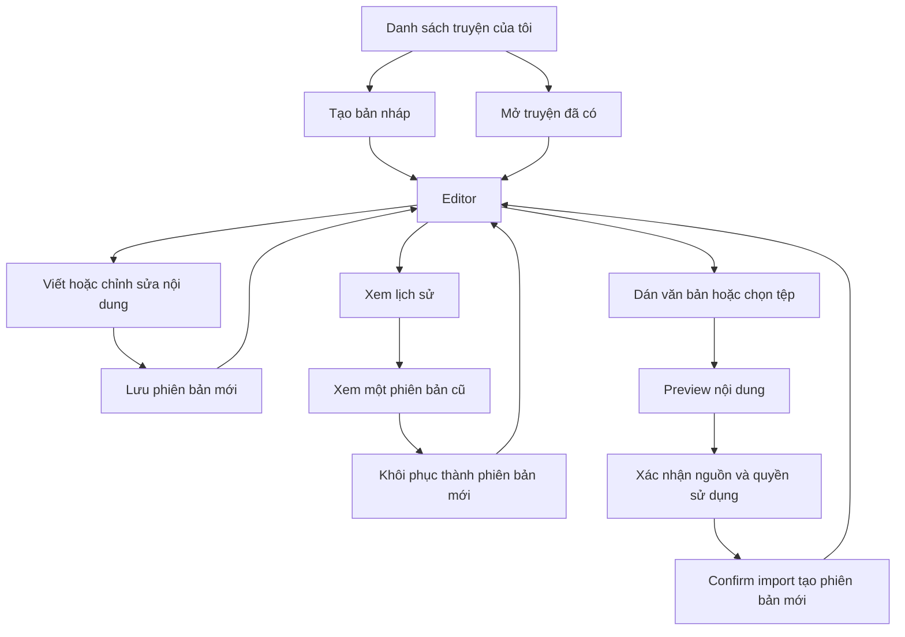

# Tích hợp frontend cho quy trình tạo truyện thủ công

Cập nhật ngày 15/10/2026. Tài liệu mô tả backend hiện có, dành cho developer frontend triển khai màn hình Creator và kết nối API. Những hành vi giao diện được đề xuất bên dưới chưa phải một frontend đã được triển khai.

## 1 Phạm vi và các quyết định nghiệp vụ

- Một sản phẩm dùng một `Story`; mỗi lần lưu nội dung tạo một `StoryVersion` mới.
- Creator viết nội dung vào `content`. Không bắt buộc tạo outline rồi mới viết body, cũng không phải chạy các phase 1–5 của AI generation.
- Có thể lưu bản đang viết, kể cả `content` trống. Không yêu cầu hoàn thiện câu chuyện mới cho lưu.
- Lưu thành công làm phiên bản mới trở thành **bản hiện tại**, chưa phải bản final, bản được duyệt hoặc bản xuất bản.
- Story Creator mới có `Scope=Creator`, `Source=Manual`, `ChildProfileId=null`, trạng thái `Draft`, `IsPublished=false` và `OutputMode=ReadingMediaOnly`.
- Import văn bản/tệp cũng thuộc luồng authoring thủ công, không gọi AI.
- Chưa có API Creator riêng cho final, gửi duyệt, approve, reject, publish, xóa truyện hoặc chỉnh metadata đối tượng đọc sau khi tạo. Chỉ gắn nút giao diện với các chức năng đã có API.
- Chưa kiểm tra mua gói/quota trong luồng này. Không còn công tắc `CreatorAuthoring:Enabled`.

## 2 Kết nối và xác thực

Core API local thường chạy tại:

```text
http://localhost:5259
```

Đặt địa chỉ này trong cấu hình môi trường frontend; không cố định localhost cho bản deploy. Base path của Creator:

```text
/api/v1/creator/stories
```

Tất cả endpoint Creator yêu cầu:

```http
Authorization: Bearer <access_token>
Accept: application/json
```

Với JSON request, thêm `Content-Type: application/json`. Với `FormData`, **không tự đặt Content-Type** để trình duyệt tạo multipart boundary.

Sử dụng JWT access token do luồng đăng nhập hiện có trả về, không dùng refresh token hoặc token phiên trẻ. Khi cần đăng nhập trực tiếp để kiểm thử:

```http
POST /api/v1/auth/login
Content-Type: application/json
```

```json
{
  "identifier": "creator@example.com",
  "password": "<nhap mat khau tai khoan kiem thu>"
}
```

Lấy `data.accessToken`. Không ghi token/mật khẩu vào source, console, URL hoặc báo cáo lỗi.

Backend kiểm tra tài khoản `Active`, chưa xóa và không đang bị khóa. Controller không yêu cầu riêng role `ContentCreator`; service hiện kiểm tra trạng thái tài khoản và quyền sở hữu. Không hiểu việc đăng nhập có role Creator là đủ để truy cập truyện của người khác.

## 3 Luồng màn hình và chuỗi API



### Danh sách truyện

1. Gọi `GET /api/v1/creator/stories?pageIndex=1&pageSize=20`.
2. Render `data.items`; dùng `storyId` làm ID sản phẩm.
3. Khi chọn một truyện, chuyển sang editor và tải bản hiện tại như hướng dẫn bên dưới.

### Mở editor

1. Gọi `GET /api/v1/creator/stories/{storyId}` để lấy metadata, `revisionToken`, `selectedVersionId`.
2. **CreatorDraftDto không chứa content.** Nếu `selectedVersionId` khác null, gọi thêm:
   `GET /api/v1/creator/stories/{storyId}/content/versions/{selectedVersionId}`.
3. Dùng version DTO để điền `content`, khai báo nguồn và quyền sử dụng. Bản nháp chưa có version thì bắt đầu với chuỗi trống.
4. Lưu snapshot đã tải làm mốc xác định `dirty`, đồng thời giữ `revisionToken` và `selectedVersionId` cho lệnh ghi tiếp theo.

Hai GET không phải một snapshot transaction. Nếu có tab khác đang sửa, lệnh lưu sau đó vẫn được bảo vệ bởi revision và base version; xử lý 409 thay vì tự ghi đè.

### Tạo và viết thủ công

1. Gọi `POST /manual` một lần để tạo sản phẩm.
2. Dùng `storyId` trả về cho mọi lần chỉnh sửa sau; không tạo Story mới mỗi lần nhấn Lưu.
3. Gửi `POST /{storyId}/manual/versions` với toàn bộ nội dung đang viết.
4. Khi thành công, cập nhật metadata từ `data.story` và nội dung đã lưu từ `data.version`.
5. Làm mới danh sách/lịch sử hoặc cập nhật cache tương ứng.

## 4 Những giá trị frontend phải quản lý

```ts
type EditorState = {
  storyId: number;
  revisionToken: string;
  selectedVersionId: number | null;
  lastVersionNo: number;
  title: string;
  content: string;
  sourceDeclaration: string;
  rightsDeclaration: string;
  dirty: boolean;
  saving: boolean;
};
```

- `storyId`: ID sản phẩm.
- `versionId`: khóa database của một phiên bản. Không đồng nghĩa với số thứ tự phiên bản.
- `versionNo`: số thứ tự V1, V2, V3 trong một Story.
- `selectedVersionId`: ID bản hiện tại do backend tính từ `IsCurrent`. Version DTO không có thuộc tính `isCurrent`; khi hiển thị lịch sử, so sánh `version.versionId === draft.selectedVersionId`.
- `revisionToken`: nhận diện trạng thái chỉnh sửa. Sao chép từ backend; không tự sinh hoặc nhập chuỗi ví dụ như `TOKEN_TU_BUOC_1`.
- `baseVersionId`: gửi bằng `selectedVersionId` hiện tại. Với lần lưu đầu tiên thì `null`.
- `sourceVersionId`: chỉ dùng khi restore, là ID bản muốn lấy nội dung để khôi phục.
- `operationId`: nhận diện **một thao tác ghi**, không phải ID truyện hoặc version. Có thể dùng `crypto.randomUUID()` trong frontend chạy ở secure context.

Không dùng `versionNo`, `lastVersionNo` hoặc một dòng lịch sử đang xem làm `baseVersionId`. Việc xem V1 khi V3 đang hiện tại không thay đổi cơ sở ghi của editor.

## 5 Hợp đồng response và các kiểu dữ liệu

```ts
export interface ApiResponse<T> {
  success: boolean;
  message: string;
  data: T | null;
  errors: string[] | null;
}

export interface CreatorDraft {
  storyId: number;
  authorUserId: number;
  title: string;
  description: string;
  language: string;
  ageBand: string;
  genre: string;
  experienceMode: string;
  audienceRevision: number;
  revisionToken: string;
  selectedVersionId: number | null;
  lastVersionNo: number;
  createdAt: string;
  updatedAt: string | null;
}

export interface CreatorVersion {
  versionId: number;
  storyId: number;
  versionNo: number;
  baseVersionId: number | null;
  restoredFromVersionId: number | null;
  editorUserId: number;
  title: string;
  content: string;
  origin: string; // Write | Import | Restore trong luồng Creator
  sourceDeclaration: string;
  rightsDeclaration: string;
  importFileName: string | null;
  importSourceHash: string | null;
  audienceRevision: number;
  createdAt: string;
}

export interface ContentSaved {
  story: CreatorDraft;
  version: CreatorVersion;
}

export interface ImportPreview {
  previewToken: string;
  storyId: number;
  content: string;
  inputMethod: string; // paste | txt | docx
  fileName: string | null;
  sourceHash: string;
  expiresAt: string;
}

export interface PagedResult<T> {
  items: T[];
  pageIndex: number;
  pageSize: number;
  totalCount: number;
  totalPages: number;
  hasPreviousPage: boolean;
  hasNextPage: boolean;
}
```

Date trả về là chuỗi ISO; chuyển sang múi giờ hiển thị của người dùng. `CreatorDraft` không cung cấp `content`, `status`, `isPublished` hay `source`; không đọc các thuộc tính này từ response hiện tại hoặc mặc định rằng API đã trả chúng.

### Cấu trúc phản hồi ví dụ

Sau create hoặc GET bản nháp, metadata nằm trực tiếp trong `data`:

```json
{
  "success": true,
  "message": "Thao tác thành công.",
  "data": {
    "storyId": 200,
    "authorUserId": 13,
    "title": "Hạt giống của Lan",
    "description": "Câu chuyện về sự kiên nhẫn",
    "language": "vi",
    "ageBand": "6-8",
    "genre": "Tình bạn",
    "experienceMode": "reading",
    "audienceRevision": 1,
    "revisionToken": "0123456789abcdef0123456789abcdef",
    "selectedVersionId": null,
    "lastVersionNo": 0,
    "createdAt": "2026-10-15T06:00:00Z",
    "updatedAt": null
  },
  "errors": null
}
```

Đây là dữ liệu minh họa. ID và token phải lấy từ request thực tế, không sao chép các giá trị ví dụ sang truyện khác.

Sau Save, Restore hoặc Confirm, `data` có hai thuộc tính `story` và `version`. Lấy token mới tại `data.story.revisionToken`, ID hiện tại tại `data.story.selectedVersionId`, nội dung tại `data.version.content`.

## 6 Tạo bản nháp

```http
POST /api/v1/creator/stories/manual
```

```json
{
  "operationId": "manual-demo-create-001",
  "title": "Hạt giống của Lan",
  "description": "Câu chuyện về sự kiên nhẫn",
  "language": "vi",
  "ageBand": "6-8",
  "genre": "Tình bạn",
  "experienceMode": "reading"
}
```

- Thành công: **201**, `ApiResponse<CreatorDraft>`.
- Ban đầu `selectedVersionId=null`, `lastVersionNo=0`.
- Giá trị mặc định hỗ trợ: language `vi`, `en`; ageBand `6-8`, `9-10`; experienceMode `reading`, `listening`, `combined`.
- `listening` hoặc `combined` chưa tự khởi chạy tạo audio/media; chỉ là metadata lựa chọn trải nghiệm.
- Trong form, backend cho phép tên/mô tả/thể loại trống; frontend có thể có yêu cầu UX riêng nhưng cần phân biệt với validation bắt buộc của API.

## 7 Danh sách và chi tiết

```http
GET /api/v1/creator/stories?pageIndex=1&pageSize=20
```

Thành công **200**, `ApiResponse<PagedResult<CreatorDraft>>`. Backend chỉ trả truyện Creator thuộc tài khoản đang đăng nhập và chưa xóa. `pageIndex >= 1`, `1 <= pageSize <= 100`; mặc định lần lượt 1 và 20. Sắp xếp theo thời điểm cập nhật hoặc tạo mới giảm dần.

```http
GET /api/v1/creator/stories/{storyId}
```

Thành công **200**, `ApiResponse<CreatorDraft>`. Dùng để mở editor hoặc đồng bộ lại metadata sau xung đột/retry. Không gọi API danh sách truyện công khai hoặc Parent thay cho route Creator.

## 8 Lưu nội dung thủ công

```http
POST /api/v1/creator/stories/{storyId}/manual/versions
```

```json
{
  "operationId": "manual-demo-save-001",
  "revisionToken": "<revisionToken thuc te cua editor>",
  "baseVersionId": null,
  "title": "Hạt giống của Lan",
  "content": "Lan gieo một hạt giống nhỏ.\nMỗi sáng, Lan tưới nước cho cây.",
  "sourceDeclaration": "Tự sáng tác",
  "rightsDeclaration": "Tôi có quyền sử dụng nội dung này"
}
```

Thành công **201**, `ApiResponse<ContentSaved>`.

Backend kiểm tra revision và base version, thêm version có `origin=Write`, chuyển bản hiện tại, cập nhật Title/Content của Story, đổi revision và lưu audit/receipt trong transaction. Không ghi đè nội dung version cũ.

Frontend cần:

1. Chụp một snapshot của editor ngay khi gửi lệnh; các lần retry phải giữ nguyên snapshot đó.
2. Chặn gửi song song Save/Restore/Confirm trên cùng editor. Không gửi request mỗi lần gõ; mỗi lệnh lưu thành công sẽ tạo một version thật.
3. Khi thành công, cập nhật revision và selectedVersionId từ `result.story`.
4. Chỉ đánh dấu `dirty=false` nếu nội dung hiện tại vẫn giống snapshot vừa lưu. Nếu người dùng tiếp tục gõ trong lúc request chạy, giữ phần chỉnh sửa mới và đánh dấu còn thay đổi chưa lưu.
5. Nếu chọn làm autosave, gom thay đổi bằng debounce, chỉ một request đang chạy, sau đó tạo lệnh mới cho snapshot mới. Đây là hành vi frontend cần thiết kế, backend chưa có chế độ autosave riêng.

Không `trim()` hoặc normalize `content` trước khi gửi nếu muốn bảo toàn nội dung người dùng. Backend Save giữ nguyên khoảng trắng và xuống dòng của Content; các trường tên/khai báo được trim. Save cho phép content trống và hai khai báo trống, trong khi Confirm import yêu cầu chúng khác trống.

## 9 Lịch sử và khôi phục

```http
GET /api/v1/creator/stories/{storyId}/content/versions
```

Thành công **200**, `ApiResponse<CreatorVersion[]>`, versionNo giảm dần.

```http
GET /api/v1/creator/stories/{storyId}/content/versions/{versionId}
```

Thành công **200**, `ApiResponse<CreatorVersion>`. Hiển thị phiên bản cũ trong khu vực xem trước riêng; không tự thay revision/base của editor hoặc xem việc đọc bản cũ như một thao tác restore.

```http
POST /api/v1/creator/stories/{storyId}/content/restore
```

```json
{
  "operationId": "manual-demo-restore-001",
  "revisionToken": "<revisionToken cua ban hien tai>",
  "baseVersionId": 302,
  "sourceVersionId": 301
}
```

Ví dụ V1 ID 301, V2 ID 302 đang hiện tại. Restore tạo V3, có `origin=Restore`, `baseVersionId=302`, `restoredFromVersionId=301`, nội dung sao chép từ V1.

Thành công **201**, `ApiResponse<ContentSaved>`. Cập nhật editor theo kết quả trả về và tải lại lịch sử. Trước khi thay editor bằng nội dung khôi phục, cho người dùng quyết định cách xử lý phần đang sửa chưa lưu. Dialog xác nhận là đề xuất UX, không phải một bước chấp thuận nội dung của backend.

## 10 Nhập văn bản hoặc tệp

### 10.1 Preview bằng văn bản

```http
POST /api/v1/creator/stories/{storyId}/imports/preview
```

```json
{
  "operationId": "manual-demo-preview-001",
  "revisionToken": "<revisionToken hien tai>",
  "content": "Thỏ chia sẻ chiếc ô với Sóc trong một ngày mưa."
}
```

Thành công **201**, `ApiResponse<ImportPreview>`. Backend chuẩn hóa văn bản, trả nội dung preview và token bảo vệ dữ liệu. Preview không tạo version và không đổi revision.

### 10.2 Preview bằng tệp

```http
POST /api/v1/creator/stories/{storyId}/imports/preview-file
Content-Type: multipart/form-data; boundary=<browser tự tạo>
```

Các form field chính xác:

- `File`: đối tượng `File` từ input.
- `RevisionToken`: revision của editor.
- `OperationId`: ID của thao tác preview.

Ví dụ tạo body trong trình duyệt:

```ts
const form = new FormData();
form.append("File", file);
form.append("RevisionToken", editor.revisionToken);
form.append("OperationId", crypto.randomUUID());

// Không thêm Content-Type trong headers của request này.
const preview = await api<ImportPreview>(
  `/api/v1/creator/stories/${editor.storyId}/imports/preview-file`,
  { method: "POST", body: form },
);
```

Response tương tự preview văn bản; inputMethod là `txt` hoặc `docx`, fileName có tên tệp.

### 10.3 State của màn hình preview

Giữ riêng:

```ts
type PendingImport = {
  preview: ImportPreview;
  revisionTokenAtPreview: string;
  baseVersionIdAtPreview: number | null;
};
```

Chụp revision/base ở lúc bắt đầu preview. Hiển thị **preview.content** từ server để người dùng kiểm tra. Không thay editor đã lưu chỉ vì preview thành công.

Nếu người dùng thay đổi preview content, cần preview lại. Nếu một lần Save/Restore/Confirm khác đã thành công, hủy preview cũ và yêu cầu preview lại; không gắn preview cũ với revision mới.

### 10.4 Confirm import

```http
POST /api/v1/creator/stories/{storyId}/imports/confirm
```

```json
{
  "operationId": "manual-demo-confirm-001",
  "revisionToken": "<revisionToken da dung de preview>",
  "baseVersionId": 303,
  "previewToken": "<previewToken thuc te>",
  "content": "Thỏ chia sẻ chiếc ô với Sóc trong một ngày mưa.",
  "title": "Chiếc ô tình bạn",
  "sourceDeclaration": "Nội dung do tôi tự sáng tác",
  "rightsDeclaration": "Tôi có quyền sử dụng nội dung này"
}
```

Gửi `content=preview.content` chính xác, `previewToken=preview.previewToken` và revision/base đã chụp. Nếu chưa có version thì baseVersionId null. Không dùng hash nguồn để thay previewToken.

Backend kiểm tra tài khoản, story, revision, base, thời hạn và hash nội dung. Thành công **201**, `ApiResponse<ContentSaved>`, tạo version `origin=Import`. Cập nhật editor như Save và xóa state preview sau khi hoàn tất.

Preview có thời hạn mặc định 24 giờ; đọc `expiresAt` thực tế. Preview không có receipt để đảm bảo retry trả cùng token. Với Confirm đã thành công, retry cùng OperationId và payload sẽ trả receipt cũ, kể cả khi preview đã hết hạn sau đó. Một thao tác Confirm mới với preview đã cũ có thể trả 409 do revision thay đổi trước khi tới kiểm tra dùng lại token.

## 11 Client TypeScript tối thiểu

Đây là ví dụ kết nối HTTP, không phải bộ quản lý state hoàn chỉnh. Ghép với auth store và cơ chế refresh token sẵn có của frontend.

```ts
const API_ORIGIN = "http://localhost:5259"; // thay bằng cấu hình môi trường

class ApiError extends Error {
  constructor(
    public status: number,
    message: string,
    public details: string[] | null = null,
  ) {
    super(message);
  }
}

// getAccessToken phải lấy token hiện tại từ auth layer của dự án.
declare function getAccessToken(): string | null;

async function api<T>(route: string, init: RequestInit = {}): Promise<T> {
  const headers = new Headers(init.headers);
  headers.set("Accept", "application/json");
  const token = getAccessToken();
  if (token) headers.set("Authorization", `Bearer ${token}`);

  const response = await fetch(`${API_ORIGIN}${route}`, { ...init, headers });
  const text = await response.text();
  let payload: ApiResponse<T> | null = null;
  try {
    payload = text ? (JSON.parse(text) as ApiResponse<T>) : null;
  } catch {
    // 401, 413 hoặc proxy có thể không trả ApiResponse JSON.
  }
  if (!response.ok || !payload?.success) {
    throw new ApiError(
      response.status,
      payload?.message || `Request thất bại với HTTP ${response.status}`,
      payload?.errors || null,
    );
  }
  return payload.data as T;
}

function postJson<T>(route: string, body: unknown): Promise<T> {
  return api<T>(route, {
    method: "POST",
    headers: { "Content-Type": "application/json" },
    body: JSON.stringify(body),
  });
}

async function openEditor(storyId: number) {
  const base = `/api/v1/creator/stories/${storyId}`;
  const draft = await api<CreatorDraft>(base);
  const version = draft.selectedVersionId === null
    ? null
    : await api<CreatorVersion>(
        `${base}/content/versions/${draft.selectedVersionId}`,
      );
  return {
    draft,
    title: version?.title ?? draft.title,
    content: version?.content ?? "",
    sourceDeclaration: version?.sourceDeclaration ?? "",
    rightsDeclaration: version?.rightsDeclaration ?? "",
  };
}

function makeSaveCommand(editor: EditorState) {
  // Tạo đúng một lần cho một thao tác; giữ object này nếu cần retry.
  return Object.freeze({
    operationId: crypto.randomUUID(),
    revisionToken: editor.revisionToken,
    baseVersionId: editor.selectedVersionId,
    title: editor.title,
    content: editor.content,
    sourceDeclaration: editor.sourceDeclaration,
    rightsDeclaration: editor.rightsDeclaration,
  });
}

async function sendSave(storyId: number, command: ReturnType<typeof makeSaveCommand>) {
  return postJson<ContentSaved>(
    `/api/v1/creator/stories/${storyId}/manual/versions`,
    command,
  );
}
```

Các interface dùng trong ví dụ nằm ở mục 4 và 5. `file` và `editor` trong ví dụ upload là dữ liệu của event handler tương ứng.

## 12 Quy tắc retry và xử lý xung đột

### Retry khi kết quả chưa rõ

- Tạo operationId và snapshot payload một lần, giữ chúng trong state pending cho đến khi biết kết quả.
- Nếu timeout, mất mạng hoặc hủy chờ response, server vẫn có thể đã commit. Retry **nguyên operationId và payload**; không tự tạo operationId mới.
- Nếu retry sau refresh token, vẫn giữ nguyên body của thao tác cũ.
- Không dùng lại operationId với content, title, revision hoặc base khác. Hash backend bao gồm các trường này và loại lệnh.
- Không giữ snapshot chứa nội dung truyện ở nơi lưu trữ lâu dài nếu chưa có chính sách phù hợp; cơ chế phục hồi pending sau reload cần được frontend thiết kế riêng.

### Khi nhận receipt của một lệnh cũ

Backend có thể trả HTTP 201 và dữ liệu V1 cho một lần retry V1, trong khi truyện đã có V3. Receipt là kết quả thao tác cũ, không phải trạng thái mới nhất của Story.

Sau khi giải quyết một pending có kết quả chưa rõ, gọi GET bản nháp để đồng bộ revision/selectedVersionId; nếu cần, tải version hiện tại. Không ghi đè phần nội dung người dùng chưa lưu trong editor chỉ vì receipt cũ vừa về.

### Khi nhận HTTP 409

- `Bản nháp đã thay đổi.`: revision cũ hoặc sai.
- `Phiên bản nguồn đã thay đổi.`: baseVersionId khác bản hiện tại.
- `OperationId đã được dùng cho yêu cầu khác.`: đang dùng lại khóa thao tác với payload khác.
- Import cũng có thể xung đột do preview hết hạn, sai revision hoặc đã được sử dụng.

Giữ lại nội dung người dùng đang sửa, tải trạng thái server để so sánh và cho người dùng quyết định. Chỉ sau khi đã giải quyết xung đột mới tạo lệnh mới với token/base mới và operationId mới. Không lặp vô hạn bằng cách thay token mới rồi tự ghi đè.

## 13 Validation và lỗi cần hiển thị

Giới hạn mặc định hiện tại:

- operationId: từ 1 đến 100 ký tự, không chỉ có khoảng trắng.
- Title: tối đa 200 ký tự; Description 1.000; Genre 50.
- SourceDeclaration và RightsDeclaration: tối đa 2.000 ký tự mỗi trường.
- Content: tối đa 200.000 ký tự; Save cho phép trống, Import không cho phép trống.
- File: TXT UTF-8 hoặc DOCX, tối đa 5.000.000 byte; tên tệp tối đa 255 ký tự.
- Request upload: tối đa 5.250.000 byte. Server/proxy có thể chặn trước khi vào controller.
- language: `vi`, `en`; ageBand: `6-8`, `9-10` theo options mặc định. Đây là chuỗi UI/API Creator, không gửi `Age_6_8` hoặc `Age_9_10` của enum ChildProfile.

Frontend nên validate sớm nhưng backend vẫn là nơi xác nhận cuối cùng. Backend chưa có endpoint cung cấp cấu hình authoring động; cần cập nhật đồng bộ giao diện nếu các options được cấu hình khác mặc định.

- **400**: input/DTO không hợp lệ, vượt giới hạn hoặc preview không đúng. Hiển thị message và errors khi có.
- **401**: chưa xác thực hoặc token không hợp lệ. Theo cơ chế auth/refresh hiện có, tránh vòng lặp refresh.
- **403**: tài khoản không được phép hoạt động theo kiểm tra hiện tại. Không còn lý do “Creator authoring chưa được bật” trong source mới.
- **404**: không có tài nguyên, sai chủ sở hữu hoặc sai scope. Không suy luận rằng story của người khác có tồn tại.
- **409**: xử lý theo mục 12, không xóa nội dung chưa lưu.
- **413**: body quá lớn ở HTTP server/proxy; response có thể không phải JSON chuẩn.
- **5xx hoặc lỗi mạng**: thông báo lỗi, giữ snapshot pending và phần đang sửa. Không mặc định rằng thao tác chưa lưu ở server.

MVC validation hiện được cấu hình trả ApiResponse với `errors`; lỗi nghiệp vụ cũng dùng ApiResponse. Auth middleware hoặc tầng HTTP/proxy vẫn có thể trả response rỗng hay định dạng khác, nên client phải đọc được trường hợp không có JSON.

## 14 Kịch bản frontend cần kiểm tra

1. Tạo bản nháp, mở editor trống và lưu V1 thành công.
2. Đóng/mở lại editor, content được tải bằng GET version hiện tại chứ không đọc từ Draft DTO.
3. Chỉnh sửa thành V2; lịch sử hiển thị V2/V1, V1 không bị thay nội dung.
4. Mở V1 để xem, bản hiện tại vẫn là V2; chỉ restore mới tạo V3.
5. Restore V1 thành V3; base là V2, nguồn khôi phục là V1.
6. Retry lệnh V2 sau restore không tạo V4 và không chuyển editor hiện tại ngược về V2.
7. Hai tab sửa cùng một truyện: tab cũ nhận 409, nội dung chưa lưu vẫn còn để đối chiếu.
8. Người dùng gõ tiếp khi đang Save: phần gõ sau snapshot không bị đánh dấu đã lưu hoặc bị response cũ ghi đè.
9. Preview văn bản hoặc tệp không tạo version; hủy preview không làm mất nội dung editor.
10. Confirm đúng preview tạo một version Import; sửa nội dung preview phải preview lại.
11. Dùng tài khoản khác không mở được story; token hết hạn đi qua luồng auth phù hợp.

Ví dụ đã kiểm thử HTTP thật và đối chiếu PostgreSQL local: Story **14**, tác giả ID **13**, V1 ID **15**, V2 ID **16**, V3 restore ID **17**. Lần chạy đạt **17/17 bước**, chỉ V3 hiện tại, Story vẫn Draft/chưa xuất bản, không có AI job, media hay quiz. Dữ liệu này phục vụ kiểm tra local; không cố định các ID trên trong frontend.

## 15 Nguồn đối chiếu

- [CreatorAuthoringController](../src/Core/StoryPlatform.Api/Controllers/CreatorAuthoringController.cs): route, method và mã thành công.
- [CreatorAuthoringDtos](../src/Core/StoryPlatform.Application/Features/CreatorAuthoring/DTOs/CreatorAuthoringDtos.cs): request/response DTO.
- [CreatorAuthoringService](../src/Core/StoryPlatform.Application/Features/CreatorAuthoring/Services/CreatorAuthoringService.cs): lưu, restore, ownership, revision và receipt.
- [CreatorAuthoringService Imports](../src/Core/StoryPlatform.Application/Features/CreatorAuthoring/Services/CreatorAuthoringService.Imports.cs): preview và confirm.
- [CreatorAuthoringOptions](../src/Core/StoryPlatform.Application/Features/CreatorAuthoring/CreatorAuthoringOptions.cs): giới hạn mặc định.
- [Postman Collection](postman/CreatorAuthoring.local.postman_collection.json): bộ request kiểm thử, không dùng thay cho state management frontend.

Tài liệu này chỉ hướng dẫn tích hợp backend hiện có. Các nút final, duyệt, publish, tạo media và AI hỗ trợ cần hợp đồng API riêng trước khi tích hợp.
